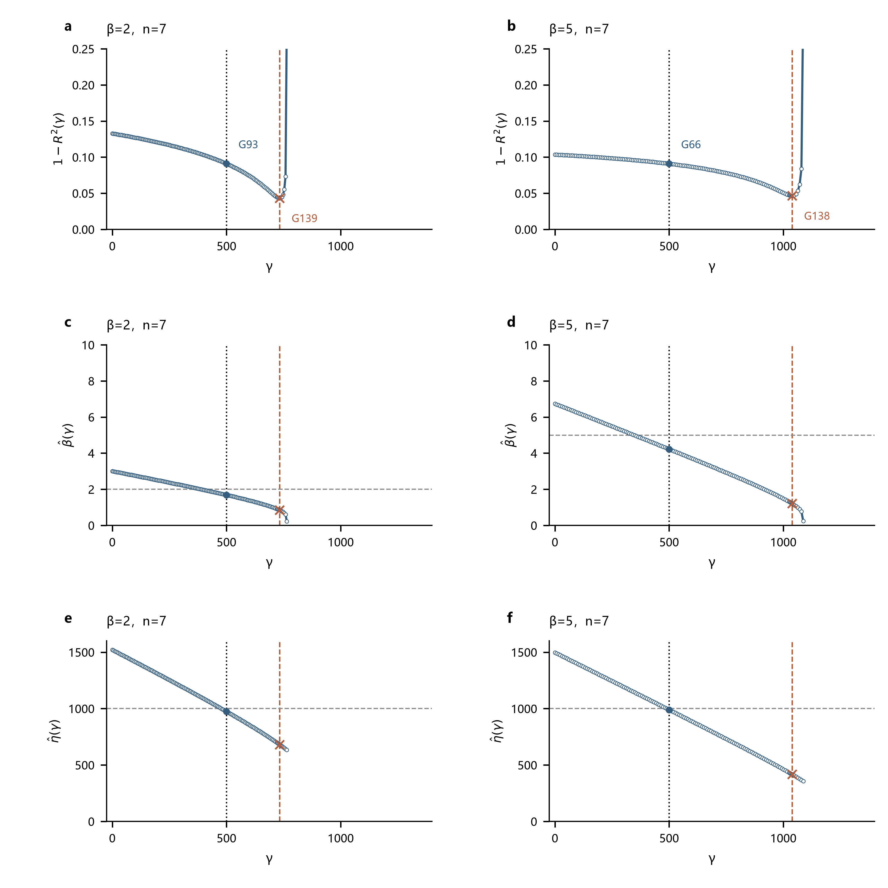
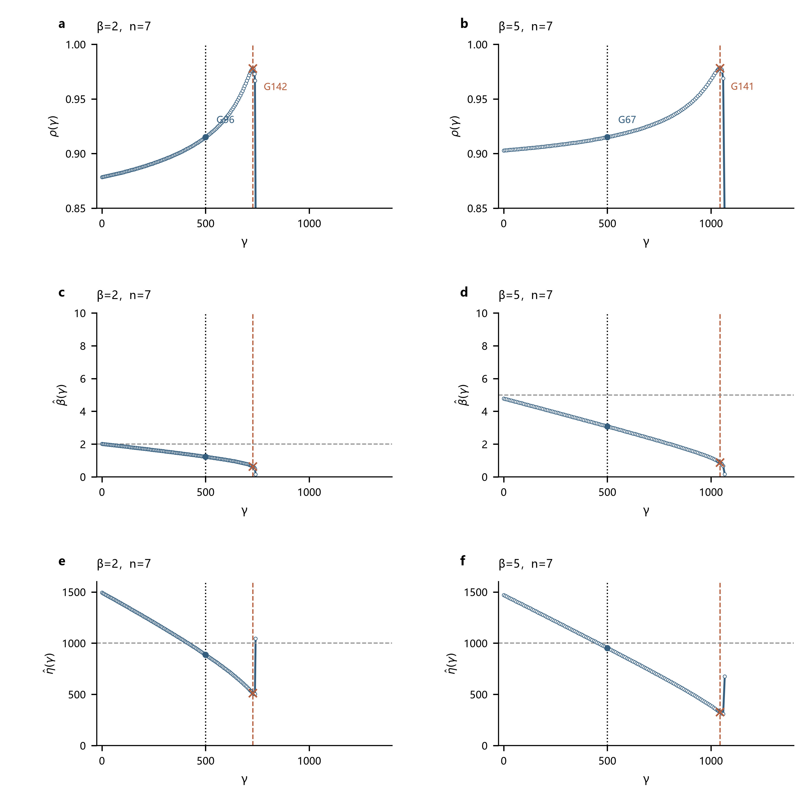
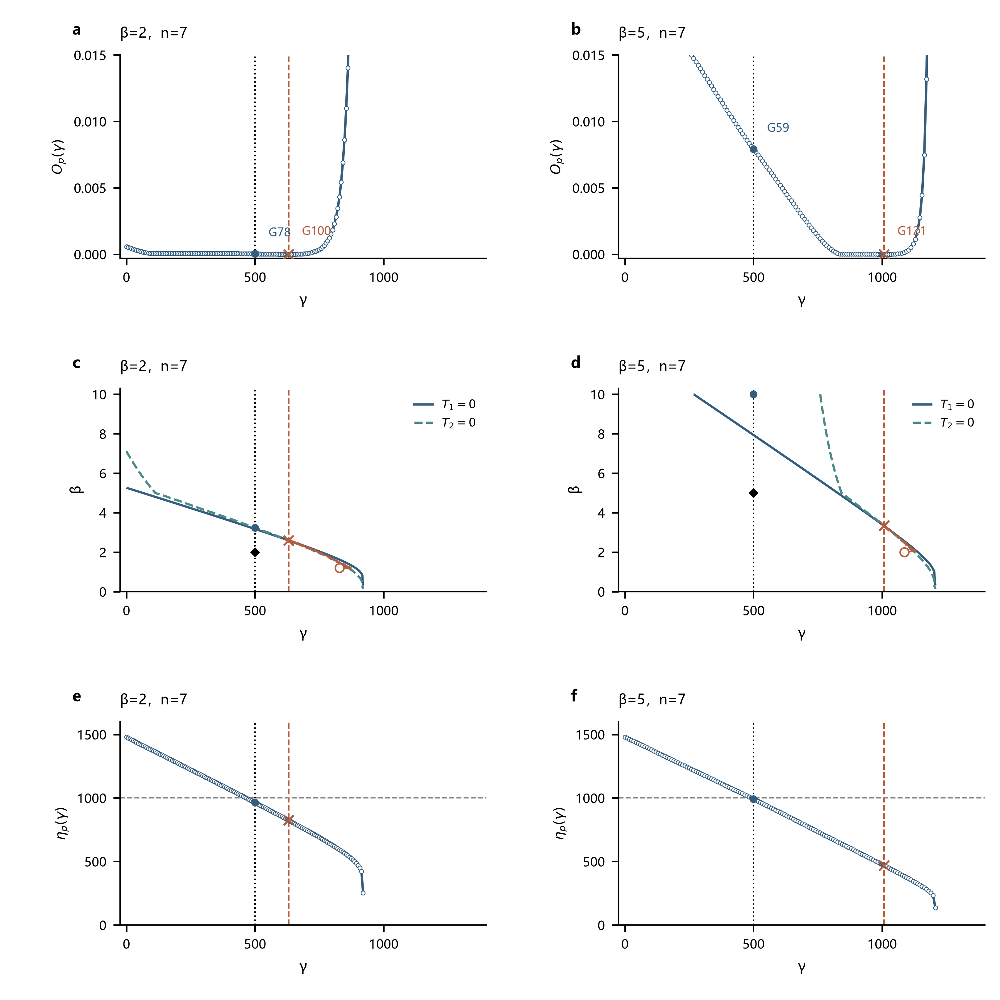
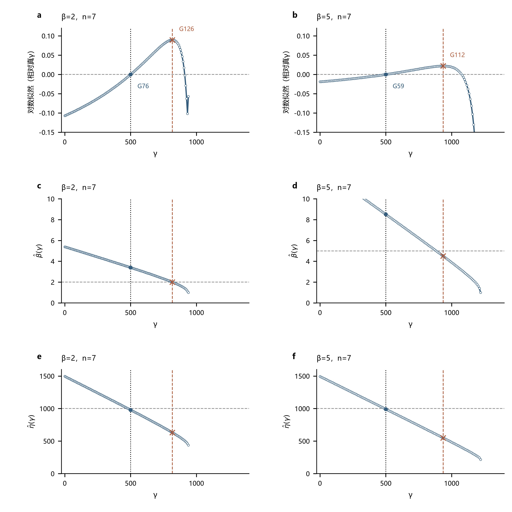
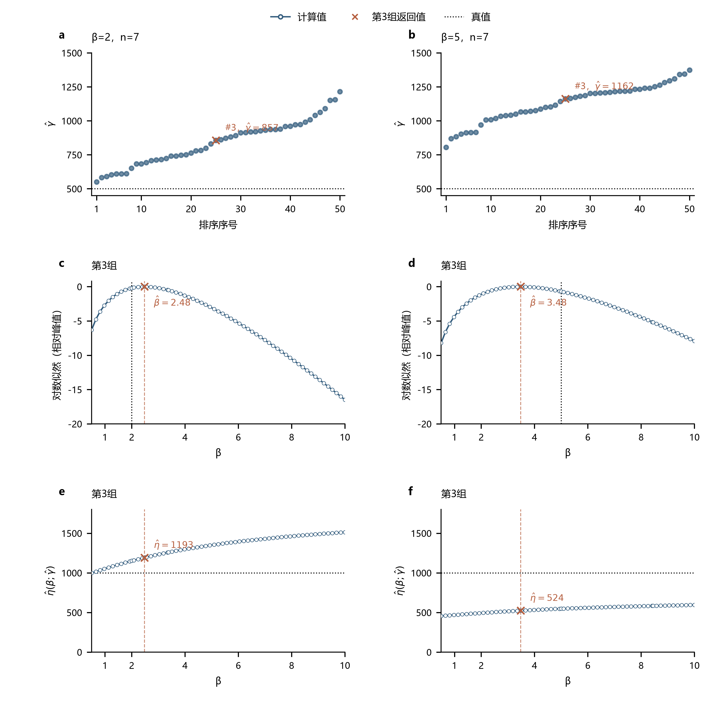

# 报告1：高形状参数下的估计偏移

> 研究报告 · 2026-10-02 · 方法口径与诊断更新：2026-10-11

## 1　问题描述

在案例 W(5,1000,500) 中，多种方法会出现 γ 偏高， η、β 偏低的现象，随着样本量 n 增大，这种偏移总体会减弱。（如图1所示）。这引出了一个问题：为什么三参数 Weibull 分布在“高形状参数 β + 小样本 n”条件下，会出现一组很有规律的参数偏移，而且这些偏掉的参数仍然能把样本拟合得很好？

**图1｜随着n增大，β和η低估、γ高估的现象总体减轻。**

## 2　机制分析与对照实验

以下先分析高β、小n下，参数偏离真值的分布为何仍能拟合样本，再分析各方法的估计判据为何会选中这些分布。

三参数Weibull分布为：

$$\begin{aligned}
F(t)&=1-\exp\left[-\left(\frac{t-\gamma}{\eta}\right)^\beta\right],\\
f(t)&=\frac{\beta}{\eta}\left(\frac{t-\gamma}{\eta}\right)^{\beta-1}
\exp\left[-\left(\frac{t-\gamma}{\eta}\right)^\beta\right].
\end{aligned}
\tag{1}$$

其中，t为寿命，F(t)为分布函数，f(t)为概率密度，β、η、γ分别为形状、尺度和位置参数；β>0、η>0、t>γ。后文ln表示自然对数。

支持条件γ<t₁由最小观测t₁确定。最小观测离真γ越远，样本允许的位置上移空间越大。

**图2｜高β、小n下，样本对γ上移的上界约束较弱，随n增大而增强。**

图3以原β=5、n=7第31组为例。γ上移缩短各观测到起点的距离，η和β的降低可使中部分位保持接近。

**图3｜γ升高、η和β降低后，分布仍可贴近同一组观测。** 黑点的累计概率由样本排序近似。

起点信息不足与参数补偿，使偏移组合仍能拟合观测；偏移的方向和程度则取决于各方法对这些组合的评价。以下按各方法的实际步骤考察判据变化，WMLE和MLE的条件曲线用于分析联合准则，不代表先估计γ的求解顺序。

记排序观测到候选γ的距离为：

$$d_i=t_i-\gamma,\qquad 0\leq\gamma<t_1.
\tag{2}$$

其中，tᵢ为从小到大排序的第i个观测，dᵢ为该观测到候选位置的距离，i=1,…,n，n为样本量，帽号表示估计值。

### 2.1　[MDM](../../src/content/algorithms/mdm.md)

MDM比较各观测反算的尺度参数，以这些伪尺度之间的差异估计参数。原文首先通过秩估计得到排序观测的累计概率：

$$\hat F(t_{(i)})=
\frac{i}{i+(n+1-i)F_{2(n+1-i),\,2i,\,0.5}}.
\tag{3}$$

其中，$t_{(i)}$为第i个排序观测，$\hat F(t_{(i)})$为对应的累计概率估计，$F_{2(n+1-i),\,2i,\,0.5}$为自由度分别为2(n+1−i)和2i的F分布中位数。本组存档计算采用Bernard近似：

$$\hat F(t_{(i)})\approx\frac{i-0.3}{n+0.4}.
\tag{4}$$

将式（4）的累计概率代入原文的尺度参数伪估计量：

$$\hat\eta_i(\gamma,\beta)=
\frac{t_{(i)}-\gamma}{[-\ln(1-\hat F(t_{(i)}))]^{1/\beta}}.
\tag{5}$$

其中，η̂ᵢ为第i个观测反算的伪尺度。固定γ，尝试不同β，并以n个伪尺度的标准差$\sigma_\eta(\gamma,\beta)$衡量差异；取其中最小的标准差$\sigma_{\eta,\min}(\gamma)$，同时保留对应的β。

原文以条件最小标准差对γ的差分梯度确定位置：

$$\nabla(\gamma)=
\frac{\sigma_{\eta,\min}(\gamma+\Delta\gamma)
-\sigma_{\eta,\min}(\gamma)}{\Delta\gamma}.
\tag{6}$$

其中，∇(γ)为条件最小标准差的梯度，Δγ为位置参数的差分步长。本组以固定正梯度代替零梯度判据，按下式确定γ̂：

$$\nabla(\hat\gamma)=0.10.
\tag{7}$$

当γ=0处的梯度已达到或超过0.10时，取γ̂=0。β̂取该位置对应的形状参数，最终尺度取伪尺度均值：

$$\hat\eta=\frac{1}{n}\sum_{i=1}^{n}
\frac{t_{(i)}-\hat\gamma}{[-\ln(1-\hat F(t_{(i)}))]^{1/\hat\beta}}.
\tag{8}$$

其中，β̂、η̂、γ̂分别为形状、尺度和位置估计。图4以中心差分近似计算式（6）的梯度，横虚线为式（7）的补偿值0.10，竖点线为真γ=500。

**图4｜高β时梯度曲线较集中，补偿值交点总体右移；随n增大，右移程度减轻。**

β=5时，真γ处的梯度多数低于0.10，曲线比β=2更集中，交点因而集中于真γ右侧。随n增大，β=5的位置估计向真值靠近。

这一差别来自伪尺度对γ的响应。固定β，对式（5）求导并在β较大时作一阶展开：

$$\frac{\partial\hat\eta_i}{\partial\gamma}
=-[-\ln(1-\hat F(t_{(i)}))]^{-1/\beta}
\approx -1+\frac{\ln[-\ln(1-\hat F(t_{(i)}))]}{\beta}.
\tag{9}$$

由式（9），β增大时，后一项的绝对值减小，各伪尺度随γ的变化更接近同步。它们之间的差异变化较小，标准差随γ的变化也较小，因此梯度接近零，多条曲线在真实γ处更容易集中在零附近。

n增大使最小观测更靠近真γ（图2），收紧位置上移空间；同时，概率位置与样本间距的随机偏差减小，原本不同的β、γ组合更容易被区分。图4所示交点仍受固定补偿值影响，但右移程度随n增大而减轻。

位置确定后，MDM在该γ处取使伪尺度标准差最小的β，再按式（8）计算η。图5展开图4a、b中加深的第48组曲线：每个候选γ对应的β̂(γ)、η̂(γ)分别由这两步得到。

**图5｜偏高γ对应较低β，并通过伪尺度均值得到较低η。** 蓝点为固定真γ的条件估计，橙叉为最终估计。

在伪尺度接近一致时，由式（5）可得：

$$\frac{t_{(j)}-\gamma}{t_{(i)}-\gamma}
\approx\left[\frac{-\ln(1-\hat F(t_{(j)}))}{-\ln(1-\hat F(t_{(i)}))}\right]^{1/\beta},\qquad j>i.
\tag{10}$$

其中，j为较大观测的序号。

γ估计偏大时，观测到起点的距离被压短，其中较小观测的距离缩短比例更大。因此，式（10）左侧的距离比增大，而右侧的概率比保持不变，需要较小的β维持伪尺度的一致性。图5d显示，本例偏高的γ最终对应低于真值的β。

随后，将这组γ和β代入式（8）计算η。图5f显示，本例的η也低于真值，最终形成γ高估、β和η低估的结果。

### 2.2　[LSE](../../src/content/algorithms/lse.md)

LSE对每个候选位置γ拟合一条直线，选择拟合程度最好的位置，再由斜率和截距恢复形状与尺度。其依据是Weibull变量的对数距离关系：

$$
\ln(X-\gamma)=\ln\eta+\frac{Z}{\beta}.
\tag{11}
$$

X为Weibull随机变量，Z=βln[(X−γ)/η]为标准对数Weibull变量。对式（11）中的n个变量排序后取期望，得到：

$$
\operatorname{E}[\ln(X_{(i)}-\gamma)]
=\ln\eta+\frac{z_i}{\beta}.
\tag{12}
$$

n为样本量，X₍ᵢ₎为第i小的随机观测，zᵢ=E[Z₍ᵢ₎]为标准变量的顺序统计量期望。

对实际观测x₍ᵢ₎，记对数距离yᵢ=ln(x₍ᵢ₎−γ)。根据式（12），以zᵢ为横坐标、yᵢ为纵坐标拟合直线yᵢ≈a+bzᵢ，截距a对应lnη，斜率b对应1/β，因此：

$$
\hat\beta(\gamma)=\frac1b,
\qquad
\hat\eta(\gamma)=e^a.
\tag{13}
$$

LSE用F比评价直线拟合程度，并选择F比最大的γ。F比与回归决定系数R²的关系为：

$$
F(\gamma)=\frac{n-2}{(n-1)[1-R^2(\gamma)]}.
\tag{14}
$$

固定n后，式（14）的F比最大化等价于最小化1−R²，位置判据便写成：

$$
\hat\gamma=\underset{0\le\gamma<x_{(1)}}{\arg\min}\,[1-R^2(\gamma)].
\tag{15}
$$

x₍₁₎为样本最小值。图6按式（15）展示位置准则，橙叉标记所选γ。

**图6｜高β时，真位置附近的准则曲线更平，最低点可向两侧偏移。**

β=5时，改变γ对真位置附近拟合程度的影响较小，不同位置难以区分。样本间距的随机波动因而可能使最佳拟合位置偏离真值；随n增大，位置偏移减轻。

这种差别可以从对数变换看出。观测较集中且γ未接近最小观测时，在样本均值附近展开：

$$\ln(x_{(i)}-\gamma)\approx\ln(\overline x-\gamma)
+\frac{x_{(i)}-\overline x}{\overline x-\gamma}
-\frac{(x_{(i)}-\overline x)^2}{2(\overline x-\gamma)^2}.
\tag{16}$$

其中，x̄为样本均值。式（16）的前两项只改变截距和整体比例，不影响R²；二次项才改变点列的弯曲程度。高β时相对间距较小，二次项的影响较弱，因此位置改变较大时仍可能保持接近的拟合程度。

配对样本在真γ处的对数距离仅随β整体缩放，R²保持相同。图6中的差别来自离开真位置后，对数变换对样本间距的重新匹配；最低点位于哪一侧，仍由具体样本决定。

位置选定后，回归斜率和截距决定其余两个参数。对yᵢ≈a+bzᵢ作最小二乘回归，可得：

$$\begin{aligned}
b(\gamma)&=\frac{\sum_i(z_i-\overline z)\ln(x_{(i)}-\gamma)}{\sum_i(z_i-\overline z)^2},\\
a(\gamma)&=\frac1n\sum_i\ln(x_{(i)}-\gamma)-b(\gamma)\overline z.
\end{aligned}
\tag{17}$$

其中，z̄为参考坐标的均值。图7展开图6a、b中加深的第17组配对曲线：式（15）确定γ，式（17）、（13）给出该γ对应的β、η。

**图7｜判据选出的偏高γ，对应较低的β、η。** 空心点为计算节点，蓝点为固定真γ的条件估计，橙叉为最终估计。

图7a、b中，准则最低点均在真γ右侧，β=5的右移幅度更大。γ右移使较小观测的对数距离下降更多，回归斜率增大，按式（13）取倒数后β降低（图7c、d）；本例截距随γ右移减小，按式（13）恢复的η也降低（图7e、f）。因此，准则选择的位置偏移通过同一条回归线传递到形状和尺度，形成γ高估、β和η低估。图6中的其他样本也可能选择偏低γ，并产生相反方向的参数变化。

### 2.3　[LRE](../../src/content/algorithms/lre.md)

LRE先将样本转换为Weibull概率图坐标，选择线性相关性最高的位置，再用回归斜率和截距估计形状与尺度。由分布函数的线性化关系：

$$
\ln[-\ln(1-F(x))]
=\beta\ln(x-\gamma)-\beta\ln\eta,
\tag{18}
$$

将式（18）中第i个排序观测的累计概率F(x₍ᵢ₎)用绘图位置pᵢ代替，得到：

$$
z_i=\ln[-\ln(1-p_i)]
\approx\beta y_i-\beta\ln\eta,
\qquad y_i=\ln(x_{(i)}-\gamma).
\tag{19}
$$

F(x)为Weibull分布函数，pᵢ为按次序i和样本量n分配的累计概率，zᵢ为相应的概率图参考坐标。LSE的参考点来自顺序统计量期望，LRE的参考点来自绘图概率的分位变换。

根据式（19），LRE以yᵢ为横坐标、zᵢ为纵坐标拟合直线zᵢ≈a+byᵢ。这里斜率b直接对应β，截距a对应−βlnη，因此：

$$
\hat\beta(\gamma)=b,
\qquad
\hat\eta(\gamma)=e^{-a/b}.
\tag{20}
$$

LRE选择线性相关系数ρ最大的γ：

$$
\hat\gamma
=\underset{0\le\gamma<x_{(1)}}{\arg\max}\,\rho(\gamma).
\tag{21}
$$

ρ(γ)为给定γ时yᵢ与zᵢ的相关系数。本组沿用Bernard绘图位置pᵢ=(i−0.3)/(n+0.4)。将相关系数展开，图中的位置判据为：

$$
\rho(\gamma)=
\frac{\sum_i(y_i-\overline y)(z_i-\overline z)}
{\sqrt{\sum_i(y_i-\overline y)^2\sum_i(z_i-\overline z)^2}}.
\tag{22}
$$

其中，ȳ、z̄分别为对数距离和概率图参考坐标的均值。zᵢ固定，yᵢ随γ变化；图8按式（22）绘制曲线，橙叉标记相关性最高的位置。

**图8｜高β时，真位置附近的相关性曲线更平，最高点可偏离真位置。**

式（16）的前两项只改变对数距离的整体平移与比例，不改变相关系数；二次项才改变点列的弯曲程度。高β时观测相对集中，二次项较小，因此较大范围的γ仍可能给出相近的相关性。样本间距与固定绘图位置的随机差异，便可能使最高点偏离真γ。

配对样本在真γ处的对数距离仅随β整体缩放，相关系数相同。高β的影响体现为曲线对γ变化较不敏感，而非真γ处的相关性更低；最高点既可能右移，也可能落在左侧。随n增大，所选位置整体更接近真值，高β下仍可出现较大的位置偏移。

位置确定后，对zᵢ≈a+byᵢ作最小二乘回归，可得：

$$\begin{aligned}
b(\gamma)&=\frac{\sum_i(y_i-\overline y)(z_i-\overline z)}{\sum_i(y_i-\overline y)^2},\\
a(\gamma)&=\overline z-b(\gamma)\overline y.
\end{aligned}
\tag{23}$$

图9展开图8a、b中加深的第11组配对曲线：式（21）选择γ，式（23）、（20）给出该γ对应的β、η。

**图9｜更高的相关性选中偏高γ，并通过回归线得到较低β、η。** 空心点为计算节点，蓝点为固定真γ的条件估计，橙叉为最终估计。

图9a、b的最高点均在真γ右侧，β=5的右移幅度更大。γ右移使较小观测的对数距离下降更多，拉开yᵢ的间距，而zᵢ保持不变。本例回归斜率随之减小，按式（20）得到较低β（图9c、d）；将同一γ下的斜率、截距代入式（20），也得到较低η（图9e、f）。因此，相关性提高并不意味着参数更接近真值：位置选择改变了回归线，也改变了对应的形状和尺度。

### 2.4　[WMLE](../../src/content/algorithms/wmle.md)

WMLE在似然方程中加入有限样本校准权重，联合估计形状与位置，再恢复尺度。

将式（1）中各独立观测的密度相乘并取对数，得到：

$$\ell(\beta,\eta,\gamma)=\sum_i\ln f(t_i)
=n\ln\beta-n\beta\ln\eta+(\beta-1)\sum_i\ln d_i
-\eta^{-\beta}\sum_i d_i^\beta.
\tag{24}$$

其中，ℓ为样本对数似然。对式（24）的尺度导数置零可得ηᵝ=n⁻¹∑dᵢᵝ，代入形状与位置导数，再除以n，得到未校准方程：

$$\frac{1}{\beta}+\frac{1}{n}\sum_i\ln d_i
-\frac{\sum_i d_i^\beta\ln d_i}{\sum_i d_i^\beta}=0,\qquad
\beta\frac{\sum_i d_i^{\beta-1}}{\sum_i d_i^\beta}
-\frac{\beta-1}{n}\sum_i\frac{1}{d_i}=0.
\tag{25}$$

β>1时，式（25）中的位置方程等价于：

$$\left(\frac{1}{n}\sum_i\frac{1}{d_i}\right)
\frac{\sum_i d_i^\beta}{\sum_i d_i^{\beta-1}}=\frac{\beta}{\beta-1}.
\tag{26}$$

WMLE先根据样本量取得校准权重，将形状与位置的两条加权方程写成残差：

$$
T_1(\beta,\gamma)=\frac{J_2(n)}{\beta}+\frac1n\sum_i\ln (x_{(i)}-\gamma)
-\frac{\sum_i (x_{(i)}-\gamma)^\beta\ln (x_{(i)}-\gamma)}{\sum_i (x_{(i)}-\gamma)^\beta}.
\tag{27}
$$
$$
T_2(\beta,\gamma)=\left(\frac1n\sum_i\frac1{(x_{(i)}-\gamma)}\right)
\frac{\sum_i (x_{(i)}-\gamma)^\beta}{\sum_i (x_{(i)}-\gamma)^{\beta-1}}-J_3(n,\beta).
\tag{28}
$$

J₂、J₃分别为形状与位置的校准权重，J₃随候选β更新。

T₁、T₂为形状与位置方程的残差。两式共享β和γ，需要联立求解；程序共同调整β、γ，最小化残差平方和：

$$
(\hat\beta,\hat\gamma)=\underset{\beta,\gamma}{\arg\min}
\left[T_1(\beta,\gamma)^2+T_2(\beta,\gamma)^2\right].
\tag{29}
$$

得到β̂、γ̂后，将它们代入尺度公式：

$$
\frac1n\sum_i\left(\frac{x_{(i)}-\hat\gamma}{\eta}\right)^{\hat\beta}=J_1(n)
\quad\Longrightarrow\quad
\hat\eta=\left[\frac{\sum_i(x_{(i)}-\hat\gamma)^{\hat\beta}}{nJ_1(n)}\right]^{1/\hat\beta}.
\tag{30}
$$

J₁为尺度校准权重。

本批J₃表覆盖β=0.1—5，β>5沿用端点近似，形状搜索范围为0<β<10。

为比较不同γ下两条方程能否同时得到满足，在每个γ处最小化式（29）的联合残差：

$$\begin{aligned}
O(\beta,\gamma)&=T_1(\beta,\gamma)^2+T_2(\beta,\gamma)^2,\\
\beta_p(\gamma)&=\underset{0<\beta<10}{\arg\min}\,O(\beta,\gamma),\\
O_p(\gamma)&=O(\beta_p(\gamma),\gamma).
\end{aligned}
\tag{31}$$

其中，O为联合残差平方和，βₚ为固定γ下使O最小的形状，Oₚ为该处的最小残差。图10按式（31）绘制曲线；接近零的低点表示两条方程可在该γ处同时满足，橙叉为原程序返回解。

**图10｜高β时，联合残差更多在真位置右侧降至接近零；n增大时位置偏移减轻。**

高β下观测较集中，真实γ处的距离相对差异较小。γ右移既缩短平均距离，也拉开距离的相对差异，从而改变两条加权方程的平衡。

这一影响可由式（27）、（28）看出。在平均距离x̄−γ处，对对数项和幂项作二阶展开；观测偏差的一次项平均为零，保留二阶项得到：

$$\begin{aligned}
T_1(\beta,\gamma)&\approx\frac{J_2(n)}{\beta}-\frac{\beta s^2}{(\overline x-\gamma)^2},\\
T_2(\beta,\gamma)&\approx1+\frac{\beta s^2}{(\overline x-\gamma)^2}-J_3(n,\beta),\\
\frac{d}{d\gamma}\frac{s^2}{(\overline x-\gamma)^2}
&=\frac{2s^2}{(\overline x-\gamma)^3}.
\end{aligned}
\tag{32}$$

其中，x̄为样本均值，s²=n⁻¹∑ᵢ(x₍ᵢ₎−x̄)²。式（32）适用于相对间距较小、候选β与相对间距之积也较小的局部范围。

γ右移时，s²不变、x̄−γ减小，距离相对差异项增大。形状方程因而需要较小β重新平衡；位置方程则同时受这一项和J₃(n,β)影响。高β时s²较小，该项在真γ附近对位置变化的响应较弱，样本波动可能对应较大的γ调整。当右移后出现共同零点，联合判据便接受偏高γ与较低β。交点位置仍取决于实际样本和校准权重，图10使用完整方程计算。

图11展开图10a、b中加深的第41组配对样本。上排为原剖面曲线，中排展示式（27）、（28）的共同交点与实际联合迭代，下排将各γ处的βₚ代入式（30），得到条件尺度ηₚ(γ)。

**图11｜β、γ在两方程的共同交点同时确定，η随后由尺度公式恢复。** 空心点为计算节点，蓝点为固定真γ的条件最优拟合，橙线为实际迭代，橙叉为返回解，黑菱形为真参数。

图11b中，真γ处的最小联合残差仍为正，右移后才接近零；图11d的共同交点因此位于真γ右侧，并对应较低β。将这对β、γ代入式（30），尺度也降低（图11f），形成γ高估、β和η低估。配对的β=2样本也有位置右移，但幅度较小。

该高β样本在真γ处的条件形状接近上界10，涉及J₃的端点近似。因此，本批偏移同时受加权方程、权重近似和搜索范围影响，不能全部归为原方法的固有性质。

### 2.5　[MLE](../../src/content/algorithms/mle.md)

MLE寻找使样本似然最大的形状、尺度和位置组合。程序从多组起点联合搜索三参数，再比较收敛且β≥1的候选。对数似然为：

$$
\ell(\beta,\eta,\gamma)
=n\ln\beta-n\beta\ln\eta+(\beta-1)\sum_i\ln (x_{(i)}-\gamma)
-\sum_i((x_{(i)}-\gamma)/\eta)^\beta.
\tag{33}
$$

ℓ为对数似然。本批接受域为β≥1、η>0、0≤γ<x₍₁₎。

为观察位置的影响，对每个γ重新求对应的最优形状和尺度。先对式（33）的尺度求导，令其为零：

$$
\frac{\partial\ell}{\partial\eta}
=-\frac{n\beta}{\eta}
+\frac{\beta}{\eta^{\beta+1}}\sum_i (x_{(i)}-\gamma)^\beta=0
\quad\Longrightarrow\quad
\hat\eta(\beta,\gamma)
=\left[\frac1n\sum_i (x_{(i)}-\gamma)^\beta\right]^{1/\beta}.
\tag{34}
$$

将式（34）的尺度代回式（33），对β求导并除以n，得到条件形状得分：

$$
U_\beta(\beta;\gamma)=\frac1\beta+\bar y
-\frac{\sum_i (x_{(i)}-\gamma)^\beta y_i}{\sum_i (x_{(i)}-\gamma)^\beta}=0.
\tag{35}
$$

yᵢ=ln(x₍ᵢ₎−γ)，ȳ为这些对数距离的均值，Uβ为除以n后的形状得分。记式（35）的未约束根为β₀(γ)，在β≥1的接受域内取β̂(γ)=max{1,β₀(γ)}，再按式（34）计算对应尺度，代入式（33）得到条件最优对数似然：

$$
\ell_p(\gamma)
=\ell[\hat\beta(\gamma),\hat\eta(\gamma),\gamma].
\tag{36}
$$

图12展示式（36）的剖面对数似然，最高点对应最优位置。图12、13均减去同一样本在真γ=500处的值，使曲线变化更清楚，最高点位置不变。橙叉按原程序返回的三个参数计算；程序仍联合搜索三参数。

**图12｜高β时，真位置附近的似然更平，较远的参数组合仍可取得接近的似然。**

这种接近来自参数补偿。令Z=βln[(X−γ)/η]，其密度为exp(z−exp z)。由X=γ+ηexp(Z/β)，当中部观测的|Z|/β较小时，一阶展开得到：

$$\begin{aligned}
X&\approx\gamma+\eta+\frac{\eta}{\beta}Z,\\
\ell(\beta,\eta,\gamma)&\approx-n\ln(\eta/\beta)
+\sum_i\left(z_i-\exp z_i\right),\qquad
z_i=\frac{x_{(i)}-(\gamma+\eta)}{\eta/\beta}.
\end{aligned}
\tag{37}$$

X为Weibull随机变量，Z为标准对数Weibull变量，zᵢ为一阶近似中的标准化观测。式（37）的近似似然主要取决于γ+η和η/β：γ升高时，η和β同步降低，仍可能保留相近的中部位置与分散程度。高β、小n下，观测不足以清楚区分这些组合，样本波动便可能使似然峰偏离真位置。图12按完整的式（33）计算；式（37）解释曲线较平的原因。

增大n后，本组估计的位置偏移总体减轻。MLE的似然峰既可能右移，也可能左移，不能将所有结果概括为γ高估。

图13展开图12a、b中加深的第18组配对曲线。式（35）和（34）给出各γ下的条件最优β、η，展示较优参数组合中三个参数的联动。

**图13｜本例的似然峰位于真γ右侧，β、η较固定真γ时降低。** 空心点为计算节点，蓝点为固定真γ的条件估计，橙叉为原程序返回值。

高β样本在γ≈935处的对数似然，比固定真γ的最优拟合仅提高约0.022，对应的条件β由约8.51降至4.51，η由约992降至550。沿条件最优组合，γ上移扩大对数距离的相对差异，式（35）对应较小β；在式（34）中，观测距离缩短与β降低共同对应较小η。该例说明，似然略高的参数组合仍可能明显偏离真值。

本例原返回值位于图示剖面峰附近，但数值收敛不保证全局最优。程序在搜索结束后剔除β<1，部分样本在其他γ处仍有更高似然的β≥1候选。曲线保留β=1分支，并按原参数标记返回值；这类求解不足需与高β下的参数补偿区分，具体见[报告2的MLE分析](报告2：小样本情况下的明显异常估计.md)。

### 2.6　[MMLE](../../src/content/algorithms/mmle.md)

MMLE用样本最小值估计位置，删除该观测后，对其余n−1个距离作二参数Weibull极大似然估计：

$$
\hat\gamma=x_{(1)}.
\tag{38}
$$

在式（33）中删去最小观测，固定式（38）的位置，并代入式（40）的尺度，得到以β为变量的对数似然：

$$
\begin{aligned}
\ell(\beta;\hat\gamma)
={}&(n-1)\ln\beta
-(n-1)\ln\!\left[\frac1{n-1}\sum_{i=2}^n(x_{(i)}-\hat\gamma)^\beta\right]\\
&+(\beta-1)\sum_{i=2}^n\ln(x_{(i)}-\hat\gamma)-(n-1).
\end{aligned}
\tag{39}
$$

式（39）的ℓ为保留观测的对数似然，其最高点对应β̂。程序从β=1作固定点迭代，求对数似然导数为零的点，再计算尺度：

$$
\hat\eta=\left[\frac1{n-1}\sum_{i=2}^n (x_{(i)}-\hat\gamma)^{\hat\beta}\right]^{1/\hat\beta}.
\tag{40}
$$

式（38）直接以样本最小值定位。高β、小n下，最小观测往往远离真起点（图2），γ在这一步被高估。

图14按式（39）展示β的似然峰；纵轴为$\ell(\beta;\hat\gamma)-\ell(\hat\beta;\hat\gamma)$，峰顶对应β̂。

**图14｜高β下，多数似然峰位于真β左侧，对应形状低估。**

最小值定位缩短了保留距离，其中较小距离缩短的比例更大，保留距离的相对分散程度增大，对应的形状估计降低。在式（37）的高β近似范围内，将两个排序观测相减得到：

$$X_{(i)}-X_{(1)}\approx\frac{\eta}{\beta}\left[Z_{(i)}-Z_{(1)}\right],\qquad i=2,\ldots,n.
\tag{41}$$

其中，X₍ᵢ₎、Z₍ᵢ₎为式（37）中随机变量的排序取值，β、η为生成分布的参数。共同因子η/β只改变式（39）的常数项，不改变似然峰的位置。因此，高β下的形状估计主要受保留距离的相对分散程度影响，未必随真β同比增大。

图15上排将50组γ估计从小到大排列，中排、下排展开同一第3组的形状选择与尺度恢复。其似然曲线与图14a、b中的加深曲线一致。尺度曲线由候选β代入式（40）得到，似然峰对应的β给出最终η。

**图15｜MMLE先以最小值确定γ，再取似然峰对应的β，最后计算η。**

高β代表样本的γ偏高，固定这一位置后，似然峰位于真β左侧，计算出的η也低于真值（图15b、d、f）。η由缩短后的保留距离与所选β共同决定。低β对照的似然峰仍可位于真值右侧，体现了具体样本分散程度的影响。

随n增大，最小观测更接近真起点，γ高估和η低估减轻；β仍受保留距离的随机分散程度影响。

## 3　结论与研究启示

高β、小n下，起点附近的观测不足，γ上移及η、β降低仍可保留相近的中部拟合。在本组对照中，MDM的固定梯度阈值、WMLE的校准方程和MMLE的最小值定位使偏移组合被选中；回归与似然准则也可支持偏移，但方向随样本改变。

较好的样本拟合并不保证三个参数接近真值。后续应检验MDM阈值、WMLE校准目标及MMLE最小值定位对偏移的贡献，区分方法规则与形状范围、端点处理的影响，并比较回归和似然方法的正反向偏移样本。

---

**数据与程序。** [MMLE似然与参数流程数据](交付/程序/报告1/20261011-MMLE似然与参数流程.json)、[MMLE定位与形状尺度数据](交付/程序/报告1/20261011-MMLE定位与形状尺度.json)、[MLE曲线族与参数传递数据](交付/程序/报告1/20261011-MLE曲线族与参数传递.json)、[WMLE曲线族与参数传递数据](交付/程序/报告1/20261011-WMLE曲线族与参数传递.json)、[LRE曲线族与参数传递数据](交付/程序/报告1/20261011-LRE曲线族与参数传递.json)、[LSE代表样本传递数据](交付/程序/报告1/20261011-LSE代表样本传递.json)、[LSE曲线簇与参数传导数据](交付/程序/报告1/20261011-LSE曲线簇与参数传导.json)、[MDM梯度与参数传递数据](交付/程序/报告1/20261011-MDM梯度与参数传递.json)、[完整统计表](交付/结果/报告1/高形状参数补偿统计.xlsx)、[其余方法准则曲线](交付/结果/报告1/中间数据/逐法过程曲线.json)、[WMLE联合判据曲线](交付/程序/报告1/20261011-WMLE联合判据曲线.json)、[WMLE单样本联合过程](交付/程序/报告1/20261011-WMLE单样本联合过程.json)、[MMLE估计与曲线](交付/程序/报告1/20261011-MMLE估计与曲线.json)、[小提琴源数据](交付/结果/报告1/中间数据/图1小提琴数据与核验.json)、[配对单例与推导核验](交付/结果/报告1/中间数据/配对单例与推导核验.json)及[原案例观测与方程网格](交付/结果/报告1/中间数据/单组绘图点与方程.json)提供取数依据；复算入口见[研究目录说明](README.md#复现入口)。

**补充材料。** [连续β的成功比例](交付/结果/报告1/补充图1_估计成功率.png)；[LRE绘图位置版本对照](交付/结果/报告1/补充图2_LRE绘图位置对照.png)；[连续β的估计中位数](交付/结果/报告1/补充图4_连续形状对照.png)；[参数补偿与固定位置诊断](交付/结果/报告1/补充图5_位置尺度补偿.png)；[原案例回归点与联合方程](交付/结果/报告1/补充图6_原案例回归与方程.png)。

补充图1的a、b分别为n=7、15，成功比例以各条件50组为分母，失败保留在分母中。补充图2比较相同样本上的LRE与Park绘图位置实现，实线为成功位置估计中位数，阴影为第25–75百分位，黑虚线为真γ=500。

补充图4展示各条件成功估计的中位数，a–c为n=7，d–f为n=15，黑虚线为相应参数真值；颜色对应六种方法。

补充图5a为β=5、n=7的成功估计误差，横纵坐标分别为Δγ=γ̂−500、Δη=η̂−1000，黑虚线为尺度误差与位置误差等量反向的参考关系；b比较原估计与固定γ=500条件拟合的尺度绝对误差中位数，实心点为原估计，空心点为条件拟合。MMLE的条件拟合仍删去原最小观测。

补充图6a、b为原β=2组#31、β=5组#37的LSE变换点与条件回归，c、d为原β=2组#2、β=5组#11的LRE变换点与条件回归。蓝圆及虚线为γ=500，红方点及实线为返回γ，同号1–7对应同一排序观测。e、f为原WMLE组#18的T₁=0蓝实线与T₂=0绿虚线，红叉为联合返回解，黑菱形为生成真参数，灰横点线为权重表上端β=5。该图取自两批原案例；逐法组图使用配对样本。

**补充推导｜最小观测与局部分位补偿**

最小观测超过t，要求n个独立观测都超过t，故其生存概率为$[1-F(t)]^n$；对t取负导数，得到：

$$f_{t_1}(t)=n[1-F(t)]^{n-1}f(t).
\tag{42}$$

其中，fₜ₁(t)为最小观测的概率密度，图2下方的理论密度按式（42）计算。

在式（1）的分布函数中令F(Q(p))=p，解得寿命分位点：

$$Q(p)=\gamma+\eta[-\ln(1-p)]^{1/\beta},\qquad
Q(1-e^{-1})=\gamma+\eta.
\tag{43}$$

其中，Q(p)为累计概率p对应的寿命分位点，0<p<1，e为自然指数的底数，1−e⁻¹≈0.632。将式（43）在63.2%分位附近作一阶展开：

$$z=\ln[-\ln(1-p)],\qquad
Q(p)=\gamma+\eta\exp(z/\beta)
\approx(\gamma+\eta)+\frac{\eta}{\beta}z.
\tag{44}$$

其中，z为累计概率的双对数变换，z=0对应63.2%分位。γ+η决定中部位置，η/β是此处分位曲线关于z的斜率。升高γ并降低η，可保持中部位置接近；再按相近比例降低β，可保持局部斜率接近。

例如，W(5,1000,500)与W(2.5,500,1000)的中部分位均为1500、局部斜率均为200。局部近似适用于z/β较小的范围。

图4、6、8、10、12比较β=2、5及n=7、15、30，图7展开n=7的第17组配对样本，展示参数传递。图9展开n=7的第11组配对样本，展示LRE参数传递。图11展开n=7的第41组配对样本，展示WMLE联合求解和尺度传递。图13展开n=7的第18组配对样本，展示剖面对数似然及条件最优β、η的联动。图14比较最小值定位后的似然峰，β=2、5及n=7、15、30各50组。图15展开第3组配对样本，保留观测与上方曲线族一致。每个条件使用50组样本，同一样本量下两种β共用潜在单位指数样本E。
