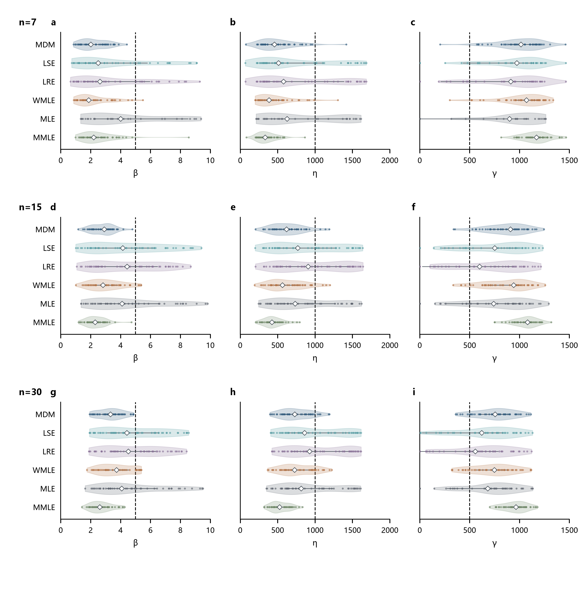
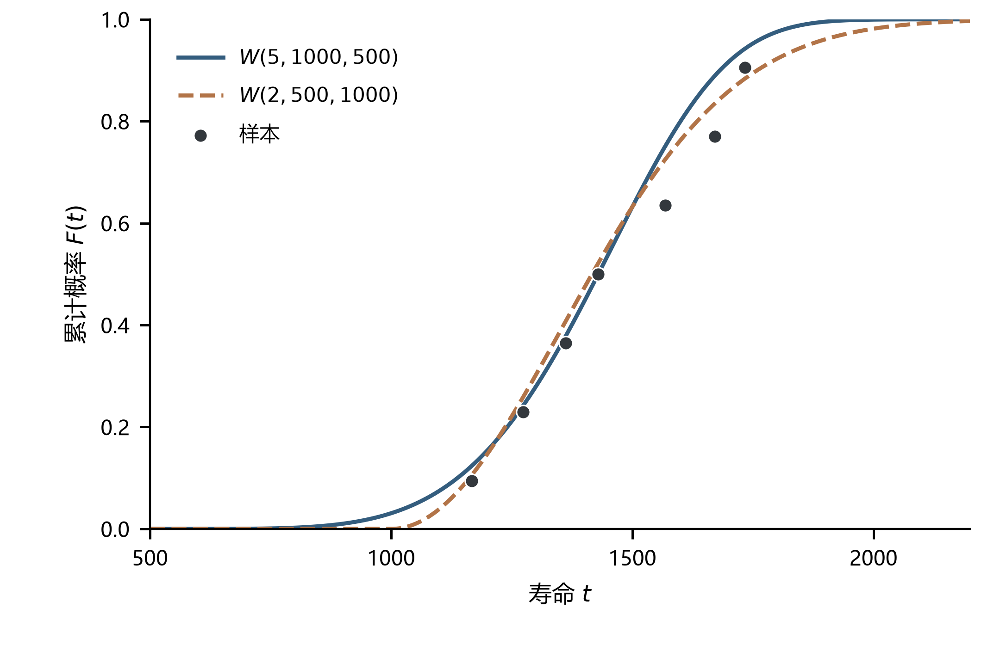
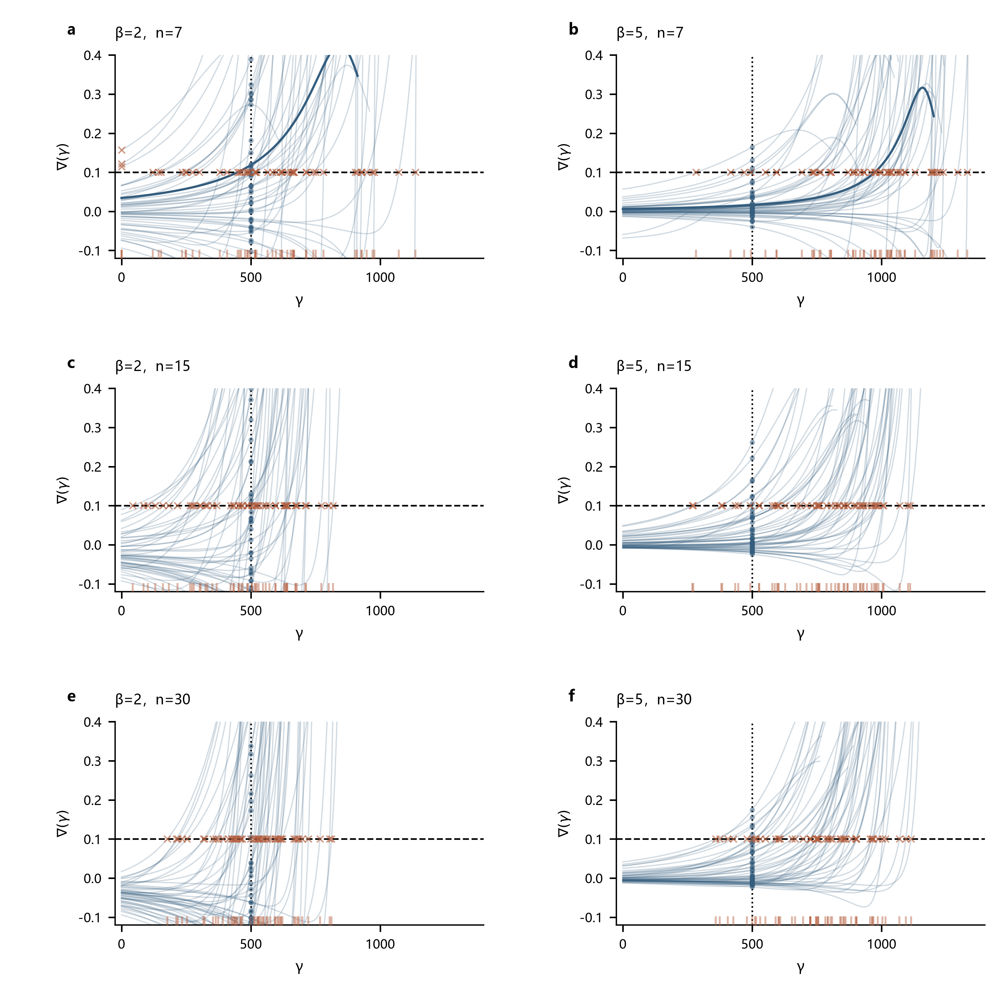
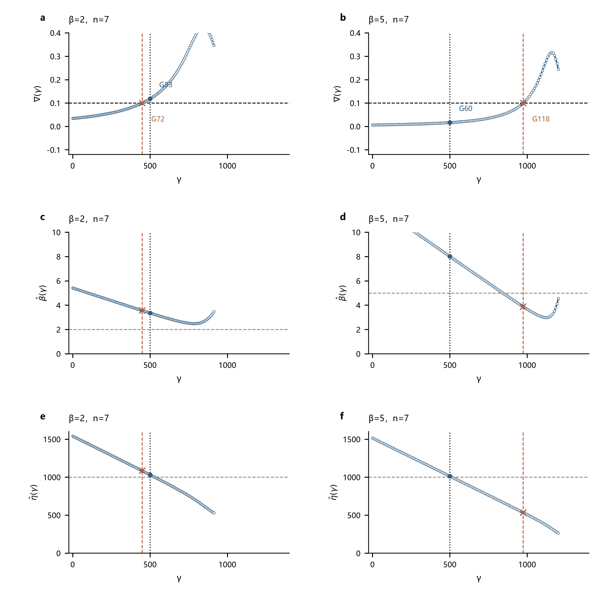
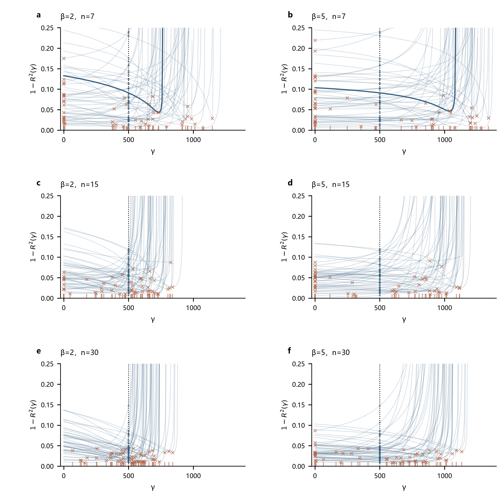
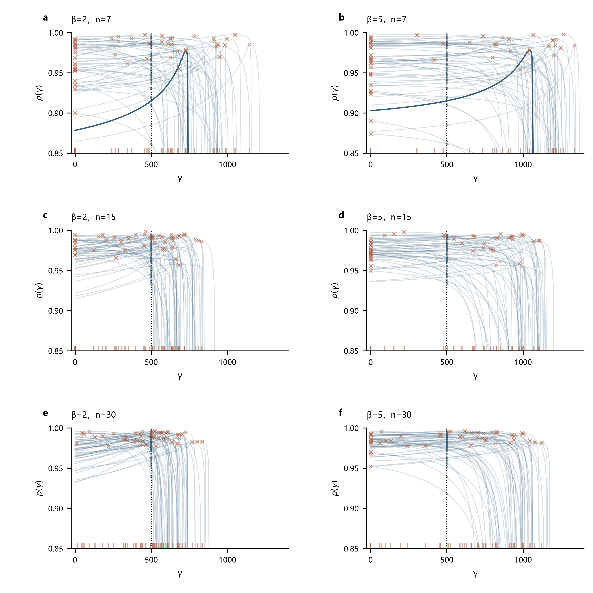
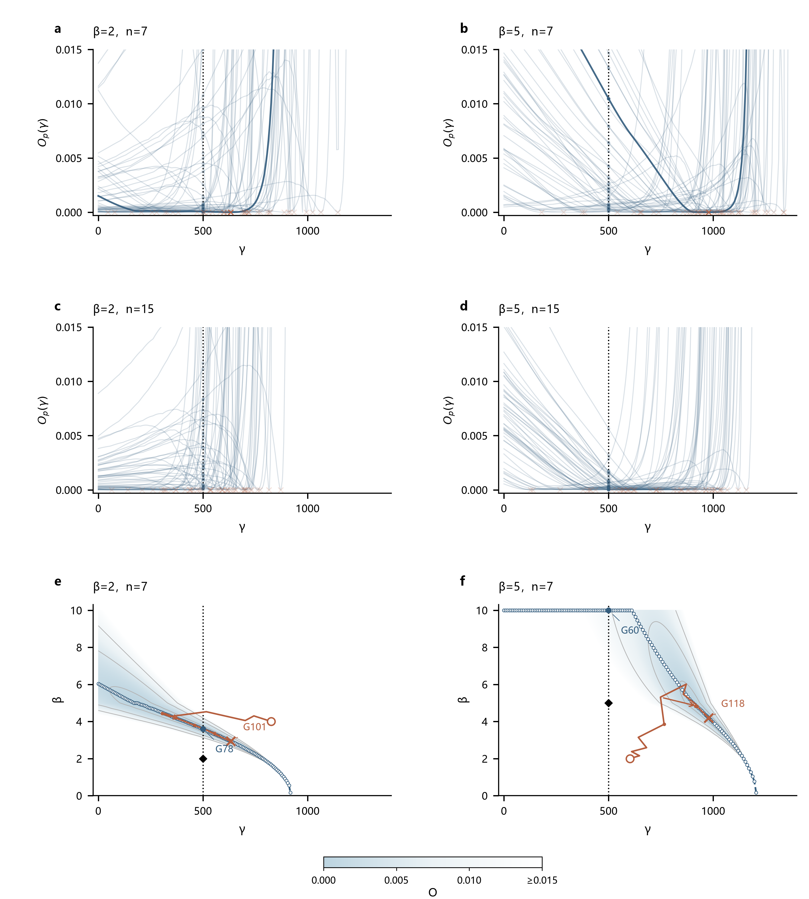
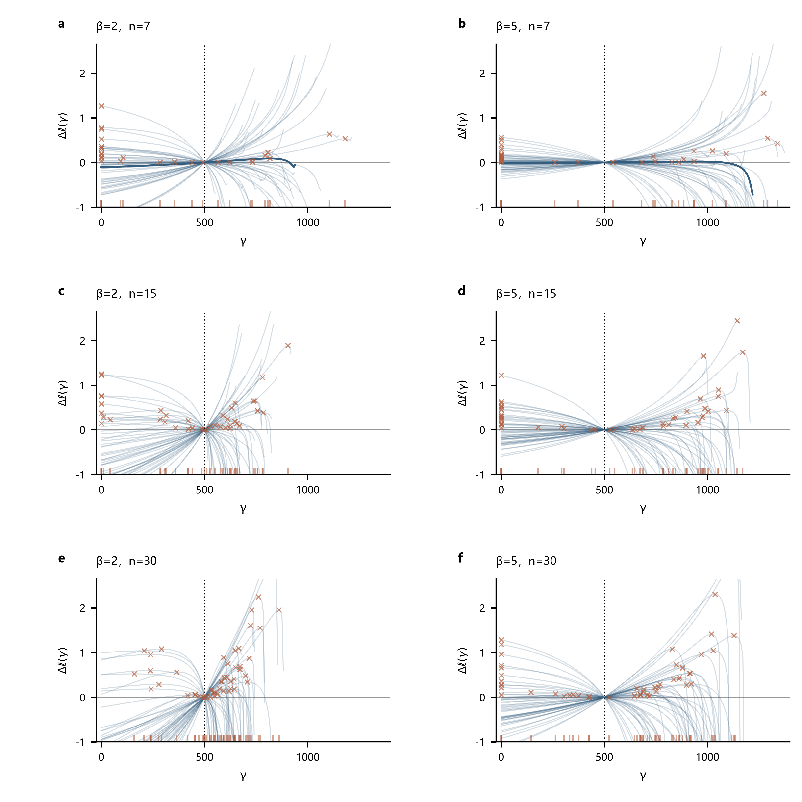
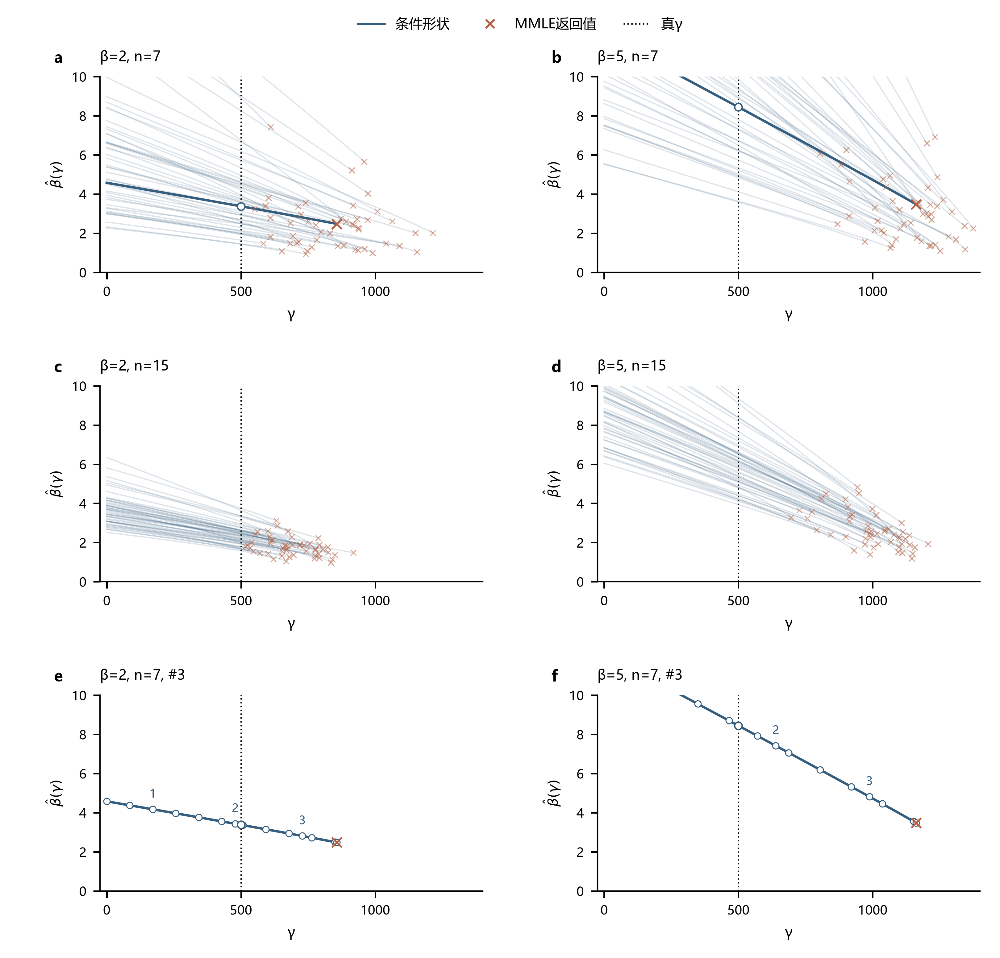

# 报告1：高形状参数下的估计偏移

> 研究报告 · 2026-10-02 · 方法口径与诊断更新：2026-10-11

## 第一章　问题描述

在W(5,1000,500)的原案例中，多种方法出现γ偏高、η和β偏低的共同偏移：小样本下，γ的估计中心接近1000，η接近500（图1）。

**图1｜随着n增大，β和η低估、γ高估的现象总体减轻。**

如图1所示，MDM、WMLE和MMLE在大多数样本中高估γ、低估β和η。LSE、LRE和MLE还出现γ低估、β和η高估的结果。

## 第二章　机制分析与对照实验

以下先分析高β、小n下，参数偏离真值的分布为何仍能拟合样本，再分析各方法的估计判据为何会选中这些分布。

三参数Weibull分布为：

$$\begin{aligned}
F(t)&=1-\exp\left[-\left(\frac{t-\gamma}{\eta}\right)^\beta\right],\\
f(t)&=\frac{\beta}{\eta}\left(\frac{t-\gamma}{\eta}\right)^{\beta-1}
\exp\left[-\left(\frac{t-\gamma}{\eta}\right)^\beta\right].
\end{aligned}
\tag{1}$$

其中，t为寿命，F(t)为分布函数，f(t)为概率密度，β、η、γ分别为形状、尺度和位置参数；β>0、η>0、t>γ。后文ln表示自然对数。

支持条件γ<t₁由最小观测t₁确定。最小观测离真γ越远，样本允许的位置上移空间越大。

**图2｜高β、小n下，样本对γ上移的上界约束较弱，随n增大而增强。**

图3以原β=5、n=7第31组为例。γ上移缩短各观测到起点的距离，η和β的降低可使中部分位保持接近。

**图3｜γ升高、η和β降低后，分布仍可贴近同一组观测。** 黑点的累计概率由样本排序近似。

起点信息不足与参数补偿，使偏移组合仍能拟合观测；偏移的方向和程度则取决于各方法对这些组合的评价。以下固定γ考察判据变化，WMLE和MLE的条件曲线用于分析联合准则，不代表先估计γ的求解顺序。

记排序观测到候选γ的距离为：

$$d_i=t_i-\gamma,\qquad 0\leq\gamma<t_1.
\tag{2}$$

其中，tᵢ为从小到大排序的第i个观测，dᵢ为该观测到候选位置的距离，i=1,…,n，n为样本量，帽号表示估计值。

### 2.1 [MDM](../../src/content/algorithms/mdm.md)：条件最小标准差梯度与固定补偿值

MDM比较各观测反算的尺度参数，以这些伪尺度之间的差异估计参数。原文首先通过秩估计得到排序观测的累计概率：

$$\hat F(t_{(i)})=
\frac{i}{i+(n+1-i)F_{2(n+1-i),\,2i,\,0.5}}.
\tag{3}$$

其中，$t_{(i)}$为第i个排序观测，$\hat F(t_{(i)})$为对应的累计概率估计，$F_{2(n+1-i),\,2i,\,0.5}$为自由度分别为2(n+1−i)和2i的F分布中位数。本组存档计算采用Bernard近似：

$$\hat F(t_{(i)})\approx\frac{i-0.3}{n+0.4}.
\tag{4}$$

将式（4）的累计概率代入原文的尺度参数伪估计量：

$$\hat\eta_i(\gamma,\beta)=
\frac{t_{(i)}-\gamma}{[-\ln(1-\hat F(t_{(i)}))]^{1/\beta}}.
\tag{5}$$

其中，η̂ᵢ为第i个观测反算的伪尺度。固定γ，尝试不同β，并以n个伪尺度的标准差$\sigma_\eta(\gamma,\beta)$衡量差异；取其中最小的标准差$\sigma_{\eta,\min}(\gamma)$，同时保留对应的β。

原文以条件最小标准差对γ的差分梯度确定位置：

$$\nabla(\gamma)=
\frac{\sigma_{\eta,\min}(\gamma+\Delta\gamma)
-\sigma_{\eta,\min}(\gamma)}{\Delta\gamma}.
\tag{6}$$

其中，∇(γ)为条件最小标准差的梯度，Δγ为位置参数的差分步长。本组以固定正梯度代替零梯度判据，按下式确定γ̂：

$$\nabla(\hat\gamma)=0.10.
\tag{7}$$

当γ=0处的梯度已达到或超过0.10时，取γ̂=0。β̂取该位置对应的形状参数，最终尺度取伪尺度均值：

$$\hat\eta=\frac{1}{n}\sum_{i=1}^{n}
\frac{t_{(i)}-\hat\gamma}{[-\ln(1-\hat F(t_{(i)}))]^{1/\hat\beta}}.
\tag{8}$$

其中，β̂、η̂、γ̂分别为形状、尺度和位置估计。图4以中心差分近似计算式（6）的梯度，横虚线为式（7）的补偿值0.10，竖点线为真γ=500。

**图4｜高β时梯度曲线较集中，补偿值交点总体右移；随n增大，右移程度减轻。**

β=5时，真γ处的梯度多数低于0.10，曲线比β=2更集中，交点因而集中于真γ右侧。随n增大，β=5的位置估计向真值靠近。

这一差别来自伪尺度对γ的响应。固定β，对式（5）求导并在β较大时作一阶展开：

$$\frac{\partial\hat\eta_i}{\partial\gamma}
=-[-\ln(1-\hat F(t_{(i)}))]^{-1/\beta}
\approx -1+\frac{\ln[-\ln(1-\hat F(t_{(i)}))]}{\beta}.
\tag{9}$$

式（9）中，各伪尺度的变化率随β增大而接近共同值−1。共同平移不改变标准差，标准差梯度的大小受这些变化率之间的差异限制；差异缩小，梯度便集中在零附近。在条件最优β为内部平滑解时，重新优化β不增加一阶响应。高β对照中，真γ附近的条件β也较大，因此固定的0.10补偿值多数要在更右侧达到。这一展开解释曲线的压缩趋势，梯度的正负仍由具体样本决定。

n增大使最小观测更靠近真γ（图2），收紧位置上移空间；同时，概率位置与样本间距的随机偏差减小，原本不同的β、γ组合更容易被区分。图4所示交点仍受固定补偿值影响，但右移程度随n增大而减轻。

位置确定后，MDM在该γ处取使伪尺度标准差最小的β，再按式（8）计算η。图5展开图4a、b中加深的第48组曲线：每个候选γ对应的β̂(γ)、η̂(γ)分别由这两步得到。

**图5｜偏高γ对应较低β，并通过伪尺度均值得到较低η。** 蓝点为固定真γ的条件估计，橙叉为最终估计。

在伪尺度接近一致时，由式（5）可得：

$$\frac{t_{(j)}-\gamma}{t_{(i)}-\gamma}
\approx\left[\frac{-\ln(1-\hat F(t_{(j)}))}{-\ln(1-\hat F(t_{(i)}))}\right]^{1/\beta},\qquad j>i.
\tag{10}$$

其中，j为较大观测的序号。γ上移时，小距离缩短的比例更大，式（10）左侧的距离比增大，而右侧的概率比不变，需要较小β维持伪尺度一致性。图5d显示了这一变化；缩短后的距离与对应β代入式（8），尺度均值也随之降低（图5f）。该高β样本最终返回W(3.89,535,974)，说明梯度补偿先选中了偏高的位置，再带动形状与尺度偏低。

### 2.2 [LSE](../../src/content/algorithms/lse.md)：回归准则匹配了样本的随机间距

LSE以理论顺序统计量为参考，用线性匹配判据选择位置。样本间距的随机波动会改变最佳匹配位置。

Weibull样本满足以下对数关系：

$$\ln(t_i-\gamma)=\ln\eta+\frac{\ln E_i}{\beta},\qquad
z_i=\mathbb{E}[\ln E_i].
\tag{11}$$

其中，Eᵢ为排序后的第i个单位指数随机变量，与tᵢ对应；𝔼为数学期望，zᵢ为对数顺序统计量的期望。以式（11）的zᵢ为参考，对候选γ下的观测作带截距的最小二乘回归：

$$y_i(\gamma)=\ln d_i=a+bz_i+r_i,\qquad
\hat\beta(\gamma)=1/b,\qquad \hat\eta(\gamma)=\exp(a).
\tag{12}$$

其中，yᵢ为距离的对数，a、b、rᵢ分别为截距、斜率和残差。式（12）的回归总平方和等于回归平方和与残差平方和之和，因此未被回归解释的比例为：

$$\mathrm{SST}=\sum_i(y_i-\overline y)^2,\qquad
\mathrm{SSE}=\sum_i r_i^2,\qquad
1-R^2(\gamma)=\frac{\mathrm{SSE}}{\mathrm{SST}}
=1-\operatorname{corr}^2\{z_i,y_i(\gamma)\}.
\tag{13}$$

其中，ȳ为变换观测均值，SST、SSE分别为总平方和、残差平方和，R²为回归决定系数，corr为Pearson相关系数。LSE最大化的White比值为：

$$\frac{\mathrm{SST}/(n-1)}{\mathrm{SSE}/(n-2)}
=\frac{n-2}{n-1}\frac{1}{1-R^2(\gamma)}.
\tag{14}$$

固定n后，式（14）等价于最小化式（13）的1−R²。样本较集中时，在|tᵢ−t̄|相对t̄−γ较小的区间，对数变换可作一阶展开：

$$\ln(t_i-\gamma)\approx\ln(\overline t-\gamma)
+\frac{t_i-\overline t}{\overline t-\gamma}.
\tag{15}$$

其中，t̄为样本均值。在式（15）的近似范围内，改变γ主要改变截距和整体比例，相关系数对此保持不变，位置区分来自一阶近似省略的曲率。高β样本较集中，准则对位置变化的区分较弱；随机间距则通过曲率改变最低点。

由式（11），在真实γ=500处，配对样本满足yᵢ=ln1000+(lnEᵢ)/β。β增大只缩小对数间距，真实位置处的R²保持不变；偏移来自其他位置对随机间距的重新匹配。图6展示式（13）的准则随γ的变化。

**图6｜回归准则可在偏离真值的位置获得更好的间距匹配。**

原β=5、n=7第37组中，γ由500移至约974时，残差比例由0.047降至0.019（补充图6b）。因此，偏高的位置在LSE准则下优于固定真位置的条件拟合：它更好地匹配了该样本的随机间距，却不代表位置更准确。

γ右移使较小观测的对数距离下降更多，y对z的回归斜率增大，按式（12）的β=1/b得到较小形状；回归以较小尺度匹配缩短的中部距离，最终返回W(1.97,335,974)。LSE选择了变换后相对残差更小的分布，而该分布的参数已偏离真值。图6也有左侧最低点，说明这种匹配可产生双向偏移。

### 2.3 [LRE](../../src/content/algorithms/lre.md)：最高相关性可能匹配概率位置的随机误差

LRE以固定绘图位置近似累计概率，用线性相关性选择位置。绘图位置与样本实际概率位置的随机差异，会随位置调整进入匹配准则。

对Weibull分布函数连续取两次对数，得到：

$$\ln[-\ln(1-F(t))]=\beta\ln(t-\gamma)-\beta\ln\eta.
\tag{16}$$

以绘图位置pᵢ代替未知F(tᵢ)，采用式（4）的Bernard近似。记变换坐标：

$$X_i(\gamma)=\ln d_i,\qquad Y_i=\ln[-\ln(1-p_i)].
\tag{17}$$

其中，Xᵢ为距离对数，Yᵢ为固定绘图概率的双对数变换。对Y与X作带截距的最小二乘回归，与式（16）的线性关系比较可得：

$$Y_i=a+bX_i(\gamma)+r_i,\qquad
\hat\beta(\gamma)=b,\qquad \hat\eta(\gamma)=\exp(-a/b).
\tag{18}$$

其中，a、b、rᵢ为截距、斜率和残差。由式（18）的回归平方和分解，未被解释的比例为：

$$1-R^2(\gamma)=\frac{\sum_i r_i^2}{\sum_i(Y_i-\overline Y)^2}
=1-\operatorname{corr}^2\{X_i(\gamma),Y_i\}.
\tag{19}$$

其中，Ȳ为Yᵢ均值，R²为Y对X的回归决定系数。LRE最大化R²，等价于最小化式（19）；其参考坐标及回归方向与LSE不同。

式（15）的一阶展开同样适用于Xᵢ，相关性对位置变化的区分较弱。固定的Yᵢ与随机样本间距之间的匹配，通过曲率改变相关性高点；真实位置处的配对相关性仍保持不变。图7展示式（19）的准则随γ的变化。

**图7｜提高线性相关性可伴随参数偏移。**

原β=5、n=7第11组中，γ由500移至约914时，R²由0.953升至0.987（补充图6d）。固定的绘图概率与这组观测在右移后更接近直线，因而相关性准则接受了偏高的位置。

此时X的间距增大，而Y保持不变，式（18）的回归斜率b降低，β=b也降低；较小η则对应缩短后的中部距离，最终返回W(1.36,461,914)。更高相关性来自对该样本概率位置误差的匹配，不能保证三个参数接近真值。图7的配对展开例返回γ=0，说明LRE同样没有固定的偏移方向。

### 2.4 [WMLE](../../src/content/algorithms/wmle.md)：样本集中改变校准方程的联合平衡

WMLE用有限样本校准系数调整似然方程。样本统计量与校准目标的差异，会使两式的共同交点偏离真位置。

将式（1）中各独立观测的密度相乘并取对数，得到：

$$\ell(\beta,\eta,\gamma)=\sum_i\ln f(t_i)
=n\ln\beta-n\beta\ln\eta+(\beta-1)\sum_i\ln d_i
-\eta^{-\beta}\sum_i d_i^\beta.
\tag{20}$$

其中，ℓ为样本对数似然。对式（20）的尺度导数置零可得ηᵝ=n⁻¹∑dᵢᵝ，代入形状与位置导数，再除以n，得到未校准方程：

$$\frac{1}{\beta}+\frac{1}{n}\sum_i\ln d_i
-\frac{\sum_i d_i^\beta\ln d_i}{\sum_i d_i^\beta}=0,\qquad
\beta\frac{\sum_i d_i^{\beta-1}}{\sum_i d_i^\beta}
-\frac{\beta-1}{n}\sum_i\frac{1}{d_i}=0.
\tag{21}$$

β>1时，式（21）中的位置方程等价于：

$$\left(\frac{1}{n}\sum_i\frac{1}{d_i}\right)
\frac{\sum_i d_i^\beta}{\sum_i d_i^{\beta-1}}=\frac{\beta}{\beta-1}.
\tag{22}$$

WMLE将式（21）中形状方程的系数1、式（22）中的目标值β/(β−1)替换为校准值，形成两项残差：

$$T_1(\beta,\gamma)=\frac{J_2(n)}{\beta}+\frac{1}{n}\sum_i\ln d_i
-\frac{\sum_i d_i^\beta\ln d_i}{\sum_i d_i^\beta},
\tag{23}$$

$$T_2(\beta,\gamma)=\left(\frac{1}{n}\sum_i\frac{1}{d_i}\right)
\frac{\sum_i d_i^\beta}{\sum_i d_i^{\beta-1}}-J_3(n,\beta).
\tag{24}$$

其中，T₁、T₂为形状、位置方程残差，J₂、J₃为校准系数。本批J₃表覆盖β=0.1—5，β>5采用端点工程近似。尺度由下式计算：

$$\eta^\beta=\frac{\sum_i d_i^\beta}{nJ_1(n)}.
\tag{25}$$

其中，J₁为尺度校准系数。

当各dᵢ相等时，式（24）中的乘积恰为1。高β样本的距离较集中，这一乘积可能接近1，但校准目标J₃由n和候选β决定。改变β会同时影响T₁、T₂；真实γ处即使使其中一项残差为零，也未必能使另一项为零。

WMLE按两项残差的平方和联合选择β、γ。为比较不同γ下能够达到的拟合程度，在每个γ处优化β，得到：

$$O(\beta,\gamma)=T_1(\beta,\gamma)^2+T_2(\beta,\gamma)^2,\qquad
O_p(\gamma)=\inf_{0<\beta<10}O(\beta,\gamma).
\tag{26}$$

其中，O为联合目标函数，Oₚ为固定γ下残差平方和的下界，边界处按极限计算。图8a–d展示Oₚ；每个点都在该γ处重新优化β。图8e、f展开上方同一单样本，在β–γ平面展示式（26）的联合目标与实际搜索过程。

**图8｜WMLE联合调整β、γ，使偏移组合的残差接近零。**

图题中的β为抽样真值。单样本图中，底色表示O，蓝虚线及圆点为各γ下使O最小的β，橙线为原程序选中起点的联合迭代，空心橙圆为起点。黑菱形为真参数，红叉为返回解。上方的深蓝曲线由下方蓝线对应的O值构成。

图8f中，真实γ=500处即使将β调至上界附近，O仍约为0.0105；联合搜索返回γ约979、β约4.20，O接近零。式（25）随后给出η约512，最终选中γ高估、β和η低估的分布。

该例在真实γ处的条件最优β接近程序上界10，计算涉及J₃的端点近似；形状范围与端点近似对偏移的贡献仍需进一步区分。

### 2.5 [MLE](../../src/content/algorithms/mle.md)：有限样本的似然改善对应较大参数偏移

MLE以对数似然为准则，联合优化β、η、γ。高β、小样本下，参数补偿使部分组合的似然接近，随机波动可改变高点位置。本批按β≥1、η>0、0≤γ<t₁接受结果。

由式（20）的对数似然，对尺度求导并令其为0，得到条件尺度；再代入形状导数，得到条件形状方程：

$$\hat\eta(\beta,\gamma)=\left(\frac{1}{n}\sum_i d_i^\beta\right)^{1/\beta},\qquad
\frac{1}{\beta}+\frac{1}{n}\sum_i\ln d_i
-\frac{\sum_i d_i^\beta\ln d_i}{\sum_i d_i^\beta}=0.
\tag{27}$$

其中，η̂(β,γ)为给定β、γ的条件尺度。记式（27）中形状方程的未约束根为β₀(γ)，取β̂(γ)=max{1,β₀(γ)}，再代回式（27）的尺度表达式计算η̂(γ)。β₀<1时，条件最优值为β=1、η=平均距离，形状得分≤0。以下帽号指受约束条件最优值，其似然为：

$$\ell_p(\gamma)=\ell(\hat\beta(\gamma),\hat\eta(\gamma),\gamma),\qquad
\Delta\ell(\gamma)=\ell_p(\gamma)-\ell_p(500).
\tag{28}$$

其中，ℓₚ为β≥1接受域内的剖面对数似然，Δℓ为相对于固定γ=500的条件拟合的似然增量。图9展示式（28）的似然增量随γ的变化。

**图9｜高β下，部分相差较大的参数组合具有接近的似然。** 红叉标记原程序返回位置，曲线包含β=1条件解。

原β=5、n=7第33组返回W(3.48,637,907)，相对于固定γ=500的条件最优拟合，对数似然提高0.053。位置上移后，式（27）的形状方程以较小β匹配增大的距离相对差异，尺度表达式则拟合较短的距离。补偿后的分布虽偏离真参数，却使这组观测的似然更高，因而在准则比较中优于真位置条件拟合。

较大参数偏移仅对应很小的似然改善，表明本例对这类参数组合的区分较弱，有限样本波动便可改变更高似然的位置。图9的配对展开例反而返回γ=0，因此这种区分不足并不只产生右移。

W(5,1000,500)、n=7第4组的右移候选比真位置条件拟合具有更高似然，但另有更好的β=1合格候选。这说明似然准则支持右移与搜索不足可以同时存在，原返回值不能直接视为准则的最优解。具体候选见[报告2的MLE分析](报告2：小样本情况下的明显异常估计.md)。

### 2.6 [MMLE](../../src/content/algorithms/mmle.md)：样本最小值定位带动形状与尺度偏移

MMLE采用Kundu–Raqab的单样本形式，取γ̂=t₁，删去一个最小观测，再估计β、η。因此，图2中高β、小n下最小观测远离真起点的现象，直接转化为γ高估。

对保留的t₂,…,tₙ，修正对数似然为：

$$\ell_m(\beta,\eta,\gamma)
=q\ln\beta-q\beta\ln\eta
+(\beta-1)\sum_{i=2}^{n}\ln d_i
-\sum_{i=2}^{n}\left(\frac{d_i}{\eta}\right)^\beta,
\qquad q=n-1.
\tag{29}$$

其中，ℓₘ为删去最小观测后的对数似然，q为保留观测数。本节dᵢ=tᵢ−γ仅用于i=2,…,n，故γ=t₁时所有保留距离仍为正。

对式（29）的η导数置零，再将条件尺度代入β的导数，得到：

$$\hat\eta(\beta,\gamma)
=\left(\frac{1}{q}\sum_{i=2}^{n}d_i^\beta\right)^{1/\beta},\qquad
\frac{1}{\beta}+\frac{1}{q}\sum_{i=2}^{n}\ln d_i
-\frac{\sum_{i=2}^{n}d_i^\beta\ln d_i}{\sum_{i=2}^{n}d_i^\beta}=0.
\tag{30}$$

固定保留样本，按式（30）求得条件形状β̂(γ)及尺度η̂(γ)。图10展示β̂(γ)随位置平移的变化；MMLE直接取曲线在γ=t₁处的值。

**图10｜最小值定位使高β样本的γ明显上移，并降低条件形状估计。** 红叉为MMLE返回值。

MMLE的位置偏差在γ̂=t₁这一步已被确定，后续拟合只能调整β、η。高β时t₁更远离真起点，保留距离因位置上移而缩短、相对差异增大，式（30）的形状方程根及对应尺度随之降低。图10f中，γ由500移至约1162时，条件β由约8.4降至3.5，η由约1199降至524。后两项参数适应了偏高的起点，因而返回γ高估、β和η低估的分布；随n增大，最小值定位造成的偏移减轻。

## 第三章　结论与研究启示

高β、小n下，起点附近的观测不足，γ上移及η、β降低仍可保留相近的中部拟合。在本组对照中，MDM的固定梯度阈值、WMLE的校准方程和MMLE的最小值定位使偏移组合被选中；回归与似然准则也可支持偏移，但方向随样本改变。

较好的样本拟合并不保证三个参数接近真值。后续应检验MDM阈值、WMLE校准目标及MMLE最小值定位对偏移的贡献，区分方法规则与形状范围、端点处理的影响，并比较回归和似然方法的正反向偏移样本。

---

**数据与程序。** [MDM梯度与参数传递数据](交付/程序/报告1/20261011-MDM梯度与参数传递.json)、[完整统计表](交付/结果/报告1/高形状参数补偿统计.xlsx)、[其余方法准则曲线](交付/结果/报告1/中间数据/逐法过程曲线.json)、[WMLE联合判据曲线](交付/程序/报告1/20261011-WMLE联合判据曲线.json)、[WMLE单样本联合过程](交付/程序/报告1/20261011-WMLE单样本联合过程.json)、[MMLE估计与曲线](交付/程序/报告1/20261011-MMLE估计与曲线.json)、[小提琴源数据](交付/结果/报告1/中间数据/图1小提琴数据与核验.json)、[配对单例与推导核验](交付/结果/报告1/中间数据/配对单例与推导核验.json)及[原案例观测与方程网格](交付/结果/报告1/中间数据/单组绘图点与方程.json)提供取数依据；复算入口见[研究目录说明](README.md#复现入口)。

**补充材料。** [连续β的成功比例](交付/结果/报告1/补充图1_估计成功率.png)；[LRE绘图位置版本对照](交付/结果/报告1/补充图2_LRE绘图位置对照.png)；[连续β的估计中位数](交付/结果/报告1/补充图4_连续形状对照.png)；[参数补偿与固定位置诊断](交付/结果/报告1/补充图5_位置尺度补偿.png)；[原案例回归点与联合方程](交付/结果/报告1/补充图6_原案例回归与方程.png)。

补充图1的a、b分别为n=7、15，成功比例以各条件50组为分母，失败保留在分母中。补充图2比较相同样本上的LRE与Park绘图位置实现，实线为成功位置估计中位数，阴影为第25–75百分位，黑虚线为真γ=500。

补充图4展示各条件成功估计的中位数，a–c为n=7，d–f为n=15，黑虚线为相应参数真值；颜色对应六种方法。

补充图5a为β=5、n=7的成功估计误差，横纵坐标分别为Δγ=γ̂−500、Δη=η̂−1000，黑虚线为尺度误差与位置误差等量反向的参考关系；b比较原估计与固定γ=500条件拟合的尺度绝对误差中位数，实心点为原估计，空心点为条件拟合。MMLE的条件拟合仍删去原最小观测。

补充图6a、b为原β=2组#31、β=5组#37的LSE变换点与条件回归，c、d为原β=2组#2、β=5组#11的LRE变换点与条件回归。蓝圆及虚线为γ=500，红方点及实线为返回γ，同号1–7对应同一排序观测。e、f为原WMLE组#18的T₁=0蓝实线与T₂=0绿虚线，红叉为联合返回解，黑菱形为生成真参数，灰横点线为权重表上端β=5。该图取自两批原案例；图4–10使用配对样本。

**补充推导｜最小观测与局部分位补偿**

最小观测超过t，要求n个独立观测都超过t，故其生存概率为$[1-F(t)]^n$；对t取负导数，得到：

$$f_{t_1}(t)=n[1-F(t)]^{n-1}f(t).
\tag{31}$$

其中，fₜ₁(t)为最小观测的概率密度，图2下方的理论密度按式（31）计算。

在式（1）的分布函数中令F(Q(p))=p，解得寿命分位点：

$$Q(p)=\gamma+\eta[-\ln(1-p)]^{1/\beta},\qquad
Q(1-e^{-1})=\gamma+\eta.
\tag{32}$$

其中，Q(p)为累计概率p对应的寿命分位点，0<p<1，e为自然指数的底数，1−e⁻¹≈0.632。将式（32）在63.2%分位附近作一阶展开：

$$z=\ln[-\ln(1-p)],\qquad
Q(p)=\gamma+\eta\exp(z/\beta)
\approx(\gamma+\eta)+\frac{\eta}{\beta}z.
\tag{33}$$

其中，z为累计概率的双对数变换，z=0对应63.2%分位。γ+η决定中部位置，η/β是此处分位曲线关于z的斜率。升高γ并降低η，可保持中部位置接近；再按相近比例降低β，可保持局部斜率接近。

例如，W(5,1000,500)与W(2.5,500,1000)的中部分位均为1500、局部斜率均为200。局部近似适用于z/β较小的范围。

图4–10对比β=2、5和n=7、15，每个条件使用50组样本；同一样本量下两种β共用潜在单位指数样本E。下排两格分别展开上排两条深蓝曲线。
