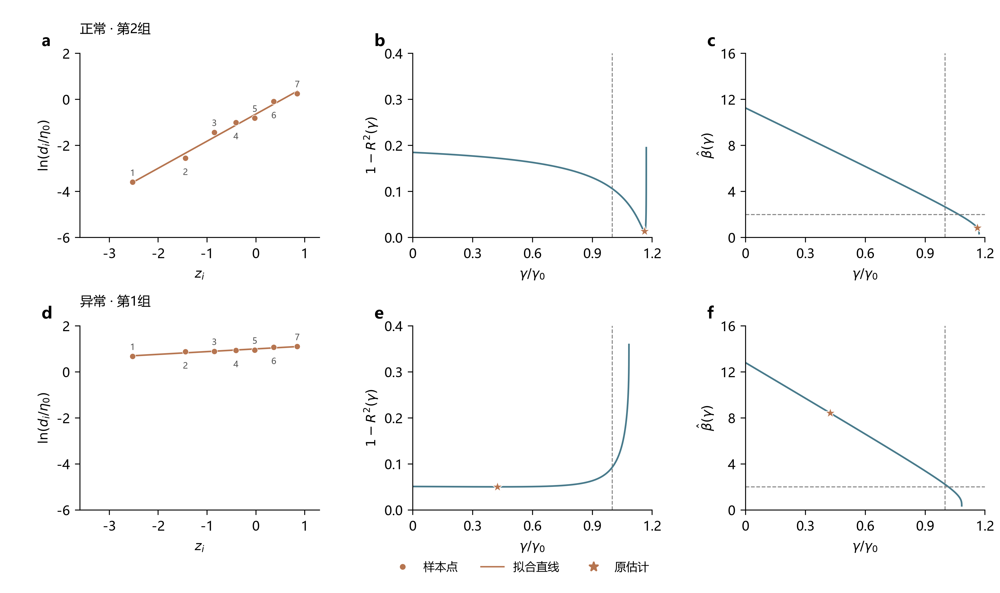
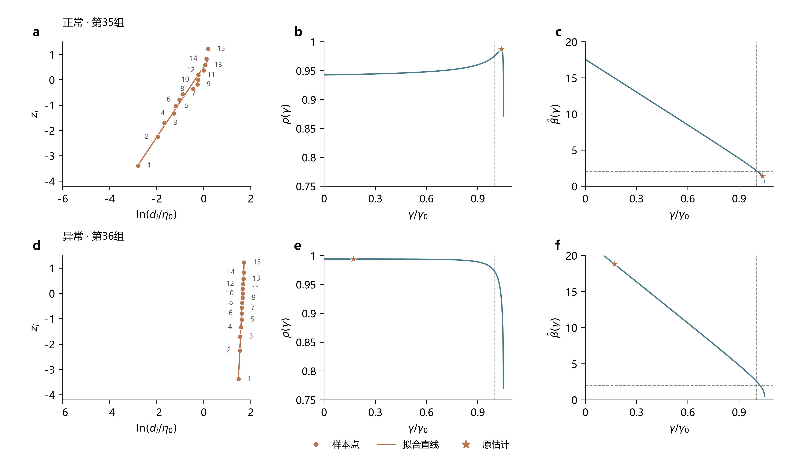
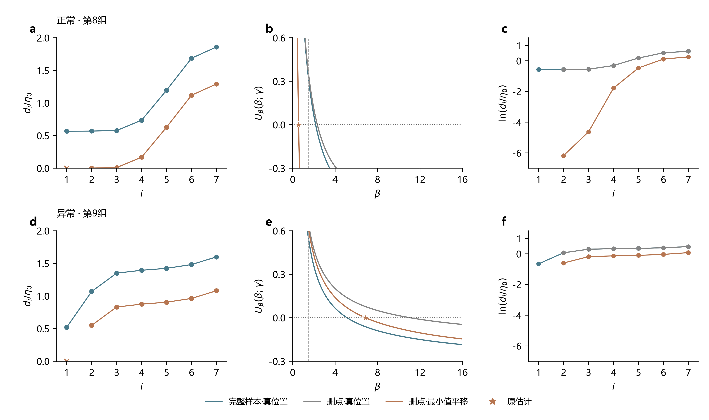

# 报告2：小样本情况下的明显异常估计

> 研究报告 · 2026-10-10 · 方法口径与诊断更新：2026-10-11

## 1　问题描述

此前计算覆盖以下参数组合、方法和样本量：

| 项目     | 设置                                                                                                |
| ------ | ------------------------------------------------------------------------------------------------- |
| 参数组合   | β=1.5、2、3、5，η=100、γ=500；β=1.5、2、3、5，η=1000、γ=500；β=2、3，η=1000、γ=1000；β=2、3、5，η=1000、γ=3000。共13个组合 |
| 估计方法   | MDM δ=0.10、0.15、0.20，LSE、LRE、MLE、WMLE、MMLE，共8种设置                                                  |
| 样本量n   | 7、15、30，每个参数组合、每档n各50组                                                                            |

估计结果中，部分参数与真值存在明显偏差。例如，W(2,100,500)、n=15的第36组样本得到以下结果，加粗数值为明显偏离的估计值。

| 方法 | 形状β | 尺度η | 位置γ |
|---|---:|---:|---:|
| 真值 | 2 | 100 | 500 |
| LSE | **21.70** | **609.36** | **0** |
| LRE | **18.80** | **522.81** | **85.73** |
| MLE | **23.54** | **608.35** | **0** |

本报告将形状估计值达到真值的3倍，或不超过真值1/3的结果称为明显异常估计：

$$
\hat\beta\ge3\beta\quad\text{或}\quad\hat\beta\le\frac{\beta}{3}.
$$

其中，β为形状真值，β̂为估计值。高估与低估合计统计。

**图1｜明显异常估计的发生频率随参数条件、样本量和方法而异。**

明显异常总体在大形状、小样本下更常见，增大样本量后减轻。LSE、LRE出现较多，MDM、WMLE和MMLE相对较少。

本报告对照正常与异常样本，沿各方法的估计流程分析偏差形成的环节，以解释明显异常估计怎样产生，以及某些参数条件和方法为何更容易出现。

## 2　明显异常估计的形成机制

2.1节逐个方法分析正常与异常样本的估计过程，定位偏差形成的环节；2.2节解释解释哪些条件更容易触发这些过程；2.3节比较不同方法对同类样本特征的响应。

### 2.1　各方法的异常形成机制

组图上排为正常样本，下排为异常样本，星号标记原估计。γ₀、η₀为位置、尺度真值，部分坐标以γ/γ₀、dᵢ/η₀表示位置和样本距离；MDM保留γ的原量纲。热力图空白格表示0次。

#### 2.1.1　[LSE](../../src/content/algorithms/lse.md)

LSE对每个候选位置γ拟合一条直线，选择拟合程度最好的位置，再由斜率和截距恢复形状与尺度。其依据是Weibull变量的对数距离关系：

$$
\ln(X-\gamma)=\ln\eta+\frac{Z}{\beta}.
$$

X为Weibull随机变量，Z=βln[(X−γ)/η]为标准对数Weibull变量。对n个变量排序后取期望，得到：

$$
\operatorname{E}[\ln(X_{(i)}-\gamma)]
=\ln\eta+\frac{z_i}{\beta}.
$$

n为样本量，X₍ᵢ₎为第i小的随机观测，zᵢ=E[Z₍ᵢ₎]为标准变量的顺序统计量期望，只由i和n决定。

对实际观测x₍ᵢ₎，记距离dᵢ=x₍ᵢ₎−γ、对数距离yᵢ=ln dᵢ。以zᵢ为横坐标、yᵢ为纵坐标拟合直线yᵢ≈a+bzᵢ，截距a对应lnη，斜率b对应1/β，因此：

$$
\hat\beta(\gamma)=\frac1b,
\qquad
\hat\eta(\gamma)=e^a.
$$

LSE用F比评价直线拟合程度，并选择F比最大的γ。F比与回归决定系数R²的关系为：

$$
F(\gamma)=\frac{n-2}{(n-1)[1-R^2(\gamma)]}.
$$

同一组样本的n固定，最大化F比等价于最小化1−R²，位置判据便写成：

$$
\hat\gamma=\underset{0\le\gamma<x_{(1)}}{\arg\min}\,[1-R^2(\gamma)].
$$

x₍₁₎为样本最小值。图中的1−R²曲线显示位置如何被选取，形状曲线则显示该位置对应的斜率倒数。LSE的明显异常分为零边界高估、内部左侧高估和内部右侧低估。

**图2｜LSE各类明显异常估计的发生次数。**

**（1）零边界高估。**

W(2,100,500)、n=15的正常与异常样本如下：

| 样本 | 位置γ̂ | 形状β̂ | 尺度η̂ | 观测值（升序） |
| --- | ---: | ---: | ---: | --- |
| 正常·第35组 | 518.20 | 1.42 | 70.42 | 524.99，532.96，537.51，546.83，549.15，554.55，559.29，582.77，595.63，597.60，598.04，618.58，625.47，631.01，639.05 |
| 异常·第36组 | 0.00 | 21.70 | 609.36 | 524.67，551.74，554.21，573.41，585.02，588.71，591.87，595.61，609.05，610.30，611.69，617.54，625.80，633.61，640.02 |

LSE改变γ以寻找1−R²的最低点，再取该处回归斜率的倒数作为形状。图3同时展示所选位置的拟合线、位置判据和条件形状。

**图3｜第36组的零边界最低点对应较小斜率和形状高估。**

第35组的最低点位于内部位置，所选拟合线的斜率对应正常形状。第36组在真位置下的下端对数点列匹配较差，左移γ压缩这一间距，使点列更接近直线，最低点落在零边界。

改善拟合的同时，纵向对数跨度也由1.74缩至0.20，拟合线变平。斜率降至0.046，取倒数后β升至21.70。这类异常形成于左侧位置改善线性匹配、该位置的小斜率再被转为大形状的过程。

**（2）内部左侧高估。**

W(2,1000,3000)、n=7的正常与异常样本如下：

| 样本 | 位置γ̂ | 形状β̂ | 尺度η̂ | 观测值（升序） |
| --- | ---: | ---: | ---: | --- |
| 正常·第2组 | 3483.60 | 0.85 | 528.75 | 3511.08，3561.75，3723.35，3851.58，3927.62，4397.57，4774.74 |
| 异常·第1组 | 1273.68 | 8.42 | 2717.62 | 3250.30，3676.83，3723.74，3827.75，3860.06，4191.49，4293.82 |

LSE同样寻找1−R²的最低点。本例比较最低点留在内部左侧时，位置变化怎样通过回归斜率影响形状。

**图4｜内部左侧的最低点使第1组的拟合线变平，斜率倒数形成高估。**

第1组的最小观测与第二个观测相隔较远，真位置下的前两个对数点间距大于拟合直线所对应的间距。左移γ优先压缩这一段，线性匹配改善；继续左移后准则回升，最低点留在γ=1273.68。

这次平移还使整体对数跨度缩小，拟合斜率降至0.119，β=1/b随之升至8.42。第2组的最低点位于较靠右的位置，所选点列的纵向跨度更大，斜率对应正常形状。第1组的高估由改善下端匹配的左移及随之变小的斜率共同形成。

**（3）内部右侧低估。**

W(2,1000,500)、n=7的正常与异常样本如下：

| 样本 | 位置γ̂ | 形状β̂ | 尺度η̂ | 观测值（升序） |
| --- | ---: | ---: | ---: | --- |
| 正常·第18组 | 603.11 | 0.91 | 542.97 | 634.38，750.70，764.00，978.92，1044.85，1698.88，1814.71 |
| 异常·第19组 | 774.35 | 0.58 | 399.58 | 779.38，799.04，885.47，1061.58，1197.68，1302.69，2480.21 |

两组样本都由1−R²的最低点定位。本例比较位置右移后，下端对数间距被拉开的程度及其对应斜率。

**图5｜第19组更靠近最小观测的最低点，对应更大的回归斜率和形状低估。**

第19组的最大观测远离其余点列，真位置下点列弯曲。右移γ使最小距离缩小得更快，拉开下端对数间距，改善线性匹配，最低点位于内部右侧。

第19组的所选位置距最小观测仅5.04，明显小于第18组的31.27。下端点被拉得更低，拟合斜率增至1.727，取倒数后β降至0.58。两组都选择右侧位置，第19组更强的间距拉伸使形状越过低估界限。

#### 2.1.2　[LRE](../../src/content/algorithms/lre.md)

LRE先将样本转换为Weibull概率图坐标，选择线性相关性最高的位置，再用回归斜率和截距估计形状与尺度。由分布函数的线性化关系：

$$
\ln[-\ln(1-F(x))]
=\beta\ln(x-\gamma)-\beta\ln\eta,
$$

将第i个排序观测的累计概率F(x₍ᵢ₎)用绘图位置pᵢ代替，得到：

$$
z_i=\ln[-\ln(1-p_i)]
\approx\beta y_i-\beta\ln\eta,
\qquad y_i=\ln(x_{(i)}-\gamma).
$$

F(x)为Weibull分布函数，pᵢ为按次序i和样本量n分配的累计概率，zᵢ为相应的概率图参考坐标。LSE的参考点来自顺序统计量期望，LRE的参考点来自绘图概率的分位变换。

LRE以yᵢ为横坐标、zᵢ为纵坐标拟合直线zᵢ≈a+byᵢ。这里斜率b直接对应β，截距a对应−βlnη，因此：

$$
\hat\beta(\gamma)=b,
\qquad
\hat\eta(\gamma)=e^{-a/b}.
$$

改变γ会改变样本对数距离及其与参考坐标的相关性。LRE选择线性相关系数ρ最大的γ：

$$
\hat\gamma
=\underset{0\le\gamma<x_{(1)}}{\arg\max}\,\rho(\gamma).
$$

ρ(γ)为给定γ时yᵢ与zᵢ的相关系数。图中的ρ曲线显示位置选择，拟合线和形状曲线显示该位置对应的斜率。明显异常分为零边界高估、内部左侧高估和内部右侧低估。

**图6｜LRE各类明显异常估计的发生次数。**

**（1）零边界高估。**

W(2,1000,3000)、n=7的正常与异常样本如下：

| 样本 | 位置γ̂ | 形状β̂ | 尺度η̂ | 观测值（升序） |
| --- | ---: | ---: | ---: | --- |
| 正常·第4组 | 2296.80 | 3.01 | 1743.63 | 3109.09，3388.63，3881.19，3927.27，3941.84，3990.51，4649.68 |
| 异常·第5组 | 0.00 | 13.78 | 3993.75 | 3301.70，3818.64，3840.65，3938.63，3979.78，4031.52，4091.30 |

LRE选择相关系数ρ最高的位置，并直接将该处回归斜率作为形状。图7将相关性最大的位置与概率图上的斜率联系起来。

**图7｜第5组的相关性最高点落在零边界，回归斜率形成高估。**

第5组的最小观测较孤立，后续点列集中。左移γ压缩下端对数间距，概率图相关性提高，最大值落在零边界。第4组的相关性高点仍在内部位置，横向点列保留较大的跨度。

LRE的横轴是样本对数距离，纵轴参考坐标固定。第5组左移后的横向跨度缩窄，拟合线变陡，斜率达到13.78，直接形成形状高估。其异常由相关性准则选取零位置及该位置对应的大斜率共同形成。

**（2）内部左侧高估。**

W(2,100,500)、n=15的正常与异常样本如下：

| 样本 | 位置γ̂ | 形状β̂ | 尺度η̂ | 观测值（升序） |
| --- | ---: | ---: | ---: | --- |
| 正常·第35组 | 518.85 | 1.39 | 68.70 | 524.99，532.96，537.51，546.83，549.15，554.55，559.29，582.77，595.63，597.60，598.04，618.58，625.47，631.01，639.05 |
| 异常·第36组 | 85.73 | 18.80 | 522.81 | 524.67，551.74，554.21，573.41，585.02，588.71，591.87，595.61，609.05，610.30，611.69，617.54，625.80，633.61，640.02 |

LRE比较不同γ下的概率图相关性，再取相关性最高处的回归斜率。图8显示最高点留在内部左侧时的结果。

**图8｜第36组在内部左侧达到最高相关性，同时对应较大的回归斜率。**

第36组的下端间距较大。左移γ使下端点与其余参考点的匹配改善，相关性最高点留在真位置左侧的内部；第35组的最高点位于真位置附近，所选点列保留较大的横向跨度。

第36组左移后，对数跨度由1.74缩至0.23。覆盖固定参考坐标范围的拟合线变陡，斜率升至18.80。这里LRE直接取斜率为β，形状高估形成于改善概率图相关性的左移过程。

**（3）内部右侧低估。**

W(2,1000,500)、n=7的正常与异常样本如下：

| 样本 | 位置γ̂ | 形状β̂ | 尺度η̂ | 观测值（升序） |
| --- | ---: | ---: | ---: | --- |
| 正常·第18组 | 598.12 | 0.86 | 538.49 | 634.38，750.70，764.00，978.92，1044.85，1698.88，1814.71 |
| 异常·第19组 | 773.02 | 0.56 | 384.30 | 779.38，799.04，885.47，1061.58，1197.68，1302.69，2480.21 |

LRE仍以ρ最高点确定位置。图9比较两组右侧位置下的概率图横向跨度及回归斜率。

**图9｜第19组的右侧相关性最高点，对应更平的拟合线和形状低估。**

第19组的上端观测远离其余点列，真位置下点列弯曲。右移γ拉开下端对数间距，相关性在内部右侧达到最高点。

第19组的所选位置距最小观测6.36，第18组则为36.26。前者的下端对数点被拉得更远，横向跨度更大，拟合线更平；直接取斜率后得到β=0.56。两组的相关性准则都选择右侧位置，更靠近最小值的第19组因此形成明显低估。

#### 2.1.3　[MLE](../../src/content/algorithms/mle.md)

MLE寻找使样本似然最大的形状、尺度和位置组合。程序从多组起点联合搜索三参数，再比较收敛且β≥1的候选。对数似然为：

$$
\ell(\beta,\eta,\gamma)
=n\ln\beta-n\beta\ln\eta+(\beta-1)\sum_i\ln d_i
-\sum_i(d_i/\eta)^\beta.
$$

ℓ为对数似然，dᵢ=x₍ᵢ₎−γ为样本距离。本批接受域为β≥1、η>0、0≤γ<x₍₁₎。

为观察位置的影响，对每个γ重新求对应的最优形状和尺度。先对尺度求导，令其为零：

$$
\frac{\partial\ell}{\partial\eta}
=-\frac{n\beta}{\eta}
+\frac{\beta}{\eta^{\beta+1}}\sum_i d_i^\beta=0
\quad\Longrightarrow\quad
\hat\eta(\beta,\gamma)
=\left[\frac1n\sum_i d_i^\beta\right]^{1/\beta}.
$$

将该尺度代回似然，对β求导并除以n，得到条件形状得分：

$$
U_\beta(\beta;\gamma)=\frac1\beta+\bar y
-\frac{\sum_i d_i^\beta y_i}{\sum_i d_i^\beta}=0.
$$

yᵢ=ln dᵢ，ȳ为这些对数距离的均值，Uβ为除以n后的形状得分。记方程的未约束根为β₀(γ)，在β≥1的接受域内取β̂(γ)=max{1,β₀(γ)}，再计算对应尺度，得到条件最优对数似然：

$$
\ell_p(\gamma)
=\ell[\hat\beta(\gamma),\hat\eta(\gamma),\gamma].
$$

ℓₚ(γ)表示该位置下能达到的最高对数似然。β₀<1时，条件解为β=1、η=平均距离。图11—13绘制ℓₚ(γ)−ℓₚ(γ₀)，减去真位置处的常数保持似然高低和峰的位置，可据此检查原返回点是否仍有更好的候选。

原结果分为左侧较高似然高估、右侧较高似然低估和近零停点高估。前两类的候选比真位置条件拟合具有更高似然，其中部分返回值仍可改善，数值求解不足在对应情形中单独说明。

**图10｜MLE各类明显异常估计的发生次数。**

**（1）较高似然的左侧高估。**

W(2,100,500)、n=15的正常与异常样本如下：

| 样本 | 位置γ̂ | 形状β̂ | 尺度η̂ | 观测值（升序） |
| --- | ---: | ---: | ---: | --- |
| 正常·第35组 | 521.17 | 1.49 | 64.27 | 524.99，532.96，537.51，546.83，549.15，554.55，559.29，582.77，595.63，597.60，598.04，618.58，625.47，631.01，639.05 |
| 异常·第36组 | 0.00 | 23.54 | 608.35 | 524.67，551.74，554.21，573.41，585.02，588.71，591.87，595.61，609.05，610.30，611.69，617.54，625.80，633.61，640.02 |

MLE比较参数组合的似然。图11先以条件似然显示不同位置的候选高低，再由形状得分关系显示这些位置对应的β。

**图11｜第36组的零位置候选具有较高似然，并对应形状高估。**

第35组的原估计位于内部似然峰附近。第36组左移至零位置后，条件对数似然比真位置提高约0.68；零位置处向右小幅移动会降低似然，支持该边界候选的局部最优关系。

同一左移压缩对数距离，使形状得分中加权均值与普通均值的差减小。得分方程要求这个差等于1/β，因此条件形状由真位置处的3.50升至23.54。该样本的高估受到左侧较高似然候选及其形状关系的共同支持。

**（2）较高似然的右侧低估。**

W(5,1000,500)、n=7的正常与异常样本如下：

| 样本 | 位置γ̂ | 形状β̂ | 尺度η̂ | 观测值（升序） |
| --- | ---: | ---: | ---: | --- |
| 正常·第3组 | 0.00 | 10.14 | 1462.26 | 1106.94，1120.24，1442.18，1459.87，1480.23，1480.87，1615.80 |
| 异常·第4组 | 1092.59 | 1.44 | 370.63 | 1121.42，1212.48，1385.65，1453.77，1469.10，1513.70，1865.14 |

MLE以较高似然选择参数组合。图12比较左侧与右侧候选，同时保留β=1时的条件最优分支。

**图12｜第4组右侧较高似然候选对应形状低估，β=1分支仍有更高似然。**

第3组的原返回值位于左侧，形状为10.14；第4组则在右侧候选处得到小形状。第4组的最小观测远离真位置，下端留下空缺，最大观测又高于其余点列。右移γ后，候选比真位置条件拟合具有更高似然。

右移使最小距离明显缩小，对数跨度扩大，形状得分中的均值之差增大，条件形状降至1.44。原返回点右侧的β=1分支还有更高似然，表明该结果同时包含求解不足；沿该分支改善似然后，形状仍低于5/3。这个例子的低估涉及似然支持较小形状，以及搜索未充分找到更高候选两个环节。

**（3）数值求解造成的近零停点高估。**

W(2,1000,3000)、n=7的正常与异常样本如下：

| 样本 | 位置γ̂ | 形状β̂ | 尺度η̂ | 观测值（升序） |
| --- | ---: | ---: | ---: | --- |
| 正常·第38组 | 3283.98 | 1.52 | 705.64 | 3347.71，3616.97，3808.44，3846.60，3937.32，4165.27，4740.66 |
| 异常·第37组 | 0.0001 | 13.10 | 3786.32 | 3204.36，3330.72，3381.19，3675.75，3829.79，3956.29，4102.16 |

程序用多起点数值搜索实现似然最大化，并从接受的候选中选取似然最高者。图13检查原返回点的位置，以及向右调整后是否仍有更高似然。

**图13｜第37组的近零返回点仍有提高似然的方向。**

第38组的原估计落在内部似然峰附近；第37组的星号却停在近零位置，曲线向右仍能升高。第37组用原样本和冻结程序复算，返回值一致，五起点的结果为：

| 起点γ | 搜索结束γ | 搜索结束β | 当前接受结果 |
|---:|---:|---:|---|
| 0 | 0.000104 | 13.1027 | 优化器标记收敛，保留 |
| 801.09 | 接近3204.36 | 0.4675 | β<1，剔除 |
| 1602.18 | 接近3204.36 | 0.8111 | β<1，剔除 |
| 2403.27 | 接近3204.36 | 0.8278 | β<1，剔除 |
| 2883.93 | 接近3204.36 | 0.9769 | β<1，剔除 |

Nelder–Mead按搜索点间的参数距离和目标值差异停止。零位置起点仅推进到约0.0001，其余四个起点在搜索结束后因β<1被剔除，程序直接接受了剩余候选。固定真位置γ=3000、重估β和η后，得到似然更高的合格候选。这说明原候选还能改善，偏差形成于搜索停止和候选接受环节。

近零位置又将该样本的对数跨度由1.69压至0.25，形状得分因而对应β≈13.10。这里先由数值搜索返回近零位置，再由该位置的形状关系形成高估。

全量候选比较在197条MLE异常中检出25条更优合格候选，主要发生于n=7；第37组的五起点复算定位了其中一种停止与接受问题。具体候选见[逐条诊断](交付/结果/报告2/数据/全量流程定位.csv)。

#### 2.1.4　[MDM](../../src/content/algorithms/mdm.md)

MDM让同一组样本反算的尺度尽量一致：在每个候选γ下找标准差最小的形状，再用这一最小标准差的梯度确定位置，最后取伪尺度均值作为尺度估计。

排序观测的累计概率先由秩估计得到：

$$
\hat F(t_{(i)})=
\frac{i}{i+(n+1-i)F_{2(n+1-i),\,2i,\,0.5}},
\qquad i=1,2,\ldots,n.
$$

t₍ᵢ₎为第i个排序观测，F̂(t₍ᵢ₎)为累计概率估计，$F_{2(n+1-i),\,2i,\,0.5}$为相应自由度的F分布中位数。原文使用精确中位秩，本批程序及过程图采用Bernard近似$\hat F(t_{(i)})\approx(i-0.3)/(n+0.4)$。

给定γ和β，每个观测反算的尺度伪估计量为：

$$
\hat\eta_i=
\frac{t_{(i)}-\gamma}{[-\ln(1-\hat F(t_{(i)}))]^{1/\beta}},
\qquad i=1,2,\ldots,n.
$$

η̂ᵢ为第i个观测反算的伪尺度，ση(γ,β)为这n个伪尺度的标准差。原文从最小观测逐步递减候选位置γⱼ，对每个位置尝试候选形状βₖ；j、k为候选编号。将这个过程写成关于γ的条件最小化：

$$
\sigma_{\eta,\min}(\gamma)=\min_\beta\sigma_\eta(\gamma,\beta),
\qquad
\hat\beta(\gamma)=\underset{\beta}{\arg\min}\,\sigma_\eta(\gamma,\beta).
$$

最小化在候选形状范围内进行，ση,min(γ)为该位置的最小标准差，β̂(γ)为达到最低点的形状。比较相邻位置的最小标准差，得到差分梯度：

$$
\nabla\gamma=
\frac{\sigma_{\eta,\min}(\gamma+\Delta\gamma)
-\sigma_{\eta,\min}(\gamma)}{\Delta\gamma}.
$$

∇γ为条件最小标准差对γ的梯度，Δγ为位置增量。MDM用正偏移值δ代替零梯度判据，本节取δ=0.20；梯度曲线与δ的交点确定γ̂，再取该位置下标准差最低点的形状为β̂。

确定γ̂和β̂后，尺度取伪尺度的平均值：

$$
\hat\eta=
\sum_{i=1}^{n}\left\{
\frac{t_{(i)}-\hat\gamma}{[-\ln(1-F(t_{(i)}))]^{1/\hat\beta}}
\right\}/n.
$$

式中F(t₍ᵢ₎)采用上述秩估计的累计概率。对每个γ都按条件形状β̂(γ)取均值，便得到图中的条件尺度曲线：

$$
\hat\eta(\gamma)=\frac1n\sum_{i=1}^{n}
\frac{t_{(i)}-\gamma}{[-\ln(1-\hat F(t_{(i)}))]^{1/\hat\beta(\gamma)}}.
$$

图15、16分别展示梯度定位、所选位置下的形状选择和条件尺度。明显异常分为阈值交点低估和右端回退高估。

**图14｜MDM（δ=0.20）各类明显异常估计的发生次数。**

**（1）阈值交点的低估。**

W(5,100,500)、n=7的正常与异常样本如下：

| 样本 | 位置γ̂ | 形状β̂ | 尺度η̂ | 观测值（升序） |
| --- | ---: | ---: | ---: | --- |
| 正常·第10组 | 517.71 | 2.45 | 83.27 | 543.87，569.35，590.90，591.15，596.79，614.92，629.13 |
| 异常·第11组 | 570.98 | 1.35 | 30.40 | 575.95，585.29，585.82，586.04，606.41，616.31，629.89 |

MDM先找梯度与δ=0.20的交点，再取该位置下标准差最低点的形状和伪尺度均值。图15将定位、形状选择和尺度恢复三个环节并列显示。

**图15｜第11组的阈值交点更接近最小观测，随后得到较小形状和尺度。**

两组在真位置处的梯度都低于阈值。第10组较早达到δ，交点距最小观测26.16；第11组的下端空缺更大，梯度直到距最小观测4.97处才达到阈值。异常形成首先表现为交点更靠近最小值。

在这个靠右的位置，下端对数距离被拉开。为使各观测反算的伪尺度尽量一致，标准差最低点对应的形状由真位置处的6.00降至1.35，伪尺度均值也下降。固定阈值的定位及随后的小形状拟合，共同形成形状低估和尺度偏低。此类异常在真位置处的梯度均低于δ，图示样本展示了这一定位过程。

**（2）右端回退的高估。**

W(2,1000,3000)、n=7的正常与异常样本如下：

| 样本 | 位置γ̂ | 形状β̂ | 尺度η̂ | 观测值（升序） |
| --- | ---: | ---: | ---: | --- |
| 正常·第4组 | 2760.08 | 2.15 | 1239.05 | 3109.09，3388.63，3881.19，3927.27，3941.84，3990.51，4649.68 |
| 异常·第5组 | 3301.70 | 6.43 | 568.02 | 3301.70，3818.64，3840.65，3938.63，3979.78，4031.52，4091.30 |

MDM应通过梯度阈值交点定位。图16比较正常样本找到交点、异常样本进入右端回退后，形状与尺度怎样被确定。

**图16｜第5组的右端探测漏掉内部交点，回退位置随后对应形状高估。**

第4组的梯度曲线达到δ时，程序找到内部交点。第5组的梯度先升后降，在γ≈3098.95、3248.08两处达到δ=0.20；右端探测从γ≈3298.40开始，探测点已在两交点右侧，梯度均低于阈值，程序进入回退，将γ置于最小观测附近。该返回位置来自回退处理。

第5组的最小观测较孤立，其余观测集中。回退位置使首个伪尺度接近零，标准差由其余伪尺度的水平和离散程度共同决定。在该位置，增大形状使其余伪尺度更集中、标准差下降，最低点对应β=6.43，伪尺度均值为568.02。这个高估由漏掉内部交点的回退定位，以及回退位置下的伪尺度拟合共同形成。

#### 2.1.5　[WMLE](../../src/content/algorithms/wmle.md)

WMLE通过校准后的形状与位置方程共同确定参数。形状方程用J₂校准MLE得分中的1/β项，位置方程将距离与倒数距离构成的样本乘积和校准项J₃匹配。将两式各自移至一边，得到残差：

$$
T_1(\beta,\gamma)=\frac{J_2(n)}\beta+\bar y
-\frac{\sum_i d_i^\beta y_i}{\sum_i d_i^\beta},
$$
$$
T_2(\beta,\gamma)
=\left(\frac1n\sum_i\frac1{d_i}\right)
\frac{\sum_i d_i^\beta}{\sum_i d_i^{\beta-1}}
-J_3(n,\beta).
$$

T₁、T₂为方程残差，J₂、J₃为校准权重。两式同时为零才确定形状与位置；程序最小化T₁²+T₂²，并以残差平方和≤1e−8接受联合解。

为得到γ为横坐标的判断曲线，先在每个γ下求形状方程的根β̂(γ)：

$$
T_1[\hat\beta(\gamma),\gamma]=0.
$$

将它代入位置方程，绘制$T_2[\hat\beta(\gamma),\gamma]$。第一式已经满足，因此这条曲线与零线的交点也满足第二式，对应两方程的联合解。图18、19同时给出两条零线及其交点；条件计算在0<β<10内进行，无T₁解处留空。全量成功记录中，9条在真位置无范围内T₁条件解，其中3条属于异常；真位置的条件对照按有T₁解的记录统计。

形状与位置确定后，尺度按加权公式计算：

$$
\hat\eta=\left[\frac{\sum_i(x_{(i)}-\hat\gamma)^{\hat\beta}}{nJ_1(n)}\right]^{1/\hat\beta}.
$$

J₁为尺度校准系数。校准系数取自存档权重表，其中J₃覆盖β=0.1—5，β>5采用端点工程近似。明显异常分为右侧交点低估和左侧交点高估。

**图17｜WMLE各类明显异常估计的发生次数。**

**（1）右侧交点的低估。**

W(5,100,500)、n=7的正常与异常样本如下：

| 样本 | 位置γ̂ | 形状β̂ | 尺度η̂ | 观测值（升序） |
| --- | ---: | ---: | ---: | --- |
| 正常·第10组 | 516.81 | 2.78 | 82.68 | 543.87，569.35，590.90，591.15，596.79，614.92，629.13 |
| 异常·第11组 | 573.51 | 1.10 | 26.30 | 575.95，585.29，585.82，586.04，606.41，616.31，629.89 |

WMLE需要形状方程和位置方程同时平衡。图18给出两条方程的零线，以及沿T₁零线计算的T₂；T₂与零线的交点确定联合解。

**图18｜第11组更靠近最小值的联合交点，对应形状低估。**

两组在真位置处的T₂都为负，样本乘积低于校准项。第10组的两式在距最小观测27.06处平衡；第11组下端空缺更大，联合交点直到距最小观测2.44处才出现。

靠近最小值时，下端倒数距离增大，样本乘积与校准项达到平衡；对数跨度也被拉开，形状方程对应的β由真位置处的4.96降至1.10。该低估形成于两条方程在大位置、小形状处共同平衡的过程。

真位置有T₁条件解的右侧低估记录，均呈现T₂<0；另有3条的真位置T₁根超出搜索上界，它们在原返回位置仍满足两条联合方程。

**（2）左侧交点的高估。**

W(1.5,100,500)、n=7的正常与异常样本如下：

| 样本 | 位置γ̂ | 形状β̂ | 尺度η̂ | 观测值（升序） |
| --- | ---: | ---: | ---: | --- |
| 正常·第10组 | 494.70 | 1.18 | 109.39 | 506.42，529.52，572.77，573.44，589.69，658.98，734.47 |
| 异常·第9组 | 475.49 | 5.31 | 163.08 | 551.95，606.91，635.06，639.45，642.43，648.24，659.99 |

WMLE仍以两条方程的联合交点确定形状与位置。图19比较点列较分散和较集中时，交点对应的形状。

**图19｜第9组原本偏大的条件形状，经左侧联合交点进一步增大。**

第9组的最小观测较孤立，其余观测集中。在真位置处，形状方程已给出4.25，接近高估界限4.5；此时T₂为正，样本乘积高于校准项，两式尚未平衡。

左移γ压缩对数跨度，两式在β=5.31处共同平衡，使原本偏大的条件形状跨过高估界限。第10组的距离较分散，联合交点对应β=1.18。两组都可以在左侧取得交点，第9组原有的集中程度使左移后形成明显高估。

#### 2.1.6　[MMLE](../../src/content/algorithms/mmle.md)

MMLE先用样本最小值估计位置，删除这个观测，再由其余n−1个距离估计形状与尺度：

$$
\hat\gamma=x_{(1)},\qquad d_i=x_{(i)}-x_{(1)},\quad i=2,\ldots,n.
$$

这里的dᵢ为保留观测到样本最小值的距离。对这些距离应用形状得分关系，将MLE得分中的样本均值改为n−1个保留观测的均值，得到：

$$
U_\beta(\beta;\gamma)
=\frac1\beta+\frac1{n-1}\sum_{i=2}^n\ln d_i
-\frac{\sum_{i=2}^n d_i^\beta\ln d_i}{\sum_{i=2}^n d_i^\beta}=0.
$$

此处γ取已确定的γ̂。程序从β=1作固定点迭代，方程的根给出β̂，再由保留距离计算尺度：

$$
\hat\eta=\left[\frac1{n-1}\sum_{i=2}^n d_i^{\hat\beta}\right]^{1/\hat\beta}.
$$

MMLE的位置由最小值直接给出，图21—23以β为横坐标，比较完整样本、删点后的样本、删点后再作最小值平移的形状得分；各曲线与零线的交点给出对应形状，分别显示样本集中、删点和平移的作用。明显异常分为最小值平移低估、删点后集中高估和完整样本集中高估。

**图20｜MMLE各类明显异常估计的发生次数。**

**（1）最小值平移后的低估。**

W(5,100,500)、n=7的正常与异常样本如下：

| 样本 | 位置γ̂ | 形状β̂ | 尺度η̂ | 观测值（升序） |
| --- | ---: | ---: | ---: | --- |
| 正常·第10组 | 543.87 | 3.19 | 61.37 | 543.87，569.35，590.90，591.15，596.79，614.92，629.13 |
| 异常·第11组 | 575.95 | 1.54 | 28.69 | 575.95，585.29，585.82，586.04，606.41，616.31，629.89 |

MMLE直接将最小值取为位置，删去该观测后再估计形状。图21将删点与最小值平移分开，比较各步骤对应的形状得分零点。

**图21｜第11组的最小值平移拉开保留距离，使形状得分的根移向小形状。**

第11组的最小观测远离真位置。对同一组保留样本，以最小值代替真位置平移时，较小距离缩减得更多，保留距离的相对离散被放大；对数跨度由0.42增至1.75。

形状得分中的均值之差随之增大，按1/β关系，方程的根由6.31降至1.54。第10组平移后的对数跨度较小，形状仍在正常范围。该低估形成于最小值平移放大保留距离离散程度、形状方程再将其转为小β的过程。

**（2）删点后集中的高估。**

W(2,1000,3000)、n=7的正常与异常样本如下：

| 样本 | 位置γ̂ | 形状β̂ | 尺度η̂ | 观测值（升序） |
| --- | ---: | ---: | ---: | --- |
| 正常·第4组 | 3109.09 | 2.48 | 962.71 | 3109.09，3388.63，3881.19，3927.27，3941.84，3990.51，4649.68 |
| 异常·第5组 | 3301.70 | 7.69 | 690.49 | 3301.70，3818.64，3840.65，3938.63，3979.78，4031.52，4091.30 |

MMLE先删除最小观测，再作最小值平移。图22比较完整样本、删点后的样本和平移后的样本，观察形状高估在哪一步形成。

**图22｜第5组删去孤立的最小观测后形成高估，平移后仍超过界限。**

第5组的最小观测与其余点列相隔较远，后续观测集中。固定真位置时，删去这个孤立观测使剩余对数距离更集中，形状越过高估界限6。三个处理条件下的形状估计如下：

| 样本与位置处理 | γ | 条件形状β̂ |
|---|---:|---:|
| 完整样本、固定真位置 | 3000 | 4.78 |
| 删除最小观测、固定真位置 | 3000 | 11.22 |
| 删除最小观测、以最小值平移 | 3301.70 | 7.69 |

随后作最小值平移，保留距离的相对离散增大，形状回落，仍属明显高估。第4组删点后保留样本仍较分散，最终形状处于正常范围。这一类的异常首先在删点环节形成，后续平移减轻了高估。

**（3）完整样本集中的高估。**

W(1.5,100,500)、n=7的正常与异常样本如下：

| 样本 | 位置γ̂ | 形状β̂ | 尺度η̂ | 观测值（升序） |
| --- | ---: | ---: | ---: | --- |
| 正常·第8组 | 556.76 | 0.56 | 37.54 | 556.76，556.96，557.73，573.62，619.61，668.66，686.00 |
| 异常·第9组 | 551.95 | 6.86 | 93.10 | 551.95，606.91，635.06，639.45，642.43，648.24，659.99 |

MMLE同样经过删点和平移。本例先比较完整样本的形状得分，判断大形状是否在删点之前已经受到样本支持。

**图23｜第9组的完整样本已支持高估，删点进一步加强集中。**

第9组的完整点列在真位置下就较集中，形状已超过高估界限4.5。删点进一步加强集中；最小值平移使形状回落，最终仍属高估。

| 样本与位置处理 | γ | 条件形状β̂ |
|---|---:|---:|
| 完整样本、固定真位置 | 500 | 5.13 |
| 删除最小观测、固定真位置 | 500 | 11.07 |
| 删除最小观测、以最小值平移 | 551.95 | 6.86 |

第8组保留观测中有点紧贴样本最小值，平移后下端对数距离被明显拉开，最终形状处于正常范围。第9组的异常由样本原有的集中与删点作用共同形成，平移降低形状后仍未退出高估范围。

### 2.2　样本条件的影响

2.1中的异常由下端空缺、局部间距和样本集中等特征触发。本节联系这些形成过程，解释形状参数、样本量和位置相对尺度的大小为何影响异常发生。

**大形状与小样本更容易留下下端空缺。** 独立Weibull样本的最小值满足：

$$
\Pr\{X_{(1)}>\gamma+a\eta\}
=[1-F_X(\gamma+a\eta)]^n
=\exp(-na^\beta),\qquad 0<a<1.
$$

X₍₁₎为样本最小值，Fₓ为Weibull分布函数，a为以尺度计的下端距离。取n=15、a=0.5，最小值进入γ+0.5η以内的概率，β=2时约98%，β=5时约37%。β增大或n减小，都使最小值更容易远离真位置。

下端空缺减少了位置附近的观测，样本对位置的约束减弱。2.1中的回归与似然方法因此可能在远离真位置处取得较好的拟合；MDM、WMLE的低估样本体现了交点靠近最小值的过程，MMLE则直接将偏大的最小值用于平移。增大n补充下端观测，从这一环节减轻位置偏移及其带来的形状变化。

**偶然集中的样本可以直接推高形状。** W(5,1000,500)、n=7第28、29组在同一真位置下比较（图24）。第28组的对数距离较分散，第29组则十分集中，后者同时支持较大的回归形状和似然形状。

LSE中，集中点列使斜率1/β较小；LRE中，固定参考坐标对应较窄的横向跨度，使斜率β较大。MLE的形状得分要求1/β等于对数距离的加权均值与普通均值之差；加权均值不超过最大值，因此方程的根满足：

$$
\hat\beta(\gamma)\ge\frac1{\max_i y_i-\bar y}.
$$

第29组的形状下界已达到33.62，得分方程的根为55.69；第28组的根为6.16。固定真位置的全量对照仍有15条高估，均发生于n=7。这个对照显示，部分高估在位置正确时仍会形成，其来源是样本自身的集中程度经形状关系被放大。

**图24｜给定真位置后，第29组集中的对数距离仍支持较大形状。**

**位置相对尺度较大，会放大左侧候选的形状。** 写成X=γ+ηZ，可得：

$$
\mathrm{CV}(X)=\frac{\mathrm{SD}(Z)}{\gamma/\eta+\mathbb E[Z]}.
$$

Z为形状β、尺度1、位置0的Weibull变量，CV为标准差与均值之比，SD为标准差，𝔼为数学期望。形状固定时，γ/η越大，原始观测的相对离散越小。

本批位置下界为0。将候选位置移向零时，样本距离更接近原始观测，较大的γ/η因而可对应更集中的距离。回归或似然准则选择这类左侧候选后，形状关系容易给出更大的β。它放大了2.1中左移定位所形成的高估。

### 2.3　方法差异

同一组样本间距经过不同的估计环节，会产生不同的参数响应。各方法的关键区别为：

| 方法 | 决定参数的环节 | 样本差异怎样形成异常 |
|---|---|---|
| LSE | 用顺序统计量期望作参考，最大化F比，再取回归斜率倒数 | 左移改善拟合时，较小斜率形成高估；右移拉开对数间距时，较大斜率形成低估 |
| LRE | 用绘图概率作参考，最大化相关系数，再直接取回归斜率 | 横向跨度随位置压缩或拉开，分别对应大斜率或小斜率；参考点与回归方向均不同于LSE |
| MLE | 联合比较形状、尺度和位置的似然 | 较高似然候选可能对应集中距离与大形状，也可能对应拉开的距离与小形状；部分返回值受数值求解不足影响 |
| MDM | 以条件最小标准差的梯度达到固定δ来定位 | 交点靠近最小值时，条件拟合可得到小形状；非单调梯度的交点漏检可使程序进入回退 |
| WMLE | 使校准后的形状与位置方程同时平衡 | 距离和倒数距离改变两式的平衡位置，靠右或靠左的联合交点分别可能对应形状低估或高估 |
| MMLE | 直接用最小值定位，删点后估计形状与尺度 | 最小值平移放大相对离散，推动低估；删除孤立的最小观测则可能加强集中，推动高估 |

LSE、LRE都可能通过移动位置改善线性匹配，位置变化又通过斜率关系改变形状，因而两种方向的异常均较常见。MLE按似然评价整个参数组合，本批左侧大形状候选较多得到似然支持。MDM、WMLE较多在右侧定位，MMLE直接作最小值平移，本批较多出现小形状结果。这些差异来自各方法将样本间距转为参数的具体方式。

求解过程与搜索范围也参与了频率差异。MLE第37组的近零返回值来自停止和候选接受环节，MDM第5组来自漏交点后的回退。本批MDM、WMLE的形状搜索上限分别为15、10；β=5时的高估界限为15，这些上限限制了可计入高估的返回值。图1呈现的频率由方法准则、构造、求解过程和搜索范围共同决定。

## 3　改进方向

较好的拟合或方程平衡可以与较大的参数误差同时出现，改进需要对应异常实际形成的环节。

已定位的计算问题先在原样本上修正并复核：MLE需在搜索中施加β≥1，处理β=1分支，并检查返回候选是否仍能提高似然；MDM需完善非单调梯度的交点搜索与回退处理。

方法层面，回归方法可研究线性匹配与参数恢复之间的约束，MDM可研究补偿值与样本梯度的适配，WMLE可研究校准系数及权重表端点对交点的影响，MMLE可研究最小值平移与删点对形状估计的共同作用。

后续对照应分别评价计算修正和方法调整，以参数误差、明显异常频率及求解成功率检验对应环节的改变是否有效。

[计算记录与推导](README.md#复现入口)
