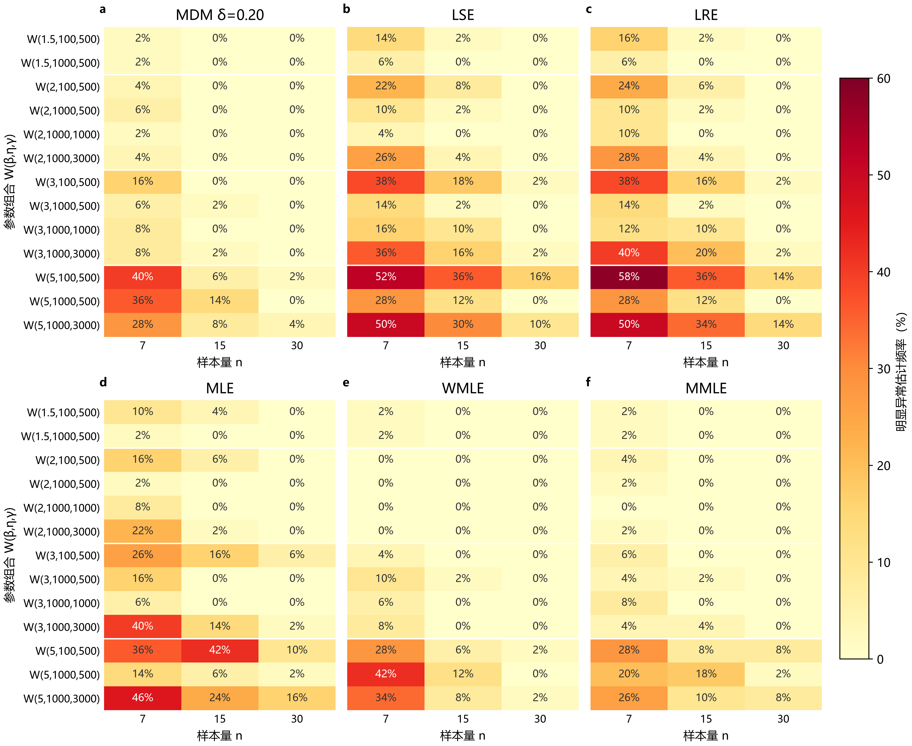
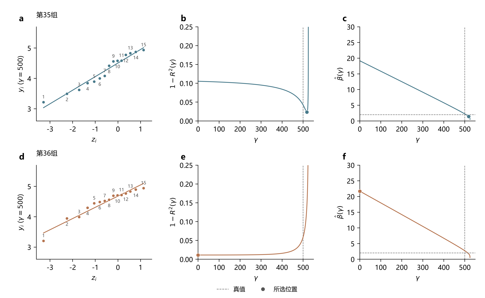

# 报告2：小样本情况下的明显异常估计

> 研究报告 · 2026-10-10

## 1　问题描述

此前计算覆盖以下参数组合、方法和样本量：

| 项目     | 设置                                                                                                |
| ------ | ------------------------------------------------------------------------------------------------- |
| 参数组合   | β=1.5、2、3、5，η=100、γ=500；β=1.5、2、3、5，η=1000、γ=500；β=2、3，η=1000、γ=1000；β=2、3、5，η=1000、γ=3000。共13个组合 |
| 估计方法   | MDM δ=0.10、0.15、0.20，LSE、LRE、MLE、WMLE、MMLE，共8种设置                                                  |
| 样本量n   | 7、15、30，每个参数组合、每档n各50组                                                                            |

估计结果中，部分参数与真值存在明显偏差。例如，W(2,100,500)、n=15的第36组样本得到以下结果，加粗数值为明显偏离的估计值。

| 方法 | 形状β | 尺度η | 位置γ |
|---|---:|---:|---:|
| 真值 | 2 | 100 | 500 |
| LSE | **21.70** | **609.36** | **0** |
| LRE | **18.80** | **522.81** | **85.73** |
| MLE | **23.54** | **608.35** | **0** |

这些结果与真参数明显不符，因此需要探究为什么会出现这样的估计。这里将**形状估计值达到真值的3倍，或不超过真值1/3的结果称为明显异常估计**：

$$
\hat\beta\ge3\beta\quad\text{或}\quad\hat\beta\le\frac{\beta}{3}.
$$

其中，β为形状真值，β̂为估计值。高估与低估合计统计。

**图1｜明显异常估计的发生频率随参数条件、样本量和方法而异。**

统计结果见图1，明显异常估计在六种方法中均有出现，且总体上在形状参数较大、样本量较小的条件下更常见。LSE、LRE出现较多，MDM、WMLE和MMLE相对较少；增大样本量能减轻这种现象，但仍不能完全消除。

## 2　为什么：位置左移后，另外两个参数会补偿

固定一组观测，向左移动γ会增大距离x−γ的平均值，却不改变样本标准差，因此距离的相对离散减小：

$$
\mathrm{CV}(x-\gamma)=\frac{\mathrm{SD}(x)}{\bar x-\gamma}.
$$

Weibull形状大对应相对波动小。对MLE固定位置的条件解，可以证明γ越左，条件形状和尺度越大；回归法也通过自己的概率图准则选择位置。本例这些大参数能维持接近的中部拟合，所以参数离真值很远，仍可能是准则偏好的结果。非负位置约束把左移截在γ=0，便形成有限下界极值。

**图2｜位置左移，条件形状与尺度增大，中部拟合仍接近。** R00第36组的原始CV为0.0528，扣除真位置后的CV为0.3331；曲线展示固定位置后重新求条件参数的变化。

此前对365条诊断样本作过逐条复核，其中351条满足各自准则的局部条件，12条MLE存在可行改善方向，2条LRE与下界候选在诊断容差内等价。**参数误差大不等于求解器停错，报告成功也不等于局部最优。** 这里的有限γ=0极值，与β<1、γ趋近样本最小值时的似然无界是两种现象。

## 3　什么范围更值得警惕？

以下下界预警针对形状高估，沿用原365条诊断记录和筛查定义；它在本次963条（含低估）中的覆盖率尚未检验。

**样本层面可以在正式求解前筛查。** 只输入观测、n、方法及版本，在位置下界0计算条件形状βc(0)与该方法的边界方向：MLE向右移动时似然下降；LSE/LRE向右移动时回归损失上升。定义

$$
S_0=\beta_c(0)\,\mathbf1\{\text{支持下界局部最优的方向成立}\},\qquad S_0\ge10\text{ 时预警}.
$$

具体导数、符号容差与可执行入口见[预警程序](跨组合诊断/20261009-形状异常退化解/附录/程序/准则关系.py)和[附录说明](跨组合诊断/20261009-形状异常退化解/附录/README.md)。它不使用真参数，识别的是高形状下界候选。

| 方法 | 命中标记 | 漏报 | 分层未标记对照报警 |
|---|---:|---:|---:|
| LSE | 105/106 | 1 | 0/1170 |
| LRE | 108/111 | 3 | 0/1170 |
| MLE | 132/148 | 16 | 0/1034 |
| 合计 | 345/365（94.52%） | 20 | 0/3374 |

20条漏报中19条不支持下界方向，1条条件形状不足10。对照来自同一存档设计，0/3374不是总体零误报保证；报警也不保证求解器最终选中该候选，不报警不能保证准确。

不同参数条件下的出现频率见图1；这里的预警检验考察能否仅凭样本识别高形状下界候选。

## 4　共性：看整组间距，也看准则是否偏好下界

原365条诊断样本中345条位置精确为0；原始观测的CV中位数约0.051—0.055，对照约0.113—0.115，呈现位置偏左、相对波动小与条件参数放大的关联。原始CV控制组合和n后的分离有限，不能单独当判据。

关键区别是：**下界处能算出高形状，未必准则真的偏好下界。** 忽略边界方向、只看条件形状≥10，会提示1,646/3,374条未标记对照；完整预警在这些对照中未见报警。最小间距也不能单独决定结果，必须使用整组样本和本方法准则。

## 5　结论

按3倍判据，六种方法均出现明显异常估计，样本量增大后整体减少。原诊断记录解释了形状高估中的位置左移与参数补偿，多数满足局部准则，少数存在可改善停点；其下界预警不能直接代表包含低估的全部963条，低估机制还需逐法检验。频率只限这13组合，正式统计仍保留原有记录和分母。

## 6　处理建议（本轮不执行）

优先增加样本量；有物理依据时限制合理位置区间，尤其避免无依据的大幅左移；同时比较不同方法的偏差、误差和失败代价；为估计结果附带可观测诊断。修改范围或方法后还需独立验证。

[详细推导与全量复核](跨组合诊断/20261009-形状异常退化解/附录/机理推导与全量复核.md)保存局部判据、例外、频率图4—7、统计敏感性与边界路径。有限扫描不是全域证明；Shao等（2004）Table 1未取得，本文不声称复现它。旧文件完整保留，正式批次哈希核验见[保护记录](跨组合诊断/20261009-形状异常退化解/附录/机理验证/保护核验.json)。
