# 报告2：小样本情况下的明显异常估计

> 研究报告 · 2026-10-10 · 方法口径与诊断更新：2026-10-11

## 1　问题描述

此前计算覆盖以下参数组合、方法和样本量：

| 项目     | 设置                                                                                                |
| ------ | ------------------------------------------------------------------------------------------------- |
| 参数组合   | β=1.5、2、3、5，η=100、γ=500；β=1.5、2、3、5，η=1000、γ=500；β=2、3，η=1000、γ=1000；β=2、3、5，η=1000、γ=3000。共13个组合 |
| 估计方法   | MDM δ=0.10、0.15、0.20，LSE、LRE、WMLE、MLE、MMLE，共8种设置                                                  |
| 样本量n   | 7、15、30，每个参数组合、每档n各50组                                                                            |

估计结果中，部分参数与真值存在明显偏差。例如，W(2,100,500)、n=15的第36组样本得到以下结果。

| 方法 | 形状β | 尺度η | 位置γ |
|---|---:|---:|---:|
| 真值 | 2 | 100 | 500 |
| LSE | **21.70** | **609.36** | **0** |
| LRE | **18.80** | **522.81** | **85.73** |
| MLE | **23.54** | **608.35** | **0** |

本报告将形状估计值达到真值的3倍，或不超过真值1/3的结果称为明显异常估计：

$$
\hat\beta\ge3\beta\quad\text{或}\quad\hat\beta\le\frac{\beta}{3}.
\tag{1}
$$

式（1）中，β为形状真值，β̂为估计值；图1按此判据统计异常频率。

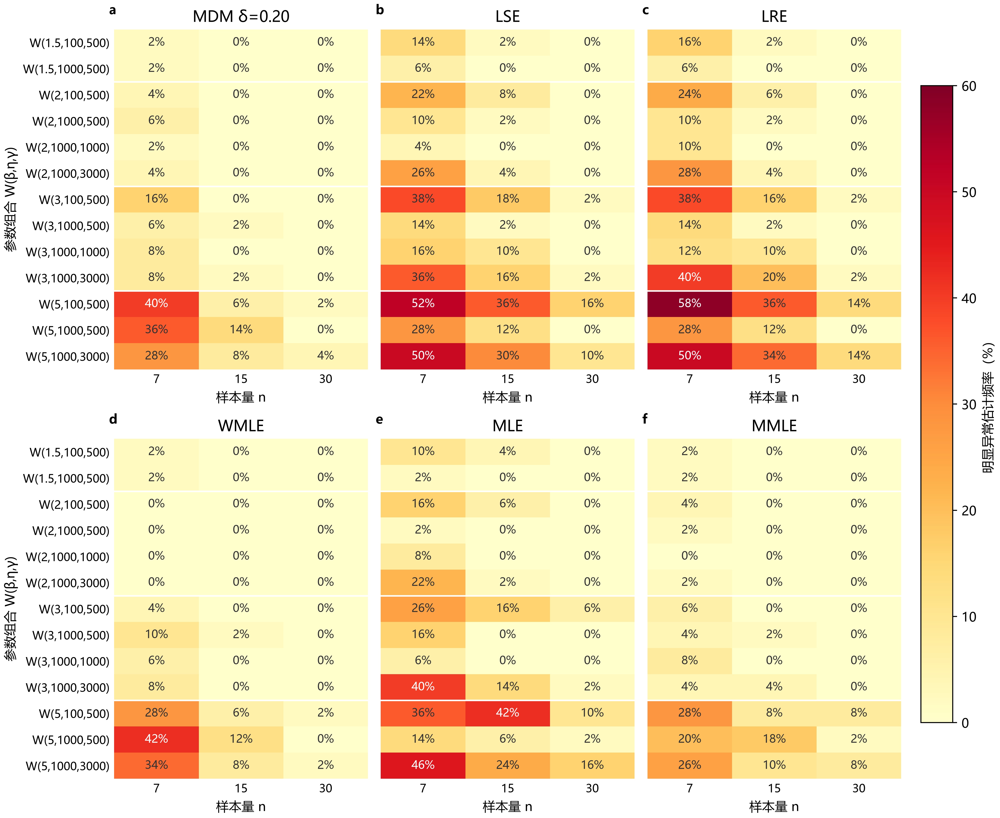

**图1｜明显异常估计的发生频率随参数条件、样本量和方法而异。**

明显异常总体在大形状、小样本下更常见，增大样本量后减轻。LSE、LRE出现较多，MDM、WMLE和MMLE相对较少。

本报告对照正常与异常样本，沿各方法的估计流程分析偏差形成的环节，以解释明显异常估计怎样产生，以及某些参数条件和方法为何更容易出现。

## 2　明显异常估计的形成机制

2.1节逐个方法分析正常与异常样本的估计过程，定位偏差形成的环节；2.2节解释哪些条件更容易触发这些过程；2.3节比较不同方法对同类样本特征的响应。

### 2.1　各方法的异常形成机制

组图上排为正常样本，下排为异常样本，星号标记原估计。γ₀、η₀为位置、尺度真值，部分坐标以γ/γ₀、(x₍ᵢ₎−γ̂)/η₀表示位置和样本距离。热力图空白格表示0次。

#### 2.1.1　[MDM](../../src/content/algorithms/mdm.md)

MDM让同一组样本反算的尺度尽量一致：在每个候选γ下找标准差最小的形状，再用这一最小标准差的梯度确定位置，最后取伪尺度均值作为尺度估计。

排序观测的累计概率先由秩估计得到：

$$
\hat F(t_{(i)})=
\frac{i}{i+(n+1-i)F_{2(n+1-i),\,2i,\,0.5}},
\qquad i=1,2,\ldots,n.
\tag{2}
$$

t₍ᵢ₎为第i个排序观测，F̂(t₍ᵢ₎)为累计概率估计，$F_{2(n+1-i),\,2i,\,0.5}$为相应自由度的F分布中位数。式（2）使用精确中位秩，本批程序及过程图采用Bernard近似$\hat F(t_{(i)})\approx(i-0.3)/(n+0.4)$。

给定γ和β，将式（2）的累计概率代入尺度反算关系，每个观测的尺度伪估计量为：

$$
\hat\eta_i=
\frac{t_{(i)}-\gamma}{[-\ln(1-\hat F(t_{(i)}))]^{1/\beta}},
\qquad i=1,2,\ldots,n.
\tag{3}
$$

式（3）的η̂ᵢ为第i个观测反算的伪尺度，ση(γ,β)为这n个伪尺度的标准差。原文从最小观测逐步递减候选位置γⱼ，对每个位置尝试候选形状βₖ；j、k为候选编号。将这个过程写成关于γ的条件最小化：

$$
\sigma_{\eta,\min}(\gamma)=\min_\beta\sigma_\eta(\gamma,\beta),
\qquad
\hat\beta(\gamma)=\underset{\beta}{\arg\min}\,\sigma_\eta(\gamma,\beta).
\tag{4}
$$

式（4）的最小化在候选形状范围内进行，ση,min(γ)为该位置的最小标准差，β̂(γ)为达到最低点的形状。比较式（4）在相邻位置的最小标准差，得到差分梯度：

$$
\nabla\gamma=
\frac{\sigma_{\eta,\min}(\gamma+\Delta\gamma)
-\sigma_{\eta,\min}(\gamma)}{\Delta\gamma}.
\tag{5}
$$

∇γ为条件最小标准差对γ的梯度，Δγ为位置增量。MDM用正偏移值δ代替零梯度判据，本节取δ=0.20；式（5）的梯度达到δ时确定γ̂，再按式（4）取该位置下标准差最低点的形状为β̂。

确定γ̂和β̂后，尺度取伪尺度的平均值：

$$
\hat\eta=
\sum_{i=1}^{n}\left\{
\frac{t_{(i)}-\hat\gamma}{[-\ln(1-F(t_{(i)}))]^{1/\hat\beta}}
\right\}/n.
\tag{6}
$$

式（6）中F(t₍ᵢ₎)采用式（2）后的Bernard近似。对每个γ按式（4）求条件形状β̂(γ)，再按式（6）取伪尺度均值，得到条件尺度曲线：

$$
\hat\eta(\gamma)=\frac1n\sum_{i=1}^{n}
\frac{t_{(i)}-\gamma}{[-\ln(1-\hat F(t_{(i)}))]^{1/\hat\beta(\gamma)}}.
\tag{7}
$$

图3、4分别按式（5）、（4）、（7）展示梯度定位、所选位置下的形状选择和条件尺度。本批明显异常分为阈值交点低估和程序回退高估。

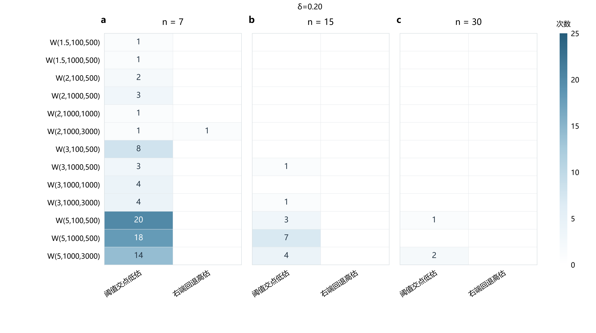

**图2｜MDM（δ=0.20）各类明显异常估计的发生次数。**

**（1）阈值交点的低估。**

W(2,1000,3000)、n=7的正常与异常样本如下：

| 样本 | 形状β̂ | 尺度η̂ | 位置γ̂ | 观测值（升序） |
| --- | ---: | ---: | ---: | --- |
| 正常·第47组 | 2.09 | 1024.48 | 3088.73 | 3383.42，3628.37，3855.72，4074.24，4208.83，4276.07，4388.99 |
| 异常·第35组 | 0.55 | 260.62 | 3211.67 | 3215.58，3239.54，3271.70，3274.68，3591.22，3601.65，4698.54 |

图3对照式（5）的阈值交点及式（4）、（7）对应的形状和尺度。

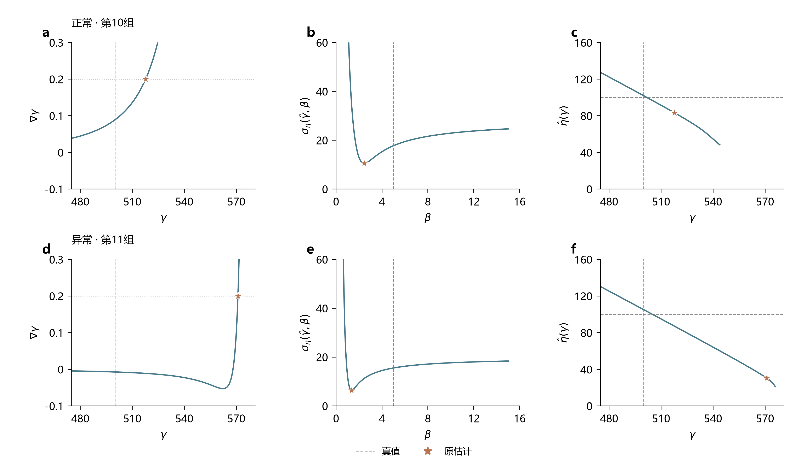

**图3｜第35组的阈值交点接近最小观测，随后得到较小形状和尺度。**

第47组在γ=3088.73处达到δ=0.20，交点距最小观测294.69，形状和尺度接近真值。第35组有四个观测集中在样本下端，最大观测明显较远；其梯度在真位置处为−0.225，直到γ=3211.67、距最小观测3.91时才达到δ。

在这一位置，首个与最大观测距γ分别为3.91和1486.87。减小β会拉开理论分位距离，使这些观测反算的伪尺度更接近。式（4）的标准差最低点因此对应β=0.55，式（7）的伪尺度均值为260.62。与真位置处的条件估计β=1.68、η=606.71相比，靠右的阈值交点进一步压低形状和尺度，形成明显异常估计。

**（2）程序回退造成的高估。**

W(2,1000,3000)、n=7的正常与异常样本如下：

| 样本 | 形状β̂ | 尺度η̂ | 位置γ̂ | 观测值（升序） |
| --- | ---: | ---: | ---: | --- |
| 正常·第47组 | 2.09 | 1024.48 | 3088.73 | 3383.42，3628.37，3855.72，4074.24，4208.83，4276.07，4388.99 |
| 异常·第5组 | 6.43 | 568.02 | 3301.70 | 3301.70，3818.64，3840.65，3938.63，3979.78，4031.52，4091.30 |

图4对照式（5）的内部交点与右端回退位置，以及式（4）、（7）对应的形状和尺度。

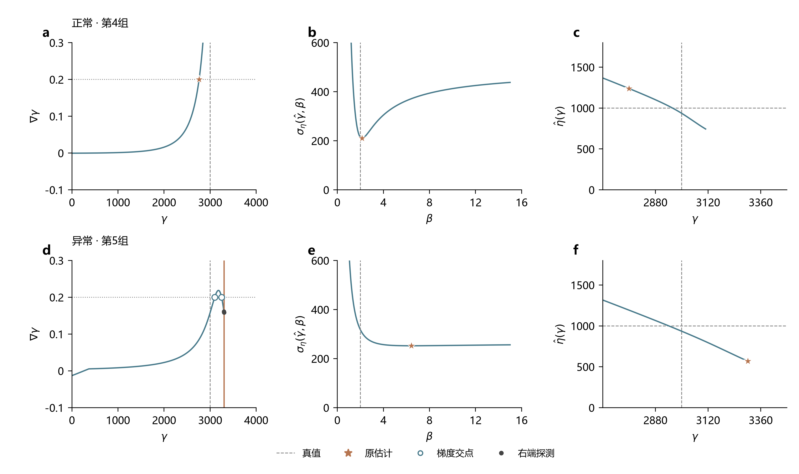

**图4｜第5组已检出交点，但程序未采用，右端回退后得到形状高估。**

第47组按内部交点返回估计。第5组的高估起于程序的交点处理问题：曲线在γ≈3098.95、3248.08两处达到δ=0.20，离散扫描已检出交点，但最终选参分支未采用这一结果。该分支只根据γ=0与最小观测附近的梯度构造求根区间；24个右端探测点从γ≈3298.40开始，已越过两个交点，梯度均低于δ，程序于是回退到γ≈3301.70。

第5组的最小观测较孤立，其余观测集中。回退位置使首个伪尺度接近零，标准差由其余伪尺度的水平和离散程度共同决定。在该位置，增大形状使其余伪尺度更集中、标准差下降，式（4）的最低点对应β=6.43，按式（6）取伪尺度均值得568.02。

#### 2.1.2　[LSE](../../src/content/algorithms/lse.md)

LSE对每个候选位置γ拟合一条直线，选择拟合程度最好的位置，再由斜率和截距恢复形状与尺度。其依据是Weibull变量的对数距离关系：

$$
\ln(X-\gamma)=\ln\eta+\frac{Z}{\beta}.
\tag{8}
$$

X为Weibull随机变量，Z=βln[(X−γ)/η]为标准对数Weibull变量。对式（8）中的n个变量排序后取期望，得到：

$$
\operatorname{E}[\ln(X_{(i)}-\gamma)]
=\ln\eta+\frac{z_i}{\beta}.
\tag{9}
$$

n为样本量，X₍ᵢ₎为第i小的随机观测，zᵢ=E[Z₍ᵢ₎]为标准变量的顺序统计量期望。

对实际观测x₍ᵢ₎，记对数距离yᵢ=ln(x₍ᵢ₎−γ)。根据式（9），以zᵢ为横坐标、yᵢ为纵坐标拟合直线yᵢ≈a+bzᵢ，截距a对应lnη，斜率b对应1/β，因此：

$$
\hat\beta(\gamma)=\frac1b,
\qquad
\hat\eta(\gamma)=e^a.
\tag{10}
$$

LSE用F比评价直线拟合程度，并选择F比最大的γ。F比与回归决定系数R²的关系为：

$$
F(\gamma)=\frac{n-2}{(n-1)[1-R^2(\gamma)]}.
\tag{11}
$$

固定n后，式（11）的F比最大化等价于最小化1−R²，位置判据便写成：

$$
\hat\gamma=\underset{0\le\gamma<x_{(1)}}{\arg\min}\,[1-R^2(\gamma)].
\tag{12}
$$

x₍₁₎为样本最小值。图中的1−R²曲线按式（12）确定位置，形状曲线按式（10）取对应斜率的倒数。LSE的明显异常分为左侧定位高估和右侧定位低估。

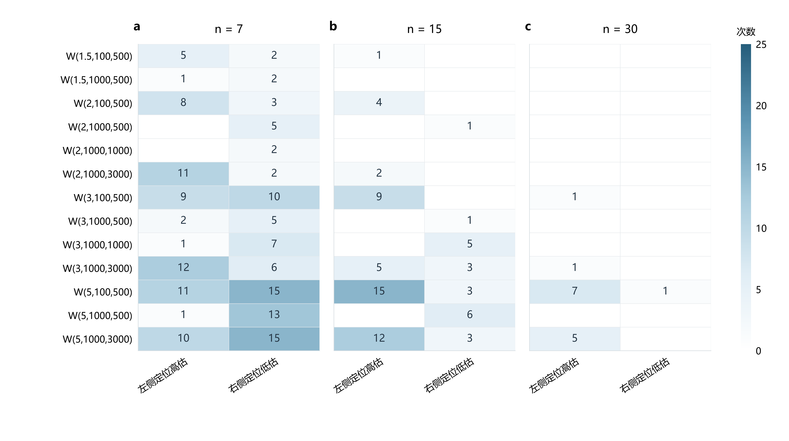

**图5｜LSE各类明显异常估计的发生次数。**

**（1）左侧定位导致的形状高估。**

正常样本与两种左侧高估样本如下：

| 样本 | 参数组合 | n | 形状β̂ | 尺度η̂ | 位置γ̂ | 观测值（升序） |
| --- | --- | ---: | ---: | ---: | ---: | --- |
| 正常·第35组 | W(2,100,500) | 15 | 1.42 | 70.42 | 518.20 | 524.99，532.96，537.51，546.83，549.15，554.55，559.29，582.77，595.63，597.60，598.04，618.58，625.47，631.01，639.05 |
| 零边界高估·第36组 | W(2,100,500) | 15 | 21.70 | 609.36 | 0.00 | 524.67，551.74，554.21，573.41，585.02，588.71，591.87，595.61，609.05，610.30，611.69，617.54，625.80，633.61，640.02 |
| 内部左侧高估·第1组 | W(2,1000,3000) | 7 | 8.42 | 2717.62 | 1273.68 | 3250.30，3676.83，3723.74，3827.75，3860.06，4191.49，4293.82 |

图6将两条异常曲线放在一起，对照式（12）的位置判据及式（10）的斜率与形状关系。

**图6｜两个异常样本均在左侧取得较好的线性匹配，同时得到较小斜率与形状高估。**

第35组的最低点位于真位置附近，斜率对应正常形状。两个异常样本在真位置下的下端间距与参考点匹配较差，左移γ压缩下端间距，使点列更接近直线。第36组的最低点落在γ=0；第1组继续左移后准则回升，最低点留在内部γ=1273.68。

改善拟合同时也压缩了整体对数跨度。第36组的跨度由1.74缩至0.20，斜率降至0.046，β升至21.70；第1组的斜率降至0.119，β升至8.42。两者都按式（10）取较小斜率的倒数形成高估，区别在于最佳位置是否落在零边界。

**（2）右侧定位导致的形状低估。**

W(2,1000,500)、n=7的正常与异常样本如下：

| 样本 | 形状β̂ | 尺度η̂ | 位置γ̂ | 观测值（升序） |
| --- | ---: | ---: | ---: | --- |
| 正常·第18组 | 0.91 | 542.97 | 603.11 | 634.38，750.70，764.00，978.92，1044.85，1698.88，1814.71 |
| 异常·第19组 | 0.58 | 399.58 | 774.35 | 779.38，799.04，885.47，1061.58，1197.68，1302.69，2480.21 |

图7对照式（12）的右侧最低点、下端对数间距及式（10）对应的拟合斜率。

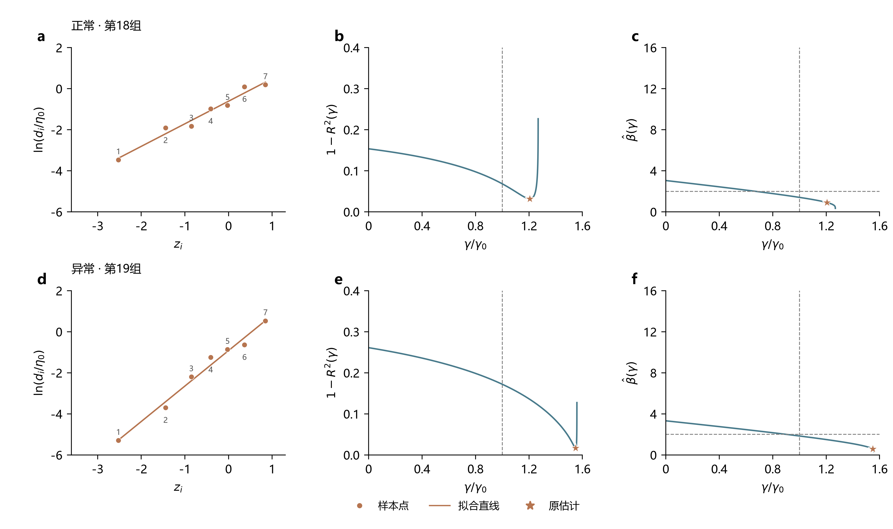

**图7｜第19组更靠近最小观测的最低点，对应更大的回归斜率和形状低估。**

第19组的最大观测远离其余点列，真位置下点列弯曲。右移γ使最小距离缩小得更快，拉开下端对数间距，改善线性匹配，最低点位于内部右侧。

第19组的所选位置距最小观测仅5.04，明显小于第18组的31.27。下端点被拉得更低，拟合斜率增至1.727，按式（10）取倒数后β降至0.58。两组都选择右侧位置，第19组更强的间距拉伸使形状越过低估界限。

LSE中，位置左移可通过压缩对数跨度、减小斜率造成β高估；位置右移可通过拉开对数跨度、增大斜率造成β低估。

#### 2.1.3　[LRE](../../src/content/algorithms/lre.md)

LRE先将样本转换为Weibull概率图坐标，选择线性相关性最高的位置，再用回归斜率和截距估计形状与尺度。由分布函数的线性化关系：

$$
\ln[-\ln(1-F(x))]
=\beta\ln(x-\gamma)-\beta\ln\eta,
\tag{13}
$$

将式（13）中第i个排序观测的累计概率F(x₍ᵢ₎)用绘图位置pᵢ代替，得到：

$$
z_i=\ln[-\ln(1-p_i)]
\approx\beta y_i-\beta\ln\eta,
\qquad y_i=\ln(x_{(i)}-\gamma).
\tag{14}
$$

F(x)为Weibull分布函数，pᵢ为按次序i和样本量n分配的累计概率，zᵢ为相应的概率图参考坐标。LSE的参考点来自顺序统计量期望，LRE的参考点来自绘图概率的分位变换。

根据式（14），LRE以yᵢ为横坐标、zᵢ为纵坐标拟合直线zᵢ≈a+byᵢ。这里斜率b直接对应β，截距a对应−βlnη，因此：

$$
\hat\beta(\gamma)=b,
\qquad
\hat\eta(\gamma)=e^{-a/b}.
\tag{15}
$$

LRE选择线性相关系数ρ最大的γ：

$$
\hat\gamma
=\underset{0\le\gamma<x_{(1)}}{\arg\max}\,\rho(\gamma).
\tag{16}
$$

ρ(γ)为给定γ时yᵢ与zᵢ的相关系数。图中的ρ曲线按式（16）确定位置，形状曲线按式（15）取对应的拟合斜率。明显异常分为左侧定位高估和右侧定位低估。

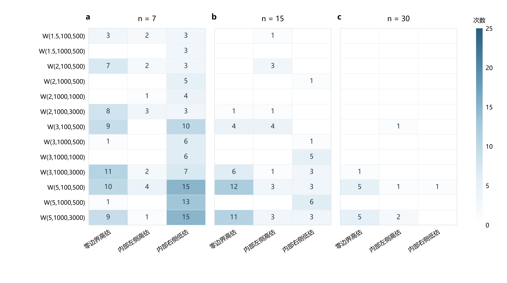

**图8｜LRE各类明显异常估计的发生次数。**

**（1）左侧定位导致的形状高估。**

正常样本与两种左侧高估样本如下：

| 样本 | 参数组合 | n | 形状β̂ | 尺度η̂ | 位置γ̂ | 观测值（升序） |
| --- | --- | ---: | ---: | ---: | ---: | --- |
| 正常·第4组 | W(2,1000,3000) | 7 | 3.01 | 1743.63 | 2296.80 | 3109.09，3388.63，3881.19，3927.27，3941.84，3990.51，4649.68 |
| 零边界高估·第5组 | W(2,1000,3000) | 7 | 13.78 | 3993.75 | 0.00 | 3301.70，3818.64，3840.65，3938.63，3979.78，4031.52，4091.30 |
| 内部左侧高估·第36组 | W(2,100,500) | 15 | 18.80 | 522.81 | 85.73 | 524.67，551.74，554.21，573.41，585.02，588.71，591.87，595.61，609.05，610.30，611.69，617.54，625.80，633.61，640.02 |

图9对照式（16）的相关性最高点及式（15）对应的拟合斜率与形状。

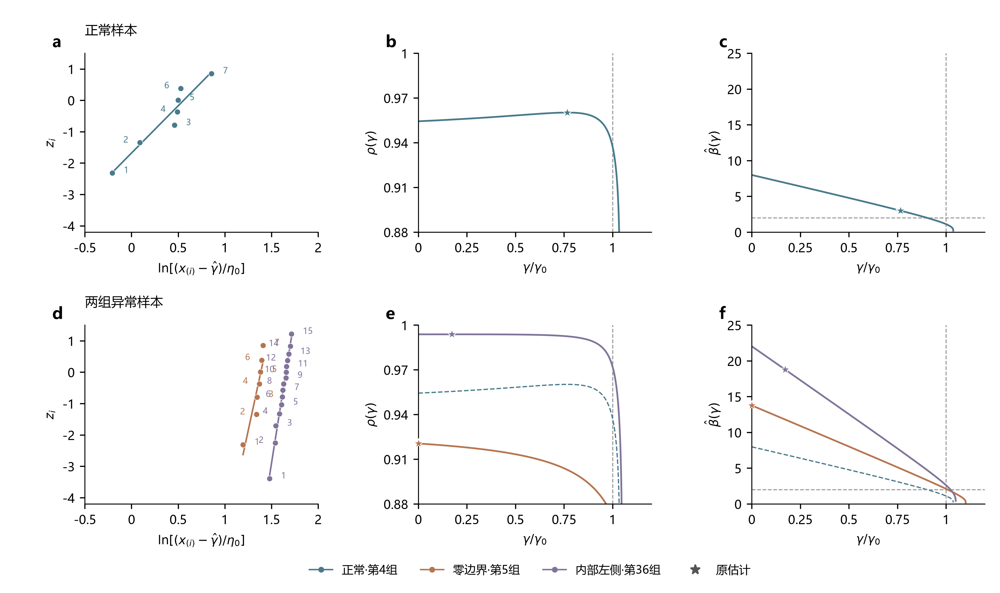

**图9｜两个异常样本均通过左移提高概率图相关性，压缩的横向跨度使斜率和形状增大。**

第4组的相关性最高点位于内部，所选点列保留较大的横向跨度。第5组的最小观测较孤立，后续观测集中；第36组的下端间距较大。左移γ压缩下端对数间距，改善与概率图参考点的匹配，第5组在γ=0达到最高相关性，第36组在内部γ=85.73达到最高相关性。

LRE的纵向参考坐标固定。第5组左移后的对数跨度缩至0.21，第36组由1.74缩至0.23；横向跨度变窄使拟合线变陡，斜率分别达到13.78、18.80，按式（15）直接得到形状高估。

**（2）右侧定位导致的形状低估。**

W(2,1000,500)、n=7的正常与异常样本如下：

| 样本 | 形状β̂ | 尺度η̂ | 位置γ̂ | 观测值（升序） |
| --- | ---: | ---: | ---: | --- |
| 正常·第18组 | 0.86 | 538.49 | 598.12 | 634.38，750.70，764.00，978.92，1044.85，1698.88，1814.71 |
| 异常·第19组 | 0.56 | 384.30 | 773.02 | 779.38，799.04，885.47，1061.58，1197.68，1302.69，2480.21 |

图10对照式（16）选择的右侧位置、概率图横向跨度及式（15）的斜率与形状关系。

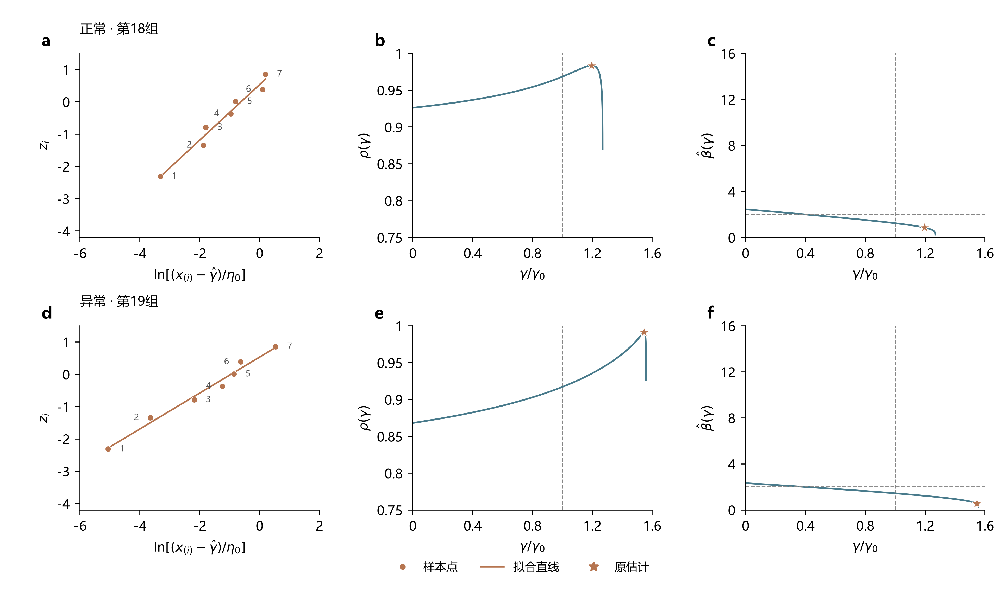

**图10｜第19组的右侧相关性最高点，对应更平的拟合线和形状低估。**

第19组的上端观测远离其余点列，真位置下点列弯曲。右移γ拉开下端对数间距，相关性在内部右侧达到最高点。

第19组的所选位置距最小观测6.36，第18组则为36.26。前者的下端对数点被拉得更远，横向跨度更大，拟合线更平；按式（15）直接取斜率后得到β=0.56。两组的相关性准则都选择右侧位置，更靠近最小值的第19组因此形成明显低估。

LRE中，位置左移压缩概率图的横向跨度，增大斜率并造成β高估；位置右移拉开横向跨度，减小斜率并造成β低估。

#### 2.1.4　[WMLE](../../src/content/algorithms/wmle.md)

WMLE先根据样本量取得校准权重，将形状与位置的两条加权方程写成残差：

$$
T_1(\beta,\gamma)=\frac{J_2(n)}{\beta}+\frac1n\sum_i\ln (x_{(i)}-\gamma)
-\frac{\sum_i (x_{(i)}-\gamma)^\beta\ln (x_{(i)}-\gamma)}{\sum_i (x_{(i)}-\gamma)^\beta}.
\tag{17}
$$
$$
T_2(\beta,\gamma)=\left(\frac1n\sum_i\frac1{(x_{(i)}-\gamma)}\right)
\frac{\sum_i (x_{(i)}-\gamma)^\beta}{\sum_i (x_{(i)}-\gamma)^{\beta-1}}-J_3(n,\beta).
\tag{18}
$$

J₂、J₃分别为形状与位置的校准权重，J₃随候选β更新。

T₁、T₂为形状与位置方程的残差。两式共享β和γ，需要联立求解；程序共同调整β、γ，最小化残差平方和：

$$
(\hat\beta,\hat\gamma)=\underset{\beta,\gamma}{\arg\min}
\left[T_1(\beta,\gamma)^2+T_2(\beta,\gamma)^2\right].
\tag{19}
$$

图12、13的a、d为原程序选中起点的实际迭代，展示式（17）、（18）的两个残差怎样趋近零；b、e为T₁=0与T₂=0的参数组合，共同交点同时确定β̂、γ̂。程序按式（19）求解，以残差平方和≤1e−8接受返回值。

得到β̂、γ̂后，将它们代入尺度公式：

$$
\frac1n\sum_i\left(\frac{x_{(i)}-\hat\gamma}{\eta}\right)^{\hat\beta}=J_1(n)
\quad\Longrightarrow\quad
\hat\eta=\left[\frac{\sum_i(x_{(i)}-\hat\gamma)^{\hat\beta}}{nJ_1(n)}\right]^{1/\hat\beta}.
\tag{20}
$$

J₁为尺度校准权重。图12、13的c、f固定已求得的β̂、γ̂，以η为横坐标画式（20）左侧。曲线与J₁水平线的交点对应η̂，白菱形标出尺度真值。

本批J₃权重表覆盖β=0.1—5，β>5采用端点工程近似。明显异常分为右侧交点低估和左侧交点高估。

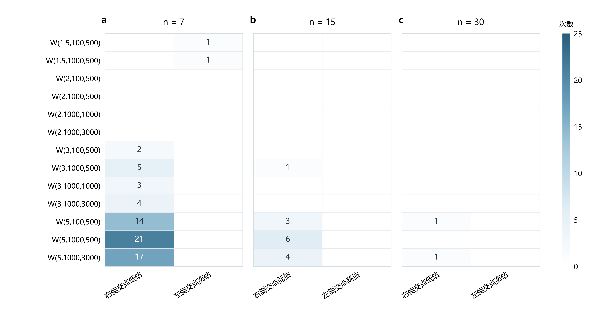

**图11｜WMLE各类明显异常估计的发生次数。**

**（1）右侧交点的低估。**

W(5,100,500)、n=7的正常与异常样本如下：

| 样本 | 形状β̂ | 尺度η̂ | 位置γ̂ | 观测值（升序） |
| --- | ---: | ---: | ---: | --- |
| 正常·第3组 | 5.35 | 86.69 | 508.70 | 548.67，582.32，591.79，594.50，597.08，600.67，607.52 |
| 异常·第11组 | 1.10 | 26.30 | 573.51 | 575.95，585.29，585.82，586.04，606.41，616.31，629.89 |

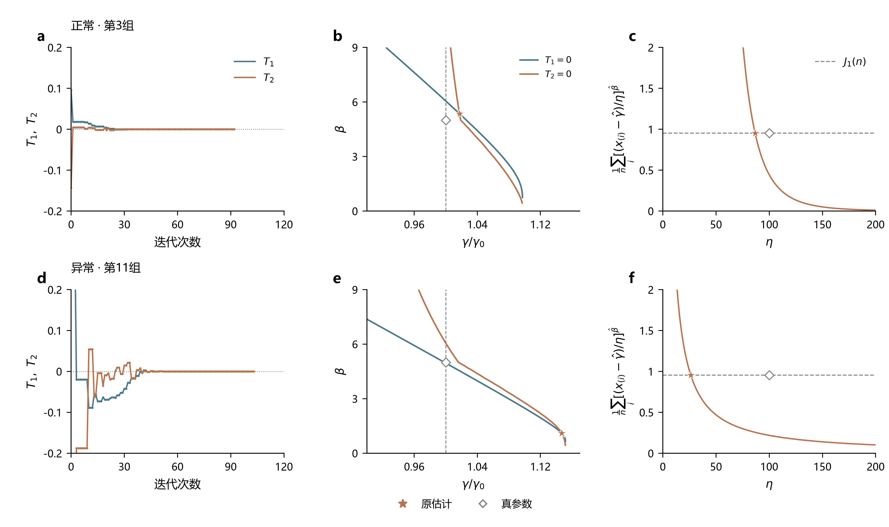

**图12｜第11组的共同交点靠近最小观测，同时给出较小的形状与尺度。**

第3组的最小观测与第二小观测相隔33.64；第11组前四个观测集中在575.95—586.04。不同的间距结构改变式（17）、（18）的平衡位置。图12a、d中，两组的T₁、T₂均随迭代趋近零。

第3组两条方程的共同交点为γ=508.70、β=5.35，接近真参数。第11组的共同交点则为γ=573.51、β=1.10，位置距最小观测仅2.44。这个组合扩大了对数距离的跨度，式（17）的加权均值与普通均值之差随之改变，两式在较小形状处同时满足。

将β=1.10、γ=573.51代入式（20），图12f的尺度方程在η=26.30处与J₁相交；第3组的交点为η=86.69。第11组已将两条加权方程解到接近零，但联合解偏离真参数，并通过尺度公式形成η的低估。

**（2）左侧交点的高估。**

W(1.5,100,500)、n=7的正常与异常样本如下：

| 样本 | 形状β̂ | 尺度η̂ | 位置γ̂ | 观测值（升序） |
| --- | ---: | ---: | ---: | --- |
| 正常·第1组 | 1.60 | 100.92 | 503.91 | 522.01，544.93，575.77，589.69，607.03，638.15，678.65 |
| 异常·第9组 | 5.31 | 163.08 | 475.49 | 551.95，606.91，635.06，639.45，642.43，648.24，659.99 |

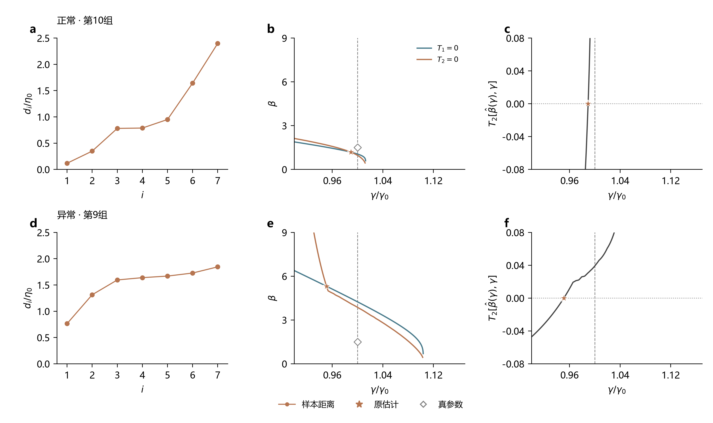

**图13｜第9组较集中的样本，使共同交点对应较大的形状与尺度。**

第9组的最小观测为551.95，其余六个观测集中在606.91—659.99；第1组分布在522.01—678.65，跨度更大。图13a、d中，两组残差均趋近零；b、e的共同交点分别为γ=503.91、β=1.60和γ=475.49、β=5.31，后者的形状明显偏大。

第9组的位置向左偏移，使观测距离整体增大、对数距离的跨度缩小。式（17）的加权均值与普通均值之差减小，与较大的β相匹配；式（18）也在这个参数组合下满足。高估由两条方程共同支持的偏大形状形成。

固定第9组的β=5.31、γ=475.49后，图13f的尺度方程在η=163.08处与J₁相交；第1组为η=100.92。偏大的形状和向左的位置通过式（20）共同确定偏大的尺度。

将全量WMLE明显异常记录的返回参数代入式（17）、（18），残差平方和均不超过1e−8。满足加权方程仍可能得到明显偏离真值的参数；不同样本改变距离统计量，使共同交点落在不同的形状与位置组合上。

#### 2.1.5　[MLE](../../src/content/algorithms/mle.md)

MLE寻找使样本似然最大的形状、尺度和位置组合。程序从多组起点联合搜索三参数，再比较收敛且β≥1的候选。对数似然为：

$$
\ell(\beta,\eta,\gamma)
=n\ln\beta-n\beta\ln\eta+(\beta-1)\sum_i\ln (x_{(i)}-\gamma)
-\sum_i((x_{(i)}-\gamma)/\eta)^\beta.
\tag{21}
$$

ℓ为对数似然。本批接受域为β≥1、η>0、0≤γ<x₍₁₎。

为观察位置的影响，对每个γ重新求对应的最优形状和尺度。先对式（21）的尺度求导，令其为零：

$$
\frac{\partial\ell}{\partial\eta}
=-\frac{n\beta}{\eta}
+\frac{\beta}{\eta^{\beta+1}}\sum_i (x_{(i)}-\gamma)^\beta=0
\quad\Longrightarrow\quad
\hat\eta(\beta,\gamma)
=\left[\frac1n\sum_i (x_{(i)}-\gamma)^\beta\right]^{1/\beta}.
\tag{22}
$$

将式（22）的尺度代回式（21），对β求导并除以n，得到条件形状得分：

$$
U_\beta(\beta;\gamma)=\frac1\beta+\bar y
-\frac{\sum_i (x_{(i)}-\gamma)^\beta y_i}{\sum_i (x_{(i)}-\gamma)^\beta}=0.
\tag{23}
$$

yᵢ=ln(x₍ᵢ₎−γ)，ȳ为这些对数距离的均值，Uβ为除以n后的形状得分。记式（23）的未约束根为β₀(γ)，在β≥1的接受域内取β̂(γ)=max{1,β₀(γ)}，再按式（22）计算对应尺度，代入式（21）得到条件最优对数似然：

$$
\ell_p(\gamma)
=\ell[\hat\beta(\gamma),\hat\eta(\gamma),\gamma].
\tag{24}
$$

式（24）的ℓₚ(γ)表示该位置下能达到的最高对数似然。β₀<1时，条件解为β=1、η=平均距离。图15—17绘制ℓₚ(γ)−ℓₚ(γ₀)，减去真位置处的常数保持似然高低和峰的位置，可据此检查原返回点是否仍有更好的候选。

原结果分为左侧较高似然高估、右侧较高似然低估和近零停点高估。前两类的候选比真位置条件拟合具有更高似然，其中部分返回值仍可改善。

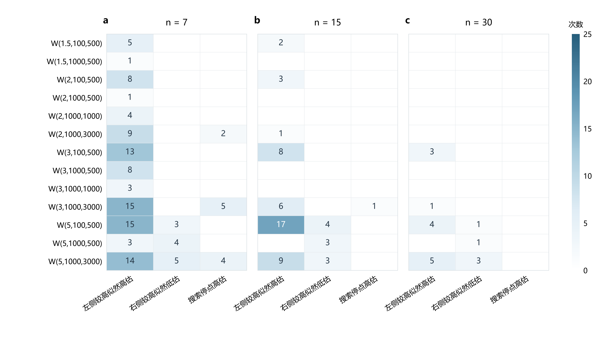

**图14｜MLE各类明显异常估计的发生次数。**

**（1）较高似然的左侧高估。**

W(2,100,500)、n=15的正常与异常样本如下：

| 样本 | 形状β̂ | 尺度η̂ | 位置γ̂ | 观测值（升序） |
| --- | ---: | ---: | ---: | --- |
| 正常·第35组 | 1.49 | 64.27 | 521.17 | 524.99，532.96，537.51，546.83，549.15，554.55，559.29，582.77，595.63，597.60，598.04，618.58，625.47，631.01，639.05 |
| 异常·第36组 | 23.54 | 608.35 | 0.00 | 524.67，551.74，554.21，573.41，585.02，588.71，591.87，595.61，609.05，610.30，611.69，617.54，625.80，633.61，640.02 |

图15对照式（24）的条件似然及式（23）对应的形状。

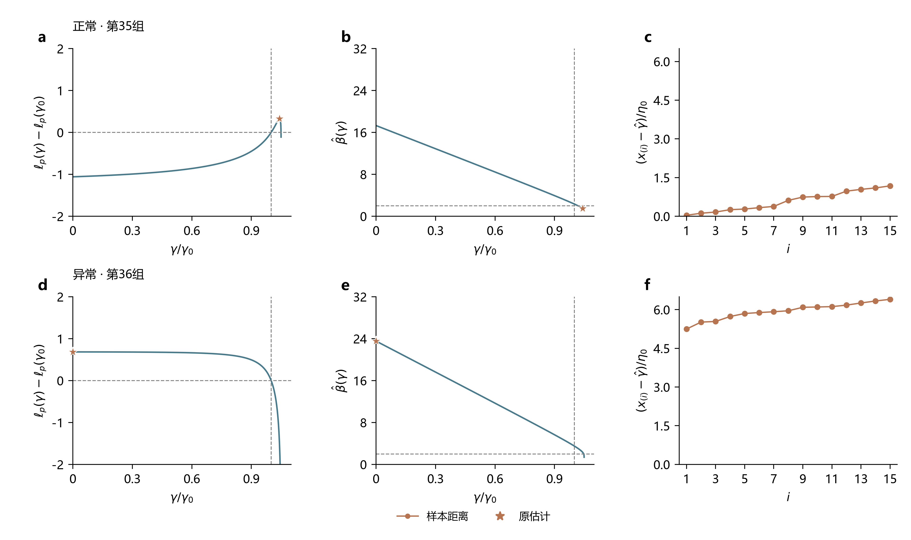

**图15｜第36组的零位置候选具有较高似然，并对应形状高估。**

第35组的原估计位于内部似然峰附近。第36组左移至零位置后，条件对数似然比真位置提高约0.68；零位置处向右小幅移动会降低似然，支持该边界候选的局部最优关系。

同一左移压缩对数距离，使形状得分中加权均值与普通均值的差减小。式（23）要求这个差等于1/β，因此条件形状由真位置处的3.50升至23.54。

**（2）较高似然的右侧低估。**

W(5,1000,500)、n=7的正常与异常样本如下：

| 样本 | 形状β̂ | 尺度η̂ | 位置γ̂ | 观测值（升序） |
| --- | ---: | ---: | ---: | --- |
| 正常·第3组 | 10.14 | 1462.26 | 0.00 | 1106.94，1120.24，1442.18，1459.87，1480.23，1480.87，1615.80 |
| 异常·第4组 | 1.44 | 370.63 | 1092.59 | 1121.42，1212.48，1385.65，1453.77，1469.10，1513.70，1865.14 |

图16按式（24）比较左侧与右侧候选，同时保留β=1时的条件最优分支。

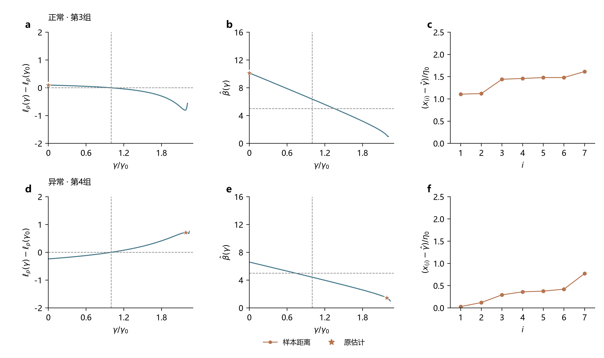

**图16｜第4组右侧较高似然候选对应形状低估，β=1分支仍有更高似然。**

第3组的原返回值位于左侧，形状为10.14；第4组则在右侧候选处得到小形状。第4组的最小观测远离真位置，下端留下空缺，最大观测又高于其余点列。右移γ后，候选比真位置条件拟合具有更高似然。

右移使最小距离明显缩小，对数跨度扩大，式（23）的均值之差增大，条件形状降至1.44。原返回点右侧的β=1分支还有更高似然，表明该结果同时包含求解不足；沿该分支改善似然后，形状仍低于5/3。

**（3）数值求解造成的近零停点高估。**

W(2,1000,3000)、n=7的正常与异常样本如下：

| 样本 | 形状β̂ | 尺度η̂ | 位置γ̂ | 观测值（升序） |
| --- | ---: | ---: | ---: | --- |
| 正常·第38组 | 1.52 | 705.64 | 3283.98 | 3347.71，3616.97，3808.44，3846.60，3937.32，4165.27，4740.66 |
| 异常·第37组 | 13.10 | 3786.32 | 0.0001 | 3204.36，3330.72，3381.19，3675.75，3829.79，3956.29，4102.16 |

图17用式（24）的条件似然检查原返回点，以及向右调整后是否仍有更高似然。

**图17｜第37组的近零返回点仍有提高似然的方向。**

第38组的原估计落在内部似然峰附近；第37组的星号却停在近零位置，曲线向右仍能升高。第37组用原样本和冻结程序复算，返回值一致，五起点的结果为：

| 起点γ | 搜索结束γ | 搜索结束β | 当前接受结果 |
|---:|---:|---:|---|
| 0 | 0.000104 | 13.1027 | 优化器标记收敛，保留 |
| 801.09 | 接近3204.36 | 0.4675 | β<1，剔除 |
| 1602.18 | 接近3204.36 | 0.8111 | β<1，剔除 |
| 2403.27 | 接近3204.36 | 0.8278 | β<1，剔除 |
| 2883.93 | 接近3204.36 | 0.9769 | β<1，剔除 |

程序从五个起点分别搜索，再从β≥1的合格返回结果中选取似然最高者。第37组从γ=0出发的搜索停在γ≈0.0001，另四个结果因β<1被剔除，最后只剩这个近零候选。

γ=0起点在位置方向的初始搜索间隔仅0.00025。搜索点在近零位置聚拢，彼此的参数距离和似然差达到停止标准，优化器便报告收敛，程序随后返回了这一候选。

但该点的对数似然为−50.3247；固定γ=3000、重新估计β和η，可得β≈2.17、η≈725.20，对数似然升至−49.9405。因此，这里的问题是数值搜索过早停止，而程序直接接受了这个候选。

近零位置又将该样本的对数跨度由1.69压至0.25，式（23）因而对应β≈13.10。

全量候选比较在197条MLE异常中检出25条更优合格候选，主要发生于n=7；第37组的五起点复算定位了其中一种停止与接受问题。具体候选见[逐条诊断](交付/结果/报告2/数据/全量流程定位.csv)。

#### 2.1.6　[MMLE](../../src/content/algorithms/mmle.md)

MMLE用样本最小值估计位置，删除该观测后，对其余n−1个距离作二参数Weibull极大似然估计：

$$
\hat\gamma=x_{(1)}.
\tag{25}
$$

在式（21）中删去最小观测，固定式（25）的位置，并代入式（27）的尺度，得到以β为变量的对数似然：

$$
\begin{aligned}
\ell(\beta;\hat\gamma)
={}&(n-1)\ln\beta
-(n-1)\ln\!\left[\frac1{n-1}\sum_{i=2}^n(x_{(i)}-\hat\gamma)^\beta\right]\\
&+(\beta-1)\sum_{i=2}^n\ln(x_{(i)}-\hat\gamma)-(n-1).
\end{aligned}
\tag{26}
$$

式（26）的ℓ为保留观测的对数似然，其最高点对应β̂。程序从β=1作固定点迭代，求对数似然导数为零的点，再计算尺度：

$$
\hat\eta=\left[\frac1{n-1}\sum_{i=2}^n (x_{(i)}-\hat\gamma)^{\hat\beta}\right]^{1/\hat\beta}.
\tag{27}
$$

图19、20左列按式（25）确定γ̂，中列绘制式（26）的对数似然，峰顶对应β̂；右列将式（27）的β̂换为β，绘制尺度计算曲线η(β)，标出最终η̂。

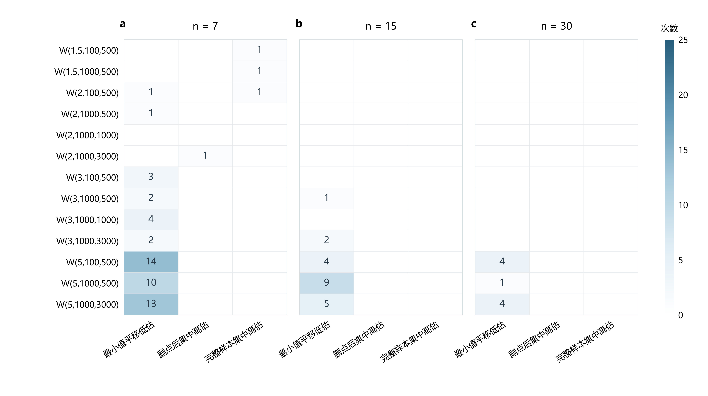

**图18｜MMLE保留距离分散与集中的两类明显异常估计。**

**（1）保留距离分散导致的形状低估。**

W(5,100,500)、n=7的正常与异常样本如下：

| 样本 | 形状β̂ | 尺度η̂ | 位置γ̂ | 观测值（升序） |
| --- | ---: | ---: | ---: | --- |
| 正常·第10组 | 3.19 | 61.37 | 543.87 | 543.87，569.35，590.90，591.15，596.79，614.92，629.13 |
| 异常·第11组 | 1.54 | 28.69 | 575.95 | 575.95，585.29，585.82，586.04，606.41，616.31，629.89 |

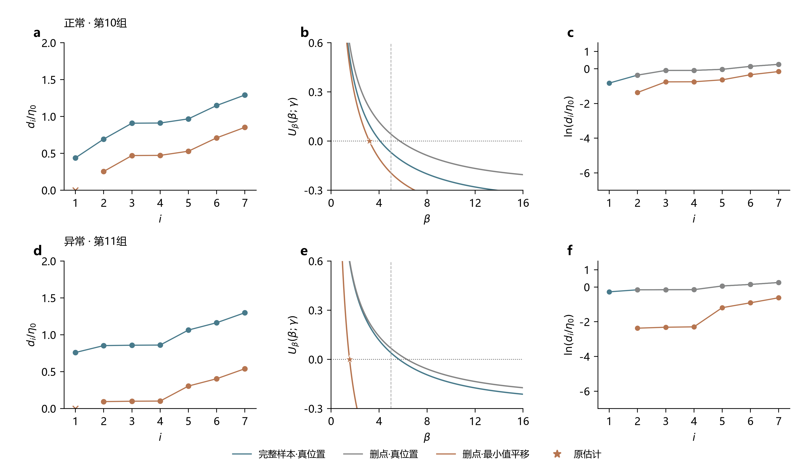

**图19｜第11组的似然峰对应较小形状，恢复尺度也偏低。**

第11组以575.95为位置后，前三个保留距离约为9.34、9.87、10.09，后续距离增至30.46—53.94，下端形成一簇较小距离。其对数跨度为1.75，大于第10组的1.21；对数距离标准差为0.80，第10组为0.42。

第11组更分散的保留距离使式（26）的似然在β=1.54处达到最高，低于5/3；第10组的峰顶为3.19，处于正常范围。两组的最小值均高于真位置，式（27）使用的是缩小后的保留距离；第11组恢复η̂=28.69，低于真尺度100。

**（2）保留距离集中导致的形状高估。**

W(2,1000,3000)、n=7的正常与异常样本如下：

| 样本 | 形状β̂ | 尺度η̂ | 位置γ̂ | 观测值（升序） |
| --- | ---: | ---: | ---: | --- |
| 正常·第4组 | 2.48 | 962.71 | 3109.09 | 3109.09，3388.63，3881.19，3927.27，3941.84，3990.51，4649.68 |
| 异常·第5组 | 7.69 | 690.49 | 3301.70 | 3301.70，3818.64，3840.65，3938.63，3979.78，4031.52，4091.30 |

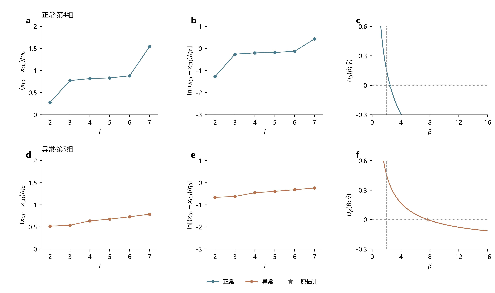

**图20｜第5组保留距离集中，似然峰对应较大形状，尺度仍偏低。**

第5组的最小观测与其余点列相隔较远，以最小值为位置后，六个保留距离都落在516.94—789.60，对数跨度仅0.42。第4组的保留距离为279.54—1540.59，对数跨度为1.71，分散程度明显更大。

第5组集中的保留距离使式（26）的似然峰落在β=7.69，超过高估界限6；第4组的峰顶为2.48。式（27）在β̂=7.69处给出η̂=690.49。较大β对应较大的距离幂均值，但保留距离上限仅789.60，尺度仍低于真值1000。

最小值定位后，保留距离更分散或更集中，会使似然峰分别落在较小或较大的β上，形成两类明显异常估计。

### 2.2　样本条件的影响

2.1中的异常由下端空缺、局部间距和样本集中等特征触发。本节联系这些形成过程，解释形状参数、样本量和位置相对尺度的大小为何影响异常发生。

**大形状与小样本更容易留下下端空缺。** 独立Weibull样本的最小值满足：

$$
\Pr\{X_{(1)}>\gamma+a\eta\}
=[1-F_X(\gamma+a\eta)]^n
=\exp(-na^\beta),\qquad 0<a<1.
\tag{28}
$$

X₍₁₎为样本最小值，Fₓ为Weibull分布函数，a为以尺度计的下端距离。由式（28），取n=15、a=0.5，最小值进入γ+0.5η以内的概率，β=2时约98%，β=5时约37%。β增大或n减小，都使最小值更容易远离真位置。

下端空缺减少了位置附近的观测，样本对位置的约束减弱。2.1中的回归与似然方法因此可能在远离真位置处取得较好的拟合；MDM、WMLE的低估样本体现了交点靠近最小值的过程，MMLE则直接将偏大的最小值用于平移。增大n补充下端观测，从这一环节减轻位置偏移及其带来的形状变化。

**偶然集中的样本可以直接推高形状。** W(5,1000,500)、n=7第28、29组在同一真位置下比较（图21）。第28组的对数距离较分散，第29组则十分集中，后者同时支持较大的回归形状和似然形状。

LSE按式（10）取斜率倒数，集中点列对应较大β；LRE按式（15）直接取斜率，固定参考坐标对应较窄的横向跨度，使β较大。MLE的式（23）要求1/β等于对数距离的加权均值与普通均值之差；加权均值不超过最大值，因此方程的根满足：

$$
\hat\beta(\gamma)\ge\frac1{\max_i y_i-\bar y}.
\tag{29}
$$

按式（29），第29组的形状下界已达到33.62，得分方程的根为55.69；第28组的根为6.16。固定真位置的全量对照仍有15条高估，均发生于n=7。这个对照显示，部分高估在位置正确时仍会形成，其来源是样本自身的集中程度经形状关系被放大。

**图21｜给定真位置后，第29组集中的对数距离仍支持较大形状。**

**位置相对尺度较大，会放大左侧候选的形状。** 写成X=γ+ηZ，可得：

$$
\mathrm{CV}(X)=\frac{\mathrm{SD}(Z)}{\gamma/\eta+\mathbb E[Z]}.
\tag{30}
$$

Z为形状β、尺度1、位置0的Weibull变量，CV为标准差与均值之比，SD为标准差，𝔼为数学期望。由式（30），形状固定时，γ/η越大，原始观测的相对离散越小。

本批位置下界为0。将候选位置移向零时，样本距离更接近原始观测，较大的γ/η因而可对应更集中的距离。回归或似然准则选择这类左侧候选后，形状关系容易给出更大的β。它放大了2.1中左移定位所形成的高估。

### 2.3　方法差异

同一组样本间距经过不同的估计环节，会产生不同的参数响应。各方法的关键区别为：

| 方法 | 决定参数的环节 | 样本差异怎样形成异常 |
|---|---|---|
| MDM | 以式（5）的梯度达到δ定位，再按式（4）、（6）恢复参数 | 交点靠近最小值时，条件拟合可得到小形状；第5组未采用已检出的交点，程序回退后形成高估 |
| LSE | 用顺序统计量期望作参考，按式（12）定位，再按式（10）恢复参数 | 左移改善拟合时，较小斜率形成高估；右移拉开对数间距时，较大斜率形成低估 |
| LRE | 用绘图概率作参考，按式（16）定位，再按式（15）恢复参数 | 横向跨度随位置压缩或拉开，分别对应大斜率或小斜率；参考点与回归方向均不同于LSE |
| WMLE | 联立式（17）、（18）求形状与位置，再由式（20）求尺度 | 距离和倒数距离改变两式的平衡位置，靠右或靠左的联合交点分别可能对应形状低估或高估 |
| MLE | 按式（21）联合比较形状、尺度和位置的似然 | 较高似然候选可能对应集中距离与大形状，也可能对应拉开的距离与小形状；部分返回值受数值求解不足影响 |
| MMLE | 按式（25）作最小值定位，再由式（26）、（27）确定形状与尺度 | 实际保留距离的相对离散较大时推动低估，过于集中时推动高估 |

LSE、LRE都可能通过移动位置改善线性匹配，位置变化又通过斜率关系改变形状，因而两种方向的异常均较常见。MLE按似然评价整个参数组合，本批左侧大形状候选较多得到似然支持。MDM、WMLE较多在右侧定位，MMLE直接作最小值平移，本批较多出现小形状结果。

求解过程与搜索范围也参与了频率差异。MLE第37组的近零返回值来自停止和候选接受环节，MDM第5组的离散扫描已发现交点，最终选参分支未采用该结果，导致右端回退和高估。本批MDM、WMLE的形状搜索上限分别为15、10；β=5时的高估界限为15，这些上限限制了可计入高估的返回值。图1呈现的频率由方法准则、构造、求解过程和搜索范围共同决定。

## 3　改进方向

较好的拟合或方程平衡可以与较大的参数误差同时出现，改进需要对应异常实际形成的环节。

已定位的计算问题先在原样本上修正并复核：MLE需在搜索中施加β≥1，处理β=1分支，并检查返回候选是否仍能提高似然；MDM需将离散扫描得到的交点区间用于求根，并在回退前检查内部交点。

方法层面，回归方法可研究线性匹配与参数恢复之间的约束，MDM可研究补偿值与样本梯度的适配，WMLE可研究校准系数及权重表端点对交点的影响，MMLE可研究最小值定位后保留距离的分散程度与形状估计的关系。

后续对照应分别评价计算修正和方法调整，以参数误差、明显异常频率及求解成功率检验对应环节的改变是否有效。

[计算记录与推导](README.md#复现入口)
