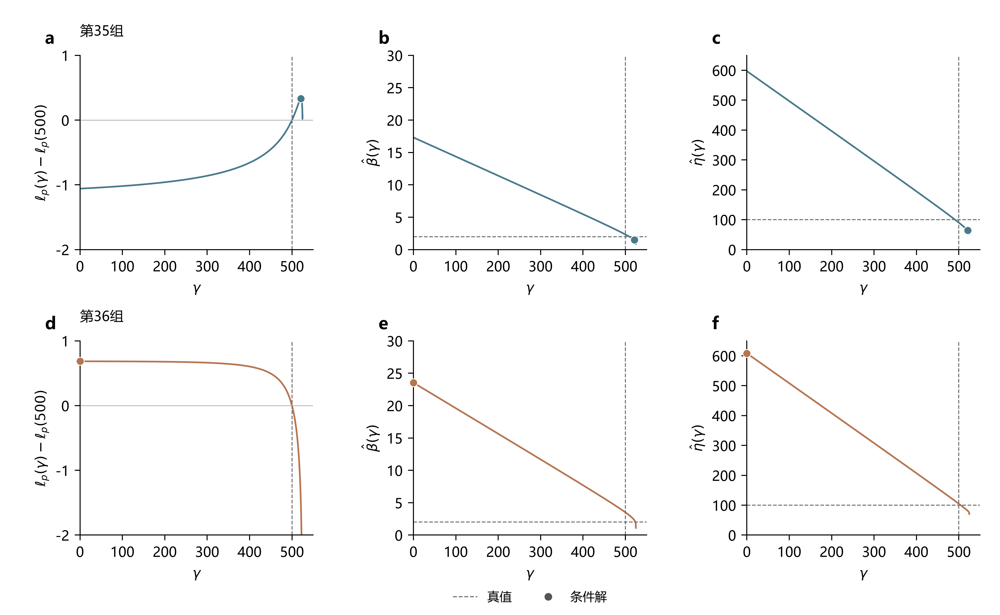
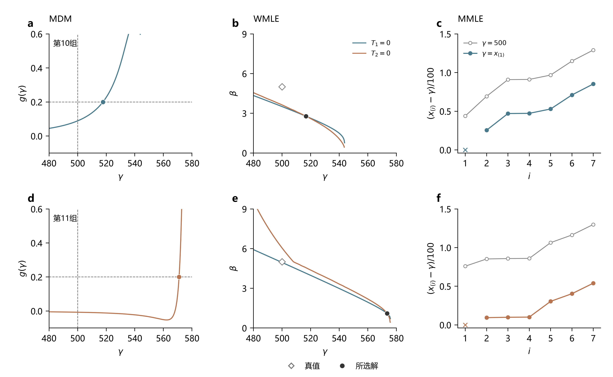
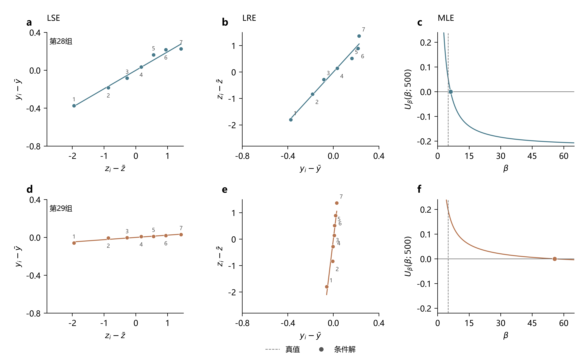

# 报告2：小样本情况下的明显异常估计

> 研究报告 · 2026-10-10

## 1　问题描述

此前计算覆盖以下参数组合、方法和样本量：

| 项目     | 设置                                                                                                |
| ------ | ------------------------------------------------------------------------------------------------- |
| 参数组合   | β=1.5、2、3、5，η=100、γ=500；β=1.5、2、3、5，η=1000、γ=500；β=2、3，η=1000、γ=1000；β=2、3、5，η=1000、γ=3000。共13个组合 |
| 估计方法   | MDM δ=0.10、0.15、0.20，LSE、LRE、MLE、WMLE、MMLE，共8种设置                                                  |
| 样本量n   | 7、15、30，每个参数组合、每档n各50组                                                                            |

估计结果中，部分参数与真值存在明显偏差。例如，W(2,100,500)、n=15的第36组样本得到以下结果，加粗数值为明显偏离的估计值。

| 方法 | 形状β | 尺度η | 位置γ |
|---|---:|---:|---:|
| 真值 | 2 | 100 | 500 |
| LSE | **21.70** | **609.36** | **0** |
| LRE | **18.80** | **522.81** | **85.73** |
| MLE | **23.54** | **608.35** | **0** |

这些结果与真参数明显不符，因此需要探究为什么会出现这样的估计。这里将**形状估计值达到真值的3倍，或不超过真值1/3的结果称为明显异常估计**：

$$
\hat\beta\ge3\beta\quad\text{或}\quad\hat\beta\le\frac{\beta}{3}.
$$

其中，β为形状真值，β̂为估计值。高估与低估合计统计。

**图1｜明显异常估计的发生频率随参数条件、样本量和方法而异。**

统计结果见图1，明显异常估计在六种方法中均有出现，且总体上在形状参数较大、样本量较小的条件下更常见。LSE、LRE出现较多，MDM、WMLE和MMLE相对较少；增大样本量能减轻这种现象，但仍不能完全消除。

## 2　明显异常估计的形成机制

### 2.1　各方法的异常形成机制

#### 2.1.1　LSE

全部243个LSE异常的拟合曲线分为三种情形：

| 最低点位置 | 数量 | 形状异常 |
|---|---:|---|
| γ=0的边界 | 105 | 形状高估 |
| 真位置左侧的内部点 | 28 | 形状高估 |
| 真位置右侧的内部点 | 110 | 形状低估 |

LSE通过调整γ，使变换后的样本点尽量落在一条直线上。记x₍ᵢ₎为第i小的观测，n为样本量，yᵢ=ln(x₍ᵢ₎−γ)，zᵢ为标准对数Weibull顺序统计量的期望。由Weibull关系：

$$
y_i\approx\ln\eta+\frac1\beta z_i.
$$

拟合直线yᵢ≈a+bzᵢ，截距a对应lnη，斜率b对应1/β，因此：

$$
\hat\beta(\gamma)=\frac1b,
\qquad
\hat\eta(\gamma)=e^a.
$$

LSE选择直线拟合程度最好的位置γ，即寻找F比最大的γ。F比与回归决定系数R²的关系为：

$$
F(\gamma)=\frac{n-2}{(n-1)[1-R^2(\gamma)]}.
$$

对同一组样本，n固定，F越大，1−R²越小。因此，寻找F比的最大值可转化为寻找1−R²的最低点：

$$
\hat\gamma=\underset{0\le\gamma<x_{(1)}}{\arg\min}\,[1-R^2(\gamma)].
$$

图2据此绘制1−R²随γ的变化，曲线最低点对应LSE选择的位置估计。

W(2,100,500)、n=15的第35、36组样本如下，按升序列出：

| 组号 | 样本 |
|---|---|
| 第35组 | 524.99，532.96，537.51，546.83，549.15，554.55，559.29，582.77，595.63，597.60，598.04，618.58，625.47，631.01，639.05 |
| 第36组 | 524.67，551.74，554.21，573.41，585.02，588.71，591.87，595.61，609.05，610.30，611.69，617.54，625.80，633.61，640.02 |

第35组的1−R²曲线先下降后上升，最低点在内部位置γ=518.20，得到形状1.42，处于正常范围（图2）。

**（1）零边界高估。** 对这类样本，左移γ能改善直线拟合，1−R²的最低点落在γ=0。第36组就是这种情况：γ从500减到0时，对数样本距离的变化范围缩小，拟合斜率从0.369降至0.046，取倒数便得到形状21.70。偏差形成于边界位置对应的小斜率。

**图2｜第35组的最低点在内部位置；第36组的最低点在γ=0的边界，对应明显高估的形状。**

**（2）内部左侧高估。** 有些样本的最佳拟合位于真位置左侧，但尚未到达零边界。位置左移仍会压缩对数间距、减小斜率，因而产生大形状。W(2,1000,3000)、n=7的第1组在γ=1273.68处取得最低点，斜率0.119，对应形状8.42。这类异常来自内部最低点所对应的小斜率。

**（3）内部右侧低估。** 对另一些样本，右移γ才使点列更接近直线。γ靠近最小观测时，下端对数距离迅速下降，对数间距扩大，拟合斜率增大，其倒数随之减小。W(2,1000,500)、n=7的第19组在γ=774.35处取得最低点，距离最小观测仅5.04；斜率为1.727，对应形状0.58。两组内部最低点样本如下：

| 样本条件 | 样本（升序） |
|---|---|
| W(2,1000,3000)，n=7，第1组 | 3250.30，3676.83，3723.74，3827.75，3860.06，4191.49，4293.82 |
| W(2,1000,500)，n=7，第19组 | 779.38，799.04，885.47，1061.58，1197.68，1302.69，2480.21 |

#### 2.1.2　LRE

LRE的255个异常分为以下三种情形：

| 所选位置 | 数量 | 形状异常 |
|---|---:|---|
| γ=0的边界 | 104 | 形状高估 |
| 真位置左侧的内部点 | 35 | 形状高估 |
| 真位置右侧的内部点 | 116 | 形状低估 |

LRE拟合的Weibull关系为zᵢ≈βyᵢ−βlnη，其中zᵢ=ln[−ln(1−pᵢ)]，pᵢ为该批次的绘图位置，yᵢ=ln(x₍ᵢ₎−γ)。拟合直线zᵢ≈a+byᵢ后，形状直接取斜率b，尺度由截距a得到：

$$
\hat\beta(\gamma)=b,
\qquad
\hat\eta(\gamma)=e^{-a/b}.
$$

LRE选择R²最大的位置，也就对应1−R²的最低点：

$$
\hat\gamma=\underset{0\le\gamma<x_{(1)}}{\arg\min}\,[1-R^2(\gamma)].
$$

**（1）零边界高估。** 对这类样本，γ=0时的点列线性程度更高。左移位置缩小y的变化范围，而参考坐标z的范围保持；要覆盖同样的z范围，直线需要更大的斜率，形状因此高估。W(2,1000,3000)、n=7的第5组从真位置移至γ=0，R²由0.760升至0.848，形状达到13.78。该组样本为3301.70、3818.64、3840.65、3938.63、3979.78、4031.52、4091.30。

**（2）内部左侧高估。** 当更高的R²出现在内部左侧，形状同样会因对数距离收缩而增大。W(2,100,500)、n=15的第36组在γ=85.73处得到更高的R²，形状为18.80。其偏差形成于内部位置所对应的大回归斜率。

**（3）内部右侧低估。** 对这类样本，右移γ提高了线性程度，同时扩大y的变化范围；在固定的z范围内，拟合斜率减小，形状随之低估。W(2,1000,500)、n=7的第19组选择γ=773.02，R²由真位置处的0.841升至0.982，形状降至0.56。

#### 2.1.3　MLE

按原位置与真位置候选的条件似然比较，197个MLE异常分为三种情形：

| 异常情形 | 数量 |
|---|---:|
| 左侧位置的形状高估，似然高于真位置候选 | 158 |
| 右侧位置的形状低估，似然高于真位置候选 | 27 |
| 搜索停点的形状高估，仍有更高似然候选 | 12 |

MLE同时搜索形状、尺度和位置，以样本的对数似然作为准则：

$$
\ell(\beta,\eta,\gamma)
=n\ln\beta-n\beta\ln\eta+(\beta-1)\sum_i\ln d_i
-\sum_i(d_i/\eta)^\beta.
$$

其中，ℓ为对数似然，dᵢ=x₍ᵢ₎−γ为样本距离。为画出似然随γ的变化，对尺度求导消去η，再由形状得分确定β，得到：

$$
U_\beta(\beta;\gamma)=\frac1\beta+\bar y
-\frac{\sum_i d_i^\beta y_i}{\sum_i d_i^\beta}=0,
\qquad
\hat\eta(\gamma)=\left[\frac1n\sum_i d_i^{\hat\beta(\gamma)}\right]^{1/\hat\beta(\gamma)}.
$$

其中，Uβ为形状得分，ȳ为yᵢ=ln dᵢ的均值。将β̂(γ)、η̂(γ)代回似然，便得到图3的ℓₚ(γ)。第35组得到内部位置521.17、形状1.49，处于正常范围。

**（1）较高似然的左侧高估。** 当小位置、大形状的组合给出更高似然，联合估计会接受这类候选。位置左移压缩对数距离，形状得分中的加权均值与普通均值之差较小，方程要求1/β较小，即β较大。第36组在γ=0处的似然高于真位置候选，形状为23.54（图3）。这类异常形成于似然准则支持了左侧的大形状组合。

**（2）较高似然的右侧低估。** 另一些样本支持较大的位置。位置接近最小观测时，下端对数距离下降、间距扩大，形状得分对应更大的1/β，得到较小形状。W(5,1000,500)、n=7的第4组估计γ=1092.59、形状1.44，其条件似然比真位置候选高0.71。这类异常形成于似然准则支持了右侧的小形状组合。

**（3）搜索停点的高估。** 这12条的位置均停在0附近，仍有似然更高的真位置候选。W(2,1000,3000)、n=7的第37组停在γ≈0.0001、形状13.10，而真位置候选还可将似然提高0.38。该停点的小位置与大形状已经相互配合，联合搜索却未达到更高似然的位置。这类偏差涉及数值搜索在位置方向上的停滞。

后两类的典型样本如下：

| 样本条件 | 样本（升序） |
|---|---|
| W(5,1000,500)，n=7，第4组 | 1121.42，1212.48，1385.65，1453.77，1469.10，1513.70，1865.14 |
| W(2,1000,3000)，n=7，第37组 | 3204.36，3330.72，3381.19，3675.75，3829.79，3956.29，4102.16 |

**图3｜第36组的左侧候选提高似然，对数距离收缩又将形状推高；第35组得到内部解。**

#### 2.1.4　MDM

MDM的100个异常分为两种情形：

| 异常情形 | 数量 |
|---|---:|
| 右侧梯度阈值交点对应形状低估 | 99 |
| 右端回退的条件拟合对应形状高估 | 1 |

MDM先在每个候选γ下选择形状，使各观测推算的尺度尽量接近；再用这些尺度的标准差对γ的梯度达到补偿值δ来确定位置。由Weibull分布关系得到：

$$
\eta_i=d_i[-\ln(1-p_i)]^{-1/\beta},
\quad
\hat\beta(\gamma)=\arg\min_{0.1\le\beta\le15}\sigma(\beta,\gamma),
\quad
 g(\gamma)=\frac{d\sigma[\hat\beta(\gamma),\gamma]}{d\gamma}=\delta.
$$

其中，ηᵢ为逐点伪尺度，σ为其标准差，g为梯度，此处pᵢ=(i−0.3)/(n+0.4)、δ=0.20。尺度估计取伪尺度的均值。W(5,100,500)、n=7的第10组在γ=517.71达到梯度阈值，得到形状2.45，处于正常范围（图4a）。

**（1）阈值交点的低估。** 这99条在真位置处的梯度均低于δ=0.20，交点位于真位置右侧。对下端观测较少的样本，梯度到接近最小观测时才达到阈值，位置因此过度右移。第11组的交点在γ=570.98，距离最小观测仅4.97（图4d）。扣除这个位置后，下端距离很小、对数间距扩大，伪尺度拟合对应的形状降至1.35，低于5/3。偏差形成于过于靠右的阈值交点。

**（2）右端回退的高估。** 程序在右端仍未找到阈值交点时，采用接近最小观测的右端候选，再进行条件尺度拟合。W(2,1000,3000)、n=7的第5组走了这一分支，位置几乎等于最小观测3301.70，形状为6.43。该样本的最小观测较孤立，其余观测集中；在右端候选下，伪尺度标准差的极小值对应较大的形状。这条高估形成于右端回退及其条件拟合。

图4使用的正常与低估样本如下，均来自W(5,100,500)、n=7：

| 组号 | 样本（升序） |
|---|---|
| 第10组 | 543.87，569.35，590.90，591.15，596.79，614.92，629.13 |
| 第11组 | 575.95，585.29，585.82，586.04，606.41，616.31，629.89 |

#### 2.1.5　WMLE

WMLE的84个异常分为两种情形，原结果均满足两条校准方程：

| 联合方程交点 | 数量 | 形状异常 |
|---|---:|---|
| 真位置右侧 | 82 | 形状低估 |
| 真位置左侧 | 2 | 形状高估 |

WMLE用两条校准方程共同确定形状和位置，程序最小化两项残差平方和T₁²+T₂²，再由样本距离计算尺度。方程为：

$$
T_1(\beta,\gamma)=\frac{J_2(n)}\beta+\bar y
-\frac{\sum_i d_i^\beta y_i}{\sum_i d_i^\beta},
$$
$$
T_2(\beta,\gamma)
=\left(\frac1n\sum_i\frac1{d_i}\right)
\frac{\sum_i d_i^\beta}{\sum_i d_i^{\beta-1}}
-J_3(n,\beta).
$$

其中，T₁、T₂为方程残差，J₂、J₃为校准系数。图4中两条零残差曲线的交点同时满足两式。第10组的交点为γ=516.81、形状2.78，处于正常范围（图4b）。

**（1）右侧交点的低估。** 这82条在真位置下满足形状方程时，位置残差T₂均为负。估计转向右侧后，下端倒数距离及对数间距增大，两条方程在大位置、小形状处平衡。第11组的交点为γ=573.51、形状1.10，位置距离最小观测仅2.44（图4e）。低估形成于右侧交点的方程平衡。

**（2）左侧交点的高估。** 这2条在真位置下的T₂为正，交点转向真位置左侧。位置左移后，对数距离收缩，形状方程对应更大的β，两式在小位置、大形状处平衡。W(1.5,100,500)、n=7的第9组，在真位置下T₂=0.0392，最终交点为γ=475.49、形状5.31，超过4.5。另一条来自尺度1000下的同号样本，也得到形状5.31。

尺度100下第9组的样本为551.95、606.91、635.06、639.45、642.43、648.24、659.99。

#### 2.1.6　MMLE

MMLE的84个异常分为两种情形：

| 异常情形 | 数量 |
|---|---:|
| 最小值平移后，形状低估 | 80 |
| 保留样本较集中，形状高估 | 4 |

MMLE直接用样本最小值估计位置，删除这个观测，再对其余n−1个距离估计形状和尺度：

$$
\hat\gamma=x_{(1)},\qquad d_i=x_{(i)}-x_{(1)},\quad i=2,\ldots,n.
$$

形状按保留样本的似然得分求解。第10组的最小值为543.87，平移后得到形状3.19，处于正常范围（图4c）。

**（1）最小值平移后的低估。** 当最小观测离真位置较远，直接用它平移会扩大保留距离的相对离散。第11组的最小值为575.95，比真位置高75.95；平移使保留对数距离的跨度从0.42扩大至1.75，形状降至1.54，低于5/3（图4f）。低估形成于最小值平移造成的间距扩大。

**图4｜第11组的右侧交点和最小值平移扩大对数间距，三种方法的形状均降至5/3以下。**

**（2）保留样本集中的高估。** 最小值平移会降低条件形状，但某些样本删去最小观测后，其余距离仍十分集中，保留样本的形状得分便支持较大的β。W(2,1000,3000)、n=7的第5组，在同一真位置下，删除孤立的最小观测使条件形状从4.78升至11.22；原MMLE完成平移与删点后得到7.69，仍超过6。

其余3条的完整样本在真位置下已支持形状高估，删点又进一步提高条件形状。例如W(1.5,100,500)、n=7的第9组，完整与删点样本在真位置下分别得到5.13和11.07，原MMLE最终得到6.86。高估形成于保留样本的集中程度；最小值平移降低了形状，最终结果仍超过判据。

### 2.2　样本条件与方法差异

**大形状与小样本减少起点附近的观测。** 独立Weibull样本的最小值满足：

$$
\Pr\{X_{(1)}>\gamma+a\eta\}
=[1-F_X(\gamma+a\eta)]^n
=\exp(-na^\beta),\qquad 0<a<1.
$$

其中，X₍₁₎为样本最小值，Fₓ为Weibull分布函数，a为相对尺度的下端距离。取n=15、a=0.5，最小值进入γ+0.5η以内的概率，β=2时约98%，β=5时约37%。大形状下，最小值与真位置之间更容易留下空缺，回归准则和联合似然可在较宽的位置区间内选择候选；MDM和WMLE的交点也随样本间距变化，MMLE则直接将这一空缺用于平移。增大n增加下端观测，能减轻这类位置偏移。

**小样本偶然过于集中，还会直接推高形状。** W(5,1000,500)、n=7的第28、29组，在相同位置γ=500下比较（图5）。第28组的条件形状处于正常范围；第29组的对数距离十分集中，LSE、LRE、MLE分别得到41.70、35.52、55.69。

LSE中，小幅变化的y对应较小斜率1/β；LRE中，同样的参考坐标变化对应较大斜率β。MLE中，形状得分Uβ=0要求1/β等于对数距离的加权均值与普通均值之差。加权均值不超过最大观测，故有：

$$
\hat\beta(\gamma)\ge\frac1{\max_i y_i-\bar y}.
$$

第29组仅这个形状下界就达到33.62，得分方程的根为55.69；第28组的根为6.16。样本集中通过各方法的形状关系放大估计，即使额外给定真位置也仍然如此。全量固定真位置的对照中，15条估计仍达到高估判据，均发生在n=7；其中MMLE恢复完整样本后，5条中的2条退出判据，与删点对照一致。

**图5｜第29组的集中点列支持更大的回归形状和似然形状，第28组的点列则较分散。**

**位置相对尺度较大，使左侧候选的形状更加极端。** 写成X=γ+ηZ，可得：

$$
\mathrm{CV}(X)=\frac{\mathrm{SD}(Z)}{\gamma/\eta+\mathbb E[Z]}.
$$

其中，X为随机观测，Z为形状β、尺度1、位置0的Weibull变量，CV为标准差与均值之比，𝔼为数学期望。本批位置下界为0，γ/η较大时，零位置下的相对离散更小。回归或似然接受这类候选时，便容易伴随较大的形状高估。这解释了位置相对尺度较大的一些组合为何更容易出现极端候选。

**不同方法将同一组样本间距转化为不同的估计。** LSE、LRE以点列的线性程度定位，左右移动位置都可能改善拟合；斜率随之改变，因此两种方向的形状异常都较常见。MLE按联合似然评价候选，本批样本的左侧、大形状候选较多受到似然支持，高估更常见。MDM的正梯度阈值在上述低估样本中于真位置右侧相交，WMLE的倒数距离项使方程平衡对下端间距敏感，两者较多输出右侧、小形状结果。MMLE直接采用最小值平移，低估较多；删除最小观测又可能使剩余距离更集中，推动形状增大。

这些规则决定了样本扰动进入估计的方式，参数范围也影响异常频率。例如，MDM的形状搜索上界为15，限制了β=5时的大形状输出。因此，图1中的频率差异同时反映样本条件、方法准则和实现范围。

## 3　改进方向

改进需要对应具体规则：回归方法可研究更能约束参数的拟合准则，MLE可研究工程位置约束及似然搜索，MDM可研究补偿值与样本梯度的适配，WMLE可研究校准系数对方程交点的影响，MMLE可联合改进最小值平移和删点构造。增加样本量则同时补充下端信息和形状信息。

明显异常的形成涉及样本、准则和数值处理之间的作用。后续应在相同样本上分别检验这些改进，对照参数误差、异常频率和求解成功率，确定哪一环节的改变能够带来实际收益。

[计算记录与推导](跨组合诊断/20261009-形状异常退化解/附录/README.md)
