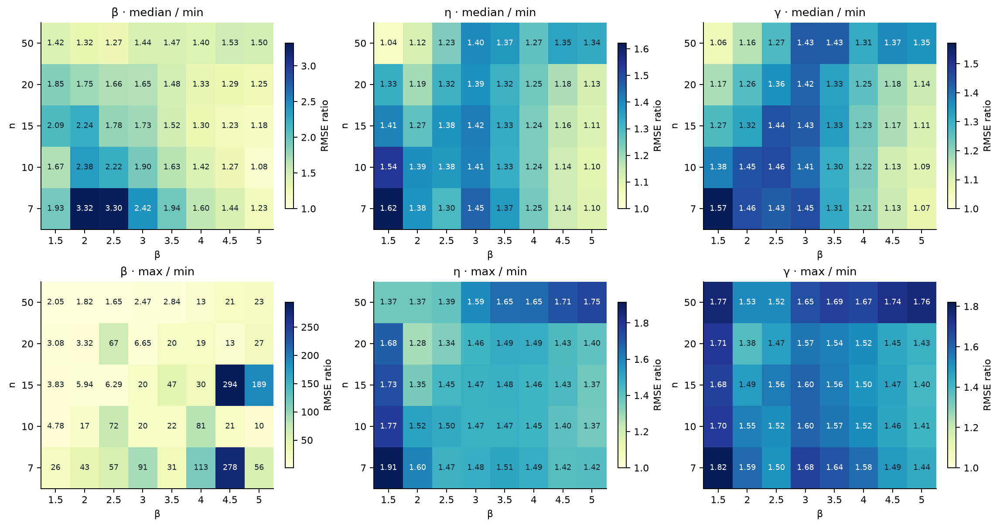
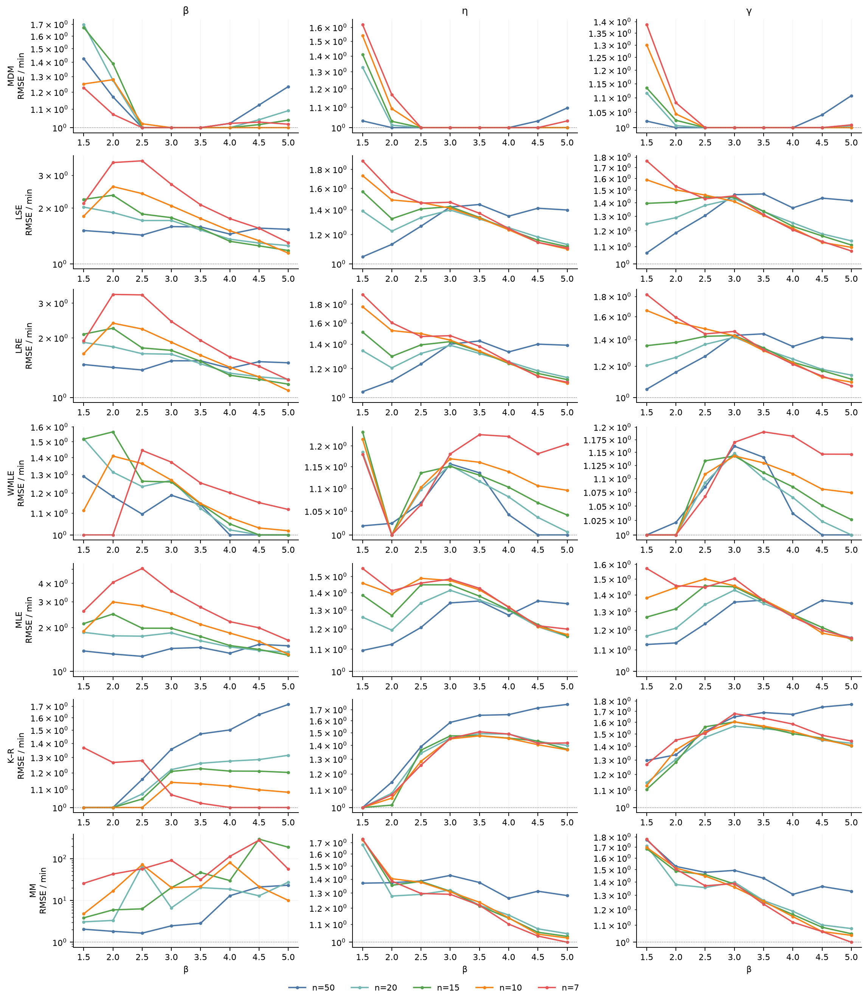
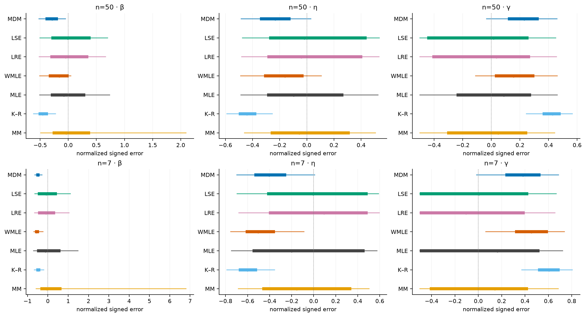
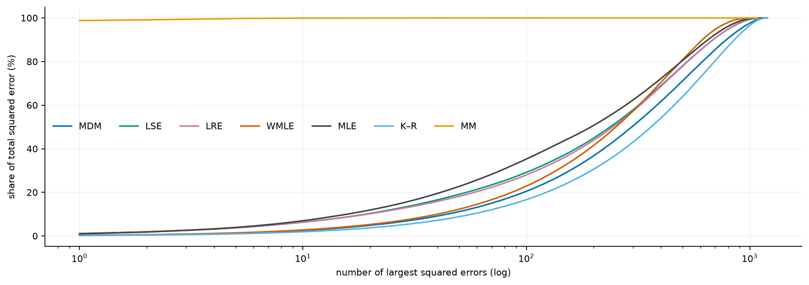
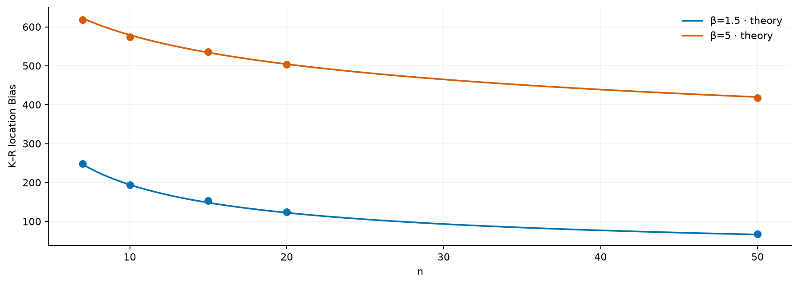
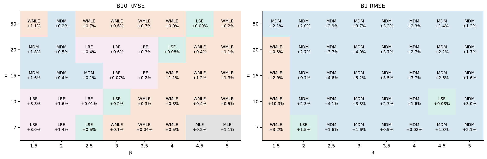

# 报告下：七种方法的性能差异、条件规律与选择启示

> v0.4 · 2026-10-20 · 讨论稿。固定η=1000、γ=500；以下认识限于本轮离散参数域。

## 1　先认识七种方法的整体差异

前面已经从估计原理和文献联系认识了不同方法。接下来要回答的是：面对同一批小样本，这些构造差别究竟表现为多大的估计差距，差距集中在哪里？只有先辨认这个整体格局，才知道后面哪些现象值得解释。

本轮比较MDM-0.1、LSE、LRE（Park）、WMLE、MLE、MMLE（K–R）和MM。β取1.5、2、2.5、3、3.5、4、4.5、5，n取7、10、15、20、50，每个条件1200份样本，共40个条件。七种方法接收相同观测，三个参数分别评价。

先把精度和返回情况分开：下文的主要精度比较，在每个条件内使用七法都返回有效估计的相同样本；各条件保留348—1199份。返回率则以全部1200次为分母。共同有效集合描述的是能共同返回时的精度，全部尝试的表现还要结合返回情况来看。

为了把不同条件放在同一参照下，定义每种方法的相对距离为“本方法RMSE／同条件七法最小RMSE”。1表示该点的最低观测误差，1.5表示高50%。这一参照用于认识差异，实际应用中的真参数仍未知。

<!-- figure:global -->

图注：共同有效集合；上排看中间方法离参照多远，下排看最差方法离参照多远。各面板独立色标，按格内倍数读值。

这张图需要同时看两层。最差方法离参照很远，可能只是一个方法拉开了量程；中间方法也明显离开参照，才说明差异涉及更多方法。本轮形状参数的中位相对距离为1.08—3.32，尺度为1.04—1.62，位置为1.06—1.57。因此，差异并不只存在于单个极端方法，三个参数呈现的差异程度也不相同。

再把七种方法全部放回来看。下表统计各方法在多少个条件中，RMSE不超过该条件最小值的1.10倍。10%是阅读差距的统一刻度，并非已确定的工程合格线；有效率范围覆盖全部40个条件。

| 方法 | 形状 | 尺度 | 位置 | 有效率范围 |
|---|---:|---:|---:|---:|
| MDM | 29/40 | 35/40 | 35/40 | 100.00—100.00% |
| LSE | 0/40 | 2/40 | 3/40 | 100.00—100.00% |
| LRE | 1/40 | 2/40 | 3/40 | 100.00—100.00% |
| WMLE | 15/40 | 18/40 | 24/40 | 96.75—100.00% |
| MLE | 0/40 | 1/40 | 0/40 | 32.25—100.00% |
| K–R | 18/40 | 9/40 | 0/40 | 100.00—100.00% |
| MM | 0/40 | 8/40 | 7/40 | 85.58—100.00% |

MDM在三个参数上都较多接近点估计参照，WMLE也有较宽的接近区域；K–R有18个条件的形状RMSE接近参照，位置却没有进入这一范围。MLE和MM还出现了返回率的变化。这里已经能看到两类值得继续追究的问题：优势覆盖哪些条件，以及形状、尺度、位置上的优势是否一致。

## 2　差距怎样随n和β共同变化

整体图告诉我们差异在哪里，下一步才考察它怎样变化。比较的重点是：同样减少样本，各方法相对其他方法的位置会怎样改变；这种响应在不同β下是否一致。

<!-- figure:change -->

图注：每行一种方法，三列为三个参数；五种颜色对应五档n。纵轴为相对距离，全部条件保留。

先看形状参数。MLE和MM从n=50到7时，相对最小误差方法的距离在八个β下均扩大；改用自身有效结果计算，方向仍一致。MDM在共同有效口径下有七个β的相对距离缩小，一个扩大；自身有效口径下八个β均缩小。它们对样本减少的响应有区别，但这还不足以把某个方法概括成全部条件下的最佳方法。

下表同时保留绝对误差的增长和相对距离的变化。增长倍数为n=7的形状RMSE除以n=50的RMSE，范围来自八个β；最后一列才是相对其他方法的距离是否扩大。

| 方法 | 自身有效：形状RMSE增长倍数 | 共同有效：增长倍数 | 相对差距扩大：共同有效 |
|---|---:|---:|---:|
| MDM | 1.75—3.04 | 1.00—3.64 | 1/8 |
| LSE | 1.74—3.97 | 1.54—5.91 | 6/8 |
| LRE | 1.68—3.74 | 1.49—5.55 | 6/8 |
| WMLE | 2.02—3.03 | 1.31—3.27 | 6/8 |
| MLE | 2.44—9.31 | 1.99—7.91 | 8/8 |
| K–R | 1.26—4.77 | 0.90—5.77 | 3/8 |
| MM | 3.52—39.13 | 4.44—53.10 | 8/8 |

两个量回答不同问题：一个方法自身误差增大，仍可能比其他方法增长得慢，因此相对位置反而改善。反过来，增长倍数不大，也可能只是n=50时就已经存在较大的偏移。这里不能把“对n不敏感”直接当作性能好的同义语。

β也会改变这种响应。例如WMLE的形状RMSE从n=50到7，在β=1.5时增长3.27倍，在β=5时增长2.03倍；自身有效口径对应3.03倍和2.24倍，两种口径都保留低β增长更大的方向。不过，各条件的成功集合不同，因此这些数值同时反映估计表现与成功筛选的变化。

形状、尺度、位置上的差距变化需要分别理解。本轮形状的极端差距与MM有关，尺度、位置没有相同量级；同一方法的三列轨迹也不一致。全条件图把这些差别和反例保留下来，便于辨别某个判断适用于哪些方法、参数和条件。

目前可以形成的认识是：方法差异既有幅度变化，也有适用区域变化；n的影响需要放在β条件下理解。它们是本轮设计域内的描述性规律，微小先后差异仍需结合蒙特卡洛不确定性判断。

## 3　前面的差距，体现为怎样的误差和代价

现在回到第一节识别出的参数间不一致：为什么一种方法在形状上接近参照，位置上却未必如此？又为什么有的方法RMSE很大，多数估计看起来却没有那么差？这些问题需要看估计分布，而非再报一次名次。

<!-- figure:error -->

图注：β=5，n=50和7纵向排列，三参数横向。分布带显示中位数、四分位区间与中心90%；全部有效值参与指标。

先看β=5、n=50时的形状误差。下表仍用相同的七法共同有效集合，Bias、SD和RMSE均除以真β。

| 方法 | 相对Bias | 相对SD | 相对RMSE |
|---|---:|---:|---:|
| MDM | -0.293 | 0.150 | 0.329 |
| LSE | 0.048 | 0.406 | 0.409 |
| LRE | 0.017 | 0.399 | 0.399 |
| WMLE | -0.183 | 0.194 | 0.266 |
| MLE | 0.013 | 0.399 | 0.399 |
| K–R | -0.440 | 0.124 | 0.457 |
| MM | 0.647 | 6.129 | 6.160 |

K–R的形状误差带较窄，但整体偏低；LSE、LRE的均值更靠近真值，却有较大的重复波动。两者分别体现持续偏移与分散。分布较窄、Bias较小或RMSE较低，分别表达不同性质，不能彼此替代。尺度、位置的分布还显示出与形状不同的偏移方向。

MM则提示另一种情况：少数输出可以支配总平方误差。为判断第二节中MM形状误差的尖峰来自哪里，遍查全部40个条件，找到单条平方误差贡献最高的记录，再查看同条件七法的完整结果。

<!-- figure:tail -->

图注：β=5、n=15，各方法自身有效结果；横轴按最大平方误差记录数累计，纵轴为其占总平方误差的比例。

在β=5、n=15下，MM的样本编号289得到形状估计13265.01，仅此一条就贡献98.81%的形状总平方误差。这条记录在七法共同有效集合中也被保留。它说明本批MM的经验RMSE对少数输出非常敏感；其不规则变化不宜解释为某一档样本量天然更难，也不据此断言总体尾部风险已经估准。

返回情况也会改变判断。按各法各自成功的结果计算B1 RMSE时，MLE在18个条件下取得最低点估计；统一到七法共同有效集合后，MLE在这40个条件中都未取得最低B1 RMSE。下面一例能直接看出集合变化的影响。

| β=5、n=7的B1比较 | 统计次数 | RMSE |
|---|---:|---:|
| MLE自身有效结果 | 817 | 190.20 |
| MDM自身有效结果 | 1200 | 219.28 |
| MDM在上述相同817份样本上 | 817 | 187.92 |

这里的局部对照用于解释整体寿命表的口径变化。它说明成功结果上的低误差需要与返回情况共同理解。有效但偏差很大、未返回有效结果，以及数值设置造成的失败，含义也各不相同；当前状态标签本身不足以逐条判定失败原因。

## 4　把典型现象接回方法构造

前面发现K–R在位置上较少接近参照，这可以联系第一部分的定位步骤来理解：本轮K–R将位置估计取为原样本最小值$\hat{\gamma}=x_{(1)}$，48000份记录均符合这一规则。有限样本的最小值通常仍高于真实起点，因而位置出现正偏移。

对未经过成功筛选的Weibull样本，这一步的位置Bias满足：

$$\operatorname{E}(\hat{\gamma}-\gamma)=\eta\,\Gamma\!\left(1+\frac{1}{\beta}\right)n^{-1/\beta}$$

这给出一个可以核验的解释：$\beta=1.5$时，偏移随$n$按$n^{-2/3}$下降；$\beta=5$时按$n^{-1/5}$下降，趋近起点更慢。下表使用K–R全部1200次结果，与该理论总体对应。

| β | n | 理论位置Bias | 实测位置Bias |
|---:|---:|---:|---:|
| 1.5 | 50 | 66.51 | 67.90 |
| 5 | 50 | 419.88 | 418.06 |
| 1.5 | 7 | 246.70 | 247.99 |
| 5 | 7 | 622.16 | 618.62 |

<!-- figure:mechanism -->

图注：理论位置Bias与全部样本的实测值；采用β域两端作对照。

理论与实测相近，能够解释高β下K–R的位置偏移为什么在n=50时仍然明显。这个解释直接针对位置步骤，形状和尺度还受后续恢复过程影响。

MM的极端记录则对应显式恢复的敏感性。Cran构造中，形状由两个矩差之比恢复：$\hat{\beta}=\frac{\ln 2}{\ln[(m_1-m_2)/(m_2-m_4)]}$。上述记录的矩差比为1.00005226，对数分母约0.00005225，因此得到很大的形状值。这里可以把复杂机制概括为：两个用于恢复形状的量非常接近，微小差别被转换成了很大的估计值。该恒等关系支持对这条记录的解释，发生频率还需要另行研究。

## 5　比较最终能怎样帮助方法选择

前面的整体比较给出了选择需要考虑的内容：n与可能的β范围、重点参数、误差容忍程度，以及返回和极端输出的代价。实际使用时还应先问，最终需要估准的是参数本身，还是某个寿命量。

用同一批参数估计计算B10和B1，就能检验改变目标后判断是否变化。B10为累计失效10%的寿命，B1为累计失效1%的寿命；两者分别按可靠度0.90和0.99代入分位点公式。

<!-- figure:life -->

图注：方案A统一七法共同有效集合，同时标出第二低RMSE与最低值的差距；方案B以全部1200次为分母，比较返回有效且满足误差容限的比例。

改为共同有效口径后，B10与形状参数的最低RMSE方法在33/40个条件不同，B1在21/40个条件不同。由此可以看到，按形状误差挑方法，未必得到寿命误差最低的候选。寿命由三个参数共同决定，参数误差可能互相补偿，也可能叠加；仅凭候选表还不能判定具体机制。

候选名称变化的次数与选择收益的大小，需要分开理解。B1表中一些第一、第二候选的差距很小；将差距与名称一起展示，可以辨别哪些变化只是相近方法之间的先后变化。需要实际寿命精度时，还可以用方案B直接看：在给定容限下，全部尝试中有多少返回了符合精度的结果。

| 估计前掌握的信息 | 可以怎样使用本轮比较 | 还需要明确什么 |
|---|---|---|
| 只知道n | 在事先给定的β参考域内比较各法表现 | β范围与权重、重点参数或寿命目标 |
| 知道n和有依据的β范围 | 在相应子域比较候选，查看不利条件 | 平均精度、偏移、返回情况与尾部要求 |
| 已拿到具体样本 | 在条件性认识之外继续利用样本特征 | 选择规则及其独立验证 |

本轮能够提供的是固定方法的条件性性能证据。后续可利用样本中可观测的特征，探索AI辅助选法：给定样本和使用目标后，判断哪种估计方式更合适，并检验它相对固定方法的收益和风险。

我们也在建设weibull.work，将已有方法的计算实现与部分分析过程整理到平台，欢迎同行试用交流。目前可以调用的方法以网站页面为准；本次七法比较使用的固定版本在研究材料中另行保存。后续希望结合样本信息、使用目标与求解过程优化，进一步探索自适应估计。
