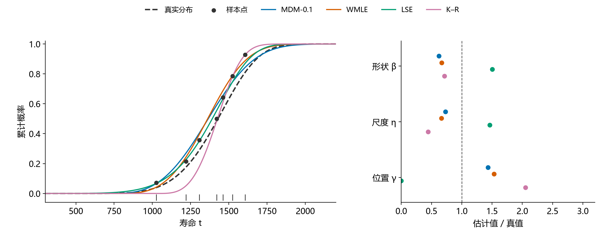
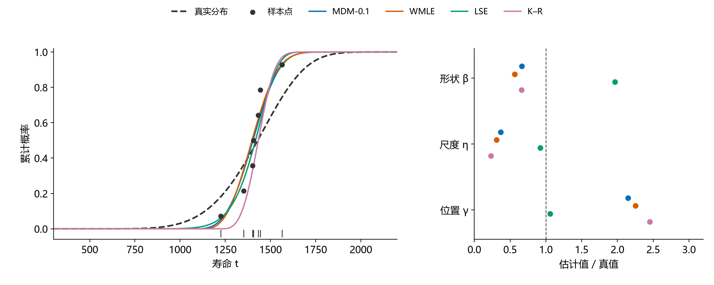
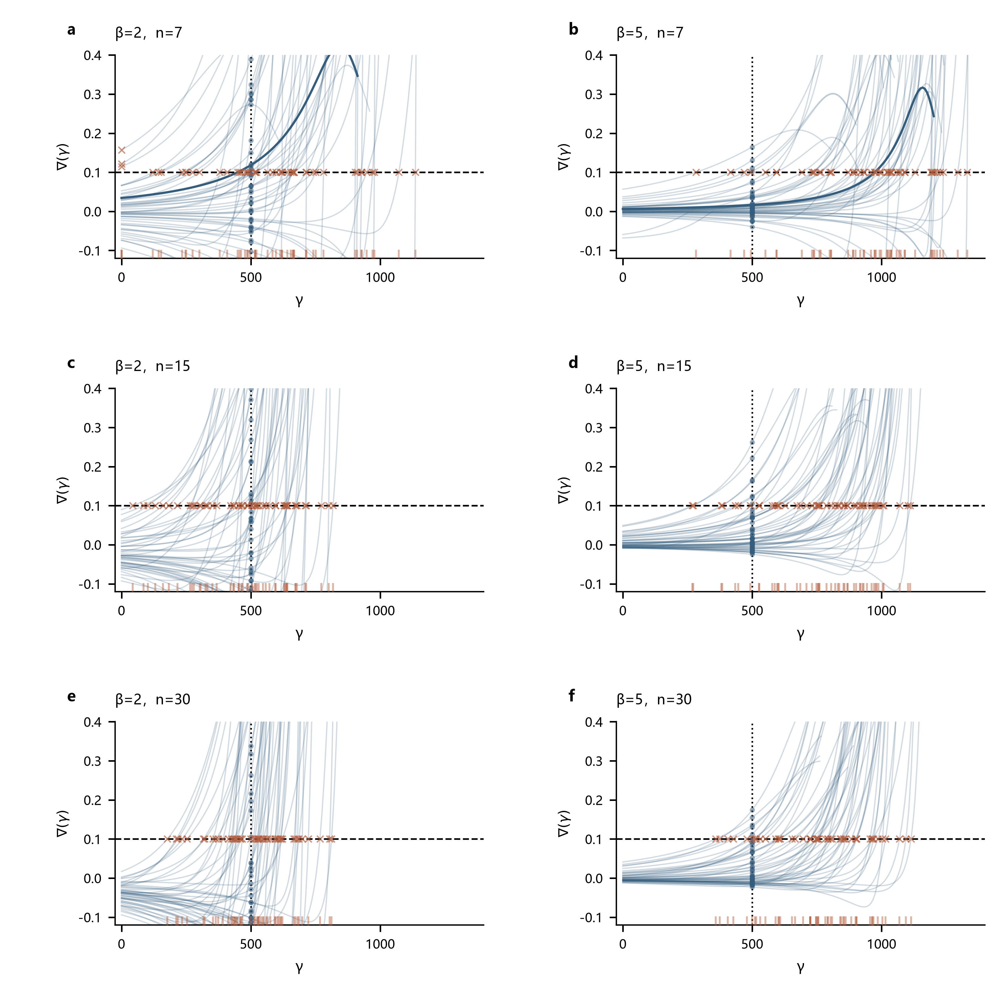
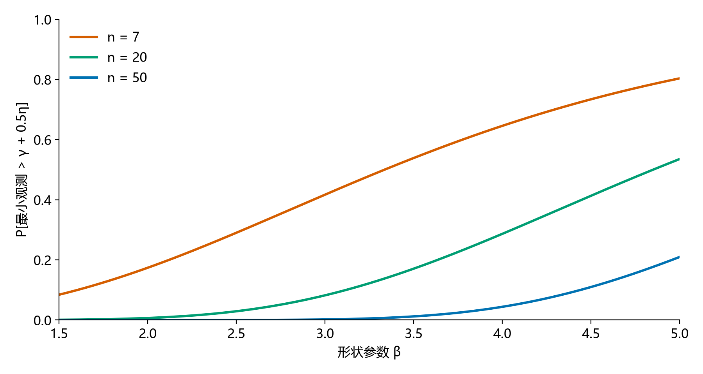
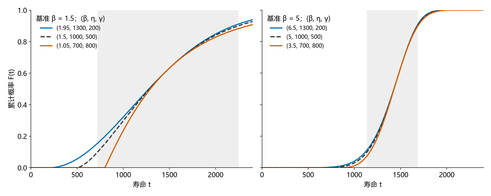

# 小样本三参数Weibull参数估计方法的比较与选择

**报告下（方法对比）v2.0｜2026-10-23**

魏鹏宇｜东北大学机械工程与自动化学院

分会场3：装备寿命与可靠性评估

## 1　实验设置

本轮比较七种方法在相同样本下的估计误差、重复抽样波动、明显异常和有效返回情况。

| 项目 | 本轮设置 |
| --- | --- |
| 方法 | MDM-0.1、LSE、LRE（Park）、WMLE、MLE、MMLE（K–R）、MM |
| 参数 | η=1000、γ=500；β=1.5、2、2.5、3、3.5、4、4.5、5 |
| 样本量 | n=50、20、15、10、7 |
| 重复抽样 | 每个条件1200组；各方法使用相同样本 |
| 主要观察 | 参数RMSE、估计分布、明显异常与有效返回 |

*统计口径：精度图使用七法均有效的共同样本；分布图使用各法自身有效结果。形状RMSE除以真β，尺度和位置RMSE除以1000。方法与求解约定见[实验设置](../../实验设置.md)。*

## 2　估计性能的差异与变化

样本量减少通常使估计误差增大，但性能变化并不限于误差数值。不同方法的响应方式，以及估计结果的分布结构，也会随样本量和形状条件改变。

### 2.1　样本量减小下的不同表现

#### n = 50

#### n = 20

#### n = 15

#### n = 10

#### n = 7

*图注：五张图共用线性半径；扇区越长，标准化RMSE越大。MM的数值另列。*

固定β观察，样本量减少时，估计误差总体增大，但各方法的增幅不同。部分方法的误差上升较快，部分方法变化较缓，方法间的差距也随之改变。固定n观察，β增大时位置误差的增长较为一致，形状和尺度误差的变化则因方法而异。

| 比较方向 | 观察到的变化 | 初步认识 |
| --- | --- | --- |
| 固定β，减小n | RMSE多数增大，各方法增幅不同 | 样本减少通常降低估计精度 |
| 固定n，增大β | 位置误差普遍增大，形状和尺度误差的变化存在方法差异 | 形状条件对各参数的影响不同 |
| 交叉观察n与β | 同一方法在不同β下的误差增幅不同 | 样本量的影响随形状条件改变 |

*图注：上两行分别为β=1.5和5下五档n的距离轨迹，每条线对应一对方法；下行为n=50到7的距离变化，覆盖八档β，红色表示扩大、蓝色表示缩小。三列依次为形状、尺度和位置参数。*

*距离为两种方法标准化RMSE之差的绝对值。六法共15对，仍使用七法共同有效样本；形状RMSE除以真β，尺度与位置RMSE除以真η。*

β=1.5时，七种方法的RMSE均随样本减少而上升；联合图中六种方法的两两差距也普遍拉开。此时，各方法的变化方向较为一致，区别主要表现为上升幅度不同。

β=5时，RMSE仍多向上，但方法间距离的变化不再一致：一些方法对继续分离，另一些逐渐接近，部分距离曲线还出现转折。比较n=50与7，LSE、LRE与WMLE的尺度和位置RMSE更接近，而它们与K–R的差距增大。

形状条件改变后，样本减少对方法关系的影响，可从普遍拉开转为拉开与接近并存。误差上升的共同方向，并不意味着方法间的精度关系保持不变。

| n | 形状Bias | 形状SD | 形状RMSE |
| --- | --- | --- | --- |
| 10 | -2.263 | 0.982 | 2.466 |
| 7 | -2.614 | 0.713 | 2.710 |

*表：WMLE，β=5；七法共同有效结果，Bias保留符号。自身有效结果也支持SD下降、负偏差加重和RMSE上升的方向。*

样本减少时，误差增大也不总表现为分布展宽。β=5的WMLE形状估计在n从10减至7时，SD下降，负偏差却加重，RMSE仍然上升。各方法不仅误差增幅不同，误差增长的表现也可能不同。

### 2.2　形状参数增大时的估计分布变化

#### β = 1.5

#### β = 2

#### β = 2.5

#### β = 3

#### β = 3.5

#### β = 4

#### β = 4.5

#### β = 5

*图注：行对应n=50、7，列对应形状、尺度、位置。虚线为真值，红点为均值，横线为四分位区间。密度显示主体分布，统计量使用全部有效值。*

β=1.5时，两档n下多数方法的主体分布形态相近。n=7的估计范围通常更宽，LSE、LRE的位置估计还出现了零边界结果。

固定n，β从1.5增至5时，估计分布进一步变化。LSE、LRE的尺度和位置估计逐渐展宽，即使n=50，四分位区间也明显扩大。因此，分布展宽并不只出现在极小样本条件。

MDM、WMLE和K–R则表现出有规律的参数偏移：形状估计的增幅落后于真β，低估加重；尺度估计向低值偏移，位置估计向高值偏移。两档n下均能观察到这一方向，n=7时偏移更明显。

另外，LSE、LRE的位置估计进一步向γ=0聚集，这在n=50时已可见，n=7时边界结果更多。原尺度密度图也呈双峰外观；后续核对发现，剔除零位置结果后未保留两个明显峰，因此这里将边界聚集与非边界估计的偏移分别考察，不据原图认定存在“接近真值与偏移”的两个内部群体。

### 2.3　明显异常估计

估计分布中还存在明显偏离真值的结果。这里沿用Research00报告2的判据，将形状估计不超过真值的1/3，或达到真值的3倍，记为明显异常估计。

| β=5、n=7，LSE | 形状 | 尺度 | 位置 |
| --- | --- | --- | --- |
| 真值 | 5 | 1000 | 500 |
| 第34组：接近真值的例子 | 5.55 | 836.77 | 681.73 |
| 第0组：明显低估的例子 | 1.24 | 282.98 | 1205.95 |

相同总体、相同样本量和相同方法，不同抽样仍可能得到相差很大的参数。异常例子中，形状和尺度明显偏低，位置则偏高；这种偏离已经超出估计结果在真值附近的小幅波动。

*两例来自本轮存档W(5,1000,500)、n=7，样本编号从0开始；仅用于展示，不代表其发生频率。*

*图注：异常为β̂≤β/3或β̂≥3β；频率以各方法自身有效结果为分母，求解失败另行统计。*

随着n减小，明显异常估计更常见。八档β下，七种方法在n=7时的异常频率都高于n=50。β=5时，异常频率在五档n上逐档上升。

异常增多的程度和方向存在方法差异：较大β、小n下，多种方法以形状低估为主；MLE在低β、小n下也有较高异常频率。它们不能由一种固定的异常模式概括。

### 2.4　主要现象

1. **n减小时，估计误差总体增大，但各方法的增幅不同。**固定β，部分方法对样本量减少更敏感，误差上升较快；部分方法增幅较小。因此，方法间的差距也随样本量改变，而非保持原有的精度关系。

2. **相同n下，β增大时，三个参数的估计呈现不同的偏移和分布变化。**部分方法的形状低估加重，并伴随尺度偏小、位置偏大；另一些方法的尺度和位置估计更分散，还出现边界聚集。β变化的影响不仅体现在误差大小，也体现在参数偏移的方向和估计分布的形态。

3. **n减小时，明显异常估计更常见。**这一变化在八档β、七种方法的n=50与7比较中均可见，但异常增多的程度及其偏移方向因方法和参数条件而异。

## 3　性能变化的机制分析

以下分别解释样本减少时的方法响应差异、较大β下的偏移与分布分化，以及明显异常估计的形成。

### 3.1　样本减少与方法响应的差异

先固定n=7，观察同一组样本经过不同方法后怎样得到不同参数。图中的点来自原始观测，各条曲线使用存档参数绘制。

#### 样本1055：最小观测较低

#### 样本474：最小观测较高

*W(5,1000,500)，n=7。两例按样本最小值的25%与75%分位附近选取，未按方法精度筛选。黑点纵坐标为(i−0.5)/n，仅作展示；底部刻线为实际寿命观测，各法仍采用自身原判据。右图为参数估计与真值之比。*

两例中，多条拟合曲线在观测范围内较接近，但对应的参数明显不同。第二组样本的观测集中在较窄区间，各方法的拟合曲线也比真实分布更集中；少量观测难以完整体现总体分布的宽度与起点。

同样的七个点并不唯一指定一组参数。K–R直接把最小观测作为位置；MDM按伪尺度梯度阈值定位；WMLE要求加权方程同时满足；LSE选择线性匹配较好的位置。因此，一种方法可能通过提高位置、降低尺度来适应这些点，另一种方法则选择更低位置和更大尺度，形状也随之调整。

样本减少使局部间距和有限覆盖更容易影响估计。各方法的定位依据、校准和约束不同，传递到参数的偏差与波动也不同。是否更适应小样本，要看这种响应在重复样本上的表现，不能由一组拟合曲线决定。

这种响应差异可以回到参数构造理解：直接以最小值定位时，下端空缺会直接转为位置高估；按固定梯度阈值定位时，样本间距会改变交点；按线性匹配定位时，同一间距变化则通过最佳拟合位置和回归斜率传递。相同的样本变化经过不同判据，可能更多表现为方向性偏移，也可能更多表现为重复波动。

#### MDM：阈值交点

#### LSE：定位判据

*复用Research00报告1的MDM和LSE诊断：β=2、5，n=7、15、30，η=1000、γ=500。每条曲线对应一组历史样本，显示定位关系随样本条件的变化；不并入本轮1200次统计。*

MDM通过同一阈值确定位置，曲线变化可以使交点产生有方向的移动；LSE在一段位置范围内的拟合质量可能十分接近，间距变化则容易改变所选位置。两种定位规则由此产生不同的偏差和波动变化。

对直接以最小值定位的K–R，可以进一步得到精确的样本量关系：

$$
\operatorname{RMSE}(\hat{\gamma})=\eta n^{-1/\beta}\sqrt{\Gamma(1+2/\beta)}.
$$

即使只看这一种方法，误差对n的响应也取决于β。不同方法采用不同统计量和定位判据，不能预期它们都按同一速度随样本减少而变差。

### 3.2　形状条件下的偏移与分布分化

#### 起点附近缺少观测

β增大时，所有观测均落在γ+0.5η以外的概率上升；n越小，这种情况越常见。起点到最小观测之间缺少数据，位置参数需要由较远处的观测外推。

*曲线由独立完整样本的精确关系P[T₍₁₎ > γ+aη]=exp(−naβ)计算，取a=0.5；该距离用于展示，不是异常判定阈值。*

#### 参数可以联动，使中部分布保持接近

图中将位置分别向两侧移动，同时调整形状和尺度，保持γ+η和η/β不变。右图三条曲线在中部更接近：参数已有明显差别，但分布差别仍较小。这提供了一条产生联合偏移的可能路径；方法实际选中哪一组参数，还取决于其估计判据。

*这是受控参数对照，不是新增拟合结果。灰区为各基准分布的10%—90%分位区间；两图采用相同位置改变量。构造依据复用Research00报告1的参数相容解释。*

在高β的分布中部，写成$T=\gamma+\eta\exp(Z/\beta)$，其中$Z=\ln E$、$E\sim\operatorname{Exp}(1)$，一阶近似给出

$$
T\approx(\gamma+\eta)+(\eta/\beta)Z.
$$

一阶近似中，γ+η控制寿命水平，η/β控制离散程度，解释了图中参数补偿的方向。

#### 估计判据怎样选出偏移的参数

Research00的MDM示例给出了实际选择路径：固定真位置时，形状估计较接近真值；阈值交点选出较高位置后，形状和尺度随之降低。位置上移改变了观测到起点的距离比例，后续形状与尺度恢复也随之改变。这一图例把三个参数的偏移连接到同一个定位过程。

*复用Research00报告1图5：β=2、5，n=7的第48组配对样本，MDM δ=0.10。蓝点为固定真位置的条件估计，橙叉为原返回结果。*

#### 估计判据怎样把结果推到边界

#### β = 5，n = 50

#### β = 5，n = 7

*图注：上排为全部有效结果，橙色表示零位置边界；下排各选一组边界样本和内部样本，圆点为原估计。灰色区域为诊断用的负γ延伸，红虚线为真实γ。LSE用等价的ρ²展示定位准则。*

上排中，位置与尺度沿相反方向变化；下排的边界样本中，准则向低位置方向仍在改善，但非负约束将返回值截在γ=0。加密搜索仍得到零位置，向负位置延伸则继续改善。这些例子支持“判据倾向与参数约束共同形成边界解”的解释。

上述图解释了参数相容、方向性偏移和边界选择。现有非边界结果尚未验证出两个明显的估计群体，因此这里不将参数相容进一步解释为双峰的成因。

### 3.3　明显异常估计的形成

明显异常估计需要区分两种来源：样本经估计准则得到偏离真值的参数，以及计算过程没有正确求得该准则要求的解。两者都能表现为参数异常，但形成环节和改进方向不同。

#### 样本结构怎样形成异常参数

下端观测成簇、最小值孤立，或远端存在单个观测，都会改变观测距离的相对关系。少数观测在小样本中占比更高，这些结构对定位和参数恢复的影响也更突出。

#### 改善线性匹配，但形状明显低估

#### 方程残差接近零，但参数明显偏离

*复用Research00报告2图7、图12。LSE例为W(2,1000,500)、n=7的第18、19组；WMLE例为W(5,100,500)、n=7的第3、11组。图中保留原批次实现与参数范围，仅说明形成路径。*

LSE的异常样本有一个远端观测，点列在真位置下的线性匹配较差。将位置向最小观测移动，能改善匹配，但也拉开下端对数距离，使回归斜率增大。形状取斜率倒数后明显降低。异常参数由当前判据选出的较好拟合形成。

WMLE的例子中，异常样本的下端观测集中，两条加权方程的共同交点移向较高位置、较低形状。迭代残差已接近零，尺度恢复后仍明显偏低。方程得到满足，并不保证小样本估计接近真值。

两例说明，样本结构既能改变拟合判据，也能改变方程交点；随后经参数恢复，将局部间距差异转成较大的参数偏离。

#### 计算过程也可能制造异常

*复用Research00报告2图17：W(2,1000,3000)、n=7的第37、38组，采用旧MLE求解程序。本轮Study04已更新求解器，此图不表示新版仍保留同一问题。*

旧MLE的异常例子停在接近零的位置，优化器报告收敛，但沿位置方向仍能提高似然。其他起点返回的候选又被接受条件剔除，最后留下这个近零停点。位置偏低压缩了对数距离的跨度，进一步得到偏大的形状。

这里应检查搜索、停止和候选接受过程。相比之下，前面的LSE判据与WMLE方程确实支持其异常参数，仅改进搜索未必能消除偏离。区分这两类来源，才能判断应改求解过程，还是研究方法对样本结构的敏感性。

## 4　评价目标、估计风险与方法选择

这些差异也改变了方法的评价。误差来自整体偏移、重复波动还是少数极端结果，对使用判断的意义不同；参数误差与寿命指标误差也需要分别看。

### 4.1　极端结果与求解失败

异常发生的频率与其对总体误差的影响不同。RMSE对误差平方求平均，少数极端值可能主导结果。MM在部分条件下的形状RMSE尖峰由极少数极端输出造成，不能将其理解为多数样本都产生同样程度的误差。

本轮中，MDM、LSE、LRE和K–R的全部尝试均返回有效估计。MLE的有效率随n减小而下降，低β时下降更明显；其误差统计对应的成功集合也随之改变。成功结果的精度与全部尝试的返回情况，共同影响实际使用时的判断。

*图注：有效率的分母为全部1200次尝试，返回状态按本轮实现与求解约定统计。*

*极端记录示例：β=4.5、n=15的MM结果中，单条有效记录贡献了几乎全部形状平方误差，仍保留在原统计中。*

### 4.2　评价目标与已知条件

方法的评价取决于使用目标。参数估计与不同寿命指标下的方法排序可能不同。

B10的最低RMSE方法随n和β变化，B1则在多数条件下由MDM取得最低RMSE。评价指标改变后，方法的相对表现也发生变化。

部分条件下，第一与第二方法的RMSE接近，单一名次不足以反映差异幅度。方法选择还应结合稳定性与异常风险。

*图注：格内为共同有效样本上RMSE最低的方法，下行为第二名高出的比例。B10、B1分别为10%、1%失效分位寿命。*

模拟条件表以真实β为依据。实际使用时，β范围未知，需要在给定参考范围内综合评价；β范围可预估时，可以缩小候选区域。选择还取决于目标参数或寿命指标，以及对波动和异常风险的要求。利用未知样本进行方法选择的规则及其收益仍需验证。

## 5　后续研究与平台

相同n和总体参数下，具体样本仍存在差异。后续考虑利用人工智能方法，根据样本可观测特征与使用目标选择估计方法，并优化方法内部的过程量和求解过程。选择规则的收益需要在新样本上验证。

我们也在[weibull.work](https://weibull.work)整理方法实现与相关分析，目前已有部分方法可以在线调用。网站仍在建设，未来希望把样本分析、方法选择与求解优化结合起来，也欢迎大家试用并提出建议。
