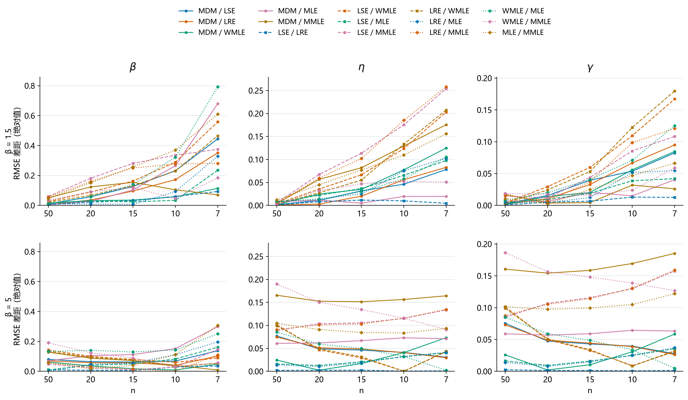
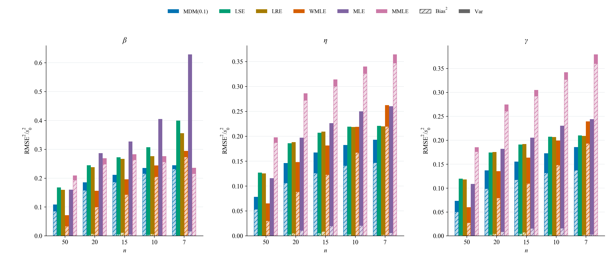
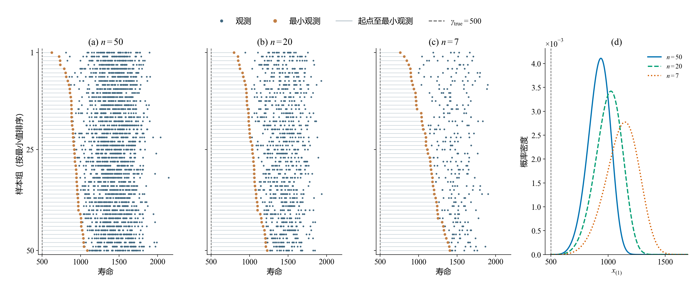
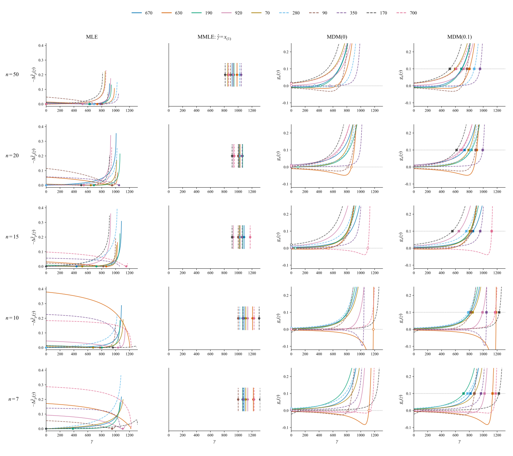
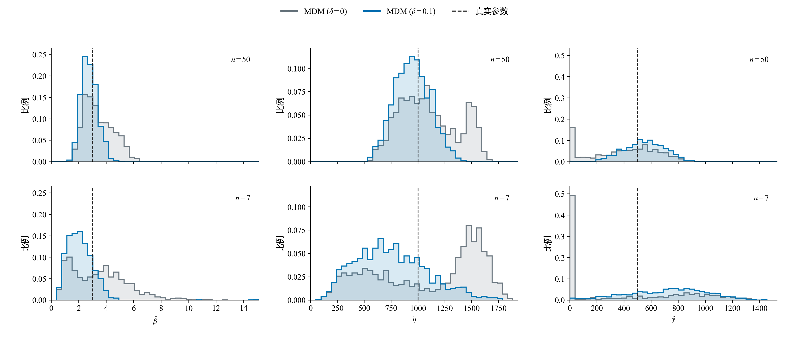

# 小样本三参数Weibull参数估计方法的比较与选择

**报告下（方法对比）v2.1｜2026-10-24**

魏鹏宇｜东北大学机械工程与自动化学院

分会场3：装备寿命与可靠性评估

## 1　实验设置

本轮比较七种方法在相同样本下的估计误差、重复抽样波动、明显异常和有效返回情况。

| 项目 | 本轮设置 |
| --- | --- |
| 方法 | MDM-0.1、LSE、LRE（Park）、WMLE、MLE、MMLE、MM |
| 参数 | η=1000、γ=500；β=1.5、2、2.5、3、3.5、4、4.5、5 |
| 样本量 | n=50、20、15、10、7 |
| 重复抽样 | 每个条件1200组；各方法使用相同样本 |
| 主要观察 | 参数RMSE、估计分布、明显异常与有效返回 |

*统计口径：精度图使用七法均有效的共同样本；分布图使用各法自身有效结果。形状RMSE除以真β，尺度和位置RMSE除以1000。方法与求解约定见[实验设置](../../实验设置.md)。*

## 2　估计性能的差异与变化

本章回答：当n减小、β增大时，观察到了什么现象？先比较误差大小、方法间差距、估计分布与异常频率怎样改变，再归纳需要解释的现象。条件变化怎样通过样本信息和估计构造产生这些表现，接在第三章讨论。

### 2.1　样本量减小下的不同表现

**展示目的：**按 β 分层，在固定形状条件下考察样本量减少带来的误差变化；再比较这一现象在不同形状条件下的共性与差异。

#### n = 50

#### n = 20

#### n = 15

#### n = 10

#### n = 7

*图注：五张图共用线性半径；扇区越长，标准化RMSE越大。MM的数值另列。*

在本次考察范围内，样本量减少时估计误差总体增大，但增长幅度因方法而异。有的方法对样本量减少较敏感，误差上升较快；有的方法增幅相对较小。

*两行分别为β=1.5、5的固定形状条件，三列分别对应形状、尺度、位置参数。横轴按n=50→20→15→10→7排列；同一参数两行共用纵轴。图中展示MDM、LSE、LRE、WMLE、MLE、MMLE六法的全部15个方法对，MM在玫瑰图中另列。*

*差距为两种方法标准化RMSE之差的绝对值，表示相隔多远；各法误差水平结合前面的玫瑰图观察。仍使用七法共同有效样本；形状RMSE除以真β，尺度和位置RMSE除以真η。*

不同方法的误差增长并不同步，方法间的精度差距也随样本量改变：一些方法对的差距扩大，另一些逐渐接近，部分还出现转折。误差总体增大，并不意味着方法间的差距始终扩大。

这种方法间的性能差异及其随样本量变化的关系，也会随形状条件改变。各方法对样本量减少的敏感程度需要在固定形状条件下比较，并结合不同分层考察其共性与差异。

### 2.2　形状参数增大时的估计分布变化

#### β = 1.5

#### β = 2

#### β = 2.5

#### β = 3

#### β = 3.5

#### β = 4

#### β = 4.5

#### β = 5

*图注：行对应n=50、7，列对应形状、尺度、位置。虚线为真值，红点为均值，横线为四分位区间。密度显示主体分布，统计量使用全部有效值。*

β=1.5时，两档n下多数方法的主体分布形态相近。n=7的估计范围通常更宽，LSE、LRE的位置估计还出现了零边界结果。

固定n，β从1.5增至5时，估计分布进一步变化。LSE、LRE的尺度和位置估计逐渐展宽，即使n=50，四分位区间也明显扩大。因此，分布展宽并不只出现在极小样本条件。

MDM、WMLE和MMLE则表现出有规律的参数偏移：形状估计的增幅落后于真β，低估加重；尺度估计向低值偏移，位置估计向高值偏移。两档n下均能观察到这一方向，n=7时偏移更明显。

另外，LSE、LRE的位置估计进一步向γ=0聚集，这在n=50时已可见，n=7时边界结果更多。原尺度密度图也呈双峰外观；后续核对发现，剔除零位置结果后未保留两个明显峰，因此这里将边界聚集与非边界估计的偏移分别考察，不据原图认定存在“接近真值与偏移”的两个内部群体。

### 2.3　明显异常估计

估计分布中还存在明显偏离真值的结果。这里沿用Research00报告2的判据，将形状估计不超过真值的1/3，或达到真值的3倍，记为明显异常估计。

| β=5、n=7，LSE | 形状 | 尺度 | 位置 |
| --- | --- | --- | --- |
| 真值 | 5 | 1000 | 500 |
| 第34组：接近真值的例子 | 5.55 | 836.77 | 681.73 |
| 第0组：明显低估的例子 | 1.24 | 282.98 | 1205.95 |

相同总体、相同样本量和相同方法，不同抽样仍可能得到相差很大的参数。异常例子中，形状和尺度明显偏低，位置则偏高；这种偏离已经超出估计结果在真值附近的小幅波动。

*两例来自本轮存档W(5,1000,500)、n=7，样本编号从0开始；仅用于展示，不代表其发生频率。*

*图注：异常为β̂≤β/3或β̂≥3β；频率以各方法自身有效结果为分母，求解失败另行统计。*

随着n减小，明显异常估计更常见。八档β下，七种方法在n=7时的异常频率都高于n=50。β=5时，异常频率在五档n上逐档上升。

异常增多的程度和方向存在方法差异：较大β、小n下，多种方法以形状低估为主；MLE在低β、小n下也有较高异常频率。它们不能由一种固定的异常模式概括。

### 2.4　主要现象

1. **n减小时，估计误差总体增大，但各方法的增幅不同。**固定β，部分方法对样本量减少更敏感，误差上升较快；部分方法增幅较小。因此，方法间的差距也随样本量改变，而非保持原有的精度关系。

2. **相同n下，β增大时，三个参数的估计呈现不同的偏移和分布变化。**部分方法的形状低估加重，并伴随尺度偏小、位置偏大；另一些方法的尺度和位置估计更分散，还出现边界聚集。β变化的影响不仅体现在误差大小，也体现在参数偏移的方向和估计分布的形态。

3. **n减小时，明显异常估计更常见。**这一变化在八档β、七种方法的n=50与7比较中均可见，但异常增多的程度及其偏移方向因方法和参数条件而异。

## 3　性能变化的机制分析

第二章建立了性能变化的事实。本章进一步追踪：n减小、β增大怎样改变有限样本所提供的信息；不同方法怎样将这些信息转化为定位判据和参数估计；这些响应又怎样表现为误差、偏移或异常。

3.1固定β，从样本信息利用、参数耦合及估计机制的敏感程度解释不同方法的RMSE增幅，回应2.1的样本量现象；3.2考察形状条件改变后的起点信息、方向性偏移和边界聚集，回应2.2；3.3追踪2.3的明显异常可能在哪个环节形成。典型案例用于解释形成过程，第二章的重复抽样结果用于判断现象在总体比较中有多普遍。

### 3.1　样本量减小时不同方法的误差增长机制

2.1显示，样本量由大变小时，误差总体增大，但不同方法的增幅不同。本节解释这条传递链：n减小改变样本信息，信息变化进入各法的判据或定位依据，使估计出现更大的方向性偏移或样本间波动，进而推高RMSE。各法判据和定位规则不同，对这些变化的放大或抑制也不同。先以β=5分解增长并观察判据，再用β=3的MDM两偏移量对照核对稳定性。

#### 误差增长中，偏差和波动各贡献多少

*三列分别对应β、η、γ；每档n按MDM(0.1)、LSE、LRE、WMLE、MLE、MMLE排列。浅色斜线为偏差平方，实色为经验方差，整根柱为标准化RMSE²。形状以真β=5、其余以1000标准化。统计采用各n七法共同有效集合，与第二章相同。*

这张堆叠图将误差平方拆开：

$$
\operatorname{RMSE}^2=\operatorname{Bias}^2+V_R,\qquad
V_R=\frac{R-1}{R}\operatorname{SD}^2.
$$

这里R为有效重复次数，SD采用样本标准差。比较n=50与n=7时，增长也能逐项相减：

$$
\Delta\operatorname{RMSE}^2=\Delta\operatorname{Bias}^2+\Delta V_R.
$$

Δ取“n=7减n=50”。正项推动误差平方增长，负项抵消增长；RMSE增大并不要求Bias的绝对值与SD同时增大。

| 方法（β=5，形状估计） | ΔRMSE² | ΔBias² | Δ方差 |
|---|---:|---:|---:|
| MDM(0.1) | +0.1357 | +0.1461 | -0.0103 |
| LSE | +0.2315 | -0.0005 | +0.2320 |
| LRE | +0.1958 | +0.0000 | +0.1958 |
| WMLE | +0.2228 | +0.2399 | -0.0171 |
| MLE | +0.4687 | +0.0160 | +0.4527 |
| MMLE | +0.0267 | +0.0216 | +0.0051 |

*表中为标准化误差平方，形状除以真β=5后再平方。各n使用七法共同有效集合，n=50、20、15、10、7分别保留1182、1100、1025、880、644组，集合随n变化；数值是相应条件下有效结果的分解。尺度、位置及含MM的完整表见[补充](../../结果呈现/比较探索/3.1误差增长分解.md)。*

在这套比较口径下，MLE、LSE和LRE的形状误差增长主要来自方差；MDM(0.1)和WMLE主要来自偏差平方增加，方差项反而下降。MMLE的形状误差增量较小，也主要由偏差平方组成。以MDM(0.1)为例，Bias由−1.46变为−2.41，SD由0.75降为0.55，RMSE仍由1.64增至2.47；LSE的Bias约由+0.24变为+0.21，SD由2.03增至3.15，RMSE由2.04增至3.16。

这些分解先说明“增长在哪里”，接着才解释“为什么不同”。共同有效集合收缩也会影响条件SD，不能把上表直接当作全部1200次抽样的波动；后面的两δ对照使用每档完整1200组共同样本，单独核对规则改变后的分布。

#### 样本减少怎样放宽对参数组合的限制

*固定W(5,1000,500)。前三列取正式n=50、20、7存档各自的前50组，按本列最小值排序；蓝点为观测，橙点为最小值，灰线连接真实起点500与最小值。右图为最小值的理论密度。前三列共用寿命轴，右图聚焦起点附近。*

低寿命下端在总体中占比很小，抽取次数减少，更容易一个也没抽到。因此，n减小时，最小观测通常离真实起点更远，起点与最小观测之间的空白更大。以500—1000这段区间为例，整组没有观测落入其中的理论概率，随n=50→20→7约为21%→54%→80%；本轮1200组的实际比例约为20%→55%→80%。

这段空白首先放宽了候选起点的支持限制。对于以全部观测为支持检查对象的三参数Weibull候选，起点必须低于最小观测。当最小观测右移时，原来因起点过高而不可能解释全部数据的一些组合，便不再被这条支持条件直接排除。与此同时，较小n下没有抽到下端观测，也仍可容许候选分布在那里保留一定概率。方法需要区分的候选因而可能增多，参数仍需由全部观测及具体判据进一步确定。

起点的位置还会与形状、尺度相互补偿：位置改变后，另两参的调整可能让候选分布在观测集中的区间内仍然相近。因而，支持条件放宽只说明部分候选不再被直接排除，最终选中什么位置，还取决于具体方法怎样比较这些参数组合。下面沿四种定位规则追踪同一批样本的响应。

#### 用共同样本看四种规则怎样确定位置

减点诊断固定使用MLE、MMLE、MDM(0)和MDM(0.1)。从1200份正式50点样本预先每10个编号取一份，共120条路径；按固定随机排列依次保留50、20、15、10、7点，四法在每档使用完全相同的观测。

*五行对应n=50、20、15、10、7，四列对应四种方法，每个剖面格子叠加十组样本。样本号、颜色和线型贯穿全图，横轴均为原始γ；MLE为相对每观测负对数似然，MDM为梯度$g_n(\gamma)$。MMLE只标样本最小值；MLE失败的曲线不标返回点。十组为典型路径，选例及120条完整核对见[补充](../../结果呈现/比较探索/3.1偏移量与廓线群体-结果.md)。*

沿行向下看，减点使同一样本的判据形状和定位结果改变：MLE低值区及最优位置发生移动，部分选点转向零边界；MMLE位置随最小观测右移；MDM的零梯度选点在平缓区或边界变化较大，而δ=0.1的交点落在梯度上升段。不同样本的响应方向并不一致，也没有各法都随n减小而变平的统一趋势，差别体现为各自规则对同一信息变化的不同响应。

判据的变化通过“选点”进入误差：不同样本的最优点向同一侧移动，会加重方向性偏差；最优点在更大范围内散开，或在内部与边界之间转换，会增大重复估计的不稳定性。当判据在一段位置范围内差别很小时，样本的偶然变化就可能重新排列候选优劣，使选点产生较大移动。随后位置变化又通过参数耦合传入形状和尺度。第一幅堆叠图中的偏差项与方差项，正是这些响应在重复估计中的表现。

#### 不同构造怎样处理这些信息与参数耦合

相同观测进入不同方法，会成为不同的估计依据；位置变化又会改变全部观测到起点的距离，进而牵动形状和尺度。这就是从样本信息转向方法视角的连接：各法利用的信息、处理三参数耦合的步骤和选参规则不同。

| 方法 | 怎样利用样本信息 | 与样本量变化有关的响应环节 |
|---|---|---|
| MLE | 用各观测到候选起点的距离构造似然，联合确定三参数。 | 对数距离和幂次距离共同影响候选组合的似然高低。 |
| WMLE | 将距离、对数距离、幂加权距离和倒数距离放入带有样本量校准权重的估计方程。 | 样本统计关系与n相关权重共同改变形状、位置方程的交点。 |
| MMLE | 以最小观测确定位置，再对删除该点后的正距离估计形状、尺度。 | 位置直接受单个极值影响，其误差随后进入其余观测到起点的距离。 |
| LSE | 将排序观测的对数距离与按n确定的理论参考坐标回归，再以相对匹配定位。 | 点列、参考坐标及回归斜率共同影响三参数恢复。 |
| LRE | 用绘图位置形成概率图参考坐标，以相关性定位，再由另一方向的回归恢复参数。 | 绘图位置、对数间距和回归方向决定其对点列变化的响应。 |
| MDM | 每个位置下使各点反算的伪尺度尽量一致，再以最小标准差的梯度阈值定位。 | 伪尺度离散程度、条件形状和梯度交点共同响应样本变化。 |
| MM | 用排序间距的加权和计算Cran的样本Weibull矩，再由矩差关系反演参数。 | 间距和n相关权重改变矩组合，非线性反演可能放大矩差的变化。 |

MMLE的位置规则为$\hat\gamma=x_{(1)}$：最小观测改变多少，位置就改变多少，位置定位不需要反解平坦准则，也不在多个候选最优点之间搜索。这使它避免了该环节的额外放大，但最小观测偏大仍会直接成为位置偏差。β=5的完整1200组结果中，n从50减到7，位置SD由95.9增至142.8，Bias则由+418.1增至+618.6；因此，它的位置RMSE增长更多体现为偏移加重。形状与尺度随后还受条件估计的影响。

#### MDM用小偏移降低定位敏感性

MDM以伪尺度离散程度的廓线梯度定位。零梯度附近较平缓时，样本的小变化也可能让定位点移动较远；引入δ=0.1，把定位目标移向梯度曲线较陡的上升段，部分避开平坦区，从而降低这种位置敏感性。上图两列MDM使用相同曲线，区别正是目标与选中位置。对内部交点，位置响应近似为$\Delta\hat\gamma\approx-\Delta g_n(\hat\gamma)/g_n'(\hat\gamma)$：同样的判据扰动，在斜率较小时会产生较大的位置移动。小偏移的作用在于减弱这一放大，而不是让样本量下降失去影响。选点改变也会带来偏差，性能需要同时看偏差和波动。

*固定W(3,1000,500)，上排n=50，下排n=7；每档两方案使用完全相同的1200组原样本，均有效。δ=0补算，δ=0.1复用原估计，其他实现相同。各列共用坐标与分箱，虚线为真值。判据图用β=5展示选参过程，本图用β=3核对重复分布，两个条件不混算。*

在β=3、n=7的配对结果中，位置SD由δ=0时450.5变为δ=0.1时292.7，位置RMSE由461.5变为369.7。这让判据上避开平缓定位区的解释，与重复估计的分布变化对应起来；结论限于当前条件和固定实现。三参数Bias、SD、RMSE及样本来源见[β=3核对](../../结果呈现/比较探索/3.1-MDM偏移量-beta3结果.md)。

本节得到的结论是：n减少后，变化的样本信息通过各法判据和定位规则，转化为不同程度的方向性偏移、选点分散或边界响应，最终形成不同的RMSE增幅。MLE、LSE、LRE在当前β=5比较中的形状误差增长主要来自方差，MDM(0.1)、WMLE主要来自偏差平方；MMLE的位置直接映射和MDM的正偏移定位体现了对特定放大环节的抑制。这些稳定作用允许波动较小，也仍可能伴随偏差增长。

上述证据解释了典型传递过程，尚未将七法全部RMSE差距逐项分解为独立机制贡献。完整选例、内部与边界统计见[群体核对](../../结果呈现/比较探索/3.1偏移量与廓线群体-结果.md)，β=3重复验证见[配对核对](../../结果呈现/比较探索/3.1-MDM偏移量-beta3结果.md)。

### 3.2　形状条件下的偏移与边界聚集

#### n与β对最小观测的共同影响

相同n下，β=5时的最小观测比β=2时更远离真实起点；样本量减小时，这段距离进一步增大。下排最小观测的分布也显示，较大β下，即使增加样本，最小观测仍可能与起点保持较大距离。这些图描述的是观测所在区间与真实起点之间的距离；其对选参的影响还要结合具体方法。

*复用Research00报告1图2：η=1000、γ=500，β=2、5，n=7、15、30。橙点为每组样本的最小观测，灰线为其到真实起点的距离；下排为最小观测的理论密度。历史样本仅用于解释，不并入本轮1200次统计。*

结合3.1的固定β图，这里展示了n与β对最小观测的共同影响。最小值提供起点的支持上界；不同方法怎样选中具体参数，仍要沿各自的估计构造追踪。

#### 参数组合与具体方法的选择

图中的两组参数虽然相差较大，在实际观测所在的区间内，分布曲线仍较接近。这是该案例中候选组合相容的直接展示，不能仅由最小值远离起点推得；随后还需追踪具体方法为什么选中了其中某一组。

*复用Research00报告1图3：β=5、n=7第31组样本；黑点累计概率由样本排序近似。两条曲线用于说明参数相容，不代表该样本必然被估成其中某一组参数。*

#### 方向性偏移的形成

MDM仍按同一个梯度阈值定位。高β时，各观测反算的伪尺度随位置变化更接近同步，标准差梯度较小，阈值交点可能出现在偏高位置。位置提高后，小观测到起点的距离缩短比例更大，需要更小的形状维持伪尺度的一致，再恢复出更小尺度。

图中先看梯度交点，再沿同一位置看形状与尺度。这样，位置偏高、形状偏低、尺度偏低对应的是同一估计过程的传递，三个参数的偏差有共同来源。

*Research00报告1图5，δ=0.1；β=2、5，n=7第48组配对样本。用于说明传递路径，不据单例认定全部方法或全部样本均如此。*

#### 边界聚集的形成

LSE移动位置是为了让对数距离与参考坐标更接近直线。左移位置会压缩下端对数间距；当这能改善点列匹配时，准则倾向于更低位置。图中橙色样本在允许范围内的最低点落到γ=0，紫色样本的最低点则留在内部。γ≥0的约束使不同样本都可能返回同一个零值，重复估计中便形成边界聚集。

选低位置也压缩了整体对数跨度，使LSE回归斜率减小，取倒数后形状升高。因此，边界位置和形状高估可以沿同一条恢复关系连接起来。

*复用报告2图6：正常与零边界样本为W(2,100,500)、n=15第35、36组；内部左偏为W(2,1000,3000)、n=7第1组。这里借用其机制图，不将这些历史条件并入本轮β=5统计。*

### 3.3　明显异常估计的形成

明显异常估计要追踪异常在哪个估计环节形成。Research00报告2区分了两种情况：当前方法的准则确实支持一组明显偏离真值的参数；或搜索、停止、候选接受没有正确落实预定规则。

#### 样本结构改变判据，异常参数仍可满足方法规则

#### LSE：改善线性匹配后，形状反而明显低估

#### WMLE：两条方程均满足，参数仍明显偏离真值

LSE的异常样本中，前几个观测相对集中，另有一个较远观测。真位置下的点列与参考坐标匹配较差，右移位置能拉开下端对数间距，使点列更接近直线。准则因此选中靠近最小观测的位置，但随之增大的回归斜率取倒数后，形状明显降低，尺度也由缩小的距离恢复为较低值。

WMLE的异常样本改变了下端距离、对数距离和幂加权距离，两条方程的共同交点移向较高位置、较低形状。将返回参数代回，残差仍接近零。这里不是方程没有解对，而是这些样本统计量本身支持了偏离真值的参数。

*复用报告2图7、12。LSE为W(2,1000,500)、n=7第18、19组；WMLE为W(5,100,500)、n=7第3、11组。保留历史实现及参数条件，只解释形成路径。*

#### 数值求解未落实规则，也能形成异常返回

旧MLE的第37组在近零位置停止，优化器标记收敛；其他起点的返回结果又因形状不满足接受条件被剔除，最终只剩这个候选。但图中向右仍可提高似然，说明搜索停止及候选接受没有实现预期的最优选择。近零位置进一步压缩对数跨度，形成较大的形状估计。

*报告2图17，W(2,1000,3000)、n=7第37、38组，采用旧MLE。Study04已更新求解器，此例用于区分计算来源，不认定新版仍有同一缺陷。*

前两例应研究估计准则对样本结构的响应；后一例应改进求解与候选检查。异常表现相近，形成环节不同，改进方向也不同。

## 4　评价目标、估计风险与方法选择

这些差异也改变了方法的评价。误差来自整体偏移、重复波动还是少数极端结果，对使用判断的意义不同；参数误差与寿命指标误差也需要分别看。

### 4.1　极端结果与求解失败

异常发生的频率与其对总体误差的影响不同。RMSE对误差平方求平均，少数极端值可能主导结果。MM在部分条件下的形状RMSE尖峰由极少数极端输出造成，不能将其理解为多数样本都产生同样程度的误差。

本轮中，MDM、LSE、LRE和MMLE的全部尝试均返回有效估计。MLE的有效率随n减小而下降，低β时下降更明显；其误差统计对应的成功集合也随之改变。成功结果的精度与全部尝试的返回情况，共同影响实际使用时的判断。

*图注：有效率的分母为全部1200次尝试，返回状态按本轮实现与求解约定统计。*

*极端记录示例：β=4.5、n=15的MM结果中，单条有效记录贡献了几乎全部形状平方误差，仍保留在原统计中。*

### 4.2　评价目标与已知条件

方法的评价取决于使用目标。参数估计与不同寿命指标下的方法排序可能不同。

B10的最低RMSE方法随n和β变化，B1则在多数条件下由MDM取得最低RMSE。评价指标改变后，方法的相对表现也发生变化。

部分条件下，第一与第二方法的RMSE接近，单一名次不足以反映差异幅度。方法选择还应结合稳定性与异常风险。

*图注：格内为共同有效样本上RMSE最低的方法，下行为第二名高出的比例。B10、B1分别为10%、1%失效分位寿命。*

模拟条件表以真实β为依据。实际使用时，β范围未知，需要在给定参考范围内综合评价；β范围可预估时，可以缩小候选区域。选择还取决于目标参数或寿命指标，以及对波动和异常风险的要求。利用未知样本进行方法选择的规则及其收益仍需验证。

## 5　后续研究与平台

相同n和总体参数下，具体样本仍存在差异。后续考虑利用人工智能方法，根据样本可观测特征与使用目标选择估计方法，并优化方法内部的过程量和求解过程。选择规则的收益需要在新样本上验证。

我们也在[weibull.work](https://weibull.work)整理方法实现与相关分析，目前已有部分方法可以在线调用。网站仍在建设，未来希望把样本分析、方法选择与求解优化结合起来，也欢迎大家试用并提出建议。
