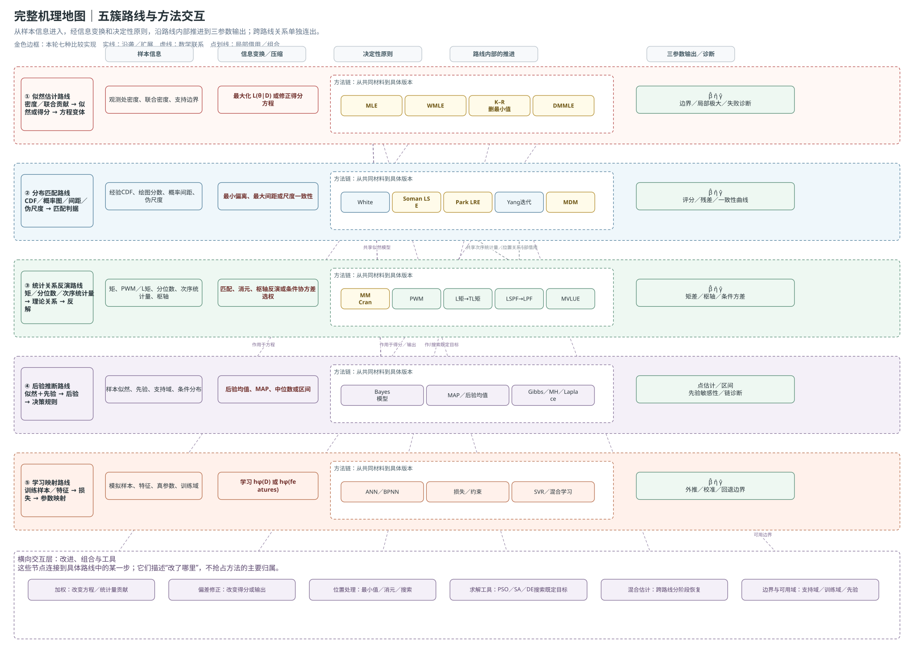
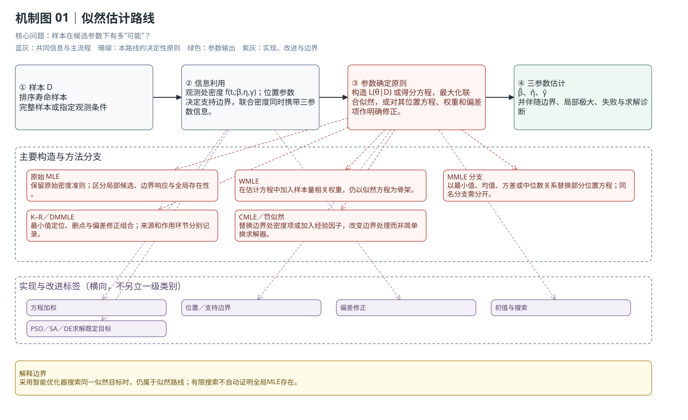
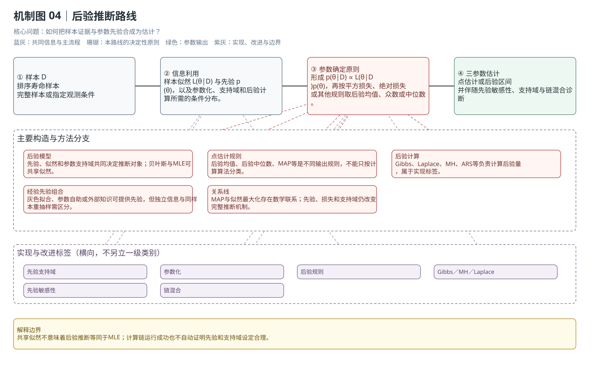
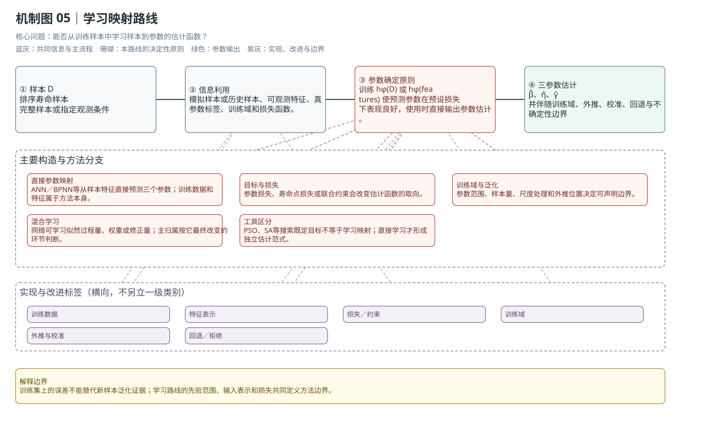

# 三参数Weibull参数估计方法的分类与相互关系

**报告上（方法分类）v0.4｜更新：2026-10-21**

魏鹏宇｜东北大学机械工程与自动化学院

分会场3：装备寿命与可靠性评估

> 先看现有方法的分散面貌，再给出按估计依据归纳的分类结果，最后回到代表方法和方法间关系。机制图的可编辑源文件为 draw.io，文中使用静态预览图供阅读。

各位老师、各位同学，大家好！我是东北大学机械工程与自动化学院的在读博士生魏鹏宇。今天汇报的题目是《小样本三参数Weibull参数估计方法的比较与选择》。

这次汇报主要分为两部分。第一部分不是马上比较谁更好，而是先回答：现有方法为什么看起来很多、杂乱，它们究竟依据什么不同；第二部分再把明确版本的方法放到共同样本上，比较它们在小样本下的偏差、波动、异常输出和失败风险。

## 1　先看现有方法：名称很多，层次混在一起

三参数Weibull分布包含形状参数β、尺度参数η和位置参数γ。位置参数改变了分布的支撑边界，也使形状和尺度的估计不再像两参数情形那样直接。围绕这个问题，文献中陆续提出了不同方案。先按文献中的方法名称、作者和年份把它们列出来，可以看到研究对象很多，提出时间也分散在不同阶段。

| 作者／年份（当前已核对的代表文献） | 方案或方法名 | 主要构造 | 当前记录 |
|---|---|---|---|
| Smith（1985） | 三参数MLE及最小值替代构造 | 原始似然；另讨论位置取最小观测、删除该观测后的估计 | 代表性非正则分析；不据此宣称MLE最早提出者 |
| Cohen–Whitten（1982） | MMLE-I—V、MME分支 | 保留部分似然方程，用最小值、均值、方差或中位数关系替换位置或矩方程 | 同一MMLE缩写下有多个具体版本 |
| Cheng–Amin（1983）；Ranneby（1984） | MPS／最大概率间距 | 用相邻CDF概率间距构造乘积或对数目标 | 两条独立提出线索，当前关系按共同方法记录 |
| Cheng–Iles（1987） | CMLE／修正似然 | 用最小观测附近的区间概率替换密度项 | 位置边界处理改变了似然项 |
| White（1969） | 概率图回归 | 用次序统计量期望构造分数，再回归对数寿命 | 两参数概率图基础 |
| Soman–Misra（1992） | 三参数LSE／White扩展 | 平移样本、White分数、回归和位置评分 | 未知位置被接入概率图流程 |
| Cran（1988） | Weibull moments | 由生存函数幂次积分形成矩，再显式恢复三参数 | 不需要多维迭代搜索 |
| Jacquelin（1993）→ Cousineau（2009） | WMLE／加权MLE | 从二参数代数关系扩展到三参数，并把三个权重放进估计方程 | 明确的扩展关系 |
| Kundu–Raqab（2009） | K–R MMLE | 以共同最小值定位并删除该观测，再估计其余参数 | 与Cohen–Whitten MMLE分支分开记录 |
| Hosking（1990）；Elamir–Seheult（2003） | L矩／截尾L矩 | 以次序统计量线性组合匹配理论统计关系，截尾L矩减少端部影响 | 统计关系路线的重要来源 |
| Nagatsuka等（2013） | LSPF | 用与位置、尺度无关的统计量估形状，再恢复其余参数 | 位置尺度自由的联合构造 |
| Nagatsuka–Balakrishnan（2015） | LPF | 只消除位置、保留尺度信息，再进行参数恢复 | 对LSPF的构造改进 |
| Park（2017；2018） | Proposed+Plot／Proposed+MLE2 | 用概率图相关系数定位，再按回归或二参数MLE恢复 | 2018补充条件下的存在性论证 |
| Yang等（2023） | 最小二乘迭代 | 概率图回归与最小次序统计量位置修正交替进行 | 位置修正与回归组合 |
| Bayes、ANN、BPNN、MDM等 | 后验、学习映射、尺度差异判据 | 分别使用先验与后验、训练映射或尺度伪估计差异 | 作者和年份按具体论文继续核对 |

表中的年份是当前已核对材料中的代表文献年份，不把“代表性分析”直接写成“最早提出”。同一缩写下存在多个构造时，后面按具体方程、统计量和参数恢复步骤继续拆开。

这样呈现后，问题就比较清楚：方法名称很多，但名称有时说的是估计准则，有时说的是统计量，有时说的是推断框架，还有些只是求解工具或改进步骤。接下来需要给出一个统一的归纳依据。

## 2　归纳后的分类依据与分类结果

现有名称之所以显得杂，是因为它们分别强调了不同内容：有的强调观测密度，有的强调概率图或概率间距，有的强调矩和次序统计量，有的强调先验和后验，有的强调训练映射；加权、偏差修正、位置处理和数值搜索又会横跨这些内容。

因此，方法的主要归属按两个层面确定：

1. **样本信息：** 从样本中提取什么，是观测处的密度、经验分布、概率间距、矩、分位数、次序统计量、不变统计量，还是训练样本中的特征。
2. **参数确定原则：** 怎样把这些信息变成三个参数，是最大化似然、最小化分布偏离、匹配概率结构、反演理论统计关系、更新后验，还是学习样本到参数的映射。

加权、偏差修正、位置处理、边界约束、数值求解和跨路线组合属于实现与改进标签。一个方法放在一个主要入口；它借用别类的统计量或步骤时，用关系线补充，不重复占据主干。

按这个依据，方法归纳为五个工作簇：似然估计、分布匹配、统计关系反演、后验推断和学习映射。它们表达的是方法的主要估计依据；具体论文仍需按方程、统计量和参数恢复步骤区分。

**图2｜分类后的结果。** 五条路线各自展示从样本信息到决定性原则、方法链和参数输出的推进方向；加权、偏差修正、位置处理、数值工具和混合估计放在横向标签中；关系线补充方法之间的沿袭、数学联系和局部借用。

## 3　似然估计路线：从观测密度及其联合贡献出发

这条路线使用观测处的密度及其联合贡献，把候选参数放进模型后比较样本的似然。参数由最大化联合似然或求解由似然导出的得分关系确定。改变权重、位置方程、边界项或偏差修正，会改变具体版本，但只要骨架仍是似然准则，就从这里进入地图。

| 样本信息 | 参数确定原则 | 实现与改进位置 |
|---|---|---|
| 观测处的密度、联合密度、删失或支持边界信息 | 最大化联合似然，或求解有明确来源的得分方程 | 方程加权、位置关系替换、边界约束、Firth型修正、局部候选与数值搜索 |

MLE、WMLE、Cohen–Whitten MMLE、K–R MMLE、CMLE、DMMLE和罚似然需要按具体方程和位置处理分别记录。PSO、模拟退火和差分进化如果只是搜索同一个似然目标，则属于数值求解标签，而不是新的估计原理。

**图3｜似然路线的共同骨架。** 样本先进入密度和得分关系，再由确定的目标或方程输出三参数；权重、位置和偏差修正改变的是其中的具体环节。

## 4　分布匹配路线：比较理论分布和样本呈现的分布关系

这条路线不直接把每个观测的联合密度作为唯一入口，而是把理论分布与样本的分布形态、概率图关系、概率间距或反推尺度放在一起比较，再依据匹配程度确定参数。

| 样本信息 | 参数确定原则 | 实现与改进位置 |
|---|---|---|
| 经验CDF、概率图分数、相邻概率间距、各观测反推的尺度伪估计 | 最小化分布差异、残差或距离；最大化概率间距评分；或让尺度伪估计更一致 | 分数选择、位置定位、回归方向、分组方式、梯度阈值和固定偏移 |

概率图、LSE／WLSE、最小距离估计、MPS／QMP和MDM都进入这个工作簇，但它们的具体判据仍需分开。MDM比较的是各观测反推尺度的一致性，不能因为也使用分布关系就与普通概率图回归混为同一估计器。

**图4｜分布匹配路线的共同材料。** CDF、概率图和尺度一致性都在比较样本与理论分布，但比较对象和目标函数不同。

## 5　统计关系反演路线：从理论统计关系恢复参数

这条路线先选取样本矩、分位数、次序统计量、不变统计量或其他可计算特征，再建立它们与总体参数之间的理论关系，最后用匹配、消元或反解恢复参数。

| 样本信息 | 参数确定原则 | 实现与改进位置 |
|---|---|---|
| 样本矩、概率加权矩、L矩、分位数、次序统计量、不变统计量 | 匹配理论统计关系，或反演矩、枢轴关系和条件线性关系 | 权重和端部处理、位置与尺度消元、条件协方差选权、显式恢复和迭代代入 |

MM、PWM、L矩、TL矩、分位数和次序统计量方法属于这里。LSPF／LPF等不变统计量方法要按实际使用的统计量和后续联合密度或恢复方程说明。线性最小方差估计作为条件性估计量构造放在这条路线下，但必须保留已知参数或代入条件。

**图5｜统计关系反演路线。** 共享某种统计量不等于使用同一个估计准则；关键还在于理论关系怎样匹配、消元和恢复。

## 6　后验推断与学习映射

后验推断把样本信息和参数先验结合成后验分布，再按后验均值、中位数或MAP等规则给出估计。它可以共享似然模型，但先验和后验决策规则使它不等同于MLE；Gibbs、Laplace和MH首先是后验计算方式。

学习映射则通过训练样本或模拟数据学习从样本特征到分布参数的估计函数。ANN、BPNN以及直接学习参数映射属于这里。训练域、特征表示、损失函数、外推和校准都是方法边界。用于搜索一个已经确定的统计目标的智能优化算法，仍按其实际目标归属。

| 扩展范式 | 样本信息 | 参数确定原则 | 实现与改进位置 |
|---|---|---|---|
| 后验推断 | 样本似然信息＋参数先验 | 后验规则，如均值、中位数或MAP | 后验计算、抽样、近似和先验敏感性 |
| 学习映射 | 训练样本、模拟样本和样本特征 | 学习特征到三个参数的映射 | 训练域、损失函数、校准和外推边界 |

**图6—7｜后验推断与学习映射。** 后验路线增加先验和后验决策，学习路线增加训练和校准；二者都可以与其他工作簇共享部分样本信息，但主要入口不同。

## 7　完整机理地图：分类与方法间关系同时保留

五个工作簇给出方法的主要归属，关系线补充方法之间的联系。完整地图中的关系分为三种：

- **沿袭或扩展：** 原文明确沿用、扩展或修正前一构造时使用实线。
- **数学联系或共享构造：** 两种方法共享CDF、矩、似然或统计量，但没有足够证据说成历史继承时使用虚线。
- **局部借用或组合：** 一个方法只借用了另一条路线的位置处理、统计量或参数恢复步骤时使用点划线。

需要重点讲清的关系包括：Jacquelin二参数推导到Cousineau WMLE及后续形状修正；Smith删最小值构造到K–R场景适配；K–R与Firth型修正共同形成DMMLE；White到Soman的概率图分支；MPS与QMP在特定分组设置下的特例关系；PWM与L矩的数学联系；LSPF到LPF的构造改进；MLE与MAP共享似然模型但后者增加先验和后验决策；以及PSO、模拟退火等工具连接到它们实际搜索的目标。

**图8｜完整机理地图。** 每条路线都有从左到右的内部推进；路线之间的共享材料、沿袭、局部借用和组合通过跨车道关系线表达。方法节点的排列因此同时说明“它属于哪条路线”和“它怎样从前一个构造发展或借用而来”。

## 8　本轮七种实现落在哪些位置

统一比较的七种实现主要落在似然估计、分布匹配和统计关系反演三个工作簇，后验推断和学习映射未纳入本批比较。这是实验对象范围。

| 实现 | 五簇主要归属 | 具体构造定位 |
|---|---|---|
| MLE | 似然估计 | 原始观测密度联合似然；另记录局部候选、边界与失败 |
| WMLE | 似然估计 | 在估计方程中引入三个权重 |
| MMLE（K–R单样本形式） | 似然估计 | 以样本最小值定位并删除该观测后估计其余参数 |
| LSE（Soman主分支） | 分布匹配 | White分数、位置评分和对数寿命对分数回归 |
| LRE（Park Proposed+Plot） | 分布匹配 | 相关系数定位、绘图概率分数和分数对对数寿命回归 |
| MDM-0.1 | 分布匹配 | 条件尺度伪估计差异、梯度阈值定位和固定偏移 |
| MM（Cran式） | 统计关系反演 | Weibull矩及矩差显式恢复参数 |

这三组实现形成清楚的构造对照：MLE、WMLE和K–R对应似然、方程加权与最小值定位；LSE、LRE和MDM对应分布关系匹配的不同分支；MM对应统计关系的显式恢复。后面的性能差异仍要由共同样本和统一评价口径检验，不能从分类图直接推出。

## 9　转入统一性能比较

后续结果将回到这些具体构造：出现偏差时检查位置处理、统计量构造和参数恢复；出现波动或异常时检查信息保留和求解环节。

第二部分将在固定的共同抽样条件下比较七种已核验实现，分析这些差异怎样随样本量与形状参数变化，并回到本地图中的具体构造解释典型表现。方法地图负责组织认识，统一实验负责检验性能。

——转入[报告下（方法对比）v0.4](报告下（方法对比）-v0.4.md)。

## 文献与源文件

- [方法分类工作稿](方法分类/04-方法分类与沿袭关系工作稿.md)：逐篇维护信息利用、参数原则、实现改进、关系证据和边界。
- [Yang综述的八类分类](方法分类/01-Yang综述的八类分类.md)：保留综述原始分类与名称辨析。
- [Research09的四条路线](方法分类/02-Research09的四条路线.md)：保留已有路线归纳及其局限。
- [机制图-v0.4目录](方法分类/机制图-v0.4/)：五类机制图、完整机理地图、draw.io源文件和静态预览图。
- [实验设置](实验设置.md)：统一比较对象、计算版本和数据合同。
