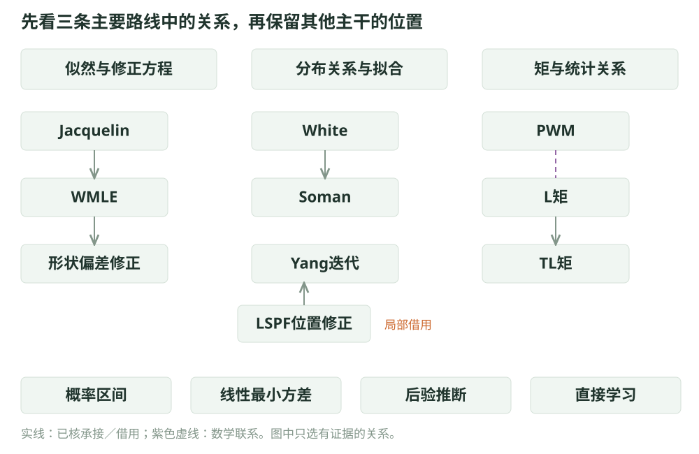
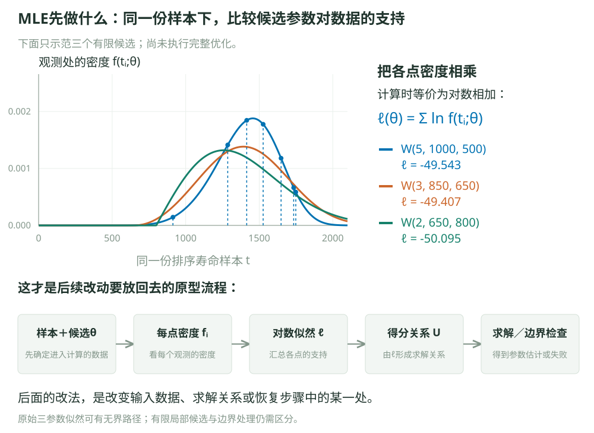
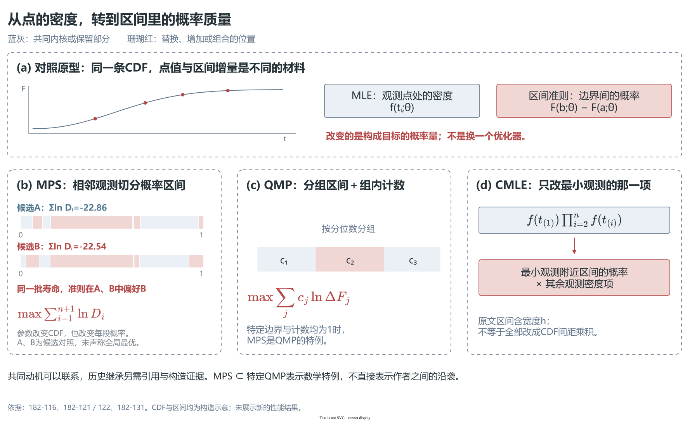
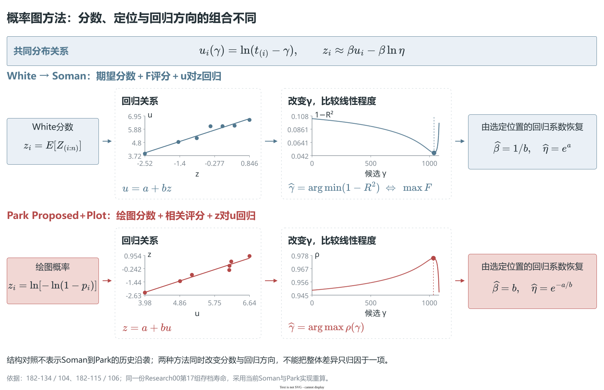
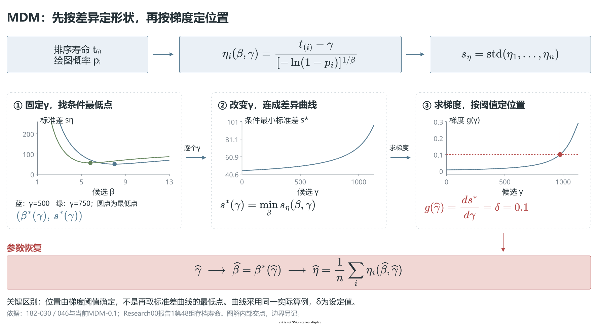
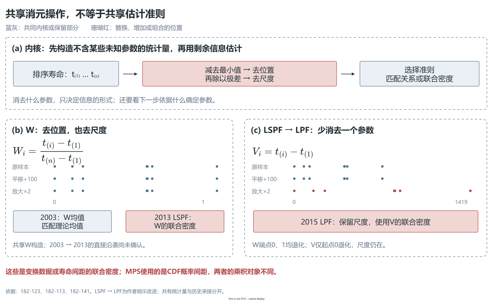

# 三参数Weibull参数估计方法的分类与相互关系

**报告上（方法分类）v0.4｜更新：2026-10-21**

魏鹏宇｜东北大学机械工程与自动化学院

分会场3：装备寿命与可靠性评估

> 内容顺序：先分开样本信息、参数确定原则和实现改进 → 三条经典统计路线与两种扩展估计范式 → 沿袭与关联 → 共同困难与改进路线 → 七种实现定位，接入统一性能比较。

> 本版继承[HTML审阅页第9轮](reviewbyhtml/方法分类/index.html)确认的内容与图示，并吸收重要参考回答，将候选区域收束为“三条经典统计路线＋两种扩展估计范式”的工作骨架；五簇的正式图示尚未经过新一轮HTML审阅。机制图以结构为骨架，在关键节点嵌入曲线，展示判据和改动位置。图注与文献依据供查阅，现场按主线取舍，不要求逐图讲完。

各位老师、各位同学，大家好！我是东北大学机械工程与自动化学院的在读博士生魏鹏宇。今天汇报的题目是《小样本三参数Weibull参数估计方法的比较与选择》。

这次汇报主要分为两部分。首先根据原理对现有参数估计方法进行分类，梳理文献之间的沿袭与联系，再确定代表方法；然后在统一条件下比较它们的性能差异，分析这些差异怎样随样本量与参数条件共同变化，简要解释典型表现，最后讨论对实际方法选择的启示。

希望通过这些整理和比较，为大家理解和选用这些方法提供一点参考，也借这个机会向各位老师和同行请教。

## 1　先分开三个问题，再看清方法地图

在可靠性工程中，受试验成本与周期限制，可用于寿命分布参数估计的样本数量往往有限。小样本条件下，不同估计方法的精度、稳定性和异常估计风险有何差异，这些差异又怎样受到样本量与参数条件的共同影响，是本次研究关心的问题。

方法之间并不存在一个脱离条件、脱离评价目标的固定优劣排序。因此，需要先理解方法在构造上的联系与区别，再比较它们在不同条件下的具体表现。

三参数Weibull分布包含形状β、尺度η和位置γ。与两参数情形相比，增加的位置参数决定了分布的起点，也影响其余两个参数怎样估计。围绕这一问题，文献提出了很多方法，名称中既有统计准则，也有修正步骤和计算算法。

这里先对每个估计方法连续问三个问题：

1. **它利用样本中的什么信息？** 例如观测密度、累计概率及其间距、矩、次序统计量、概率图关系或样本特征。
2. **它通过什么原则把这些信息转化为三个参数的估计值？** 例如最大化似然、最小化分布差异、匹配理论统计关系、反演枢轴关系、更新后验或学习样本到参数的映射。
3. **它的实现与改进发生在哪里？** 例如加权、偏差修正、位置处理、约束、数值优化、交替求解和混合估计。

前两个问题用于确定方法在地图中的主要位置，第三个问题作为横向标签记录。一个方法可以与多个区域存在共享构造或组合关系，但需要有一个清楚的主要归属。这样既能形成聚类，也能保留跨区域的连接线。



**图1｜在同一视野中看工作骨架与方法关系。** 现有图示仍是上一版候选区域的过程图，五簇骨架的正式重绘待后续审阅；沿袭、局部借用和共享数学构造分别辨认，不能把所有引用都画成继承箭头。具体依据由方法分类工作稿维护。

当前报告暂用五个工作簇组织方法地图：三条经典统计路线是**似然估计、分布匹配、统计关系反演**；两种扩展估计范式是**后验推断和学习映射**。五簇不要求在所有统计学意义上完全平行，主要用于为每个方法提供清楚的讲述入口。

```text
三参数 Weibull 参数估计
├─ 三条经典统计路线
│  ├─ 似然估计
│  ├─ 分布匹配
│  └─ 统计关系反演
├─ 两种扩展估计范式
│  ├─ 后验推断
│  └─ 学习映射
└─ 横向关系：加权、偏差修正、位置处理、数值求解、组合与局部借用
```

**似然估计路线**以样本在模型下的联合密度或由其得到的得分关系为依据，寻找能够解释观测数据的参数。**分布匹配路线**比较理论分布与样本呈现的分布形态、概率图关系或概率间隔，选择二者最一致的参数；MPS放在这里的概率间距分支。**统计关系反演路线**建立样本矩、分位数、次序统计量或其他统计特征与总体参数之间的理论关系，再匹配或反解参数；线性最小方差作为条件性估计量构造放在这条路线下。**后验推断路线**把样本信息与先验结合形成后验，再按后验规则估计；**学习映射路线**通过训练样本或模拟数据学习样本特征到参数的估计函数。

Yang综述的八类和Research09的四条路线提供了覆盖范围与讲述线索，但它们混合了目标函数、统计构造、推断框架、模型路线和计算方式。这里保留三个观察方面，同时用五簇工作骨架压缩讲述入口；加权、偏差修正、位置处理、数值优化和混合估计作为跨路线标签与关系线表达。接下来先用似然作为例子，说明同一信息基础上可以怎样发生不同的参数确定和实现改进。

## 2　似然估计路线的修正，可以发生在方程、数据和偏差处理上

先把MLE的原型讲清。给定一份样本，尝试一组候选参数 $\theta=(\beta,\eta,\gamma)$，这组参数规定一条密度曲线。每个观测在曲线上对应一个密度值，将它们相乘得到似然，取对数则得到

$$
\ell(\theta)=\sum_i\ln f(t_i;\theta).
$$



**图2｜样本 → 观测处的密度 → 对数似然 → 求解关系 → 参数输出。** 图中候选参数用于说明似然怎样构成，不代表已经求得最优解。

由似然导出得分关系，再结合参数域和边界条件寻找候选解。三参数模型的支撑依赖位置，原始似然可能出现无界路径；有限局部极大、边界响应与求解失败需要区分。更换搜索算法可以改善漏解，但不等于改变估计准则或证明全局MLE存在。

Cohen–Whitten的处理是保留部分似然方程，用其他统计关系替换位置得分方程。原文有五个MMLE分支，采用的辅助关系包括最小值、均值、方差和中位数。这说明“修正极大似然”本身还不是一个足够明确的方法版本。


**图3｜保留共同骨架，对照删最小值、替换位置关系和方程加权；曲线嵌入关键判据节点，历史来源单独接回构造。**

Jacquelin的二参数推导是其中一个起点。Cousineau把它扩展到三参数，在估计方程中引入三个权重，形成WMLE。后续研究又针对其小样本形状偏差增加修正。**进入求解方程的权重，与求解后附加的偏差修正，是两个环节。**

另一种构造由Smith采用：以样本最小值定位，删除该观测后估计其余参数。Kundu–Raqab在两样本应力—强度问题中采用并适配这一思路；后续DMMLE再结合Firth型得分修正。一个方法因而可以同时承接多个来源。

这也解释了为什么不能把不同论文中的MMLE直接混用。后半部分比较的K–R采用单样本形式，位置取样本最小值；它与Cohen–Whitten的方程替换不同，位置误差怎样传到尺度和形状，也值得单独考察。

## 分布匹配中的概率间距分支：改变用来比较参数的概率量

还可以把关注点从观测处的密度转向区间概率。候选参数给出一条CDF，排序样本把它切成相邻的概率间距；MPS用这些间距的乘积，或其对数之和比较候选参数。图中两组候选参数对应不同间距和评分，能直接看到判据怎样随参数改变。



**图4｜MPS比较CDF间距；QMP保留组内计数；CMLE改变最小观测对应的项。** 不同方法怎样构造区间概率、保留哪些信息，仍需分别说明，不能因都使用概率量就视为同一个估计器。

这条路线说明，一部分改进直接改变估计目标，另一部分只替换目标中的某一项。后半部分的七种实现没有覆盖这一区域，介绍其原理有助于说明本轮比较的范围。

## 3　分布匹配中的概率图分支，具体分歧在四个步骤

概率图路线的共同起点比较直观。给定候选位置γ，把排序寿命平移后取对数，三参数Weibull关系可写成

$$
z_i=\beta\ln(t_{(i)}-\gamma)-\beta\ln\eta.
$$

也就是寻找一条直线。但具体估计还取决于四步：**分数怎样取、位置怎样定、沿哪个方向回归、其余参数怎样恢复。**



**图5｜分数、回归、位置判据和参数恢复放在对应位置；曲线只解释关键判据，历史承接由原文证据判断。**

White用标准对数Weibull次序统计量的期望作分数，再进行回归。Soman–Misra明确沿用这一基础，增加位置搜索，用原文的总离差与残差评分选择位置。

Park则沿相关性定位的思路，寻找使平移对数寿命与绘图分数相关性最大的位置，再接回归或二参数MLE恢复。2018年的工作补充了条件下的存在性论证。这里后续增加的是理论依据，而非又一种估计准则。

两种定位评分在使用相同坐标和搜索域时有单调对应，但完整估计器还受分数与回归方向影响。后半部分的LSE采用Soman主分支，对数寿命对分数回归；LRE采用Park的Proposed+Plot，分数对对数寿命回归。两种回归方向给出的形状估计一般不同。

这里还有一条跨路线联系：Yang等的迭代法把LSPF中的最小值期望修正接到概率图回归上，交替更新位置与其余参数。借用的是位置处理步骤，形状估计仍来自回归。这类局部借用需要在分类之间连起来。

## 分布匹配中的尺度一致性分支：MDM先按尺度差异定形状，再按梯度定位置

为排序观测指定绘图概率后，给定候选形状与位置，每个观测都能反推出一个尺度伪估计。实际样本中的这些值通常不同，MDM用它们的离散程度构造判据。



**图6｜固定位置求条件形状 → 随位置形成差异曲线 → 按梯度阈值定位。** 参数恢复收束在末端，曲线对应实际的判据变化。

本轮MDM-0.1先在每个候选位置下，选使尺度伪估计标准差最小的形状；改变位置，得到条件最小标准差曲线，再按其斜率达到 $\delta=0.1$ 定位，尺度取伪估计均值。这里定位用的是梯度阈值，不是再把位置选到标准差全局最小处。固定偏移值、非负位置约束和边界处理都属于本轮具体版本，需要与一般MDM名称分开说明。

## 4　统计关系反演：矩与统计量可以共享材料，也可以采用不同估计准则

矩法并不限于均值、方差和偏度。概率加权矩PWM、L矩、截尾L矩，以及Cran的Weibull矩，都利用样本统计量与分布参数之间的关系，但选取的统计量和样本权重不同。


**图7｜Cran从生存阶梯面积形成矩，再由矩差恢复参数。** PWM→L矩为线性重组，L矩→TL矩改变统计关系的构造；数学联系与历史承接分别说明。

相关PWM与L矩可以线性转换，截尾L矩进一步调整端部次序统计量的使用，以减少极端观测影响。Cran的Weibull矩与PWM也有总体关系；落实到样本后，权重和恢复方程仍要具体区分。

后半部分的MM采用Cran式构造。直观地说，先把排序寿命之间的间隔按不同权重加总，得到1、2、4阶Weibull矩，再用矩差直接恢复参数。它省去了迭代搜索，但形状估计涉及两个正矩差之比；当这个比值从大于1的一侧趋近1时，公式分母趋近零，统计量的小幅波动就可能被放大为很大的形状估计。后半部分会用具体样本展示这一过程。



**图8｜同一坐标下比较原样本、平移与缩放。** W消去位置与尺度，V只消去位置；消元以后还要说明采用什么估计准则。

这组构造更能说明“构造统计量”为什么还需要细分。将观测减去最小值，再除以极差，可消除位置与尺度。Nagatsuka等2003年的工作匹配这个标准化统计量的均值，2013年的LSPF则对其建立联合密度来估计形状。**使用的统计量相近，确定参数的依据已经改变。**

2015年的LPF明确针对LSPF作改进，改用只消除位置的统计量，保留尺度信息。这条改进涉及统计量和后续参数恢复，应与前两者共享构造的关系分开。

其他次序统计量方法也各有目标：Chen从枢轴关系估位置，Sugiyama等利用期望与协方差构造条件位置MVLUE。后者的性质依赖已知形状、尺度等条件；代入估计值形成迭代后，需要重新评价整体表现。

## 线性最小方差分支与后验推断：扩展范式与条件性构造


**图9｜先按理论期望校正次序统计量，再按协方差确定组合权重。** 原文权重例子位于给定形状、尺度的条件下；将未知参数代入形成迭代，不能直接沿用条件最优性质。

从这张图可以看到，线性最小方差方法关注的是：在给定条件和估计类中，怎样组合各个次序统计量。权重来自理论期望与协方差；把条件估计接成三参数迭代，整体性能仍须另作评价。


**图10｜先验与似然形成后验，再指定点估计规则。** Gibbs、MH和Laplace参与后验计算；经验因子进入修正目标并取最大值，是另一个需要辨明的环节。

后验推断也要拆开看：先验和似然决定后验，后验均值或其他规则决定怎样给出估计，抽样和近似算法负责计算。不能只看到用了某种抽样算法，就把它当成一种独立估计准则。

## 5　组合方法与智能工具，要放回它实际参与的环节


**图11｜区分搜索既定目标、拟合当前样本、跨样本直接学习和组合参数恢复。** 先说明工具作用于什么对象，再讨论其带来的改动。

沿这些联系继续看，会发现方法之间有很多交叉。比如先用似然或WMLE估形状，再用矩关系恢复位置和尺度；也可以先用灰色模型估位置，再在平移后的概率图上作SVR拟合。分类能说明各部分的原理，关系图则要保留这些组合。

智能工具尤其如此。PSO、模拟退火等可用于搜索似然；SVR可用于拟合当前样本的变换关系；神经网络还可用于调节核密度带宽。这些作用与网络直接从样本特征输出三个参数不同。面对一个新的方法名称，先看它改变了哪个环节，就较容易找到已有方法中的对应位置。

论文之间的引用提供了追溯线索，还需要结合正文判断用途。有的引用明确采用公式，有的是比较对象或实测数据来源。这里把作者明示的承接，与我们通过构造比较得到的数学联系分别记录，避免把所有引用都画成发展箭头。

## 6　主要改进路线，回应的是反复出现的几类困难

把前面的文献关系放在一起看，许多改动反复围绕几类困难展开：位置未知时怎样定位、怎样处理边界；有限样本下怎样减小偏差；样本信息怎样保留和利用；以及怎样可靠地完成求解。下面按问题归纳这些改动，同一方法可以同时涉及多个环节。

| 面对的困难 | 主要改动 | 文献中的例子 |
|---|---|---|
| 未知位置影响支撑边界与其余参数估计 | 替换位置方程、用最小值定位、消去位置，或用概率区间调整估计目标 | Cohen–Whitten、Smith／K–R、LSPF／LPF、MPS／CMLE；具体处理各不相同 |
| 小样本下存在系统偏差 | 在估计方程中加权、修改得分，或在估计后追加偏差修正 | WMLE及其后续形状修正、结合Firth思路的DMMLE |
| 端部观测影响较大，或变换后待估信息利用受限 | 调整次序统计量权重，或改变消元方式以保留信息 | TL矩减少端部观测影响；LPF相对LSPF保留尺度信息，分别针对不同的信息利用问题 |
| 非线性方程与目标函数难以可靠求解 | 条件求解、位置搜索，或借助优化算法搜索同一目标 | 似然的条件求解与位置搜索，以及PSO、模拟退火等计算工具 |

这些路线的区别需要保留。替换方程或改用概率区间，改变了估计的依据；加权、修正及参数恢复会改变各部分样本信息怎样影响输出；初值、搜索区间和求解算法则影响程序能否找到目标对应的解。改进应当对照它针对的困难评价，同时考察误差、波动和异常风险的变化。

由此，第一部分可以得到三点认识。**第一，方法名称虽多，可以按估计依据和具体改动归拢；同一名称也可能需要拆成不同版本。第二，同类方法可能在位置处理或参数恢复上分开，不同类的方法又可能共享统计量、借用步骤或组合多个来源。第三，面对同一份小样本，结果差异可以回到这些具体环节分析，方法的分类和沿袭本身还不能给出性能排序。**

这就引出后面的统一比较：各文献的提出背景和验证条件不同，需要把明确版本的方法放到共同样本上，辨别它们在参数与样本量的不同组合下表现出哪些差异，以及这些差异怎样变化。

## 7　七种实现落在五簇骨架中的三条经典路线

前面看了样本信息、参数确定原则和相互关系，下面需要把实际参加比较的对象放回这张五簇工作地图。**本轮七种实现集中在三条经典统计路线：似然估计、分布匹配和统计关系反演。** 后验推断和学习映射是扩展估计范式，未纳入本批统一计算。这是比较对象的范围，不代表五簇中每一簇都已完成同等规模的实验。

这七种实现体现了三组可以对照的构造差别：在似然路线内看方程加权和最小值定位的不同处理；在拟合路线内看概率图回归与尺度差异判据的不同；再以Cran式Weibull矩作跨路线对照。它们已有程序并完成了共同样本核验，可以在一致条件下比较。

MDM的条件形状、梯度定位与尺度恢复已在第3节解释。下表把各简称固定到具体构造，后半部分的误差、波动和异常表现可回指这些环节。

| 本轮具体实现 | 主要归属区域 | 确定参数的主要依据 | 在比较中承担的作用 |
|---|---|---|---|
| MLE | 似然估计 | 原始似然；当前实现比较有限局部候选，并单列边界处理 | 作为原始密度准则的基线 |
| WMLE（Cousineau） | 似然估计 | 在估计方程中引入三个权重，求解加权方程 | 与MLE对照，考察方程加权后的整体表现 |
| MMLE（K–R单样本形式） | 似然估计 | 位置取样本最小值，删除该观测后估计形状和尺度 | 考察最小值定位策略的收益与代价 |
| LSE（Soman主分支） | 分布匹配：概率图分支 | White分数；以总离差／残差评分定位，再回归对数寿命对分数 | 作为一条明确的概率图回归分支 |
| LRE（Park Proposed+Plot） | 分布匹配：概率图分支 | 绘图概率分数；以相关性定位，再回归分数对对数寿命 | 与LSE对照不同分数、定位与回归方向的整体影响 |
| MDM-0.1 | 分布匹配：尺度一致性分支 | 固定位置时最小化尺度标准差，再按条件最小标准差曲线的梯度δ=0.1定位，尺度取反推值均值 | 对照直线残差之外的拟合判据及固定偏移定位 |
| MM（Cran式） | 统计关系反演 | 根据样本Weibull矩及其差值显式恢复参数，保留当前非负位置修正 | 对照矩恢复构造，并追溯其可能的近奇异输出 |

这张表把后面的简称固定到具体构造。七种实现覆盖的是五簇骨架中的三条经典统计路线，**并非从五个工作簇中各选一种**；MPS、线性最小方差、Bayes和直接学习等尚未纳入本批比较，因此本轮结果的适用对象也限于表中版本。

讲述时，可以把这七种实现分成三组来记：MLE、WMLE和K–R分别看原似然、方程加权与最小值定位；LSE、LRE和MDM分别对照概率图回归的不同分支与尺度差异判据；MM看统计关系的显式恢复。这样，后面的结果就有了可以回指的依据。

例如，解释K–R的位置响应时，先看“位置取最小值”这一步；解释MM的极端形状估计时，回到矩差恢复公式；比较LSE与LRE时，同时考虑分数、定位和回归方向。至于不同方法谁更准、谁更稳定，仍由共同样本的结果和具体案例判断，分类本身不给出性能排序。

接下来就在相同样本上考察这七种实现：先辨别误差、波动和异常风险的差异，再分析这些差异怎样随样本量与形状参数共同变化。对少量典型表现，回到前面的方法构造作简要解释，最后归纳这些规律对实际选择的启示。

——转入[报告下（方法对比）v0.4](报告下（方法对比）-v0.4.md)。

## 文献依据（查阅用）

本稿将已核对的内容与本轮确认图示组织为口述顺序。原文中的公式位置、引用用途、适用条件及尚未核实的前驱，由[方法分类工作稿](方法分类/04-方法分类与沿袭关系工作稿.md)集中维护；现有74篇包含方法、理论、比较与应用文章，不按74种独立估计器计算。

- 分类框架：[工作稿第1节](方法分类/04-方法分类与沿袭关系工作稿.md#1-先把分类问题的三个方面分开)；原分类见[Yang综述](方法分类/01-Yang综述的八类分类.md)与[Research09线索](方法分类/02-Research09的四条路线.md)。
- 似然及概率区间构造：[工作稿第2节](方法分类/04-方法分类与沿袭关系工作稿.md#2-似然路线非正则问题方程修改与求解分开)。
- 概率图差异：[工作稿第3节](方法分类/04-方法分类与沿袭关系工作稿.md#3-概率图与拟合路线按构造拆开名称)。
- 矩／统计量关系：[工作稿第4节](方法分类/04-方法分类与沿袭关系工作稿.md#4-矩统计量与线性估计共同材料不等于同一准则)。
- 组合与工具的作用：[工作稿第5节](方法分类/04-方法分类与沿袭关系工作稿.md#5-组合后验与智能方法按实际环节连回主干)。
- 第6节按问题归纳改进路线，依据仍为上述各节的构造与引用核对，不据共同动机增加历史沿袭关系；改进效果以各文条件和后续共同实验分别判断。
- 第7节MDM的偏移判据见[MDM原理与实现说明](../../src/content/algorithms/mdm.md)；Cran式MM的矩差恢复见[MM原理与实现说明](../../src/content/algorithms/mm.md)。本轮计算版本统一以[实验设置](实验设置.md)及[固定计算实现](程序/README.md)为准。

原有文献关系图继续作为查阅素材：[似然路线](方法分类/图片/02_似然路线的文献沿袭.png)、[概率图路线](方法分类/图片/03_概率图路线的文献关系.png)、[矩与统计量](方法分类/图片/04_矩与统计量的文献关系.png)。机制图的draw.io与PDF源稿保留在[审阅素材目录](reviewbyhtml/方法分类/assets/机制图/)。
