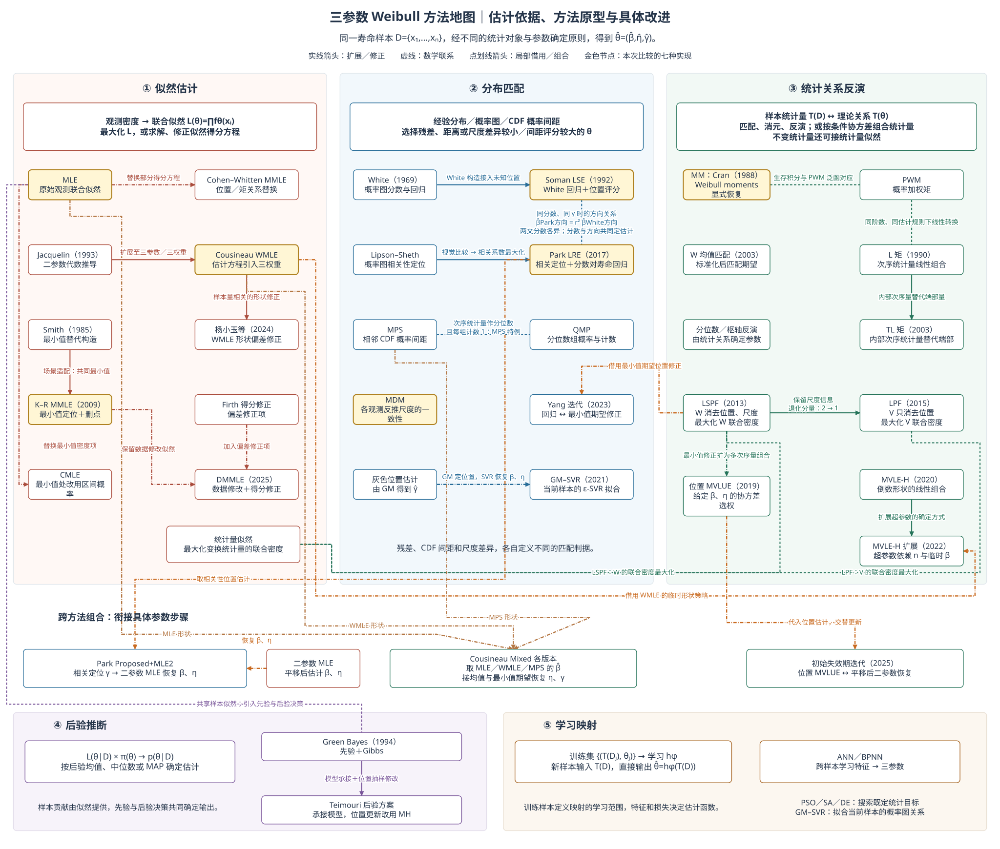
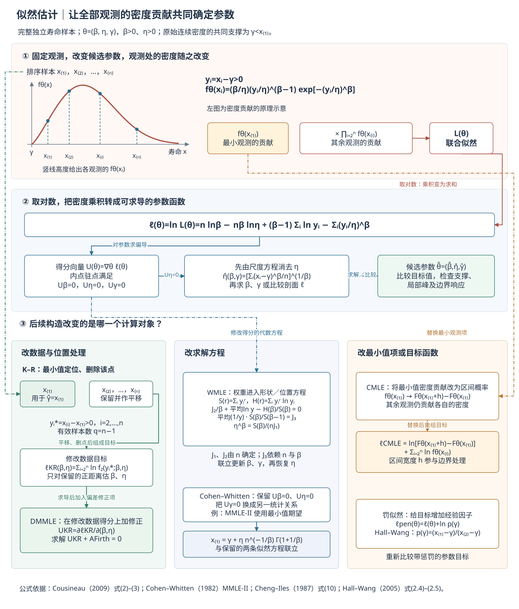
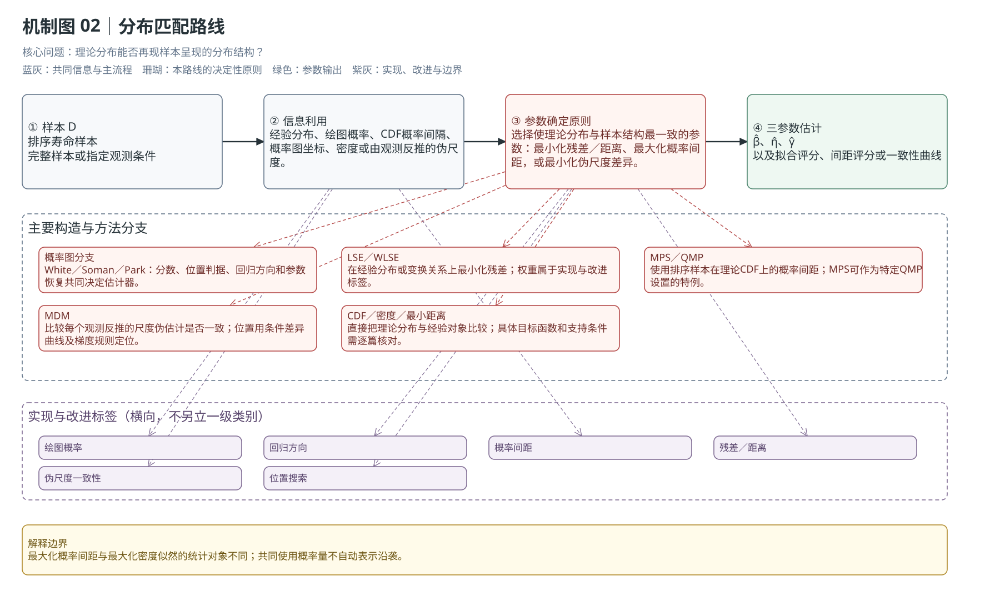
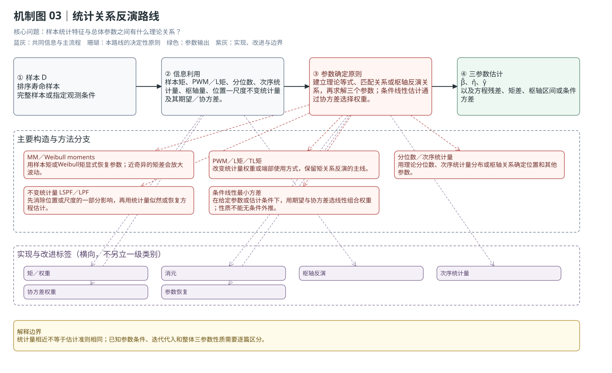
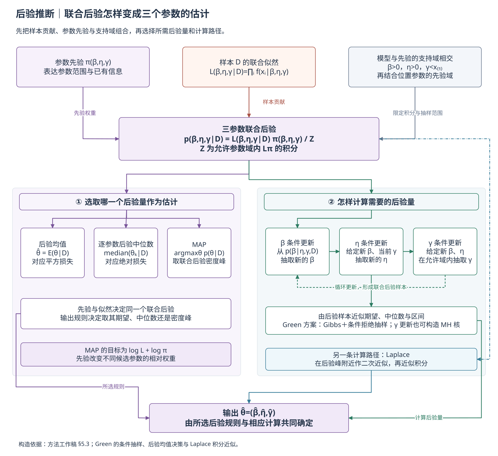
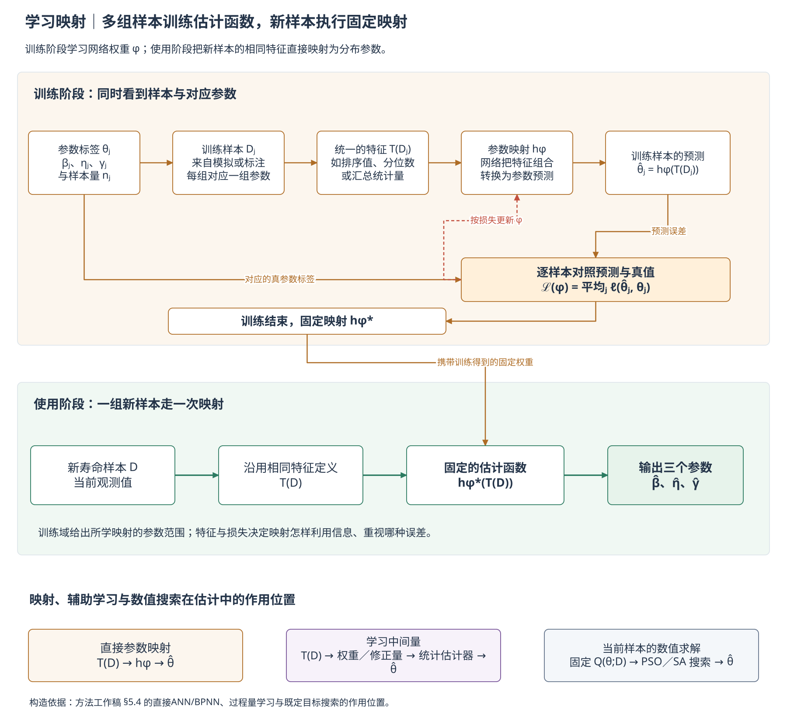

# 三参数Weibull参数估计方法的分类与相互关系

**报告上（方法分类）v1.0｜更新：2026-10-21**

魏鹏宇｜东北大学机械工程与自动化学院

分会场3：装备寿命与可靠性评估

各位老师、各位同学，大家好！我是东北大学机械工程与自动化学院的在读博士生魏鹏宇。今天汇报的题目是《小样本三参数Weibull参数估计方法的比较与选择》。

这次汇报分为两部分。第一部分梳理现有方法的估计原理，通过分类和方法间关系形成一张方法地图；第二部分在共同样本上比较代表方法，分析它们在小样本下的偏差、波动、异常输出和失败风险。

## 1　先看现有方法：名称很多，层次混在一起

三参数Weibull分布包含形状参数β、尺度参数η和位置参数γ。位置参数决定分布的支撑边界，并与形状、尺度共同参与估计。围绕三个参数的确定，文献中陆续形成了多种方案：

| 代表文献（作者／年份） | 方案或方法名 | 主要构造 | 构造特点 |
|---|---|---|---|
| Smith（1985） | 三参数MLE及最小值替代构造 | 原始似然；另讨论位置取最小观测、删除该观测后的估计 | 分析非正则似然与最小值替代构造 |
| Cohen–Whitten（1982） | MMLE-I—V、MME分支 | 保留部分似然方程，用最小值、均值、方差或中位数关系替换位置或矩方程 | 同一MMLE缩写下有多个具体版本 |
| Cheng–Amin（1983）；Ranneby（1984） | MPS／最大概率间距 | 用相邻CDF概率间距构造乘积或对数目标 | 两条独立提出线索 |
| Cheng–Iles（1987） | CMLE／修正似然 | 用最小观测附近的区间概率替换密度项 | 位置边界处理改变了似然项 |
| White（1969） | 概率图回归 | 用次序统计量期望构造分数，再回归对数寿命 | 两参数概率图基础 |
| Soman–Misra（1992） | 三参数LSE／White扩展 | 平移样本、White分数、回归和位置评分 | 未知位置被接入概率图流程 |
| Cran（1988） | Weibull moments | 由生存函数幂次积分形成矩，再显式恢复三参数 | 通过矩差显式恢复 |
| Jacquelin（1993）→ Cousineau（2009） | WMLE／加权MLE | 从二参数代数关系扩展到三参数，并把三个权重放进估计方程 | 明确的扩展关系 |
| Kundu–Raqab（2009） | K–R MMLE | 以共同最小值定位并删除该观测，再估计其余参数 | 最小值定位与删样本结合 |
| Hosking（1990）；Elamir–Seheult（2003） | L矩／截尾L矩 | 以次序统计量线性组合匹配理论统计关系，截尾L矩减少端部影响 | 统计关系路线的重要来源 |
| Nagatsuka等（2013） | LSPF | 用与位置、尺度无关的统计量估形状，再恢复其余参数 | 位置尺度自由的联合构造 |
| Nagatsuka–Balakrishnan（2015） | LPF | 只消除位置、保留尺度信息，再进行参数恢复 | 对LSPF的构造改进 |
| Park（2017；2018） | Proposed+Plot／Proposed+MLE2 | 用概率图相关系数定位，再按回归或二参数MLE恢复 | 2018补充条件下的存在性论证 |
| Yang等（2023） | 最小二乘迭代 | 概率图回归与最小次序统计量位置修正交替进行 | 位置修正与回归组合 |
| 代表文献待补 | Bayes、ANN／BPNN、MDM等 | 分别使用先验与后验、训练映射或尺度伪估计差异 | 对应后验推断、学习映射和尺度一致性判据 |

这些名称分别强调估计准则、统计量、推断框架或改进步骤。例如，MLE强调似然，L矩强调统计量，Bayes强调后验推断，加权则描述对原有构造的调整。要把这些方法联系起来，需要回到它们怎样从样本得到参数。

## 2　归纳后的分类依据与分类结果

现有名称之所以显得杂，是因为它们分别强调了不同内容：有的强调观测密度，有的强调概率图或概率间距，有的强调矩和次序统计量，有的强调先验和后验，有的强调训练映射；加权、偏差修正、位置处理和数值搜索又会横跨这些内容。

因此，方法的主要归属按两个层面确定：

1. **样本信息：** 从样本中提取什么，是观测处的密度、经验分布、概率间距、矩、分位数、次序统计量、不变统计量，还是训练样本中的特征。
2. **参数确定原则：** 怎样把这些信息变成三个参数，是最大化似然、最小化分布偏离、匹配概率结构、反演理论统计关系、更新后验，还是学习样本到参数的映射。

加权、偏差修正、位置处理、边界约束、数值求解和跨路线组合描述实现与改进发生的环节。地图按估计依据确定每个方法的主要归属，再用关系线表示它借用的统计量、步骤及其与其他方法的联系。

据此可以归纳出五条路线：似然估计、分布匹配、统计关系反演、后验推断和学习映射。每条路线内部的方法差别，体现在具体方程、统计量和参数恢复步骤上。

这五条路线的分歧，发生在把样本转成参数的关键一步：

| 路线 | 从样本构造什么 | 据此怎样确定参数 |
|---|---|---|
| 似然估计 | 观测处的密度及联合似然 $L(\theta)=\prod_i f_\theta(x_i)$ | 最大化联合似然，或求解、修正其得分方程 |
| 分布匹配 | 经验分布、概率图坐标、CDF间距或各观测反推的尺度 | 按分布差异、回归残差、间距评分或尺度一致性选择参数 |
| 统计关系反演 | 矩、分位数、次序统计量等样本特征 $T(D)$ | 将样本特征接到理论关系 $T(\theta)$，通过匹配、消元、反演或条件线性组合恢复参数 |
| 后验推断 | 样本似然与先验形成的后验 $p(\theta\mid D)\propto L(\theta)\pi(\theta)$ | 按后验均值、中位数或MAP等决策规则给出估计 |
| 学习映射 | 多组训练样本的特征与对应参数 | 从训练数据学习映射 $h_\phi$，再将新样本特征输入映射得到参数 |

例如，同一组排序寿命可以进入似然，也可以转成概率图坐标或矩。路线的区别在于：似然方法评价候选参数下的样本密度，分布匹配评价样本与理论分布的一致程度，统计关系反演则从可计算的样本特征恢复参数。后验推断进一步引入先验与后验决策，学习映射则借助多组训练样本形成估计函数。

LSPF／LPF先构造不变统计量，再最大化其联合密度，因此同时联系统计量构造与似然准则；地图把它们放在统计量构造的主要位置，并将具体准则连回统计量似然。

**图2｜方法的估计依据与具体关系。** 各区域入口给出统计对象和参数确定原则；区域内外的线连接具体方法，标明扩展、修正、数学联系或借用的参数步骤。金色节点对应本次比较的七种实现。

## 3　似然估计路线：从观测密度及其联合贡献出发

这条路线使用观测处的密度及其联合贡献，把候选参数放进模型后比较样本的似然。参数由最大化联合似然或求解由似然导出的得分关系确定。后续方法通过调整权重、替换位置方程、处理边界项或引入偏差修正，形成不同的估计方案。

| 样本信息 | 参数确定原则 | 实现与改进位置 |
|---|---|---|
| 观测处的密度、联合密度、删失或支持边界信息 | 最大化联合似然，或求解似然得分方程 | 方程加权、位置关系替换、边界约束、Firth型修正、局部候选与数值搜索 |

MLE、WMLE、Cohen–Whitten MMLE、K–R MMLE、CMLE、DMMLE和罚似然的差别，集中在似然项、估计方程和位置处理上。PSO、模拟退火和差分进化用于搜索似然目标时，承担其中的数值求解环节。

**图3｜似然路线的共同骨架。** 样本先进入密度和得分关系，再由确定的目标或方程输出三参数；权重、位置和偏差修正改变的是其中的具体环节。

## 4　分布匹配路线：比较理论分布和样本呈现的分布关系

这条路线把理论分布与样本的分布形态、概率图关系、概率间距或反推尺度放在一起比较，依据匹配程度确定参数。

| 样本信息 | 参数确定原则 | 实现与改进位置 |
|---|---|---|
| 经验CDF、概率图分数、相邻概率间距、各观测反推的尺度伪估计 | 最小化分布差异、残差或距离；最大化概率间距评分；或让尺度伪估计更一致 | 分数选择、位置定位、回归方向、分组方式、梯度阈值和固定偏移 |

概率图、LSE／WLSE、最小距离估计、MPS／QMP和MDM属于这条路线。其中，概率图回归比较变换后的回归关系，最小距离估计比较分布差异，MPS／QMP利用概率间距评分，MDM比较各观测反推尺度的一致性。

**图4｜分布匹配路线的共同材料。** CDF、概率图和尺度一致性都在比较样本与理论分布，但比较对象和目标函数不同。

## 5　统计关系反演路线：从理论统计关系恢复参数

这条路线先选取样本矩、分位数、次序统计量、不变统计量或其他可计算特征，再建立它们与总体参数之间的理论关系，最后用匹配、消元或反解恢复参数。

| 样本信息 | 参数确定原则 | 实现与改进位置 |
|---|---|---|
| 样本矩、概率加权矩、L矩、分位数、次序统计量、不变统计量 | 匹配理论统计关系，或反演矩、枢轴关系和条件线性关系 | 权重和端部处理、位置与尺度消元、条件协方差选权、显式恢复和迭代代入 |

MM、PWM、L矩、TL矩、分位数和次序统计量方法属于这里。LSPF／LPF利用不变统计量及其联合密度和恢复方程确定参数；线性最小方差估计在给定参数或代入条件下，利用条件协方差确定组合权重。

**图5｜统计关系反演路线。** 统计量的选择决定保留哪些样本特征，理论关系提供匹配、消元和恢复参数的路径。

## 6　后验推断与学习映射

后验推断把样本似然和参数先验结合成后验分布，再按后验均值、中位数或MAP等规则给出估计。Gibbs、Laplace和MH用于计算或近似后验。

学习映射通过训练样本或模拟数据学习从样本特征到分布参数的估计函数，代表方法包括ANN和BPNN。特征表示决定输入哪些样本信息，损失函数引导参数映射的学习，训练域与校准共同影响外推表现。

| 扩展范式 | 样本信息 | 参数确定原则 | 实现与改进位置 |
|---|---|---|---|
| 后验推断 | 样本似然信息＋参数先验 | 后验规则，如均值、中位数或MAP | 后验计算、抽样、近似和先验敏感性 |
| 学习映射 | 训练样本、模拟样本和样本特征 | 学习特征到三个参数的映射 | 训练域、损失函数、校准和外推边界 |

**图6—7｜后验推断与学习映射。** 后验路线由似然和先验形成后验，再按决策规则给出估计；学习路线由训练样本学习参数映射，再用于新的样本。

## 7　完整机理地图：分类与方法间关系同时保留

地图中的区域回答“方法依据什么估计”，方法节点之间的连线回答“前后两个构造改变了什么”。例如，Jacquelin二参数推导扩展为三参数WMLE，随后再引入形状偏差修正，构成一条连续改进链；K–R的数据修改构造与Firth得分修正共同进入DMMLE，构成两个来源汇合的组合。完整地图中的关系分为三种：

- **沿袭或扩展：** 原文明确沿用、扩展或修正前一构造时使用实线。
- **数学联系或共享构造：** 两种方法共享CDF、矩、似然或统计量时使用虚线。
- **局部借用或组合：** 一个方法只借用了另一条路线的位置处理、统计量或参数恢复步骤时使用点划线。

沿着这些关系，可以看到Jacquelin二参数推导向Cousineau WMLE及后续形状修正的扩展；Smith删最小值构造在K–R中的场景适配；K–R与Firth型修正形成DMMLE；White向Soman三参数概率图的扩展；MPS与QMP在特定分组设置下的特例关系；PWM与L矩的数学联系；以及LSPF向LPF的构造改进。MLE与MAP通过似然模型相连，MAP进一步引入先验和后验决策；PSO、模拟退火等工具则连接到各自搜索的目标。

**图8｜完整机理地图。** 沿Jacquelin→WMLE→形状修正、White→Soman、L矩→TL矩、LSPF→LPF等方法链，可以看到具体构造的延续；沿LSPF→Yang迭代、WMLE→MVLE-H扩展，以及Park定位→二参数MLE组合等连线，可以看到某个参数步骤怎样被另一方法借用。PWM与L矩、Cran矩与PWM、MPS与QMP的虚线记录数学联系，成立条件写在线旁。Soman与Park连线比较同分数、同位置时的回归方向关系，两文的实际分数选择各异。

## 8　本轮七种实现落在哪些位置

本次统一比较选取七种实现，覆盖似然估计、分布匹配和统计关系反演三条路线。

| 实现 | 五簇主要归属 | 具体构造定位 |
|---|---|---|
| MLE | 似然估计 | 原始观测密度联合似然；另记录局部候选、边界与失败 |
| WMLE | 似然估计 | 在估计方程中引入三个权重 |
| MMLE（K–R单样本形式） | 似然估计 | 以样本最小值定位并删除该观测后估计其余参数 |
| LSE（Soman主分支） | 分布匹配 | White分数、位置评分和对数寿命对分数回归 |
| LRE（Park Proposed+Plot） | 分布匹配 | 相关系数定位、绘图概率分数和分数对对数寿命回归 |
| MDM-0.1 | 分布匹配 | 条件尺度伪估计差异、梯度阈值定位和固定偏移 |
| MM（Cran式） | 统计关系反演 | Weibull矩及矩差显式恢复参数 |

这三组实现形成构造对照：MLE、WMLE和K–R对应似然、方程加权与最小值定位；LSE、LRE和MDM对应分布关系匹配的不同分支；MM对应统计关系的显式恢复。

## 9　转入统一性能比较

后续结果将回到这些具体构造：出现偏差时检查位置处理、统计量构造和参数恢复；出现波动或异常时检查信息保留和求解环节。

第二部分将在共同抽样条件下比较这七种实现，分析性能差异怎样随样本量与形状参数变化，并结合地图中的具体构造解释典型表现。

——转入[报告下（方法对比）v0.4](报告下（方法对比）-v0.4.md)。

## 文献与源文件

- [方法分类工作稿](方法分类/04-方法分类与沿袭关系工作稿.md)：逐篇维护信息利用、参数原则、实现改进、关系证据和边界。
- [Yang综述的八类分类](方法分类/01-Yang综述的八类分类.md)：保留综述原始分类与名称辨析。
- [Research09的四条路线](方法分类/02-Research09的四条路线.md)：保留已有路线归纳及其局限。
- [机制图-v1.0目录](方法分类/机制图-v1.0/)：五类机制图、完整机理地图、draw.io源文件和静态预览图。
- [实验设置](实验设置.md)：统一比较对象、计算版本和数据合同。
