# 三参数Weibull参数估计方法的路线图

**报告上（方法路线图）v2.0｜更新：2026-10-22**

魏鹏宇｜东北大学机械工程与自动化学院

分会场3：装备寿命与可靠性评估

各位老师、各位同学，大家好！我是东北大学机械工程与自动化学院的在读博士生魏鹏宇。今天汇报的题目是《小样本三参数Weibull参数估计方法的比较与选择》。

这次汇报分为两部分。第一部分梳理现有方法的估计原理，通过五条路线及方法间关系形成一张参数估计方法的路线图；第二部分在共同样本上比较代表方法，分析它们在小样本下的偏差、波动、异常输出和失败风险。

## 1　先看现有方法：名称很多，层次混在一起

三参数Weibull分布包含形状参数β、尺度参数η和位置参数γ。位置参数决定分布的支撑边界，并与形状、尺度共同参与估计。围绕三个参数的确定，文献中陆续形成了多种方案：

| 代表文献（作者／年份） | 方案或方法名 | 主要构造 | 构造特点 |
|---|---|---|---|
| Smith（1985） | 三参数MLE及最小值替代构造 | 原始似然；另讨论位置取最小观测、删除该观测后的估计 | 分析非正则似然与最小值替代构造 |
| Cohen–Whitten（1982） | MMLE-I—V、MME分支 | 保留部分似然方程，用最小值、均值、方差或中位数关系替换位置或矩方程 | 同一MMLE缩写下有多个具体版本 |
| Cheng–Amin（1983）；Ranneby（1984） | MPS／最大概率间距 | 用相邻CDF概率间距构造乘积或对数目标 | 两条独立提出线索 |
| Cheng–Iles（1987） | CMLE／修正似然 | 用最小观测附近的区间概率替换密度项 | 位置边界处理改变了似然项 |
| White（1969） | 概率图回归 | 用次序统计量期望构造分数，再回归对数寿命 | 两参数概率图基础 |
| Soman–Misra（1992） | 三参数LSE／White扩展 | 平移样本、White分数、回归和位置评分 | 未知位置被接入概率图流程 |
| Cran（1988） | Weibull moments | 由生存函数幂次积分形成矩，再显式恢复三参数 | 通过矩差显式恢复 |
| Jacquelin（1993）→ Cousineau（2009） | WMLE／加权MLE | 从二参数代数关系扩展到三参数，并把三个权重放进估计方程 | 明确的扩展关系 |
| Kundu–Raqab（2009） | K–R MMLE | 以共同最小值定位并删除该观测，再估计其余参数 | 最小值定位与删样本结合 |
| Hosking（1990）；Elamir–Seheult（2003） | L矩／截尾L矩 | 以次序统计量线性组合匹配理论统计关系，截尾L矩减少端部影响 | 统计关系路线的重要来源 |
| Nagatsuka等（2013） | LSPF | W变换消除位置、尺度，由W联合密度估形状，再恢复其余参数 | 不变统计量似然与参数恢复相接 |
| Nagatsuka–Balakrishnan（2015） | LPF | V变换只消除位置，由V联合密度估形状与尺度，再按原文似然方程恢复 | 对LSPF的构造改进 |
| Park（2017；2018） | Proposed+Plot／Proposed+MLE2 | 用概率图相关系数定位，再按回归或二参数MLE恢复 | 2018补充条件下的存在性论证 |
| Yang等（2023） | 最小二乘迭代 | 概率图回归与最小次序统计量位置修正交替进行 | 位置修正与回归组合 |
| 代表文献待补 | Bayes、ANN／BPNN、MDM等 | 分别使用先验与后验、训练映射或尺度伪估计差异 | 对应后验推断、学习映射和尺度一致性判据 |

这些名称分别强调估计准则、统计量、推断框架或改进步骤。例如，MLE强调似然，L矩强调统计量，Bayes强调后验推断，加权则描述对原有构造的调整。要把这些方法联系起来，需要回到它们怎样从样本得到参数。

## 2　从估计机制建立五条路线

现有名称之所以显得杂，是因为它们分别强调了不同内容：有的强调观测密度，有的强调概率图或概率间距，有的强调矩和次序统计量，有的强调先验和后验，有的强调训练映射；加权、偏差修正、位置处理和数值搜索又会横跨这些内容。

理解一种方法，先连续回答两个问题：

1. **样本信息：** 从样本中提取什么，是观测处的密度、经验分布、概率间距、矩、分位数、次序统计量、不变统计量，还是训练样本中的特征。
2. **参数确定原则：** 怎样把这些信息变成三个参数，是最大化似然、最小化分布偏离、匹配概率结构、反演理论统计关系、更新后验，还是学习样本到参数的映射。

加权、偏差修正、位置处理、边界约束、数值求解和跨路线组合则说明变化发生在哪个环节。其中有些会改变统计构造，有些服务于既定准则的计算，需要按实际步骤区分。

据此，可以从似然构造与优化、分布关系匹配、统计特征关系匹配与反演、贝叶斯后验推断以及学习型参数映射五条路线理解现有方法。路线体现不同的参数确定机制；具体方法可以完整采用一种机制，也可以通过统计量构造、参数消除、分阶段估计或组合准则连接多条路线。我们建立的是参数估计方法的路线图，目的是揭示估计原理、构造特征及其相互联系，不要求每个方法只能归入一个类别，也不以选出唯一主要归属作为进入地图的条件。

五条路线各自回答：样本形成什么对象，哪一种机制据此确定参数？

| 路线 | 从样本构造什么 | 据此怎样确定参数 |
|---|---|---|
| 一：似然构造与优化 | 样本或所选统计量在候选参数下的联合密度，形成似然函数 | 最大化似然或相应的修正准则；方程修正按其实际构造说明 |
| 二：分布关系匹配 | 经验分布、绘图概率、概率间距或其他分布表示 | 依据指定的拟合准则，在表示、残差、概率结构或一致性关系上确定参数 |
| 三：统计特征关系匹配与反演 | 矩、分位数、次序统计量等选定特征，以及它们与参数的理论关系 | 通过匹配、消元、求解或反演识别参数，再恢复其余参数 |
| 四：贝叶斯后验推断 | 样本似然与先验结合形成的参数后验分布 | 依据后验分布及相应的决策规则给出估计 |
| 五：学习型参数映射 | 多组具有已知参数标签的训练样本及其特征 | 学习样本或特征到参数的映射，固定映射后用于新样本 |

例如，同一组排序寿命可以用于构造似然，也可以转成概率图坐标或矩。分布关系匹配围绕样本的分布表示及其拟合准则展开；统计特征关系匹配与反演围绕选定特征与理论参数关系展开。贝叶斯推断使用似然，但最终估计还取决于先验和后验决策；学习型映射也可使用矩特征，但参数映射来自多组带标签样本的训练。所用材料相同，并不意味着参数确定机制相同。

LSPF就是一个需要沿过程阅读的例子：先用W变换消除位置与尺度，再由内部W统计量的联合密度构造形状似然，最后依据位置修正和尺度恢复关系补齐参数。统计量构造、似然估计和统计关系恢复在同一方法中相接。后面先分别解释这些机制，再回到完整地图看它们如何连接。

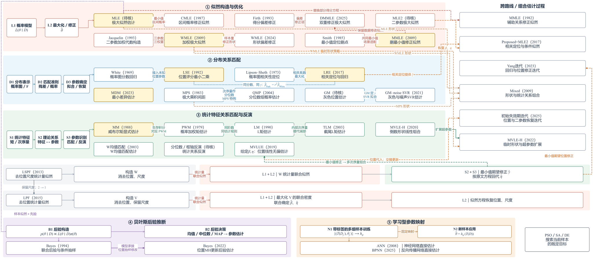

**图2｜由估计机制组成路线骨架，再接入具体方法。** 每条路线先给出统计对象及确定参数的机制，具体方法连接到采用或改变的环节。方法内部的跨路线步骤与方法之间的沿袭、修正、数学联系及局部借用分别表达；同一方法可以连接多条路线。金色节点对应本次比较的七种实现。

## 3　路线一：似然构造与优化

这条路线的核心机制是：构建样本在候选参数下的似然函数，并通过最大化似然或相应的修正准则来估计参数。先固定已经观测到的样本，把分布密度看作待估参数的函数。对独立同分布完整样本 $D=(x_1,\ldots,x_n)$，每个观测对应一个参数函数 $g_i(\theta)=f(x_i;\theta)$；所有观测共用同一组参数 $\theta=(\beta,\eta,\gamma)$。在同一个参数处将这些函数值相乘，就构成联合似然：

$$L(\theta;D)=\prod_{i=1}^{n}g_i(\theta)=\prod_{i=1}^{n}f(x_i;\theta).$$

这个乘积对整个参数域定义了一个函数。最大似然估计在该联合函数上寻找最大值。当给定参数域 $\Theta$ 内存在最大值时，

$$\widehat\theta_{\mathrm{MLE}}\in\operatorname*{arg\,max}_{\theta\in\Theta}L(\theta;D).$$

图3a把这一个构造过程连成图像：固定观测、形成各参数函数、在相同参数处相乘、在乘积函数上求最大值。前三步解释似然如何构造（L1），最后一步解释估计由什么准则确定（L2）。为便于绘制，图中固定η和γ，只展示β截面；完整三参数MLE仍在三维参数域中处理同一个联合似然。取对数、得分方程、剖面求解或数值优化是实现最大化的计算途径，得分为零还须区分极大值、其他驻点及边界情况。原始三参数似然可能无界，参数域、支持边界与有限解存在性仍须核验。

原始观测的密度乘积是这条路线的基本例子。若先变换为统计量，也可以由该统计量的联合密度构造似然；这时必须使用相应的分布，不能不加区分地把相关统计量的边缘密度相乘。LSPF的形状估计就是内部W统计量的联合似然最大化，统计量的选取没有取消其似然机制。

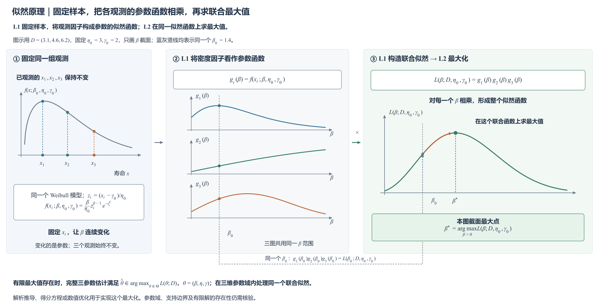

**图3a｜固定数据，把密度转为参数函数，再相乘并最大化。** 左侧三个观测固定在寿命轴上；中间三条曲线分别是这三个观测对应的参数函数，横轴均为同一β范围；右侧似然曲线由三个函数在同一β处的值逐点相乘得到。蓝灰竖线及连线追踪同一个β₀如何从三个因子构成一个联合似然值，橙色箭头表示在这个联合函数上求最大值。本图峰点是固定η₀=3、γ₀=2时的条件形状估计；完整三参数MLE仍需在三维参数域内求解。

| 样本信息 | 参数确定原则 | 实现与改进位置 |
|---|---|---|
| 原始观测或选定统计量的联合密度，以及删失或支持边界信息 | 最大化似然或修正准则；估计方程的求解与修正按具体构造解释 | 似然项替换、方程加权、位置关系替换、边界约束、Firth型修正、局部候选与数值搜索 |

由这个机制再看具体方法，改动位置就清楚了：CMLE替换最小值附近的似然贡献；罚似然引入额外目标因子；K–R先以最小值定位并删除该观测；Cohen–Whitten的不同MMLE分支保留部分方程、以特定统计关系替换其他方程；WMLE对估计方程加权，DMMLE在修改数据后进一步修正得分。修改似然项或估计方程属于统计构造变化，WMLE等不能仅凭名称就认定等同于某个未说明的似然最大化。PSO、模拟退火和差分进化直接搜索既定似然目标时，则承担数值求解环节。

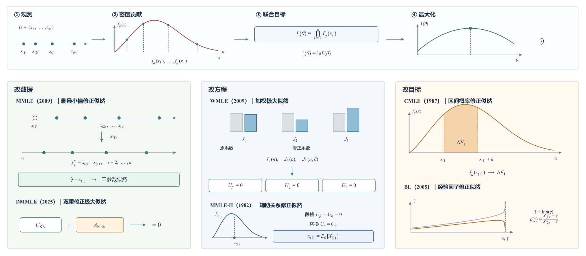

**图3b｜从密度贡献到求解方程及其改动位置。** 上部展示各观测处的密度怎样相乘形成似然，再取对数、求导并由尺度方程消去η。下部在具体接口上展开：K–R平移和删除最小观测，DMMLE修正修改数据后的得分，WMLE给方程加权，Cohen–Whitten替换位置关系，CMLE替换最小值项，罚似然增加目标因子。

## 4　路线二：分布关系匹配

这条路线将样本转化为经验分布、绘图概率、概率间距或其他分布表示，再依据指定的拟合准则确定参数。它的机制包含相接的三个环节：构造用于比较的分布表示或概率结构（D1），指定残差、距离、间距或一致性准则（D2），再据此求得参数（D3）。需要同时交代比较对象和准则；“拟合得好”只有在这两者明确后才有具体含义。

以CDF拟合为例，将排序观测 $x_{(i)}$ 配以概率点 $p_i$，候选参数给出 $F_\theta(x_{(i)})$。各点的偏离先形成整组目标，再通过最小化确定参数：

$$Q_{\mathrm{CDF}}(\theta)=\sum_{i=1}^{n}w_i\left[F_\theta(x_{(i)})-p_i\right]^2,\qquad
\widehat\theta\in\operatorname*{arg\,min}_{\theta\in\Theta}Q_{\mathrm{CDF}}(\theta).$$

图4a下部沿同一组概率点和候选曲线说明这个过程。CDF平方差是共同机制的一个例子，其他方法需要回到各自实际使用的表示和准则。

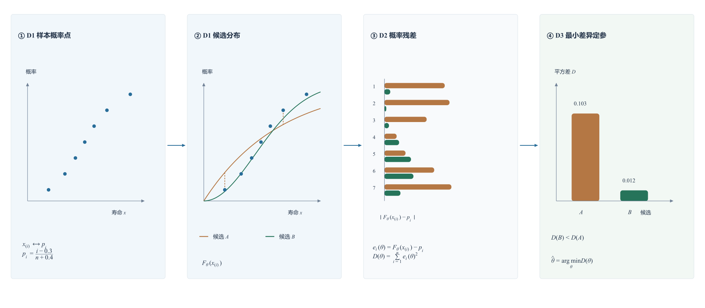

**图4a｜先明确表示与准则，再读参数怎样确定。** 上部以D1—D3概括共同机制；下部CDF例子将同一组样本概率点、候选曲线、逐点偏离和整组差异连起来。概率图改变比较坐标，MPS使用概率间距，MDM比较反推尺度；这些构造在对应机制环节展开，CDF平方差不替代它们各自的准则。

概率图把分布关系变换为近似直线，Soman与Park分别通过其位置选择、分数和回归方向恢复参数；MPS则令 $u_i=F_\theta(x_{(i)})$，补上 $u_0=0$、$u_{n+1}=1$，最大化概率间距的乘积 $\prod_{i=1}^{n+1}(u_i-u_{i-1})$。这些间距来自CDF概率轴，与LSPF／LPF的数据变换统计量联合似然不同。

MDM又改变了比较对象：由同一Weibull分布关系反推每个观测的尺度伪估计

$$\eta_i(\beta,\gamma)=\frac{x_{(i)}-\gamma}{[-\log(1-p_i)]^{1/\beta}},$$

再利用这些伪估计的一致性确定参数。本轮MDM先在给定位置下选择使尺度差异最小的形状，再以固定梯度偏移值$\delta=0.1$对条件最优值曲线定位，最后取伪尺度均值；不能把整个流程简写为同时最小化一个CDF平方差目标。

| 样本信息 | 参数确定原则 | 实现与改进位置 |
|---|---|---|
| 经验CDF、概率图分数、相邻概率间距、各观测反推的尺度伪估计 | 最小化分布差异、残差或距离；最大化概率间距评分；或让尺度伪估计更一致 | 分数选择、位置定位、回归方向、分组方式、梯度阈值和固定偏移 |

因此，概率图、LSE／WLSE、最小距离估计、MPS／QMP和MDM可以通过这条机制链联系起来：它们分别改变了分布表示、确定准则或参数恢复环节。若某一方法再接入统计关系修正位置或条件似然恢复尺度，相应步骤继续连向其他路线。

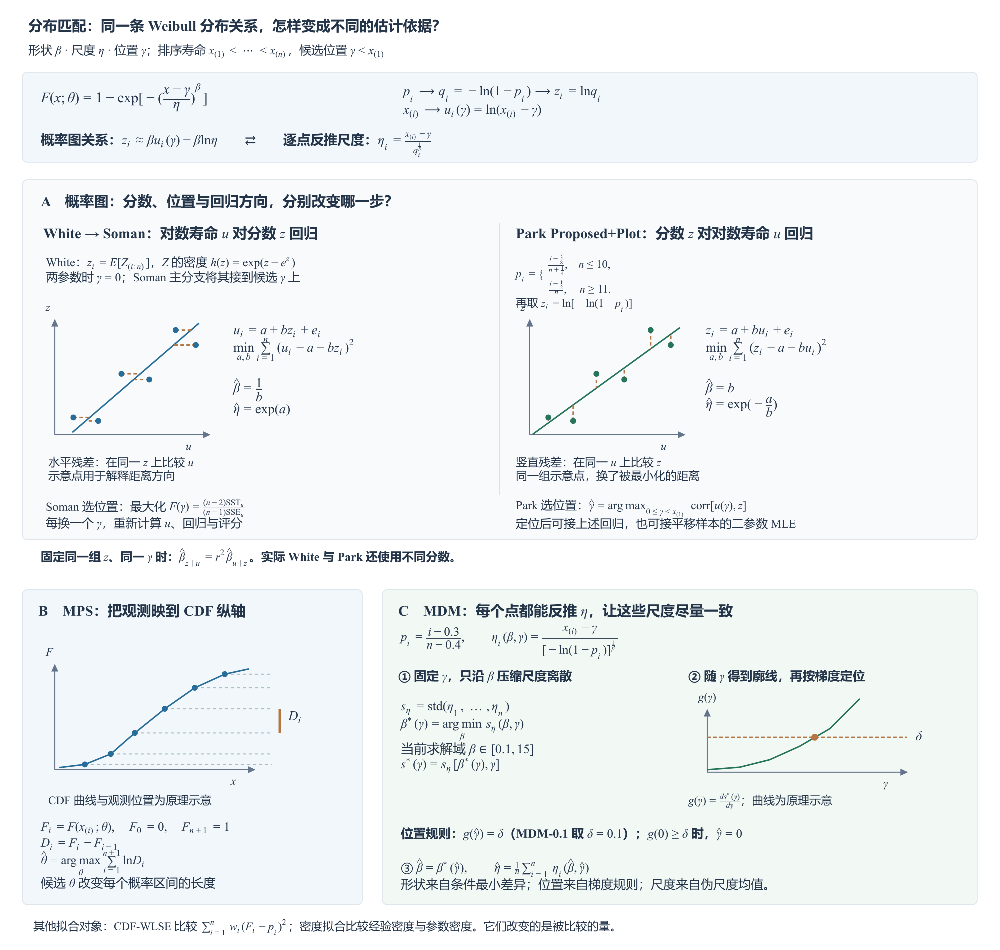

**图4b｜同一分布关系形成不同的匹配过程。** 概率图部分把White／Soman的水平残差与Park的竖直残差并置，展示分数选择、位置评分和回归方向怎样共同决定参数。MPS比较CDF纵轴上的相邻概率间距；MDM先在给定位置下选择使尺度差异最小的形状，再沿该条件最优值曲线按梯度定位，最后以伪尺度均值恢复尺度。

## 5　路线三：统计特征关系匹配与反演

这条路线提取样本的统计特征，利用它们与分布参数之间的理论关系，通过匹配、消元、求解或反演得到参数。核心在于选定特征怎样识别参数：先从样本得到特征（S1），写出相应的理论参数关系（S2），再通过该关系确定参数（S3）。这里关注若干选定特征及其理论关系；前一条路线则围绕样本的分布表示或概率结构指定拟合准则。

以常规矩法为例，样本均值、方差和偏度分别对应Weibull分布的理论矩。偏度中的位置与尺度被消去，留下关于形状的关系；解出形状后，再由方差和均值依次恢复尺度、位置。图5a下部追踪这组特征怎样接上理论曲线并得到参数。这是本例选择的识别次序，不要求所有统计关系方法都先消去位置和尺度、再估形状。

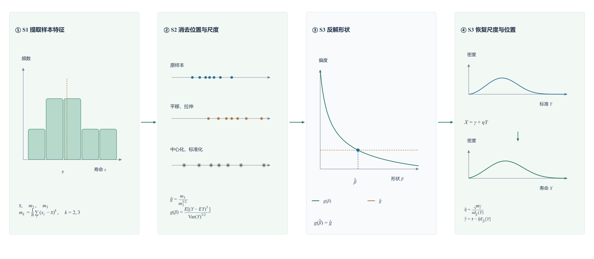

**图5a｜选定特征，通过理论关系识别参数。** 上部S1—S3给出共同机制；下部常规矩例子将样本矩、形状理论关系和参数恢复连成一条过程。偏度消元、先形状后尺度位置是这个例子的具体实现。Cran、PWM／L矩和条件线性估计分别改变特征、理论关系或识别方式；统计量似然另接似然机制。

| 样本信息 | 参数确定原则 | 实现与改进位置 |
|---|---|---|
| 样本矩、概率加权矩、L矩、分位数、次序统计量等选定特征 | 匹配理论统计关系，或反演矩、枢轴关系和条件线性关系 | 特征选择、权重和端部处理、位置与尺度消元、条件协方差选权、显式恢复和迭代代入 |

沿着这条机制看方法变化：Cran把常规幂矩改为生存函数幂次积分，用矩差及比值消元，再显式恢复参数；PWM、L矩和TL矩改变样本的秩权重与相应理论关系；分位数或枢轴方法选择其他特征及反演关系。条件位置MVLUE则由次序统计量的期望构造位置无偏估计，再利用理论协方差选择线性组合权重。其无偏、最小方差性质以形状、尺度已知并使用相应理论系数为条件，代入估计值后的三参数组合不能直接继承这些性质。

仅仅使用统计量，还不能说明采用了这条确定参数的机制。LSPF与早期W均值匹配方法使用相同形式的标准化统计量

$$W_i=\frac{X_{(i)}-X_{(1)}}{X_{(n)}-X_{(1)}},$$

却接入不同准则：均值匹配方法用理论 $E_\beta(\bar W)$ 与样本值相等确定形状；LSPF由内部W统计量的联合密度构造似然，按

$$\widehat\beta_W\in\operatorname*{arg\,max}_{\beta>0}f_W(w_2,\ldots,w_{n-1};\beta)$$

估计形状。LSPF随后用初始尺度代入最小值期望关系修正位置，再在该位置与形状下恢复尺度。因而，W消元是构造策略，形状估计体现L1／L2似然机制，位置恢复接入统计特征与参数的理论关系。LPF改用 $V_i=X_{(i)}-X_{(1)}$，只消去位置、保留尺度信息，由V联合密度联合估计形状与尺度，随后保留形状，按原文似然方程(9)、(10)重估位置与尺度；该恢复仍体现似然方程机制，不能只因使用统计量或分阶段处理就认定属于路线三。图5b将这些阶段分别连接；W／V的数据间距联合密度不能与MPS的CDF概率间距乘积混同。

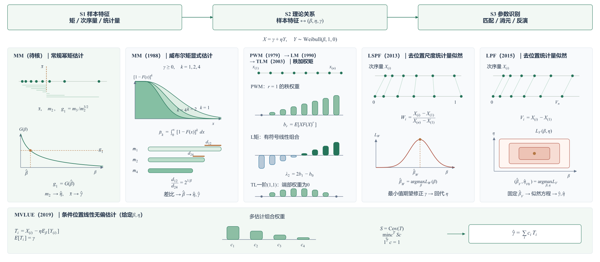

**图5b｜由特征与理论关系展开方法，再读跨路线阶段。** 常规矩法用偏度消去位置和尺度，再由方差、均值恢复；Cran改用生存曲线积分及矩差显式反解；PWM、L矩与TL矩改变统计量的样本权重。W／V板块将构造策略、联合密度最大化及后续参数恢复分别标出：LSPF先由W估形状，再修正位置并恢复尺度；LPF先由V联合估计尺度与形状，随后保留形状并由原文似然方程重估其余参数。条件位置MVLUE根据理论期望及协方差构造、组合位置估计。

## 6　路线四、五：贝叶斯后验推断与学习型参数映射

贝叶斯后验推断将先验信息与样本似然结合，形成参数后验分布，再依据后验决策规则给出估计。对于给定数据，先以似然更新先验支持的参数区域；乘积经归一化得到联合后验（B1）：

$$p(\theta\mid D)=\frac{L(\theta;D)\pi(\theta)}{\int_\Theta L(\vartheta;D)\pi(\vartheta)\,d\vartheta}.$$

再根据损失函数选择后验决策（B2）：平方损失对应后验均值，绝对损失对应后验中位数，MAP取后验密度的峰。这里最终估计依据的是后验分布及相应规则，似然是其中的组成部分。图6a将同一候选参数轴上的先验、似然、后验与决策连起来；图6b再展开联合后验及计算路径。先验选择、支持域和决策规则改变了推断构造，Gibbs、MH及Laplace则分别服务于后验抽样或近似计算。后验可积性及所选输出量的存在性仍须按具体模型条件核验。

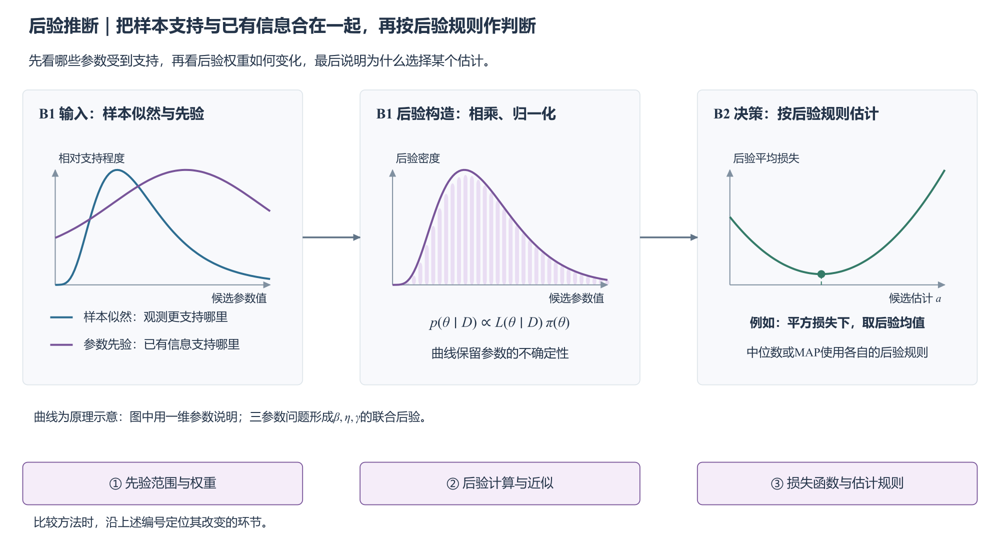

**图6a｜由支持曲线到后验，再按估计规则作判断。** 似然和先验分别支持不同的候选区域，乘积归一化后形成后验。图中以平方损失为例，用后验平均损失的最低点说明为何选择后验均值；中位数与MAP使用各自的规则。

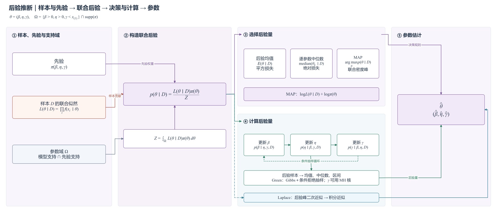

**图6b｜联合后验、输出规则与计算过程。** 似然、先验和支持域共同确定联合后验；后验均值、中位数及MAP选择不同的输出量。条件抽样通过β、η、γ的循环更新形成后验样本，Laplace则通过后验峰附近的二次近似计算积分，两种路径服务于所选后验量。

学习型参数映射的核心机制发生在两个阶段。训练时，使用多组具有已知参数标签的样本 $\{(D_j,\theta_j)\}_{j=1}^{M}$，将样本或特征 $T(D_j)$ 输入共享映射 $h_\phi$，比较预测与标签并更新同一组权重（N1）：

$$\widehat\phi\in\operatorname*{arg\,min}_{\phi}\frac{1}{M}\sum_{j=1}^{M}\mathcal L\!\left(h_\phi(T(D_j)),\theta_j\right).$$

训练完成后固定映射，将新样本输入并输出估计 $\widehat\theta=h_{\widehat\phi}(T(D_{\mathrm{new}}))$（N2）。图7a用多组样本、标签与共享权重的反馈表现训练，再接到新样本应用；图7b展开具体改动位置。ANN和BPNN可在特征、映射结构、损失或训练域上变化。即使用矩作输入，确定映射的机制仍是带标签训练；若网络只预测中间量，或PSO只搜索当前样本的目标，则需要连接到实际服务的估计环节，不能与直接参数映射合并。

| 路线 | 样本信息 | 参数确定原则 | 实现与改进位置 |
|---|---|---|---|
| 贝叶斯后验推断 | 样本似然信息＋参数先验 | 后验规则，如均值、中位数或MAP | 先验、支持域、决策规则、后验抽样或近似 |
| 学习型参数映射 | 多组带参数标签的训练样本及其特征 | 训练映射，再对新样本输出三个参数 | 特征、映射结构、训练域、损失、校准和外推边界 |

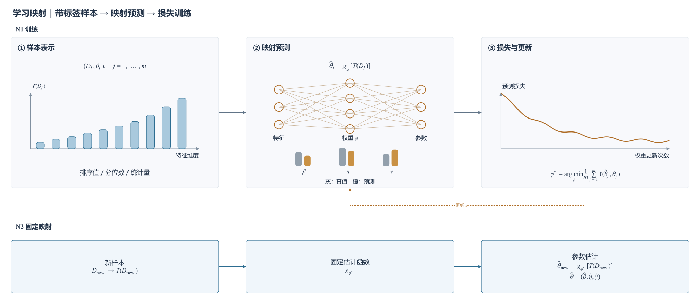

**图7a｜多组带标签样本训练，同一固定映射用于新样本。** 训练阶段（N1）中，多组样本的同类特征进入共享映射，参数预测与各自标签比较，整组误差反馈到同一组权重。应用阶段（N2）固定这些权重，将新样本转成三个参数估计；真实标签用于训练，应用时不需要提供新样本的真实参数。

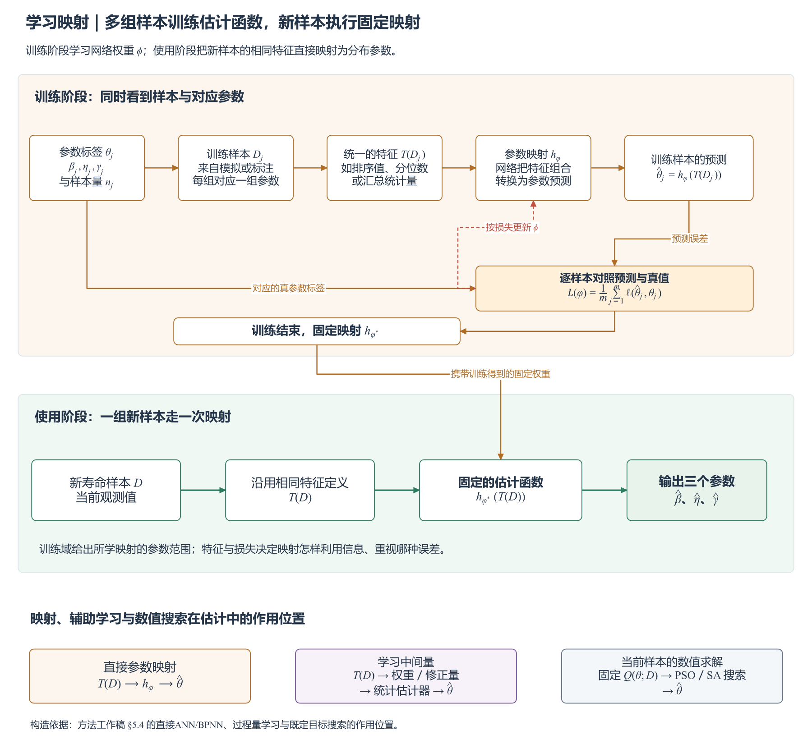

**图7b｜训练与使用分开看。** 训练阶段比较多组样本的参数预测和真值，按损失更新网络权重；使用阶段保持映射固定，将新样本的同类特征转成三个参数。图下部标出直接预测参数、学习统计估计器的中间量以及搜索当前样本目标的不同作用位置。

## 7　完整机理地图：方法怎样连接机制，方法之间怎样联系

分别理解五条路线后，再把具体方法接回地图。这里需要读两层联系。

第一层是**同一个方法内部的机制连接**。先识别它构造了什么、用什么确定哪个参数、其余参数怎样恢复，再按阶段连接路线节点。例如，LSPF依次经过W消元、W联合密度最大化、最小值期望位置修正及尺度恢复；SAM连接最小值期望关系、概率图回归和条件似然尺度更新；PM连接最小值中位数关系与给定位置的似然方程；Park Proposed+MLE2先用概率图相关性定位，再接平移样本的二参数MLE。它们可以跨路线展开，这些连接说明估计过程本身。

第二层是**不同方法之间有依据的关系**。例如，Jacquelin二参数推导扩展为三参数WMLE，随后再引入形状偏差修正，构成连续改进链；K–R的数据修改构造与Firth得分修正共同进入DMMLE，构成两个来源汇合的组合。方法之间的关系继续分为三种：

- **沿袭或扩展：** 原文明确沿用、扩展或修正前一构造时使用实线。
- **数学联系或共享构造：** 两种方法之间可核对的公式关系或共享构造使用虚线，并注明成立条件；同属一路线本身不构成历史沿袭证据。
- **局部借用或组合：** 一个方法只借用了另一条路线的位置处理、统计量或参数恢复步骤时使用点划线。

沿着这些关系，可以看到Jacquelin二参数推导向Cousineau WMLE及后续形状修正的扩展；Smith删最小值构造在K–R中的场景适配；K–R与Firth型修正形成DMMLE；White向Soman三参数概率图的扩展；MPS与QMP在特定分组设置下的特例关系；PWM与L矩的数学联系；以及LSPF向LPF的构造改进。MLE与MAP通过似然模型相连，MAP进一步引入先验和后验决策；PSO、模拟退火等工具则连接到各自搜索的目标。LSPF与早期W均值匹配方法共享标准化构造，但两者直接历史承接尚未确认；SAM与PM的相似框架，以及对LSPF／LPF的比较或实测数据引用，也不能直接画成父子沿袭。

**图8｜先沿机制读方法，再沿证据读方法关系。** 各路线的机制标识与前述原理图一致；跨路线过程线解释同一估计过程怎样接入不同机制。方法之间另用实线、虚线和点划线标注沿袭或扩展、数学联系及局部借用。沿Jacquelin→WMLE→形状修正、White→Soman、L矩→TL矩、LSPF→LPF等链，可见具体构造的延续；LSPF→Yang迭代、WMLE→MVLE-H扩展等记录局部步骤的借用。PWM与L矩、Cran矩与PWM、MPS与QMP的数学联系保留相应条件。Soman与Park的回归方向关系以同分数、同位置为前提，两文实际分数选择各异。

## 8　本轮七种实现采用了哪些机制

本次统一比较选取七种实现，重点对照似然构造与优化、分布关系匹配、统计特征关系匹配与反演中的具体构造。它们在完整地图中标为金色，比较范围不限制整个路线图的文献范围。

| 实现 | 采用的路线机制 | 具体构造定位 |
|---|---|---|
| MLE | 似然构造与优化 | 原始观测密度联合似然；另记录局部候选、边界与失败 |
| WMLE | 似然得分方程的修正 | 在估计方程中引入三个权重 |
| MMLE（K–R单样本形式） | 最小值定位、删样本后的似然估计 | 以样本最小值定位，删除该观测后进行二参数估计 |
| LSE（Soman主分支） | 分布关系匹配 | White分数、位置评分和对数寿命对分数回归 |
| LRE（Park Proposed+Plot） | 分布关系匹配 | 相关系数定位、绘图概率分数和分数对对数寿命回归 |
| MDM-0.1 | 分布关系匹配、分阶段参数确定 | 条件尺度伪估计差异、固定梯度偏移值下的位置定位 |
| MM（Cran式） | 统计特征关系匹配与反演 | Weibull矩及矩差显式恢复参数 |

这些实现形成构造对照：MLE、WMLE和K–R对应原始似然、方程加权与最小值定位后估计；LSE、LRE和MDM对应分布关系匹配的不同分支；Cran MM对应选定统计关系的显式恢复。这里按实际机制说明差别，不将七种实现分配到互斥格子，也不把同名的其他版本混入比较。

## 9　转入统一性能比较

后续结果将回到这些具体构造：出现偏差时检查位置处理、统计量构造和参数恢复；出现波动或异常时检查信息保留和求解环节。

第二部分将在共同抽样条件下比较这七种实现，分析性能差异怎样随样本量与形状参数变化，并结合地图中的具体构造解释典型表现。

——转入[报告下（方法对比）v1.2](报告下（方法对比）-v1.2.md)。

## 文献与源文件

- [方法分类工作稿](方法分类/04-方法分类与沿袭关系工作稿.md)：逐篇维护信息利用、参数原则、实现改进、关系证据和边界。
- [Yang综述的八类分类](方法分类/01-Yang综述的八类分类.md)：保留综述原始分类与名称辨析。
- [Research09的四条路线](方法分类/02-Research09的四条路线.md)：保留已有路线归纳及其局限。
- [机制图-v2.0目录](方法分类/机制图-v2.0/)：五条路线的原理图、方法细图、完整机理地图、draw.io源文件和静态预览图；图中公式采用LaTeX标准排版，英文及数学变量使用Times New Roman，制图规则见该目录说明。
- [2026-10-22路线图定位修正意见](其他/参考价值高/2026-10-22-参数估计方法路线图定位修正意见.md)：保存本轮修改原话、原因与组织方向；v1.1正文及配图归档于[历史版本](其他/历史版本/方法分类-v1.1/)。
- [实验设置](实验设置.md)：统一比较对象、计算版本和数据合同。

- [NIST：最大似然估计及完整／删失样本的似然构造](https://www.itl.nist.gov/div898/handbook/apr/section4/apr412.htm)：核对似然函数、最大化准则与求解步骤的区别。
