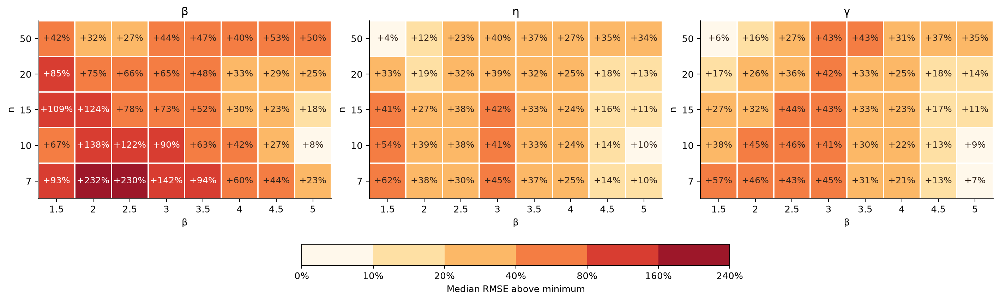

# 小样本三参数Weibull参数估计方法的比较与选择

**报告下（方法对比）v1.0｜2026-10-21**

魏鹏宇｜东北大学机械工程与自动化学院

分会场3：装备寿命与可靠性评估

## 1　实验设置

本轮比较七种方法在相同样本下的估计误差、重复抽样波动、明显异常和有效返回情况。

| 项目 | 本轮设置 |
| --- | --- |
| 方法 | MDM-0.1、LSE、LRE（Park）、WMLE、MLE、MMLE（K–R）、MM |
| 参数 | η=1000、γ=500；β=1.5、2、2.5、3、3.5、4、4.5、5 |
| 样本量 | n=50、20、15、10、7 |
| 重复抽样 | 每个条件1200组；各方法使用相同样本 |
| 主要观察 | 参数RMSE、估计分布、明显异常与有效返回 |

*统计口径：精度图使用七法均有效的共同样本；分布图使用各法自身有效结果。形状RMSE除以真β，尺度和位置RMSE除以1000。方法与求解约定见[实验设置](实验设置.md)。*

## 2　代表方法的性能差异

较大的相对差距主要出现在形状参数估计上，尺度与位置的相对差距通常较小。七种方法在三个参数上的表现并不一致。

*相对差距缩小，不等于各方法的绝对误差减小。*

*图注：每格为七法RMSE中位数高于该条件最小值的百分比；三列共用色标。*

## 3　性能差异的条件变化规律

样本量减少时，各方法的误差总体增大，但增幅与相互关系并不一致。沿n和β观察，可以进一步区分这些变化发生在哪些条件下，以及误差以什么方式增加。

### 3.1　样本量变化与方法差距

#### n = 50

#### n = 20

#### n = 15

#### n = 10

#### n = 7

随着样本量减小，各方法的估计误差总体增大，但误差增长的趋势并不一致。在相同β下，不同方法的误差增幅不同；β改变后，同一种方法随样本量减少而产生的误差增幅也会改变。

方法之间的相对差距也随之变化：部分条件下差距扩大，另一些条件下差距缩小，最低RMSE对应的方法也可能改变。

*图注：五张图共用线性半径；扇区越长，标准化RMSE越大。MM的数值另列。*

*相对差距按第2章口径核对，扩大或缩小指n=50与7两个端点的比较，不表示中间n单调变化。*

### 3.2　偏移、波动与分布分化

#### β = 1.5

#### β = 2

#### β = 2.5

#### β = 3

#### β = 3.5

#### β = 4

#### β = 4.5

#### β = 5

低β下，LSE、LRE随样本减少主要表现为形状估计变散；随β增大，尺度估计逐渐分成两组，n=7时分离更加明显。与此同时，MDM、WMLE和K–R表现出位置偏高、尺度偏低的组合，并伴有形状低估。进入高β区域后，方法之间的差异进一步表现为不同的失准方式。

其中，β=5、n=50时，LSE、LRE的尺度估计均值仍接近真值，但两个峰已经分离。均值没有反映出两组结果的差别。

WMLE呈现另一种变化：β=5、n从10减到7时，形状估计的SD下降，负偏差加重，RMSE继续上升。误差增长并非都由结果变散引起，系统偏移也可能加重。分布分化与系统偏移，使精度下降具有不同的表现。

*图注：行对应n=50、7，列对应形状、尺度、位置。虚线为真值，红点为均值，横线为四分位区间。密度显示主体分布，统计量使用全部有效值。*

| n | 形状Bias | 形状SD | 形状RMSE |
| --- | --- | --- | --- |
| 10 | -2.263 | 0.982 | 2.466 |
| 7 | -2.614 | 0.713 | 2.710 |

*表：WMLE，β=5；七法共同有效结果，Bias保留符号。自身有效结果也支持SD下降、负偏差加重和RMSE上升的方向。*

### 3.3　主要性能规律

1. **样本减少引起的方法关系变化，随形状条件而不同。**本轮两个样本量端点的比较中，低β下整体相对差距扩大，高β下则缩小；部分条件下的最低RMSE方法也随样本量改变。

2. **高β下，不同方法呈现不同的失准表现。**一些方法出现结果分化，另一些表现为系统偏移；均值接近真值或分布更集中，都可能掩盖估计结果的问题。

此外，MM在部分条件下的形状RMSE由少数极端输出主导，其评价影响在后面的风险分析中展开。

## 4　典型性能现象的机制解释

前面的差异与各方法处理未知位置、恢复形状和尺度的方式有关。以下结合原样本诊断与具体构造，解释其中的代表性现象。

### 4.1　位置估计参与形状波动的放大

针对低β下LSE、LRE随样本减少而增大的形状波动，对原样本进行固定位置诊断：保留同一批观测、绘图分数和回归方向，仅将位置设为真实γ，比较形状估计的变化。

LSE和LRE都利用ln(t−γ)构造概率图。位置的改变对各观测的影响并不相同，靠近样本最小值的观测变化更大，因而会改变对数间距与回归斜率，进一步传递到形状估计。

在同一批样本中固定真实位置后，形状估计分布有所收窄，样本量较小时差别更明显。固定位置后仍存在随n减小而增大的波动，说明原始抽样波动与位置估计带来的额外变化同时参与了误差增长。

*图注：β=1.5，η=1000，γ=500。蓝色为原方法，橙色仅将位置固定为真实γ，使用同一批1200组样本。点和线为中位数及四分位区间；密度宽度分别归一化。显示窗口为β̂/β∈[0,4]，全部有效值仍参与统计。固定真位置仅用于诊断定位影响。*

### 4.2　样本最小值与K–R的位置偏移

K–R直接以样本最小值估计位置参数。样本最小值通常高于真实起点；在本轮β范围内，n减小或β增大，二者的期望距离增大，位置正偏差随之加重。本轮40个条件中，K–R的位置估计均等于样本最小值，经验偏差与最小值分布给出的理论趋势一致。

位置偏差的理论期望为

$$
\operatorname{E}(\hat{\gamma}-\gamma)=\eta\,\Gamma(1+1/\beta)\,n^{-1/\beta}.
$$

这个定位规则直接将样本最小值与真实起点之间的距离带入位置估计。β较大时，最小值靠近真实起点的速度较慢，因此即使增加样本，位置正偏差仍可能较明显。位置偏高又会改变用于恢复形状和尺度的剩余距离。

*图为Research00的起点信息示意，参数条件与本轮统计分开；公式适用于独立完整Weibull样本，本轮40条件已核对定位规则及经验趋势。*

### 4.3　LSE与LRE的边界选解及参数补偿

LSE最大化F比，LRE最大化相关系数；两种定位准则在数学上均随概率图相关性增大而增大，因此都倾向选择使概率图接近线性的位置。对部分样本，非负位置范围内的最优解位于γ=0；其他样本选择内部位置，两类位置结果对应不同尺度区间。

随β增大，零边界对应的高尺度结果更集中，内部解对应的尺度向低值移动，两组分离形成双峰。β较小时，两组分布仍有较多重叠，存在零边界结果也未必呈现双峰。

#### β = 5，n = 50

#### β = 5，n = 7

*图注：上排为全部有效结果，橙色表示零位置边界；下排各选一组边界样本和内部样本，圆点为原估计。灰色区域为诊断用的负γ延伸，红虚线为真实γ。LSE用等价的ρ²展示定位准则。*

在核对的边界样本中，加密位置搜索仍返回γ=0；向负γ方向延伸，相关性还会提高。这些样本的边界选择与估计准则和非负约束有关。

在分布中部作近似展开，高β时的寿命水平主要受γ+η控制，离散程度与η/β有关。不同的三参数组合可以保持相近的局部分布，位置、尺度与形状因而存在相互补偿。

上排的估计点主要沿η+γ近似不变的方向分布。γ取零的一组对应较大的η，γ偏大的一组对应较小的η，两类解保持了相近的寿命水平。η+γ恰好是63.2%失效分位寿命；在图示β=5、n=50和7条件下，该组合量的误差小于两个参数各自的误差。这也解释了参数估计分化与部分寿命指标相对稳定可以同时出现。

## 5　评价目标、估计风险与方法选择

这些差异也改变了方法的评价。误差来自整体偏移、重复波动还是少数极端结果，对使用判断的意义不同；参数误差与寿命指标误差也需要分别看。

### 5.1　极端结果与求解失败

RMSE同时受到多数估计结果与少数极端值的影响。MM在部分条件下的形状RMSE尖峰由极少数极端输出主导，不能将其理解为每份样本都产生相同程度的误差。

异常还可能具有明确方向。β=5、n=7时，MDM和WMLE所记录的形状异常均为低估，与前述系统偏移相联系。

不同方法的异常风险区域并不相同。MDM、LSE、LRE和WMLE在小n、高β条件下较为突出，MLE在低β、小n条件下也出现较高异常率。异常的发生频率与其对平方误差的影响，需要分别观察。

本轮中，MDM、LSE、LRE和K–R的全部尝试均返回有效估计。MLE的有效率随n减小而下降，低β时下降更明显；其误差统计对应的成功集合也随之改变。成功结果的精度与全部尝试的返回情况，共同影响实际使用时的判断。

*图注：形状异常为β̂≤β/3或β̂≥3β，分母为有效结果数；有效率的分母为全部尝试。返回状态按本轮实现与求解约定统计。*

*极端记录示例：β=4.5、n=15的MM结果中，单条有效记录贡献了几乎全部形状平方误差，仍保留在原统计中。*

### 5.2　评价目标与已知条件

方法的评价取决于使用目标。参数估计与不同寿命指标下的方法排序可能不同。

B10的最低RMSE方法随n和β变化，B1则在多数条件下由MDM取得最低RMSE。评价指标改变后，方法的相对表现也发生变化。

部分条件下，第一与第二方法的RMSE接近，单一名次不足以反映差异幅度。方法选择还应结合稳定性与异常风险。

*图注：格内为共同有效样本上RMSE最低的方法，下行为第二名高出的比例。B10、B1分别为10%、1%失效分位寿命。*

模拟条件表以真实β为依据。实际使用时，β范围未知，需要在给定参考范围内综合评价；β范围可预估时，可以缩小候选区域。选择还取决于目标参数或寿命指标，以及对波动和异常风险的要求。利用未知样本进行方法选择的规则及其收益仍需验证。

## 6　后续研究与平台

相同n和总体参数下，具体样本仍存在差异。后续考虑利用人工智能方法，根据样本可观测特征与使用目标选择估计方法，并优化方法内部的过程量和求解过程。选择规则的收益需要在新样本上验证。

我们也在[weibull.work](https://weibull.work)整理方法实现与相关分析，目前已有部分方法可以在线调用。网站仍在建设，未来希望把样本分析、方法选择与求解优化结合起来，也欢迎大家试用并提出建议。
