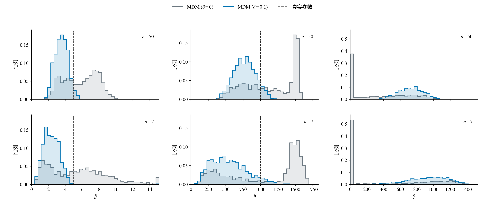

# 小样本三参数Weibull参数估计方法的比较与选择

**报告下（方法对比）v2.1｜2026-10-24**

魏鹏宇｜东北大学机械工程与自动化学院

分会场3：装备寿命与可靠性评估

## 1　实验设置

本轮比较七种方法在相同样本下的估计误差、重复抽样波动、明显异常和有效返回情况。

| 项目 | 本轮设置 |
| --- | --- |
| 方法 | MDM-0.1、LSE、LRE（Park）、WMLE、MLE、MMLE、MM |
| 参数 | η=1000、γ=500；β=1.5、2、2.5、3、3.5、4、4.5、5 |
| 样本量 | n=50、20、15、10、7 |
| 重复抽样 | 每个条件1200组；各方法使用相同样本 |
| 主要观察 | 参数RMSE、估计分布、明显异常与有效返回 |

*统计口径：精度图使用七法均有效的共同样本；分布图使用各法自身有效结果。形状RMSE除以真β，尺度和位置RMSE除以1000。方法与求解约定见[实验设置](实验设置.md)。*

## 2　估计性能的差异与变化

本章回答：当n减小、β增大时，观察到了什么现象？先比较误差大小、方法间差距、估计分布与异常频率怎样改变，再归纳需要解释的现象。条件变化怎样通过样本信息和估计构造产生这些表现，接在第三章讨论。

### 2.1　样本量减小下的不同表现

**展示目的：**按 β 分层，在固定形状条件下考察样本量减少带来的误差变化；再比较这一现象在不同形状条件下的共性与差异。

#### n = 50

#### n = 20

#### n = 15

#### n = 10

#### n = 7

*图注：五张图共用线性半径；扇区越长，标准化RMSE越大。MM的数值另列。*

在本次考察范围内，样本量减少时估计误差总体增大，但增长幅度因方法而异。有的方法对样本量减少较敏感，误差上升较快；有的方法增幅相对较小。

*两行分别为β=1.5、5的固定形状条件，三列分别对应形状、尺度、位置参数。横轴按n=50→20→15→10→7排列；同一参数两行共用纵轴。图中展示MDM、LSE、LRE、WMLE、MLE、MMLE六法的全部15个方法对，MM在玫瑰图中另列。*

*差距为两种方法标准化RMSE之差的绝对值，表示相隔多远；各法误差水平结合前面的玫瑰图观察。仍使用七法共同有效样本；形状RMSE除以真β，尺度和位置RMSE除以真η。*

不同方法的误差增长并不同步，方法间的精度差距也随样本量改变：一些方法对的差距扩大，另一些逐渐接近，部分还出现转折。误差总体增大，并不意味着方法间的差距始终扩大。

这种方法间的性能差异及其随样本量变化的关系，也会随形状条件改变。各方法对样本量减少的敏感程度需要在固定形状条件下比较，并结合不同分层考察其共性与差异。

### 2.2　形状参数增大时的估计分布变化

#### β = 1.5

#### β = 2

#### β = 2.5

#### β = 3

#### β = 3.5

#### β = 4

#### β = 4.5

#### β = 5

*图注：行对应n=50、7，列对应形状、尺度、位置。虚线为真值，红点为均值，横线为四分位区间。密度显示主体分布，统计量使用全部有效值。*

β=1.5时，两档n下多数方法的主体分布形态相近。n=7的估计范围通常更宽，LSE、LRE的位置估计还出现了零边界结果。

固定n，β从1.5增至5时，估计分布进一步变化。LSE、LRE的尺度和位置估计逐渐展宽，即使n=50，四分位区间也明显扩大。因此，分布展宽并不只出现在极小样本条件。

MDM、WMLE和MMLE则表现出有规律的参数偏移：形状估计的增幅落后于真β，低估加重；尺度估计向低值偏移，位置估计向高值偏移。两档n下均能观察到这一方向，n=7时偏移更明显。

另外，LSE、LRE的位置估计进一步向γ=0聚集，这在n=50时已可见，n=7时边界结果更多。原尺度密度图也呈双峰外观；后续核对发现，剔除零位置结果后未保留两个明显峰，因此这里将边界聚集与非边界估计的偏移分别考察，不据原图认定存在“接近真值与偏移”的两个内部群体。

### 2.3　明显异常估计

估计分布中还存在明显偏离真值的结果。这里沿用Research00报告2的判据，将形状估计不超过真值的1/3，或达到真值的3倍，记为明显异常估计。

| β=5、n=7，LSE | 形状 | 尺度 | 位置 |
| --- | --- | --- | --- |
| 真值 | 5 | 1000 | 500 |
| 第34组：接近真值的例子 | 5.55 | 836.77 | 681.73 |
| 第0组：明显低估的例子 | 1.24 | 282.98 | 1205.95 |

相同总体、相同样本量和相同方法，不同抽样仍可能得到相差很大的参数。异常例子中，形状和尺度明显偏低，位置则偏高；这种偏离已经超出估计结果在真值附近的小幅波动。

*两例来自本轮存档W(5,1000,500)、n=7，样本编号从0开始；仅用于展示，不代表其发生频率。*

*图注：异常为β̂≤β/3或β̂≥3β；频率以各方法自身有效结果为分母，求解失败另行统计。*

随着n减小，明显异常估计更常见。八档β下，七种方法在n=7时的异常频率都高于n=50。β=5时，异常频率在五档n上逐档上升。

异常增多的程度和方向存在方法差异：较大β、小n下，多种方法以形状低估为主；MLE在低β、小n下也有较高异常频率。它们不能由一种固定的异常模式概括。

### 2.4　主要现象

1. **n减小时，估计误差总体增大，但各方法的增幅不同。**固定β，部分方法对样本量减少更敏感，误差上升较快；部分方法增幅较小。因此，方法间的差距也随样本量改变，而非保持原有的精度关系。

2. **相同n下，β增大时，三个参数的估计呈现不同的偏移和分布变化。**部分方法的形状低估加重，并伴随尺度偏小、位置偏大；另一些方法的尺度和位置估计更分散，还出现边界聚集。β变化的影响不仅体现在误差大小，也体现在参数偏移的方向和估计分布的形态。

3. **n减小时，明显异常估计更常见。**这一变化在八档β、七种方法的n=50与7比较中均可见，但异常增多的程度及其偏移方向因方法和参数条件而异。

## 3　性能变化的机制分析

第二章建立了性能变化的事实。本章进一步追踪：n减小、β增大怎样改变有限样本所提供的信息；不同方法怎样将这些信息转化为定位判据和参数估计；这些响应又怎样表现为误差、偏移或异常。

3.1固定β，从样本信息利用、参数耦合及估计机制的敏感程度解释不同方法的RMSE增幅，回应2.1的样本量现象；3.2考察形状条件改变后的起点信息、方向性偏移和边界聚集，回应2.2；3.3追踪2.3的明显异常可能在哪个环节形成。典型案例用于解释形成过程，第二章的重复抽样结果用于判断现象在总体比较中有多普遍。

### 3.1　样本量减小时不同方法的误差增长机制

2.1显示，样本量由大变小时，误差总体增大，但不同方法的增幅不同。本节先确定增长来自偏移还是波动，再沿“样本信息变化→参数组合的约束与补偿→各方法定位和恢复参数→重复估计的偏移与波动”解释这些差别。以β=5贯穿具体核验，其他形状条件的现象由2.1分层图对照。

#### 误差增长中，偏差和波动各贡献多少

*三列分别对应β、η、γ；每档n按MDM(0.1)、LSE、LRE、WMLE、MLE、MMLE排列。浅色斜线为偏差平方，实色为经验方差，整根柱为标准化RMSE²。形状以真β=5、其余以1000标准化。统计采用各n七法共同有效集合，与第二章相同。*

这张堆叠图将误差平方拆开：

$$
\operatorname{RMSE}^2=\operatorname{Bias}^2+V_R,\qquad
V_R=\frac{R-1}{R}\operatorname{SD}^2.
$$

这里R为有效重复次数，SD采用样本标准差。比较n=50与n=7时，增长也能逐项相减：

$$
\Delta\operatorname{RMSE}^2=\Delta\operatorname{Bias}^2+\Delta V_R.
$$

Δ取“n=7减n=50”。正项推动误差平方增长，负项抵消增长；RMSE增大并不要求Bias的绝对值与SD同时增大。

| 方法（β=5，形状估计） | ΔRMSE² | ΔBias² | Δ方差 |
|---|---:|---:|---:|
| MDM(0.1) | +0.1357 | +0.1461 | -0.0103 |
| LSE | +0.2315 | -0.0005 | +0.2320 |
| LRE | +0.1958 | +0.0000 | +0.1958 |
| WMLE | +0.2228 | +0.2399 | -0.0171 |
| MLE | +0.4687 | +0.0160 | +0.4527 |
| MMLE | +0.0267 | +0.0216 | +0.0051 |

*表中为标准化误差平方，形状除以真β=5后再平方。各n使用七法共同有效集合，n=50、20、15、10、7分别保留1182、1100、1025、880、644组，集合随n变化；数值是相应条件下有效结果的分解。尺度、位置及含MM的完整表见[补充](结果呈现/比较探索/3.1误差增长分解.md)。*

在这套比较口径下，MLE、LSE和LRE的形状误差增长主要来自方差；MDM(0.1)和WMLE主要来自偏差平方增加，方差项反而下降。MMLE的形状误差增量较小，也主要由偏差平方组成。以MDM(0.1)为例，Bias由−1.46变为−2.41，SD由0.75降为0.55，RMSE仍由1.64增至2.47；LSE的Bias约由+0.24变为+0.21，SD由2.03增至3.15，RMSE由2.04增至3.16。

这些分解先说明“增长在哪里”，接着才解释“为什么不同”。共同有效集合收缩也会影响条件SD，不能把上表直接当作全部1200次抽样的波动；后面的两δ对照使用每档完整1200组共同样本，单独核对规则改变后的分布。

#### 样本减少怎样放宽对参数组合的限制

*固定W(5,1000,500)。前三列取正式n=50、20、7存档各自的前50组，按本列最小值排序；蓝点为观测，橙点为最小值，灰线连接真实起点500与最小值。右图为最小值的理论密度。前三列共用寿命轴，右图聚焦起点附近。*

低寿命下端在总体中占比很小，抽取次数减少，更容易一个也没抽到。因此，n减小时，最小观测通常离真实起点更远，起点与最小观测之间的空白更大。以500—1000这段区间为例，整组没有观测落入其中的理论概率，随n=50→20→7约为21%→54%→80%；本轮1200组的实际比例约为20%→55%→80%。

这段空白首先放宽了候选起点的支持限制。对于以全部观测为支持检查对象的三参数Weibull候选，起点必须低于最小观测。当最小观测右移时，原来因起点过高而不可能解释全部数据的一些组合，便不再被这条支持条件直接排除。与此同时，较小n下没有抽到下端观测，也仍可容许候选分布在那里保留一定概率。方法需要区分的候选因而可能增多，参数仍需由全部观测及具体判据进一步确定。

起点的位置还会与形状、尺度相互补偿：位置改变后，另两参的调整可能让候选分布在观测集中的区间内仍然相近。因而，支持条件放宽只说明部分候选不再被直接排除，最终选中什么位置，还取决于具体方法怎样比较这些参数组合。下面沿四种定位规则追踪同一批样本的响应。

#### 用共同样本看四种规则怎样确定位置

减点诊断固定使用MLE、MMLE、MDM(0)和MDM(0.1)。从1200份正式50点样本预先每10个编号取一份，共120条路径；按固定随机排列依次保留50、20、15、10、7点，四法在每档使用完全相同的观测。

*五行自上而下为n=50、20、15、10、7，四列为MLE、MMLE、MDM(0)、MDM(0.1)。每个MLE、MDM坐标系叠加十组样本的曲线；图例编号为样本号，同一样本跨行跨列颜色、线型一致。全部面板使用相同原始γ横轴，每列跨n固定纵轴，两MDM列共用纵轴。MLE纵轴为相对每观测负对数似然$-\Delta\bar\ell_p(\gamma)=[\ell_p(\hat\gamma)-\ell_p(\gamma)]/n$，圆点为实际返回位置；MMLE没有位置优化廓线，仅以十个彩点和短竖线标出各组$\hat\gamma=x_{(1)}$。MDM纵轴为$g_n(\gamma)$，参考线分别为目标0和0.1。*

先沿一列向下看：观测减少后，定位依据及实际选中位置怎样变化；再沿一行横向看：完全相同的观测为何得到不同位置。蓝色670号样本的MMLE位置随最小观测从913.7升至1085.2；MLE从631.8转到零边界；MDM(0)从336.1转到零边界；MDM(0.1)则由686.4移至816.1。MDM(0)的零位置点是约束截断，不要求梯度恰好为零。MMLE没有位置优化廓线，其后续形状似然不能充当定位γ的判据。

这里将[十组定位判据](结果呈现/比较探索/3.1十组定位判据.md)按相同n、相同方法叠加到同一坐标系，既看样本间的差异，也可沿同色曲线向下追踪减点响应。选例先按n=7时MLE的内部、零边界、失败，以及MDM(0)的内部、零边界分层，再选取各层参数响应的实际中心路径，保留原共同中心670号。十组覆盖六种实际分支组合，没有按“是否变平”挑选。失败行仍展示判据形状，以所绘网格最大似然作相对基准，但不标返回位置；各组的具体失败档列在[补充选例表](结果呈现/比较探索/3.1偏移量与廓线群体-结果.md)。MLE各曲线减去自身参照似然后再除以n，比较的是相对定位形状，不能把曲线的高低解释为不同样本的绝对似然优劣。

十组图用于观察不同过程，120条路径的完整统计用于判断趋势。670号是88/120条共同端点有效路径中的综合中心例，不代表所有单项变化都恰好居中；曲率中心例640、反方向例330和全部选例规则另见[群体核对](结果呈现/比较探索/3.1偏移量与廓线群体-结果.md)。

不同路径给出了不同定位响应。120条完整诊断中，MDM(0)零位置由41/120增至64/120，MLE零位置由17/120增至41/120，MLE失败由0增至32/120。可靠内部解的曲率既有降低也有升高；MLE总似然曲率的下降还包含观测项减少的加和效应，除以n后的结果不同。因此，单条路径上的位置跳变、边界转换和判据变平分别反映选参过程，不能直接当作SD或其增长的测量。曲率定义、完整群体图及正反方向例见[群体核对](结果呈现/比较探索/3.1偏移量与廓线群体-结果.md)。

#### 不同构造怎样处理这些信息与参数耦合

相同观测进入不同方法，会成为不同的估计依据；位置变化又会改变全部观测到起点的距离，进而牵动形状和尺度。这就是从样本信息转向方法视角的连接：各法利用的信息、处理三参数耦合的步骤和选参规则不同。

| 方法 | 怎样利用样本信息 | 与样本量变化有关的响应环节 |
|---|---|---|
| MLE | 用各观测到候选起点的距离构造似然，联合确定三参数。 | 对数距离和幂次距离共同影响候选组合的似然高低。 |
| WMLE | 将距离、对数距离、幂加权距离和倒数距离放入带有样本量校准权重的估计方程。 | 样本统计关系与n相关权重共同改变形状、位置方程的交点。 |
| MMLE | 以最小观测确定位置，再对删除该点后的正距离估计形状、尺度。 | 位置直接受单个极值影响，其误差随后进入其余观测到起点的距离。 |
| LSE | 将排序观测的对数距离与按n确定的理论参考坐标回归，再以相对匹配定位。 | 点列、参考坐标及回归斜率共同影响三参数恢复。 |
| LRE | 用绘图位置形成概率图参考坐标，以相关性定位，再由另一方向的回归恢复参数。 | 绘图位置、对数间距和回归方向决定其对点列变化的响应。 |
| MDM | 每个位置下使各点反算的伪尺度尽量一致，再以最小标准差的梯度阈值定位。 | 伪尺度离散程度、条件形状和梯度交点共同响应样本变化。 |
| MM | 用排序间距的加权和计算Cran的样本Weibull矩，再由矩差关系反演参数。 | 间距和n相关权重改变矩组合，非线性反演可能放大矩差的变化。 |

MMLE先用最小观测固定位置，再估计其余两参；MLE通过条件似然及位置搜索选择组合；MDM先逐位置优化形状，再按梯度阈值定位。回归与矩反演也有各自的放大环节，例如斜率取倒数和矩差反演。参数约束既可能限制极端值，也可能使多个不同样本返回同一边界值；这些作用不能用单一的“样本少了”概括。

#### MDM两种偏移量的重复分布与误差取舍

MDM内部位置由条件最小伪尺度标准差的梯度确定：

$$
S_n(\gamma)=\min_\beta s_\eta(\beta,\gamma),\qquad
g_n(\hat\gamma)=\delta.
$$

保持样本、秩、形状范围、位置约束和求解程序相同，只将δ由0改为0.1，就能直接检验偏移判据的影响。这里使用正式五档n各1200组原样本，补算MDM(0)，复用MDM(0.1)；两方案全部有效。它与上面的120条嵌套诊断分开统计。

*上排n=50，下排n=7，每种方案各1200次。每列共用横轴、分箱和纵轴；纵轴为每箱所占比例，包含γ=0的集中质量，虚线为真实参数。完整五档指标及偏差平方/方差分解在补充区。*

| 参数（n=7） | δ | Bias | SD | RMSE |
|---|---:|---:|---:|---:|
| 形状β | 0 | +0.53 | 3.48 | 3.52 |
| 形状β | 0.1 | -2.62 | 1.14 | 2.86 |
| 尺度η | 0 | +66.97 | 527.44 | 531.45 |
| 尺度η | 0.1 | -448.64 | 256.93 | 516.95 |
| 位置γ | 0 | -79.04 | 503.51 | 509.47 |
| 位置γ | 0.1 | +426.11 | 248.67 | 493.31 |

在这组小样本对照中，δ=0.1使三个参数的绝对偏差更大，但SD更小，RMSE数值也更低，直接呈现了偏差与波动的取舍。以位置为例，δ=0的Bias由n=50时−144.9变为n=7时−79.0，偏差减轻，SD却由343.4增至503.5，RMSE仍上升；δ=0.1的Bias由+221.3增至+426.1，SD由151.1增至248.7，组成又不同。不能将误差增大统一写成偏差和SD同时增大。

零位置聚集也是分布差别的一部分：δ=0的γ=0比例在正式1200组中由36.8%增至52.7%；δ=0.1在本条件五档样本中均无零位置。正偏移改变了位置选择及随后的三参数恢复，允许更大偏移而获得更集中分布；这不是由单条廓线推得，而是同一样本上改变δ后的重复比较。该结论限于当前W(5,1000,500)与固定实现，不据此认定δ=0.1对所有条件均最优。

由此能连起本节的机制链：n减少使观测和下端覆盖变少，一些候选组合不再被支持条件排除；三参补偿又使观测区间内相近的分布对应不同参数。各方法将这些观测转成最小值、似然、回归或伪尺度一致性，并按不同规则处理参数耦合，于是同样的信息变化可以形成不同的位置选择、边界响应及误差组成。MDM两δ的同样本对照进一步表明，仅改变定位规则就能改变重复估计的偏移和波动。

现在的证据支持这些构造与响应的差别，并用两δ对照验证了一个具体机制；尚未分离七法全部RMSE差距中每个环节的独立贡献。最小值图说明约束怎样变化，十组判据说明参数怎样选中，重复统计说明误差怎样增长。逐档四法参数、数值与选例记录见[群体核对](结果呈现/比较探索/3.1偏移量与廓线群体-结果.md)；原474号过程材料保留在[旧路径补充](结果呈现/比较探索/3.1逐档拟合与误差.md)。

### 3.2　形状条件下的偏移与边界聚集

#### n与β对最小观测的共同影响

相同n下，β=5时的最小观测比β=2时更远离真实起点；样本量减小时，这段距离进一步增大。下排最小观测的分布也显示，较大β下，即使增加样本，最小观测仍可能与起点保持较大距离。这些图描述的是观测所在区间与真实起点之间的距离；其对选参的影响还要结合具体方法。

*复用Research00报告1图2：η=1000、γ=500，β=2、5，n=7、15、30。橙点为每组样本的最小观测，灰线为其到真实起点的距离；下排为最小观测的理论密度。历史样本仅用于解释，不并入本轮1200次统计。*

结合3.1的固定β图，这里展示了n与β对最小观测的共同影响。最小值提供起点的支持上界；不同方法怎样选中具体参数，仍要沿各自的估计构造追踪。

#### 参数组合与具体方法的选择

图中的两组参数虽然相差较大，在实际观测所在的区间内，分布曲线仍较接近。这是该案例中候选组合相容的直接展示，不能仅由最小值远离起点推得；随后还需追踪具体方法为什么选中了其中某一组。

*复用Research00报告1图3：β=5、n=7第31组样本；黑点累计概率由样本排序近似。两条曲线用于说明参数相容，不代表该样本必然被估成其中某一组参数。*

#### 方向性偏移的形成

MDM仍按同一个梯度阈值定位。高β时，各观测反算的伪尺度随位置变化更接近同步，标准差梯度较小，阈值交点可能出现在偏高位置。位置提高后，小观测到起点的距离缩短比例更大，需要更小的形状维持伪尺度的一致，再恢复出更小尺度。

图中先看梯度交点，再沿同一位置看形状与尺度。这样，位置偏高、形状偏低、尺度偏低对应的是同一估计过程的传递，三个参数的偏差有共同来源。

*Research00报告1图5，δ=0.1；β=2、5，n=7第48组配对样本。用于说明传递路径，不据单例认定全部方法或全部样本均如此。*

#### 边界聚集的形成

LSE移动位置是为了让对数距离与参考坐标更接近直线。左移位置会压缩下端对数间距；当这能改善点列匹配时，准则倾向于更低位置。图中橙色样本在允许范围内的最低点落到γ=0，紫色样本的最低点则留在内部。γ≥0的约束使不同样本都可能返回同一个零值，重复估计中便形成边界聚集。

选低位置也压缩了整体对数跨度，使LSE回归斜率减小，取倒数后形状升高。因此，边界位置和形状高估可以沿同一条恢复关系连接起来。

*复用报告2图6：正常与零边界样本为W(2,100,500)、n=15第35、36组；内部左偏为W(2,1000,3000)、n=7第1组。这里借用其机制图，不将这些历史条件并入本轮β=5统计。*

### 3.3　明显异常估计的形成

明显异常估计要追踪异常在哪个估计环节形成。Research00报告2区分了两种情况：当前方法的准则确实支持一组明显偏离真值的参数；或搜索、停止、候选接受没有正确落实预定规则。

#### 样本结构改变判据，异常参数仍可满足方法规则

#### LSE：改善线性匹配后，形状反而明显低估

#### WMLE：两条方程均满足，参数仍明显偏离真值

LSE的异常样本中，前几个观测相对集中，另有一个较远观测。真位置下的点列与参考坐标匹配较差，右移位置能拉开下端对数间距，使点列更接近直线。准则因此选中靠近最小观测的位置，但随之增大的回归斜率取倒数后，形状明显降低，尺度也由缩小的距离恢复为较低值。

WMLE的异常样本改变了下端距离、对数距离和幂加权距离，两条方程的共同交点移向较高位置、较低形状。将返回参数代回，残差仍接近零。这里不是方程没有解对，而是这些样本统计量本身支持了偏离真值的参数。

*复用报告2图7、12。LSE为W(2,1000,500)、n=7第18、19组；WMLE为W(5,100,500)、n=7第3、11组。保留历史实现及参数条件，只解释形成路径。*

#### 数值求解未落实规则，也能形成异常返回

旧MLE的第37组在近零位置停止，优化器标记收敛；其他起点的返回结果又因形状不满足接受条件被剔除，最终只剩这个候选。但图中向右仍可提高似然，说明搜索停止及候选接受没有实现预期的最优选择。近零位置进一步压缩对数跨度，形成较大的形状估计。

*报告2图17，W(2,1000,3000)、n=7第37、38组，采用旧MLE。Study04已更新求解器，此例用于区分计算来源，不认定新版仍有同一缺陷。*

前两例应研究估计准则对样本结构的响应；后一例应改进求解与候选检查。异常表现相近，形成环节不同，改进方向也不同。

## 4　评价目标、估计风险与方法选择

这些差异也改变了方法的评价。误差来自整体偏移、重复波动还是少数极端结果，对使用判断的意义不同；参数误差与寿命指标误差也需要分别看。

### 4.1　极端结果与求解失败

异常发生的频率与其对总体误差的影响不同。RMSE对误差平方求平均，少数极端值可能主导结果。MM在部分条件下的形状RMSE尖峰由极少数极端输出造成，不能将其理解为多数样本都产生同样程度的误差。

本轮中，MDM、LSE、LRE和MMLE的全部尝试均返回有效估计。MLE的有效率随n减小而下降，低β时下降更明显；其误差统计对应的成功集合也随之改变。成功结果的精度与全部尝试的返回情况，共同影响实际使用时的判断。

*图注：有效率的分母为全部1200次尝试，返回状态按本轮实现与求解约定统计。*

*极端记录示例：β=4.5、n=15的MM结果中，单条有效记录贡献了几乎全部形状平方误差，仍保留在原统计中。*

### 4.2　评价目标与已知条件

方法的评价取决于使用目标。参数估计与不同寿命指标下的方法排序可能不同。

B10的最低RMSE方法随n和β变化，B1则在多数条件下由MDM取得最低RMSE。评价指标改变后，方法的相对表现也发生变化。

部分条件下，第一与第二方法的RMSE接近，单一名次不足以反映差异幅度。方法选择还应结合稳定性与异常风险。

*图注：格内为共同有效样本上RMSE最低的方法，下行为第二名高出的比例。B10、B1分别为10%、1%失效分位寿命。*

模拟条件表以真实β为依据。实际使用时，β范围未知，需要在给定参考范围内综合评价；β范围可预估时，可以缩小候选区域。选择还取决于目标参数或寿命指标，以及对波动和异常风险的要求。利用未知样本进行方法选择的规则及其收益仍需验证。

## 5　后续研究与平台

相同n和总体参数下，具体样本仍存在差异。后续考虑利用人工智能方法，根据样本可观测特征与使用目标选择估计方法，并优化方法内部的过程量和求解过程。选择规则的收益需要在新样本上验证。

我们也在[weibull.work](https://weibull.work)整理方法实现与相关分析，目前已有部分方法可以在线调用。网站仍在建设，未来希望把样本分析、方法选择与求解优化结合起来，也欢迎大家试用并提出建议。
