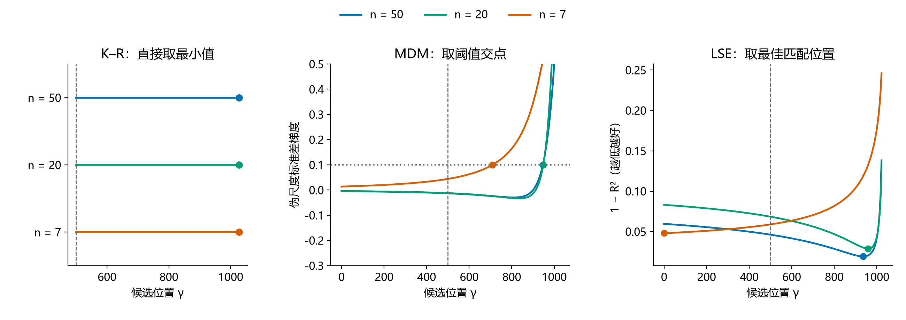
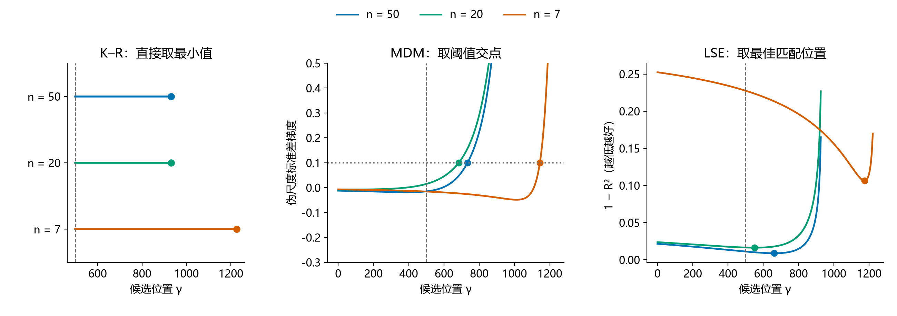
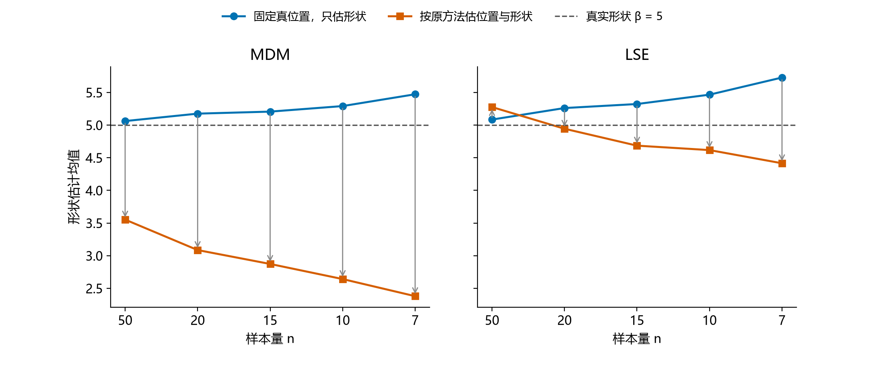
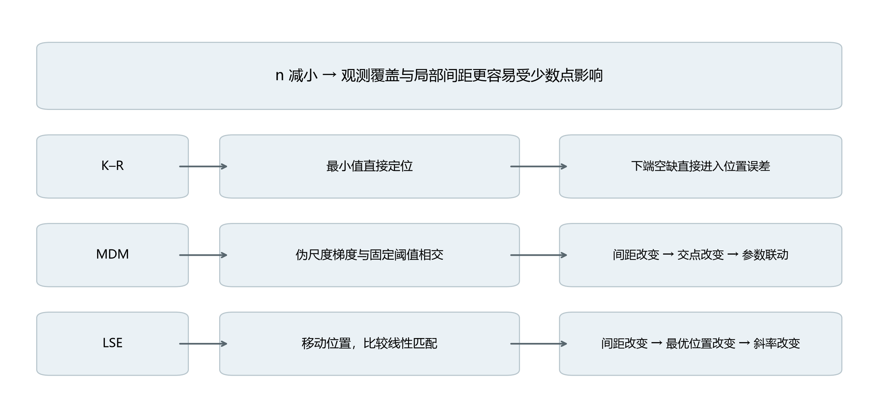
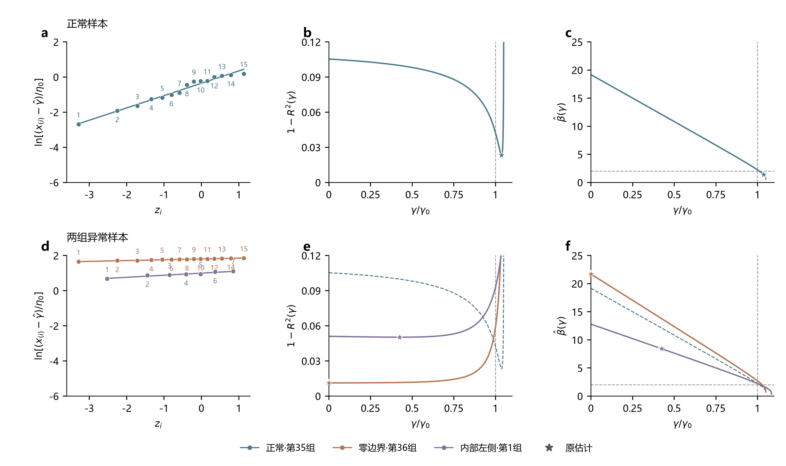
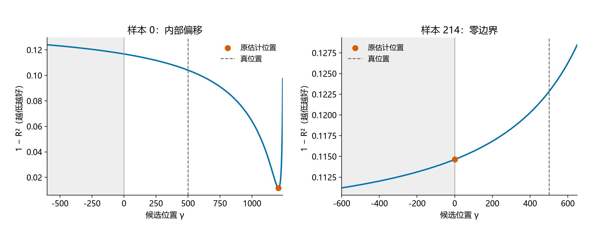
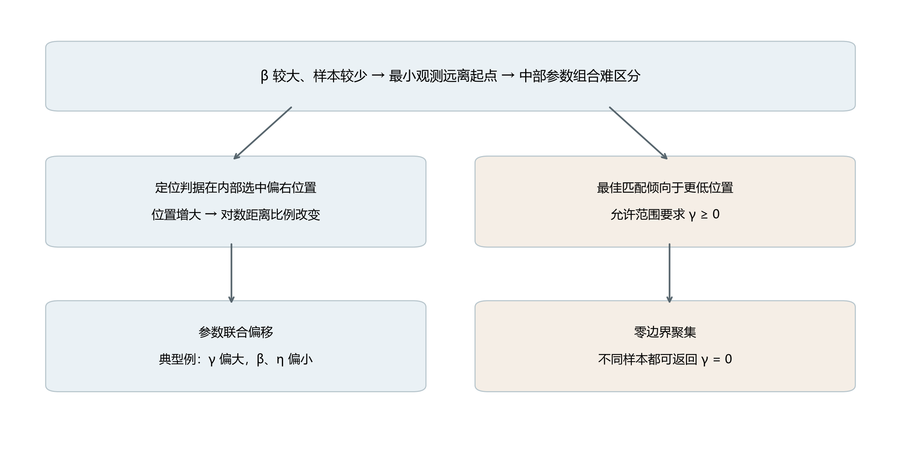
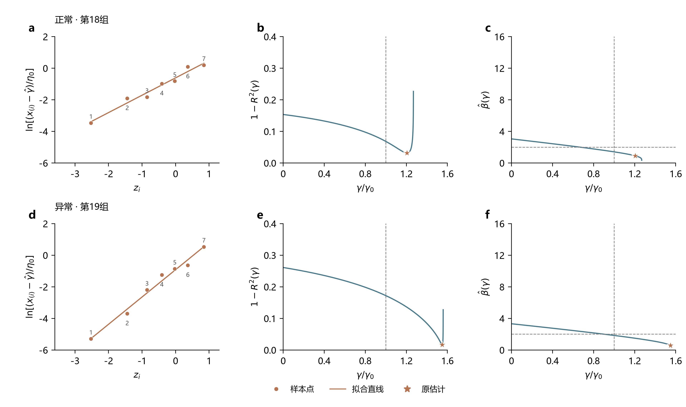
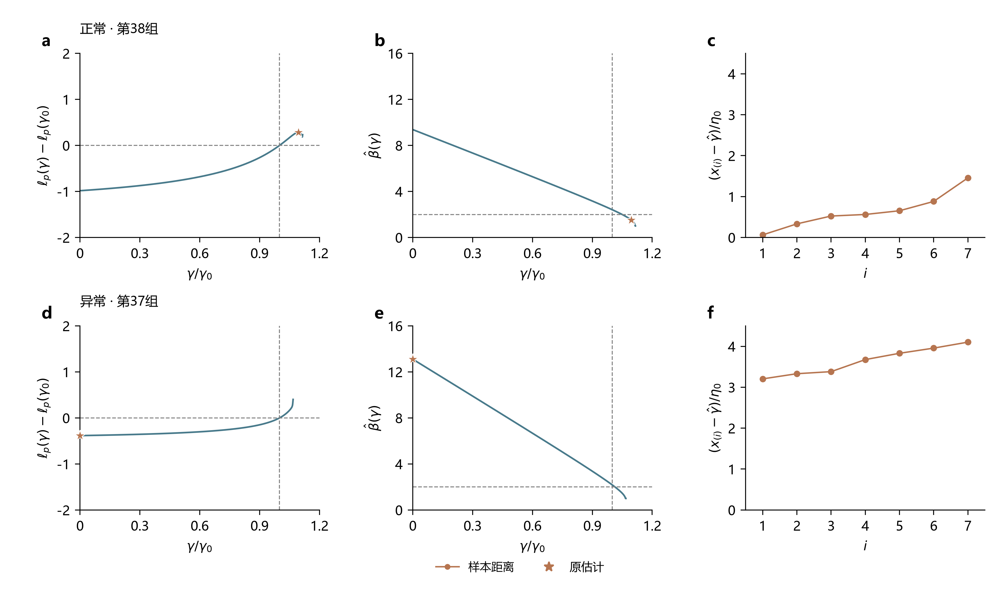

# 小样本三参数Weibull参数估计方法的比较与选择

**报告下（方法对比）v2.1｜2026-10-23**

> 待审稿：第三章包含未选定的候选解释，正式基准稿v2.0保持原文。

魏鹏宇｜东北大学机械工程与自动化学院

分会场3：装备寿命与可靠性评估

## 1　实验设置

本轮比较七种方法在相同样本下的估计误差、重复抽样波动、明显异常和有效返回情况。

| 项目 | 本轮设置 |
| --- | --- |
| 方法 | MDM-0.1、LSE、LRE（Park）、WMLE、MLE、MMLE（K–R）、MM |
| 参数 | η=1000、γ=500；β=1.5、2、2.5、3、3.5、4、4.5、5 |
| 样本量 | n=50、20、15、10、7 |
| 重复抽样 | 每个条件1200组；各方法使用相同样本 |
| 主要观察 | 参数RMSE、估计分布、明显异常与有效返回 |

*统计口径：精度图使用七法均有效的共同样本；分布图使用各法自身有效结果。形状RMSE除以真β，尺度和位置RMSE除以1000。方法与求解约定见[实验设置](实验设置.md)。*

## 2　估计性能的差异与变化

样本量减少通常使估计误差增大，但性能变化并不限于误差数值。不同方法的响应方式，以及估计结果的分布结构，也会随样本量和形状条件改变。

### 2.1　样本量减小下的不同表现

#### n = 50

#### n = 20

#### n = 15

#### n = 10

#### n = 7

*图注：五张图共用线性半径；扇区越长，标准化RMSE越大。MM的数值另列。*

固定β观察，样本量减少时，估计误差总体增大，但各方法的增幅不同。部分方法的误差上升较快，部分方法变化较缓，方法间的差距也随之改变。固定n观察，β增大时位置误差的增长较为一致，形状和尺度误差的变化则因方法而异。

| 比较方向 | 观察到的变化 | 初步认识 |
| --- | --- | --- |
| 固定β，减小n | RMSE多数增大，各方法增幅不同 | 样本减少通常降低估计精度 |
| 固定n，增大β | 位置误差普遍增大，形状和尺度误差的变化存在方法差异 | 形状条件对各参数的影响不同 |
| 交叉观察n与β | 同一方法在不同β下的误差增幅不同 | 样本量的影响随形状条件改变 |

*上两行：β=1.5和5下，两种方法的标准化RMSE差距随n变化。第三行：每行是一对方法，每列是一档β；颜色表示“n=7的差距减去n=50的差距”。红色为差距扩大，蓝色为差距缩小，白色附近为变化较小。三列子图分别对应形状、尺度和位置参数。*

这里比较方法对，是为了观察方法之间的精度差距怎样变化。差距定义为两种方法标准化RMSE之差的绝对值，只表示相隔多远，不表示谁更好。图中列出MDM、LSE、LRE、WMLE、MLE、K–R六法的全部15个配对，并未挑选部分方法对。MM因极端RMSE另列，不进入此图。

*仍使用七法共同有效样本；形状RMSE除以真β，尺度和位置RMSE除以真η。差距扩大或缩小，与两种方法各自误差是否增加是不同问题。*

β=1.5时，七种方法的RMSE均随样本减少而上升；联合图中六种方法的两两差距也普遍拉开。此时，各方法的变化方向较为一致，区别主要表现为上升幅度不同。

β=5时，RMSE仍多向上，但方法间距离的变化不再一致：一些方法对继续分离，另一些逐渐接近，部分距离曲线还出现转折。比较n=50与7，LSE、LRE与WMLE的尺度和位置RMSE更接近，而它们与K–R的差距增大。

形状条件改变后，样本减少对方法关系的影响，可从普遍拉开转为拉开与接近并存。误差上升的共同方向，并不意味着方法间的精度关系保持不变。

| n | 形状Bias | 形状SD | 形状RMSE |
| --- | --- | --- | --- |
| 10 | -2.263 | 0.982 | 2.466 |
| 7 | -2.614 | 0.713 | 2.710 |

*表：WMLE，β=5；七法共同有效结果，Bias保留符号。自身有效结果也支持SD下降、负偏差加重和RMSE上升的方向。*

样本减少时，误差增大也不总表现为分布展宽。β=5的WMLE形状估计在n从10减至7时，SD下降，负偏差却加重，RMSE仍然上升。各方法不仅误差增幅不同，误差增长的表现也可能不同。

### 2.2　形状参数增大时的估计分布变化

#### β = 1.5

#### β = 2

#### β = 2.5

#### β = 3

#### β = 3.5

#### β = 4

#### β = 4.5

#### β = 5

*图注：行对应n=50、7，列对应形状、尺度、位置。虚线为真值，红点为均值，横线为四分位区间。密度显示主体分布，统计量使用全部有效值。*

β=1.5时，两档n下多数方法的主体分布形态相近。n=7的估计范围通常更宽，LSE、LRE的位置估计还出现了零边界结果。

固定n，β从1.5增至5时，估计分布进一步变化。LSE、LRE的尺度和位置估计逐渐展宽，即使n=50，四分位区间也明显扩大。因此，分布展宽并不只出现在极小样本条件。

MDM、WMLE和K–R则表现出有规律的参数偏移：形状估计的增幅落后于真β，低估加重；尺度估计向低值偏移，位置估计向高值偏移。两档n下均能观察到这一方向，n=7时偏移更明显。

另外，LSE、LRE的位置估计进一步向γ=0聚集，这在n=50时已可见，n=7时边界结果更多。原尺度密度图也呈双峰外观；后续核对发现，剔除零位置结果后未保留两个明显峰，因此这里将边界聚集与非边界估计的偏移分别考察，不据原图认定存在“接近真值与偏移”的两个内部群体。

### 2.3　明显异常估计

估计分布中还存在明显偏离真值的结果。这里沿用Research00报告2的判据，将形状估计不超过真值的1/3，或达到真值的3倍，记为明显异常估计。

| β=5、n=7，LSE | 形状 | 尺度 | 位置 |
| --- | --- | --- | --- |
| 真值 | 5 | 1000 | 500 |
| 第34组：接近真值的例子 | 5.55 | 836.77 | 681.73 |
| 第0组：明显低估的例子 | 1.24 | 282.98 | 1205.95 |

相同总体、相同样本量和相同方法，不同抽样仍可能得到相差很大的参数。异常例子中，形状和尺度明显偏低，位置则偏高；这种偏离已经超出估计结果在真值附近的小幅波动。

*两例来自本轮存档W(5,1000,500)、n=7，样本编号从0开始；仅用于展示，不代表其发生频率。*

*图注：异常为β̂≤β/3或β̂≥3β；频率以各方法自身有效结果为分母，求解失败另行统计。*

随着n减小，明显异常估计更常见。八档β下，七种方法在n=7时的异常频率都高于n=50。β=5时，异常频率在五档n上逐档上升。

异常增多的程度和方向存在方法差异：较大β、小n下，多种方法以形状低估为主；MLE在低β、小n下也有较高异常频率。它们不能由一种固定的异常模式概括。

### 2.4　主要现象

1. **n减小时，估计误差总体增大，但各方法的增幅不同。**固定β，部分方法对样本量减少更敏感，误差上升较快；部分方法增幅较小。因此，方法间的差距也随样本量改变，而非保持原有的精度关系。

2. **相同n下，β增大时，三个参数的估计呈现不同的偏移和分布变化。**部分方法的形状低估加重，并伴随尺度偏小、位置偏大；另一些方法的尺度和位置估计更分散，还出现边界聚集。β变化的影响不仅体现在误差大小，也体现在参数偏移的方向和估计分布的形态。

3. **n减小时，明显异常估计更常见。**这一变化在八档β、七种方法的n=50与7比较中均可见，但异常增多的程度及其偏移方向因方法和参数条件而异。

## 3　性能变化的机制分析

以下分别解释三类现象：样本减少时方法的不同响应、高形状条件下的参数偏移与边界聚集，以及明显异常估计的形成。解释沿样本信息、选参判据和参数恢复展开。

### 3.1　样本减少与方法响应的差异

*核心问题：固定β，样本减少为什么会经不同估计规则形成不同的偏差与波动？三个方案可组合。推荐B作主要证据、A解释具体步骤；C适合压缩讲解。*

#### A｜直接看三种定位规则怎样响应删点

同样的观测减少，进入不同方法后，改变的估计环节并不相同。K–R的位置由最小值直接确定；MDM的位置由梯度与固定阈值的交点确定；LSE则在不同位置间比较线性匹配。

#### 删点路径1055：最小值保留，另外两法的位置仍改变

#### 删点路径474：下端空缺增大，三法以不同依据定位

第一条路径中，最小观测一直保留，K–R的位置因而不变；但删去其他点仍改变了MDM的梯度曲线和LSE的匹配曲线。MDM的交点左移，LSE的最佳位置则从内部转到零边界。第二条路径中，删点还增大了下端空缺，三种方法的位置均向右改变，但确定位置的依据与移动程度不同。

因此，样本量减少并不是给所有方法增加同一种误差。它先改变各法使用的统计关系，再由最小值、交点或最优位置传递到参数。哪种响应在小样本下更合适，要回到重复模拟中的偏差、波动与风险评价。

*固定W(5,1000,500)。复用本轮两条固定随机删点路径，n=50、20、7；未按表现筛选新路径。虚线为真位置，MDM横点线为δ=0.1，圆点为原返回位置；LSE越低越好。定位曲线的解释依据Research00报告1，本图重新计算这些样本的判据，不重写正式结果。个案说明传递环节，不给出方法总体名次。*

**采用理由：**能直接把“相同样本变化、不同参数响应”连接到方法规则。适合讲具体过程；曲线较多，需要沿三列依次讲。

#### B｜固定真位置，查明偏差从哪一步传入（推荐）

要判断形状偏移是否与位置估计有关，可以对同一批样本做一个诊断：先固定真实位置，只恢复形状；再与原方法同时估计位置和形状的结果比较。这样改变的是定位环节，样本本身保持相同。

MDM固定真位置后，形状均值在各档n下均接近真值；采用原梯度阈值定位后，形状均值向下偏移，且n越小，两个结果相隔越远。这说明本组条件下，明显的形状低估与定位环节的传递有关，不能只归因于形状恢复本身。

LSE也受到定位环节影响，但均值改变的幅度较小。这并不意味着LSE更稳定：n=7时，其原形状估计的波动明显大于MDM。因此，同样的定位不确定性，可以在一种方法中更多表现为方向性偏差，在另一种方法中更多表现为波动。

| β=5，n=7 | 原形状偏差 | 原形状SD | 固定真位置后的形状偏差 |
| --- | --- | --- | --- |
| MDM | −2.62 | 1.14 | +0.47 |
| LSE | −0.58 | 3.54 | +0.73 |

*固定W(5,1000,500)，每档n使用本法全部1200个有效样本。原估计读取存档；MDM固定γ=500后仍用原伪尺度最小标准差和形状范围，LSE固定γ后仍用原顺序统计量期望和回归关系。表中SD按总体标准差计算。固定真位置是模拟诊断，实际应用不能获得这一条件；差值不是完整的因果贡献分解。*

**推荐理由：**用同样本的条件对照定位偏差形成环节，比再次展示“样本少、误差大”更进一步。若与A组合，可先用本图确认定位环节的重要性，再用交点和最低点说明怎样传入。

#### C｜用一张机制关系图作精简讲解

样本量减少后，少数点及局部间距对估计的作用更突出。K–R将下端空缺直接转为位置误差；MDM让间距变化先改变梯度交点；LSE则让它改变最佳匹配位置及回归斜率。各法使用的信息和确定位置的规则不同，偏差与波动便可能以不同方式改变。

K–R直接用样本最小值定位，因此位置误差对样本量的响应可以精确写为：

$$
\operatorname{RMSE}(\hat{\gamma})=\eta n^{-1/\beta}\sqrt{\Gamma(1+2/\beta)}.
$$

它说明：当位置由最小值直接确定时，下端空缺以明确的样本量关系进入误差。MDM和LSE采用不同定位判据，需要另看交点或最低点如何改变。

**适用方式：**适合口头汇报时快速交代三条传递路径。关系图归纳Research00及本轮诊断，除K–R精确关系外，并不定量证明哪种方法更适应小样本；若要展开这一判断，宜保留A或B作为图证。

### 3.2　形状条件下的偏移与边界聚集

相同n下，β=5时的最小观测比β=2时更远离真实起点；样本量减小时，这段距离进一步增大。下排最小观测的分布也显示，较大β下，即使增加样本，最小观测仍可能与起点保持较大距离。观测集中于分布中部，起点附近缺少数据，位置参数需要从较远处外推。

*复用Research00报告1图2：η=1000、γ=500，β=2、5，n=7、15、30。橙点为每组样本的最小观测，灰线为其到真实起点的距离；下排为最小观测的理论密度。历史样本仅用于解释，不并入本轮1200次统计。*

最小观测远离起点时，有限样本主要覆盖分布中部。图中的两组参数虽然相差较大，在这些观测所在的区间内，分布曲线仍较接近。因此，样本可能容许不同的参数组合；还需要追踪方法判据为什么选中了其中某一组。

*复用Research00报告1图3：β=5、n=7第31组样本；黑点累计概率由样本排序近似。两条曲线用于说明参数相容，不代表该样本必然被估成其中某一组参数。*

*共同的样本起点图与参数相容图只展示一次。下面选择怎样解释“判据为何选出偏移参数”及“为何返回零边界”。推荐A作完整叙述；B为当前结果的简洁核对，可与A组合；C用于压缩主讲。*

#### A｜沿Research00的估计流程解释（推荐）

#### 先解释有方向的参数偏移

MDM仍按同一个梯度阈值定位。高β时，各观测反算的伪尺度随位置变化更接近同步，标准差梯度较小，阈值交点可能出现在偏高位置。位置提高后，小观测到起点的距离缩短比例更大，需要更小的形状维持伪尺度的一致，再恢复出更小尺度。

图中先看梯度交点，再沿同一位置看形状与尺度。这样，位置偏高、形状偏低、尺度偏低对应的是同一估计过程的传递，三个参数的偏差有共同来源。

*Research00报告1图5，δ=0.1；β=2、5，n=7第48组配对样本。用于说明传递路径，不据单例认定全部方法或全部样本均如此。*

#### 再解释为什么会在零位置聚集

LSE移动位置是为了让对数距离与参考坐标更接近直线。左移位置会压缩下端对数间距；当这能改善点列匹配时，准则倾向于更低位置。图中橙色样本在允许范围内的最低点落到γ=0，紫色样本的最低点则留在内部。γ≥0的约束使不同样本都可能返回同一个零值，重复估计中便形成边界聚集。

选低位置也压缩了整体对数跨度，使LSE回归斜率减小，取倒数后形状升高。因此，边界位置和形状高估可以沿同一条恢复关系连接起来。

*复用报告2图6：正常与零边界样本为W(2,100,500)、n=15第35、36组；内部左偏为W(2,1000,3000)、n=7第1组。这里借用其机制图，不将这些历史条件并入本轮β=5统计。当前条件的边界核对见B。*

**推荐理由：**按“判据怎样定位—位置怎样传递到其他参数”讲，分别回应规律性偏移和边界聚集；尽量复用报告1、报告2的现成证据。

#### B｜用当前同一条件的两条判据直接对照

两图使用相同参数条件、相同方法。左例的准则最低点位于真位置右侧，方法因此选中较高位置；右例的准则向低位置方向持续改善，但允许范围从零开始，实际返回值停在γ=0。零边界并不是用零代替失败，而是当前准则与非负位置约束共同给出的结果。

位置选定后，形状继续由同一回归斜率恢复。右移位置会拉开下端对数距离，可能对应较小形状；左移则压缩跨度，可能对应较大形状。这条关系解释了为什么两种定位方向会伴随不同的形状偏移。

*W(5,1000,500)、n=7、本轮LSE原样本。左例沿用第0组，右例为零边界组中向γ=−600延伸的准则改善量接近中位数的第214组；不是按最大异常程度选例。灰区为原方法不允许的负位置，仅作廓线诊断；两图纵轴范围不同，比较各自最低点位置，不比较曲线绝对高低。*

**采用理由：**用较少子图说明当前结果里的两种位置选择。它直接核对定位准则，关于点列怎样变直及参数怎样恢复，可接A中的报告2原图。

#### C｜用偏移与边界两条路径归纳

前两图说明高β、小样本下，起点附近信息不足，不同参数组合在中部仍可能相容。随后存在两类选择路径：一类在内部选中偏移位置，并带动形状、尺度改变；另一类的判据倾向于更低位置，在非负约束下集中返回零边界。

这张图将两个现象放回同一估计过程，同时保留它们的区别。它是对机制证据的归纳；如果主讲只使用此图，A或B中的实际判据图应作为解释依据，而不是仅凭箭头作结论。

**适用方式：**用作主讲的压缩图或本节收束。优点是路径清楚，细节少；定量说服力来自A、B及Research00，不宜独自承担全部验证。

### 3.3　明显异常估计的形成

明显异常估计要追踪异常在哪个估计环节形成。Research00报告2区分了两种情况：当前方法的准则确实支持一组明显偏离真值的参数；或搜索、停止、候选接受没有正确落实预定规则。

#### 样本结构改变判据，异常参数仍可满足方法规则

#### LSE：改善线性匹配后，形状反而明显低估

#### WMLE：两条方程均满足，参数仍明显偏离真值

LSE的异常样本中，前几个观测相对集中，另有一个较远观测。真位置下的点列与参考坐标匹配较差，右移位置能拉开下端对数间距，使点列更接近直线。准则因此选中靠近最小观测的位置，但随之增大的回归斜率取倒数后，形状明显降低，尺度也由缩小的距离恢复为较低值。

WMLE的异常样本改变了下端距离、对数距离和幂加权距离，两条方程的共同交点移向较高位置、较低形状。将返回参数代回，残差仍接近零。这里不是方程没有解对，而是这些样本统计量本身支持了偏离真值的参数。

*复用报告2图7、12。LSE为W(2,1000,500)、n=7第18、19组；WMLE为W(5,100,500)、n=7第3、11组。保留历史实现及参数条件，只解释形成路径。*

#### 数值求解未落实规则，也能形成异常返回

旧MLE的第37组在近零位置停止，优化器标记收敛；其他起点的返回结果又因形状不满足接受条件被剔除，最终只剩这个候选。但图中向右仍可提高似然，说明搜索停止及候选接受没有实现预期的最优选择。近零位置进一步压缩对数跨度，形成较大的形状估计。

*报告2图17，W(2,1000,3000)、n=7第37、38组，采用旧MLE。Study04已更新求解器，此例用于区分计算来源，不认定新版仍有同一缺陷。*

前两例应研究估计准则对样本结构的响应；后一例应改进求解与候选检查。异常表现相近，形成环节不同，改进方向也不同。

## 4　评价目标、估计风险与方法选择

这些差异也改变了方法的评价。误差来自整体偏移、重复波动还是少数极端结果，对使用判断的意义不同；参数误差与寿命指标误差也需要分别看。

### 4.1　极端结果与求解失败

异常发生的频率与其对总体误差的影响不同。RMSE对误差平方求平均，少数极端值可能主导结果。MM在部分条件下的形状RMSE尖峰由极少数极端输出造成，不能将其理解为多数样本都产生同样程度的误差。

本轮中，MDM、LSE、LRE和K–R的全部尝试均返回有效估计。MLE的有效率随n减小而下降，低β时下降更明显；其误差统计对应的成功集合也随之改变。成功结果的精度与全部尝试的返回情况，共同影响实际使用时的判断。

*图注：有效率的分母为全部1200次尝试，返回状态按本轮实现与求解约定统计。*

*极端记录示例：β=4.5、n=15的MM结果中，单条有效记录贡献了几乎全部形状平方误差，仍保留在原统计中。*

### 4.2　评价目标与已知条件

方法的评价取决于使用目标。参数估计与不同寿命指标下的方法排序可能不同。

B10的最低RMSE方法随n和β变化，B1则在多数条件下由MDM取得最低RMSE。评价指标改变后，方法的相对表现也发生变化。

部分条件下，第一与第二方法的RMSE接近，单一名次不足以反映差异幅度。方法选择还应结合稳定性与异常风险。

*图注：格内为共同有效样本上RMSE最低的方法，下行为第二名高出的比例。B10、B1分别为10%、1%失效分位寿命。*

模拟条件表以真实β为依据。实际使用时，β范围未知，需要在给定参考范围内综合评价；β范围可预估时，可以缩小候选区域。选择还取决于目标参数或寿命指标，以及对波动和异常风险的要求。利用未知样本进行方法选择的规则及其收益仍需验证。

## 5　后续研究与平台

相同n和总体参数下，具体样本仍存在差异。后续考虑利用人工智能方法，根据样本可观测特征与使用目标选择估计方法，并优化方法内部的过程量和求解过程。选择规则的收益需要在新样本上验证。

我们也在[weibull.work](https://weibull.work)整理方法实现与相关分析，目前已有部分方法可以在线调用。网站仍在建设，未来希望把样本分析、方法选择与求解优化结合起来，也欢迎大家试用并提出建议。
