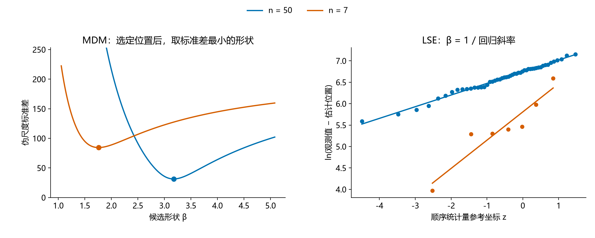

# 小样本三参数Weibull参数估计方法的比较与选择

**报告下（方法对比）v2.3｜2026-10-24**

魏鹏宇｜东北大学机械工程与自动化学院

分会场3：装备寿命与可靠性评估

## 1　实验设置

本轮比较七种方法在相同样本下的估计误差、重复抽样波动、明显异常和有效返回情况。

| 项目 | 本轮设置 |
| --- | --- |
| 方法 | MDM-0.1、LSE、LRE（Park）、WMLE、MLE、MMLE、MM |
| 参数 | η=1000、γ=500；β=1.5、2、2.5、3、3.5、4、4.5、5 |
| 样本量 | n=50、20、15、10、7 |
| 重复抽样 | 每个条件1200组；各方法使用相同样本 |
| 主要观察 | 参数RMSE、估计分布、明显异常与有效返回 |

*统计口径：精度图使用七法均有效的共同样本；分布图使用各法自身有效结果。形状RMSE除以真β，尺度和位置RMSE除以1000。方法与求解约定见[实验设置](实验设置.md)。*

## 2　估计性能的差异与变化

样本量减少通常使估计误差增大，但性能变化并不限于误差数值。不同方法的响应方式，以及估计结果的分布结构，也会随样本量和形状条件改变。

### 2.1　样本量减小下的不同表现

**展示目的：**按 β 分层，在固定形状条件下考察样本量减少带来的误差变化；再比较这一现象在不同形状条件下的共性与差异。

#### n = 50

#### n = 20

#### n = 15

#### n = 10

#### n = 7

*图注：五张图共用线性半径；扇区越长，标准化RMSE越大。MM的数值另列。*

在本次考察范围内，样本量减少时估计误差总体增大，但增长幅度因方法而异。有的方法对样本量减少较敏感，误差上升较快；有的方法增幅相对较小。

*两行分别为β=1.5、5的固定形状条件，三列分别对应形状、尺度、位置参数。横轴按n=50→20→15→10→7排列；同一参数两行共用纵轴。图中展示MDM、LSE、LRE、WMLE、MLE、MMLE六法的全部15个方法对，MM在玫瑰图中另列。*

*差距为两种方法标准化RMSE之差的绝对值，表示相隔多远；各法误差水平结合前面的玫瑰图观察。仍使用七法共同有效样本；形状RMSE除以真β，尺度和位置RMSE除以真η。*

不同方法的误差增长并不同步，方法间的精度差距也随样本量改变：一些方法对的差距扩大，另一些逐渐接近，部分还出现转折。误差总体增大，并不意味着方法间的差距始终扩大。

这种方法间的性能差异及其随样本量变化的关系，也会随形状条件改变。各方法对样本量减少的敏感程度需要在固定形状条件下比较，并结合不同分层考察其共性与差异。

### 2.2　形状参数增大时的估计分布变化

#### β = 1.5

#### β = 2

#### β = 2.5

#### β = 3

#### β = 3.5

#### β = 4

#### β = 4.5

#### β = 5

*图注：行对应n=50、7，列对应形状、尺度、位置。虚线为真值，红点为均值，横线为四分位区间。密度显示主体分布，统计量使用全部有效值。*

β=1.5时，两档n下多数方法的主体分布形态相近。n=7的估计结果通常更分散，LSE、LRE的位置估计还出现了零边界结果。

固定n，β从1.5增至5时，估计分布进一步变化。LSE、LRE的尺度和位置估计逐渐展宽，即使n=50，四分位区间也明显扩大。因此，分布展宽并不只出现在极小样本条件。

MDM、WMLE和MMLE则表现出有规律的参数偏移：形状估计的增幅落后于真β，低估加重；尺度估计向低值偏移，位置估计向高值偏移。两档n下均能观察到这一方向，n=7时偏移更明显。

随着β增大，LSE、LRE的位置估计还进一步向γ=0聚集；n=50时已可见，n=7时边界结果更多。

### 2.3　明显异常估计

估计分布中还存在明显偏离真值的结果。这里沿用Research00报告2的判据，将形状估计不超过真值的1/3，或达到真值的3倍，记为明显异常估计。

| β=5、n=7，LSE | 形状 | 尺度 | 位置 |
| --- | --- | --- | --- |
| 真值 | 5 | 1000 | 500 |
| 第34组：接近真值的例子 | 5.55 | 836.77 | 681.73 |
| 第0组：明显低估的例子 | 1.24 | 282.98 | 1205.95 |

相同总体、相同样本量和相同方法，不同抽样仍可能得到相差很大的参数。异常例子中，形状和尺度明显偏低，位置则偏高；这种偏离已经超出估计结果在真值附近的小幅波动。

*两例来自本轮存档W(5,1000,500)、n=7，样本编号从0开始；仅用于展示，不代表其发生频率。*

*图注：异常为β̂≤β/3或β̂≥3β；频率以各方法自身有效结果为分母，求解失败另行统计。*

随着n减小，明显异常估计更常见。八档β下，七种方法在n=7时的异常频率都高于n=50。β=5时，异常频率在五档n上逐档上升。

异常增多的程度和方向存在方法差异：较大β、小n下，多种方法以形状低估为主；MLE在低β、小n下也有较高异常频率。它们不能由一种固定的异常模式概括。

### 2.4　主要现象

1. **n减小时，估计误差总体增大，但各方法的增幅不同。**固定β，部分方法对样本量减少更敏感，误差上升较快；部分方法增幅较小。因此，方法间的差距也随样本量改变，而非保持原有的精度关系。

2. **相同n下，β增大时，三个参数的估计呈现不同的偏移和分布变化。**部分方法的形状低估加重，并伴随尺度偏小、位置偏大；另一些方法的尺度和位置估计更分散，还出现边界聚集。β变化的影响不仅体现在误差大小，也体现在参数偏移的方向和估计分布的形态。

3. **n减小时，明显异常估计更常见。**这一变化在八档β、七种方法的n=50与7比较中均可见，但异常增多的程度及其偏移方向因方法和参数条件而异。

## 3　性能变化的机制分析

样本量和形状条件通过改变观测覆盖及样本间距，影响参数组合的区分与各方法的选择。下面先看同一条删点路径，再结合判据剖面和参数恢复，解释偏移、边界聚集及明显异常怎样形成。

### 3.1　样本减少与方法响应的差异

固定总体为W(5,1000,500)，沿用同一组50个观测的随机删点路径，依次保留20、15、10、7个观测。每一档都是前一档的子集；在每档样本上分别用MMLE、MDM和LSE估计，比较CDF拟合和三个参数偏离真值的程度，再沿定位判据与参数恢复过程解释端点变化。

#### n = 50

#### n = 20

#### n = 15

#### n = 10

#### n = 7

*同一路径的样本减少，在三种方法中引起不同的拟合与参数变化。按n=50→20→15→10→7切换；上排三列依次为MMLE、MDM、LSE，各列只画本法拟合CDF，并以灰色虚线对照真实CDF。黑点是本组寿命观测，纵坐标为按当前n计算的(i−0.5)/n，仅作概率图展示；底部短刻线保留实际寿命位置。下排三列依次为形状、尺度、位置的带符号偏差（估计值减真值），零线表示无偏离；这是单一样本的误差，不是重复抽样的平均Bias。各档CDF共用坐标，同一参数各档也共用纵轴范围。*

这条删点路径的变化并非每一步都同向。从50点减到20点时，MDM的尺度、位置以及LSE的三个参数反而更接近真值；继续减少样本后，偏差又明显扩大。比较50点与7点两个端点，三法均表现为形状和尺度进一步偏低、位置进一步偏高，且参数移动幅度为LSE较大、MDM次之、MMLE较小。同一批观测的减少，经由不同估计规则产生了不同响应；单条路径不支持“每删一点误差必然增加”的判断。

三种方法采用不同的定位依据：MMLE直接取最小观测；MDM寻找伪尺度最小标准差的梯度达到固定阈值的位置；LSE寻找对数距离与参考坐标线性匹配最好的位置。下图分别标出最小值、阈值交点和匹配误差最低点。

删点后，最小观测增大，MMLE的位置估计直接随之右移。MDM的梯度曲线和LSE的匹配误差曲线也发生改变，两者选择的位置都向右移动，且超过MMLE的位置移动幅度。MDM、LSE使用整个观测点列构造判据，因此它们的定位变化还取决于删点后点列的间距与匹配关系。

位置确定后，还要看它如何进入形状和尺度的恢复。MDM在所选位置下寻找伪尺度标准差最小的形状，再取伪尺度均值恢复尺度；LSE在所选位置下回归对数距离，形状是斜率的倒数，尺度由截距指数恢复。

位置估计的右移进一步影响形状和尺度恢复。MDM的伪尺度标准差最低点向较低形状移动，随后由伪尺度均值恢复的尺度也降低。LSE中，较高的位置使下端观测到估计起点的距离缩短，对数距离的低端下降更多，回归线变陡；形状取斜率倒数，因而降低，截距降低则使恢复的尺度减小。

本例把误差增加落实到了具体计算过程：删点改变定位判据，位置变化再传递到形状和尺度恢复。不同方法对样本信息的使用方式不同，因此同一次样本减少引起的估计变化也不同。第二章的重复抽样结果给出整体表现，这里解释其中一条形成路径。

*蓝色为n=50，橙色为n=7；两图均在各方法实际选定的位置计算。MDM图聚焦标准差最低点区域；LSE图使用对应样本量的顺序统计量参考坐标。图中最低点、斜率和截距恢复的参数均已与前后估计核对。*

*沿用已计算的随机删点路径474，未预设保留最小观测。五档样本与估计均读取现有存档，不新增抽样或重跑估计。该例用于展示具体样本下的变化与计算步骤，不据此确定方法的总体精度排名；后两幅图继续解释n=50至7的端点变化，定位判据图保留n=20作中间参照。*

样本减少也减少了区分参数组合的观测约束。当多组参数对保留观测的解释接近时，判据可能出现宽缓区域，所选参数便更易随样本间距变化而移动。下一节结合形状条件与判据剖面说明这一联系。

### 3.2　形状条件下的参数区分与估计偏移

#### 观测约束与参数相容

相同n下，β=5时的最小观测比β=2时更远离真实起点；样本量减小时，这段距离进一步增大。观测集中于分布中部，起点附近缺少数据，位置参数需要从较远处外推。

*报告1图2：η=1000、γ=500，β=2、5，n=7、15、30。橙点为每组样本的最小观测，灰线为其到真实起点的距离；下排为最小观测的理论密度。*

图中的两组参数虽然相差较大，在观测覆盖区间内的分布曲线仍较接近。位置、尺度和形状可以相互补偿，有限观测因而容许不同的参数组合。还需要沿各方法的判据，看它怎样区分这些组合并选出参数。

*报告1图3：β=5、n=7第31组样本；对照W(5,1000,500)与W(2,500,1000)。黑点累计概率由样本排序近似。*

#### 判据区分能力与优选位置

LSE的图中，β=5时真位置附近多条曲线随候选位置变化较缓，最低点却分散在不同位置。观测较集中时，移动位置主要使对数点列近似整体平移或伸缩，线性匹配的评价改变较小；局部间距的波动便更容易改变优选位置。

*报告1图6：η=1000、γ=500；两列为β=2、5，三行为n=7、15、30。每条曲线对应一组样本，橙叉标记原返回位置，竖虚线标记真位置。*

报告2的单样本把这种宽缓区显示得更直接：第36组的候选位置从0移至约251时，条件形状从23.54降至13.64，对数似然却只下降约0.012。参数组合已经明显改变，判据评价仍几乎相同；数据对这些组合的区分较弱。图中的左端优选位置因此可以与很大的形状、尺度共同出现。

*报告2图15：W(2,100,500)、n=15，第35组为正常参照、第36组为高估样本。中列是在各候选位置重新优化得到的条件形状；数值由原图数据核对。*

#### 定位规则与参数传递

MDM按固定梯度阈值定位。高β时，各观测反算的伪尺度随位置变化更接近同步，标准差梯度较小，阈值交点向较高位置移动。位置提高后，小观测到起点的距离缩短比例更大，条件最优形状随之降低，再由伪尺度均值恢复出较小尺度。

图中从梯度交点沿同一位置读取形状与尺度，位置偏高、形状和尺度偏低便连接为同一条计算路径。

*报告1图5：δ=0.1，β=2、5，n=7第48组配对样本。两列比较形状条件，三行依次为梯度、条件形状和伪尺度均值。*

LSE的左侧优选位置则展示另一方向：左移位置压缩对数跨度，当这能改善线性匹配时，最低点会移向较低位置。橙色样本的最低点落在γ=0，紫色样本仍在内部；非负位置约束把一部分左侧偏移截在零点，形成边界聚集。对数跨度压缩又使回归斜率减小，取倒数后形状升高。报告2中的右侧样本沿相反方向传递：位置靠近最小观测，对数跨度拉大，形状和尺度降低。

*报告2图6：正常与零边界样本为W(2,100,500)、n=15第35、36组；内部左偏样本为W(2,1000,3000)、n=7第1组。右侧传递过程见报告2图7。*

| 方法 | 选择或定位依据 | 参数怎样联动 |
| --- | --- | --- |
| MMLE | 最小观测直接定位，再拟合保留距离 | 位置变化改变距离；保留距离集中或分散，使形状似然峰及恢复尺度改变。 |
| MDM | 梯度阈值交点定位 | 所选位置改变伪尺度标准差最低点及其均值，带动形状和尺度。 |
| LSE、LRE | 选择线性匹配或相关性最好的位置 | 对数跨度进入回归斜率；LSE取斜率倒数，LRE直接取斜率，再恢复尺度。 |
| WMLE | 两条加权方程的共同交点 | 样本距离同时改变两条关系，交点给出位置与形状，尺度由加权关系恢复。 |
| MLE | 比较不同参数组合的似然 | 宽缓高似然区允许位置、形状和尺度相互补偿，优选组合可明显偏离真值。 |

观测约束、判据区分与参数恢复共同决定偏移：宽缓区使不同参数组合难以区分，极值或交点给出选择方向，参数恢复再把变化传到其余参数。下端空缺、局部成簇或远端观测会进一步改变这些判据；同样的形成路径在部分样本上产生更大的偏移，表现为第二章的明显异常。

*本节复用Research00报告1、报告2的存档机制图，保留各图原条件和实现；不与Study04的1200次正式统计混合。六种方法的完整过程见报告1第2.1—2.6节与报告2第2.1节。*

## 4　评价目标、估计风险与方法选择

这些差异也改变了方法的评价。误差来自整体偏移、重复波动还是少数极端结果，对使用判断的意义不同；参数误差与寿命指标误差也需要分别看。

### 4.1　极端结果与求解失败

异常发生的频率与其对总体误差的影响不同。RMSE对误差平方求平均，少数极端值可能主导结果。MM在部分条件下的形状RMSE尖峰由极少数极端输出造成，不能将其理解为多数样本都产生同样程度的误差。

本轮中，MDM、LSE、LRE和MMLE的全部尝试均返回有效估计。MLE的有效率随n减小而下降，低β时下降更明显；其误差统计对应的成功集合也随之改变。成功结果的精度与全部尝试的返回情况，共同影响实际使用时的判断。

*图注：有效率的分母为全部1200次尝试，返回状态按本轮实现与求解约定统计。*

*极端记录示例：β=4.5、n=15的MM结果中，单条有效记录贡献了几乎全部形状平方误差，仍保留在原统计中。*

### 4.2　评价目标与已知条件

方法的评价取决于使用目标。参数估计与不同寿命指标下的方法排序可能不同。

B10的最低RMSE方法随n和β变化，B1则在多数条件下由MDM取得最低RMSE。评价指标改变后，方法的相对表现也发生变化。

部分条件下，第一与第二方法的RMSE接近，单一名次不足以反映差异幅度。方法选择还应结合稳定性与异常风险。

*图注：格内为共同有效样本上RMSE最低的方法，下行为第二名高出的比例。B10、B1分别为10%、1%失效分位寿命。*

模拟条件表以真实β为依据。实际使用时，β范围未知，需要在给定参考范围内综合评价；β范围可预估时，可以缩小候选区域。选择还取决于目标参数或寿命指标，以及对波动和异常风险的要求。利用未知样本进行方法选择的规则及其收益仍需验证。

## 5　后续研究与平台

相同n和总体参数下，具体样本仍存在差异。后续考虑利用人工智能方法，根据样本可观测特征与使用目标选择估计方法，并优化方法内部的过程量和求解过程。选择规则的收益需要在新样本上验证。

我们也在[weibull.work](https://weibull.work)整理方法实现与相关分析，目前已有部分方法可以在线调用。网站仍在建设，未来希望把样本分析、方法选择与求解优化结合起来，也欢迎大家试用并提出建议。
