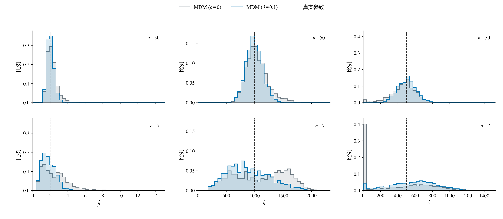

# 小样本三参数Weibull参数估计方法的比较与选择

**报告下（方法对比）v3.1｜2026-10-24**

魏鹏宇｜东北大学机械工程与自动化学院

分会场3：装备寿命与可靠性评估

## 1　实验设置

本轮比较七种方法在相同样本下的估计误差、重复抽样波动、明显异常和有效返回情况。

| 项目 | 本轮设置 |
| --- | --- |
| 方法 | MDM-0.1、LSE、LRE（Park）、WMLE、MLE、MMLE、MM |
| 参数 | η=1000、γ=500；β=1.5、2、2.5、3、3.5、4、4.5、5 |
| 样本量 | n=50、20、15、10、7 |
| 重复抽样 | 每个条件1200组；各方法使用相同样本 |
| 主要观察 | 参数RMSE、估计分布、明显异常与有效返回 |

*统计口径：精度图使用七法均有效的共同样本；分布图使用各法自身有效结果。形状RMSE除以真β，尺度和位置RMSE除以1000。方法与求解约定见[实验设置](实验设置.md)。*

## 2　估计性能的差异与变化

样本量减少通常使估计误差增大，但性能变化并不限于误差数值。不同方法的响应方式，以及估计结果的分布结构，也会随样本量和形状条件改变。

### 2.1　样本量减小下的不同表现

**展示目的：**按 β 分层，在固定形状条件下考察样本量减少带来的误差变化；再比较这一现象在不同形状条件下的共性与差异。

#### n = 50

#### n = 20

#### n = 15

#### n = 10

#### n = 7

*图注：五张图共用线性半径；扇区越长，标准化RMSE越大。MM的数值另列。*

在本次考察范围内，样本量减少时估计误差总体增大，但增长幅度因方法而异。有的方法对样本量减少较敏感，误差上升较快；有的方法增幅相对较小。

*两行分别为β=1.5、5的固定形状条件，三列分别对应形状、尺度、位置参数。横轴按n=50→20→15→10→7排列；同一参数两行共用纵轴。图中展示MDM、LSE、LRE、WMLE、MLE、MMLE六法的全部15个方法对，MM在玫瑰图中另列。*

*差距为两种方法标准化RMSE之差的绝对值，表示相隔多远；各法误差水平结合前面的玫瑰图观察。仍使用七法共同有效样本；形状RMSE除以真β，尺度和位置RMSE除以真η。*

不同方法的误差增长并不同步，方法间的精度差距也随样本量改变：一些方法对的差距扩大，另一些逐渐接近，部分还出现转折。误差总体增大，并不意味着方法间的差距始终扩大。

这种方法间的性能差异及其随样本量变化的关系，也会随形状条件改变。各方法对样本量减少的敏感程度需要在固定形状条件下比较，并结合不同分层考察其共性与差异。

### 2.2　形状参数增大时的估计分布变化

#### β = 1.5

#### β = 2

#### β = 2.5

#### β = 3

#### β = 3.5

#### β = 4

#### β = 4.5

#### β = 5

*图注：行对应n=50、7，列对应形状、尺度、位置。虚线为真值，红点为均值，横线为四分位区间。密度显示主体分布，统计量使用全部有效值。*

β=1.5时，两档n下多数方法的主体分布形态相近。n=7的估计结果通常更分散，LSE、LRE的位置估计还出现了零边界结果。

固定n，β从1.5增至5时，估计分布进一步变化。LSE、LRE的尺度和位置估计逐渐展宽，即使n=50，四分位区间也明显扩大。因此，分布展宽并不只出现在极小样本条件。

MDM、WMLE和MMLE则表现出有规律的参数偏移：形状估计的增幅落后于真β，低估加重；尺度估计向低值偏移，位置估计向高值偏移。两档n下均能观察到这一方向，n=7时偏移更明显。

随着β增大，LSE、LRE的位置估计还进一步向γ=0聚集；n=50时已可见，n=7时边界结果更多。

### 2.3　明显异常估计

估计分布中还存在明显偏离真值的结果。这里沿用Research00报告2的判据，将形状估计不超过真值的1/3，或达到真值的3倍，记为明显异常估计。

| β=5、n=7，LSE | 形状 | 尺度 | 位置 |
| --- | --- | --- | --- |
| 真值 | 5 | 1000 | 500 |
| 第34组：接近真值的例子 | 5.55 | 836.77 | 681.73 |
| 第0组：明显低估的例子 | 1.24 | 282.98 | 1205.95 |

相同总体、相同样本量和相同方法，不同抽样仍可能得到相差很大的参数。异常例子中，形状和尺度明显偏低，位置则偏高；这种偏离已经超出估计结果在真值附近的小幅波动。

*两例来自本轮存档W(5,1000,500)、n=7，样本编号从0开始；仅用于展示，不代表其发生频率。*

*图注：异常为β̂≤β/3或β̂≥3β；频率以各方法自身有效结果为分母，求解失败另行统计。*

随着n减小，明显异常估计更常见。八档β下，七种方法在n=7时的异常频率都高于n=50。β=5时，异常频率在五档n上逐档上升。

异常增多的程度和方向存在方法差异：较大β、小n下，多种方法以形状低估为主；MLE在低β、小n下也有较高异常频率。它们不能由一种固定的异常模式概括。

### 2.4　主要现象

1. **n减小时，估计误差总体增大，但各方法的增幅不同。**固定β，部分方法对样本量减少更敏感，误差上升较快；部分方法增幅较小。因此，方法间的差距也随样本量改变，而非保持原有的精度关系。

2. **相同n下，β增大时，三个参数的估计呈现不同的偏移和分布变化。**部分方法的形状低估加重，并伴随尺度偏小、位置偏大；另一些方法的尺度和位置估计更分散，还出现边界聚集。β变化的影响不仅体现在误差大小，也体现在参数偏移的方向和估计分布的形态。

3. **n减小时，明显异常估计更常见。**这一变化在八档β、七种方法的n=50与7比较中均可见，但异常增多的程度及其偏移方向因方法和参数条件而异。

## 3　性能变化的机制分析

样本量和形状条件通过改变观测覆盖及样本间距，影响参数组合的区分与各方法的选择。下面先看同一条删点路径，再结合判据剖面和参数恢复，解释偏移、边界聚集及明显异常怎样形成。

### 3.1　样本量减小时不同方法的误差增长机制

2.1显示，样本量由大变小时，误差总体增大，但不同方法的增幅不同。本节解释这条传递链：n减小改变样本信息，信息变化进入各法的判据或定位依据，使估计出现更大的方向性偏移或样本间波动，进而推高RMSE。各法判据和定位规则不同，对这些变化的放大或抑制也不同。先以β=5分解增长并观察判据，再用β=3的MDM两偏移量对照核对稳定性。

#### 误差增长中，偏差和波动各贡献多少

*三列分别对应β、η、γ；每档n按MDM(0.1)、LSE、LRE、WMLE、MLE、MMLE排列。浅色斜线为偏差平方，实色为经验方差，整根柱为标准化RMSE²。形状以真β=5、其余以1000标准化。统计采用各n七法共同有效集合，与第二章相同。*

这张堆叠图将误差平方拆开：

$$
\operatorname{RMSE}^2=\operatorname{Bias}^2+V_R,\qquad V_R=\frac{R-1}{R}\operatorname{SD}^2.
$$

这里R为有效重复次数，SD采用样本标准差。比较n=50与n=7时，增长也能逐项相减：

$$
\Delta\operatorname{RMSE}^2=\Delta\operatorname{Bias}^2+\Delta V_R.
$$

Δ取“n=7减n=50”。正项推动误差平方增长，负项抵消增长；RMSE增大并不要求Bias的绝对值与SD同时增大。

| 方法（β=5，形状估计） | ΔRMSE² | ΔBias² | Δ方差 |
| --- | --- | --- | --- |
| MDM(0.1) | +0.1357 | +0.1461 | -0.0103 |
| LSE | +0.2315 | -0.0005 | +0.2320 |
| LRE | +0.1958 | +0.0000 | +0.1958 |
| WMLE | +0.2228 | +0.2399 | -0.0171 |
| MLE | +0.4687 | +0.0160 | +0.4527 |
| MMLE | +0.0267 | +0.0216 | +0.0051 |

*表中为标准化误差平方，形状除以真β=5后再平方。各n使用七法共同有效集合，n=50、20、15、10、7分别保留1182、1100、1025、880、644组，集合随n变化；数值是相应条件下有效结果的分解。尺度、位置及含MM的完整表见[补充](#growth-supplement)。*

在这套比较口径下，MLE、LSE和LRE的形状误差增长主要来自方差；MDM(0.1)和WMLE主要来自偏差平方增加，方差项反而下降。MMLE的形状误差增量较小，也主要由偏差平方组成。以MDM(0.1)为例，Bias由−1.46变为−2.41，SD由0.75降为0.55，RMSE仍由1.64增至2.47；LSE的Bias约由+0.24变为+0.21，SD由2.03增至3.15，RMSE由2.04增至3.16。

这些分解先说明“增长在哪里”，接着才解释“为什么不同”。共同有效集合收缩也会影响条件SD，不能把上表直接当作全部1200次抽样的波动；后面的两δ对照使用每档完整1200组共同样本，单独核对规则改变后的分布。

#### 样本减少怎样放宽对参数组合的限制

*固定W(5,1000,500)。前三列取正式n=50、20、7存档各自的前50组，按本列最小值排序；蓝点为观测，橙点为最小值，灰线连接真实起点500与最小值。右图为最小值的理论密度。前三列共用寿命轴，右图聚焦起点附近。*

低寿命下端在总体中占比很小，抽取次数减少，更容易一个也没抽到。因此，n减小时，最小观测通常离真实起点更远，起点与最小观测之间的空白更大。以500—1000这段区间为例，整组没有观测落入其中的理论概率，随n=50→20→7约为21%→54%→80%；本轮1200组的实际比例约为20%→55%→80%。

这段空白首先放宽了候选起点的支持限制。对于以全部观测为支持检查对象的三参数Weibull候选，起点必须低于最小观测。当最小观测右移时，原来因起点过高而不可能解释全部数据的一些组合，便不再被这条支持条件直接排除。与此同时，较小n下没有抽到下端观测，也仍可容许候选分布在那里保留一定概率。方法需要区分的候选因而可能增多，参数仍需由全部观测及具体判据进一步确定。

起点的位置还会与形状、尺度相互补偿：位置改变后，另两参的调整可能让候选分布在观测集中的区间内仍然相近。因而，支持条件放宽只说明部分候选不再被直接排除，最终选中什么位置，还取决于具体方法怎样比较这些参数组合。下面沿四种定位规则追踪同一批样本的响应。

#### 用共同样本看四种规则怎样确定位置

减点诊断固定使用MLE、MMLE、MDM(0)和MDM(0.1)。从1200份正式50点样本预先每10个编号取一份，共120条路径；按固定随机排列依次保留50、20、15、10、7点，四法在每档使用完全相同的观测。

*五行对应n=50、20、15、10、7，四列对应四种方法，每个剖面格子叠加十组样本。样本号、颜色和线型贯穿全图，横轴均为原始γ；MLE为相对每观测负对数似然，MDM为梯度$g_n(\gamma)$。MMLE只标样本最小值；MLE失败的曲线不标返回点。十组为典型路径，选例及120条完整核对见[补充](#population-supplement)。*

沿行向下看，减点使同一样本的判据形状和定位结果改变：MLE低值区及最优位置发生移动，部分选点转向零边界；MMLE位置随最小观测右移；MDM的零梯度选点在平缓区或边界变化较大，而δ=0.1的交点落在梯度上升段。不同样本的响应方向并不一致，也没有各法都随n减小而变平的统一趋势，差别体现为各自规则对同一信息变化的不同响应。

判据的变化通过“选点”进入误差：不同样本的最优点向同一侧移动，会加重方向性偏差；最优点在更大范围内散开，或在内部与边界之间转换，会增大重复估计的不稳定性。当判据在一段位置范围内差别很小时，样本的偶然变化就可能重新排列候选优劣，使选点产生较大移动。随后位置变化又通过参数耦合传入形状和尺度。第一幅堆叠图中的偏差项与方差项，正是这些响应在重复估计中的表现。

#### 不同构造怎样处理这些信息与参数耦合

相同观测进入不同方法，会成为不同的估计依据；位置变化又会改变全部观测到起点的距离，进而牵动形状和尺度。这就是从样本信息转向方法视角的连接：各法利用的信息、处理三参数耦合的步骤和选参规则不同。

| 方法 | 怎样利用样本信息 | 与样本量变化有关的响应环节 |
| --- | --- | --- |
| MLE | 用各观测到候选起点的距离构造似然，联合确定三参数。 | 对数距离和幂次距离共同影响候选组合的似然高低。 |
| WMLE | 将距离、对数距离、幂加权距离和倒数距离放入带有样本量校准权重的估计方程。 | 样本统计关系与n相关权重共同改变形状、位置方程的交点。 |
| MMLE | 以最小观测确定位置，再对删除该点后的正距离估计形状、尺度。 | 位置直接受单个极值影响，其误差随后进入其余观测到起点的距离。 |
| LSE | 将排序观测的对数距离与按n确定的理论参考坐标回归，再以相对匹配定位。 | 点列、参考坐标及回归斜率共同影响三参数恢复。 |
| LRE | 用绘图位置形成概率图参考坐标，以相关性定位，再由另一方向的回归恢复参数。 | 绘图位置、对数间距和回归方向决定其对点列变化的响应。 |
| MDM | 每个位置下使各点反算的伪尺度尽量一致，再以最小标准差的梯度阈值定位。 | 伪尺度离散程度、条件形状和梯度交点共同响应样本变化。 |
| MM | 用排序间距的加权和计算Cran的样本Weibull矩，再由矩差关系反演参数。 | 间距和n相关权重改变矩组合，非线性反演可能放大矩差的变化。 |

MMLE的位置规则为$\hat\gamma=x_{(1)}$：最小观测改变多少，位置就改变多少，位置定位不需要反解平坦准则，也不在多个候选最优点之间搜索。这使它避免了该环节的额外放大，但最小观测偏大仍会直接成为位置偏差。β=5的完整1200组结果中，n从50减到7，位置SD由95.9增至142.8，Bias则由+418.1增至+618.6；因此，它的位置RMSE增长更多体现为偏移加重。形状与尺度随后还受条件估计的影响。

#### MDM用小偏移降低定位敏感性

MDM以伪尺度离散程度的廓线梯度定位。零梯度附近较平缓时，样本的小变化也可能让定位点移动较远；引入δ=0.1，把定位目标移向梯度曲线较陡的上升段，部分避开平坦区，从而降低这种位置敏感性。上图两列MDM使用相同曲线，区别正是目标与选中位置。对内部交点，位置响应近似为$\Delta\hat\gamma\approx-\Delta g_n(\hat\gamma)/g_n'(\hat\gamma)$：同样的判据扰动，在斜率较小时会产生较大的位置移动。小偏移的作用在于减弱这一放大，而不是让样本量下降失去影响。选点改变也会带来偏差，性能需要同时看偏差和波动。

*固定W(3,1000,500)，上排n=50，下排n=7；每档两方案使用完全相同的1200组原样本，均有效。δ=0补算，δ=0.1复用原估计，其他实现相同。各列共用坐标与分箱，虚线为真值。判据图用β=5展示选参过程，本图用β=3核对重复分布，两个条件不混算。*

在β=3、n=7的配对结果中，位置SD由δ=0时450.5变为δ=0.1时292.7，位置RMSE由461.5变为369.7。这让判据上避开平缓定位区的解释，与重复估计的分布变化对应起来；结论限于当前条件和固定实现。三参数Bias、SD、RMSE及样本来源见[β=3核对](#beta3-delta-supplement)。

本节得到的结论是：n减少后，变化的样本信息通过各法判据和定位规则，转化为不同程度的方向性偏移、选点分散或边界响应，最终形成不同的RMSE增幅。MLE、LSE、LRE在当前β=5比较中的形状误差增长主要来自方差，MDM(0.1)、WMLE主要来自偏差平方；MMLE的位置直接映射和MDM的正偏移定位体现了对特定放大环节的抑制。这些稳定作用允许波动较小，也仍可能伴随偏差增长。

上述证据解释了典型传递过程，尚未将七法全部RMSE差距逐项分解为独立机制贡献。完整选例、内部与边界统计见[群体核对](#population-supplement)，β=3重复验证见[配对核对](#beta3-delta-supplement)。

### 3.2　形状条件下的参数区分与估计偏移

#### 观测约束与参数相容

相同n下，β=5时的最小观测比β=2时更远离真实起点；样本量减小时，这段距离进一步增大。观测集中于分布中部，起点附近缺少数据，位置参数需要从较远处外推。

*报告1图2：η=1000、γ=500，β=2、5，n=7、15、30。橙点为每组样本的最小观测，灰线为其到真实起点的距离；下排为最小观测的理论密度。*

图中的两组参数虽然相差较大，在观测覆盖区间内的分布曲线仍较接近。位置、尺度和形状可以相互补偿，有限观测因而容许不同的参数组合。还需要沿各方法的判据，看它怎样区分这些组合并选出参数。

*报告1图3：β=5、n=7第31组样本；对照W(5,1000,500)与W(2,500,1000)。黑点累计概率由样本排序近似。*

#### 判据区分能力与优选位置

LSE的图中，β=5时真位置附近多条曲线随候选位置变化较缓，最低点却分散在不同位置。观测较集中时，移动位置主要使对数点列近似整体平移或伸缩，线性匹配的评价改变较小；局部间距的波动便更容易改变优选位置。

*报告1图6：η=1000、γ=500；两列为β=2、5，三行为n=7、15、30。每条曲线对应一组样本，橙叉标记原返回位置，竖虚线标记真位置。*

报告2的单样本把这种宽缓区显示得更直接：第36组的候选位置从0移至约251时，条件形状从23.54降至13.64，对数似然却只下降约0.012。参数组合已经明显改变，判据评价仍几乎相同；数据对这些组合的区分较弱。图中的左端优选位置因此可以与很大的形状、尺度共同出现。

*报告2图15：W(2,100,500)、n=15，第35组为正常参照、第36组为高估样本。中列是在各候选位置重新优化得到的条件形状；数值由原图数据核对。*

#### 定位规则与参数传递

MDM按固定梯度阈值定位。高β时，各观测反算的伪尺度随位置变化更接近同步，标准差梯度较小，阈值交点向较高位置移动。位置提高后，小观测到起点的距离缩短比例更大，条件最优形状随之降低，再由伪尺度均值恢复出较小尺度。

图中从梯度交点沿同一位置读取形状与尺度，位置偏高、形状和尺度偏低便连接为同一条计算路径。

*报告1图5：δ=0.1，β=2、5，n=7第48组配对样本。两列比较形状条件，三行依次为梯度、条件形状和伪尺度均值。*

LSE的左侧优选位置则展示另一方向：左移位置压缩对数跨度，当这能改善线性匹配时，最低点会移向较低位置。橙色样本的最低点落在γ=0，紫色样本仍在内部；非负位置约束把一部分左侧偏移截在零点，形成边界聚集。对数跨度压缩又使回归斜率减小，取倒数后形状升高。报告2中的右侧样本沿相反方向传递：位置靠近最小观测，对数跨度拉大，形状和尺度降低。

*报告2图6：正常与零边界样本为W(2,100,500)、n=15第35、36组；内部左偏样本为W(2,1000,3000)、n=7第1组。右侧传递过程见报告2图7。*

| 方法 | 选择或定位依据 | 参数怎样联动 |
| --- | --- | --- |
| MMLE | 最小观测直接定位，再拟合保留距离 | 位置变化改变距离；保留距离集中或分散，使形状似然峰及恢复尺度改变。 |
| MDM | 梯度阈值交点定位 | 所选位置改变伪尺度标准差最低点及其均值，带动形状和尺度。 |
| LSE、LRE | 选择线性匹配或相关性最好的位置 | 对数跨度进入回归斜率；LSE取斜率倒数，LRE直接取斜率，再恢复尺度。 |
| WMLE | 两条加权方程的共同交点 | 样本距离同时改变两条关系，交点给出位置与形状，尺度由加权关系恢复。 |
| MLE | 比较不同参数组合的似然 | 宽缓高似然区允许位置、形状和尺度相互补偿，优选组合可明显偏离真值。 |

观测约束、判据区分与参数恢复共同决定偏移：宽缓区使不同参数组合难以区分，极值或交点给出选择方向，参数恢复再把变化传到其余参数。下端空缺、局部成簇或远端观测会进一步改变这些判据；同样的形成路径在部分样本上产生更大的偏移，表现为第二章的明显异常。

*本节复用Research00报告1、报告2的存档机制图，保留各图原条件和实现；不与Study04的1200次正式统计混合。六种方法的完整过程见报告1第2.1—2.6节与报告2第2.1节。*

## 4　评价目标、估计风险与方法选择

这些差异也改变了方法的评价。误差来自整体偏移、重复波动还是少数极端结果，对使用判断的意义不同；参数误差与寿命指标误差也需要分别看。

### 4.1　极端结果与求解失败

异常发生的频率与其对总体误差的影响不同。RMSE对误差平方求平均，少数极端值可能主导结果。MM在部分条件下的形状RMSE尖峰由极少数极端输出造成，不能将其理解为多数样本都产生同样程度的误差。

本轮中，MDM、LSE、LRE和MMLE的全部尝试均返回有效估计。MLE的有效率随n减小而下降，低β时下降更明显；其误差统计对应的成功集合也随之改变。成功结果的精度与全部尝试的返回情况，共同影响实际使用时的判断。

*图注：有效率的分母为全部1200次尝试，返回状态按本轮实现与求解约定统计。*

*极端记录示例：β=4.5、n=15的MM结果中，单条有效记录贡献了几乎全部形状平方误差，仍保留在原统计中。*

### 4.2　评价目标与已知条件

方法的评价取决于使用目标。参数估计与不同寿命指标下的方法排序可能不同。

B10的最低RMSE方法随n和β变化，B1则在多数条件下由MDM取得最低RMSE。评价指标改变后，方法的相对表现也发生变化。

部分条件下，第一与第二方法的RMSE接近，单一名次不足以反映差异幅度。方法选择还应结合稳定性与异常风险。

*图注：格内为共同有效样本上RMSE最低的方法，下行为第二名高出的比例。B10、B1分别为10%、1%失效分位寿命。*

模拟条件表以真实β为依据。实际使用时，β范围未知，需要在给定参考范围内综合评价；β范围可预估时，可以缩小候选区域。选择还取决于目标参数或寿命指标，以及对波动和异常风险的要求。下面从样本特征出发，分别检验地图推荐的可识别性与逐样本选法的误差表现。

### 4.3　从样本特征恢复性能地图的推荐

性能地图给出已知β与n时的条件推荐。实际只有一组样本时，可以检验：**由样本自身的可观测特征，能否识别地图推荐的方法？**

复用48,000组样本与既有B10地图，以每格最低RMSE方法作为分类标签。输入为样本量、位置尺度、归一化分位数、形状统计与间距等30维特征，不输入真参数或七法估计值。按样本指纹划分训练、验证和测试，分别为28,807、9,551和9,642组；分类网络采用64×64两层结构，验证集用于早停。

| 策略 | 测试样本逐组一致率 | 40条件等权一致率 |
| --- | --- | --- |
| 训练多数类 | 44.70% | 45.00% |
| 只按n查训练多数类 | 46.53% | 47.50% |
| 样本特征分类网络 | 73.15%（7,053/9,642） | 73.30% |

*图注：每格将该条件中测试样本的预测类别作多数投票，恢复35/40格（87.5%）；虚线框为不一致格。β仅用于汇总显示，不是网络输入。MDM指δ=0.1，LRE为Park实现。逐格数据来自分类报告中的冻结结果表。*

样本特征比只看n提供了额外的地图匹配信息，但五个不一致格中，四个LSE格均被判为WMLE，另有一个MLE格被判为WMLE。LSE的逐组召回率仅5.18%，训练集上也只有6.59%。其中三个LSE冠军相对WMLE的RMSE优势不足0.2%；类别稀少、窄区域的样本信息重叠及最大概率判决的取舍共同参与识别困难。

**地图标签匹配率与当前样本的真实最优命中率是两个评价对象。**原地图按整格平均误差定义冠军，并使用全1200组结果；本轮评价的是对这张既定地图的模仿。测试样本来自相同40个条件的留出部分，范围为η=1000、γ=500及既有β×n网格。

匹配三个初始化重新训练后，完整特征的条件等权一致率均值为73.30%；删除位置尺度组降至72.25%，删除n降至73.02%。其他组未显示额外总体收益，但特征之间存在重叠信息，删除后不降不能解释为形状或间距无用。所有消融设置的LSE召回率仍不足7%。

*详细方案、结果与核对：[地图分类匹配](B10方法选择-地图分类匹配-v1.0.md)；[LSE错分诊断](B10方法选择-LSE错分诊断-v1.0.md)；[分类器特征消融](B10方法选择-分类器特征消融-v1.0.md)。*

### 4.4　以B10误差评价逐样本选法

地图分类之外，还可以直接学习各方法的预计B10平方误差风险，再按预测风险从小到大选择方法。该路线采用相同样本特征，七法结果与真值只用于监督；先运行首选方法，失败后依排序回退。

| 9,642组留出测试，40条件等权 | B10 RMSE | 相对固定方法改善 |
| --- | --- | --- |
| 训练集选定固定MDM-0.1（含固定回退） | 106.85 | — |
| 只按样本量选法 | 106.73 | 0.11% |
| 特征风险网络选法，含失败回退 | 95.08 | 11.01% |

配对95%区间为[10.27%, 11.72%]。首次选中方法失败率3.35%，本批依序回退后最终失败率0%；有效极端值保留，失败不填零误差。在同一批7,317组七法共同有效测试样本上，网络RMSE为93.14，仅用训练部分重建的β×n地图推荐为103.22，前者低9.76%。

这一模型直接优化误差风险，逐样本事后最优命中率为40.29%；将预测风险按条件取平均后，仅4/40格复现原地图冠军。**逐样本选法降低误差，并不要求它与地图分类器给出相同的条件推荐。**两条路线应分别按实际选法误差和地图标签匹配率评价。

固定β×n后，样本特征仍能区分不同方法的误差表现。例如样本最小值从低四分位到高四分位时，MLE的实际B10 RMSE由80.52增至191.61，MDM由117.10增至163.76。这为样本特征包含选法信息提供了观察证据；风险预测消融衡量额外信息贡献，不能将其换算成造成估计误差的因果占比。

收益也伴随取舍：总体带符号Bias由10.91增至30.34，P95绝对误差由217.60降至196.81。少量独立新样本中的未训练β=2.25、n=10及未训练n=30、β=3分别改善6.97%和10.01%；但η=500、γ=250及γ=0、η=1000时，RMSE分别增加26.03%和35.35%。各新条件仅200组。

当前结果说明：**在已考察范围内，样本特征可以辅助方法选择；选择目标、偏差方向、极端误差与适用范围仍需共同判断。**这是一项固定训练范围的研究原型，跨尺度、位置的推广仍待研究。配对区间固定已训练模型，不包含重新训练的全部不确定性。

*详细方案、结果与核对：[首轮方案](B10方法选择-研究方案-v1.0.md)；[选法与新样本结果](B10方法选择-简要报告-v1.0.md)；[性能地图对照](B10方法选择-性能地图对照补充-v1.0.md)；[误差因素量化](B10方法选择-误差因素量化补充-v1.0.md)。*

## 5　后续研究与平台

样本特征已在本轮固定参数范围内提供了方法选择信息。后续需扩大尺度和位置条件，并在独立样本上检验规则的稳定性与风险；进一步考虑依据使用目标，优化方法内部的过程量与求解过程。

我们也在[weibull.work](https://weibull.work)整理方法实现与相关分析，目前已有部分方法可以在线调用。网站仍在建设，未来希望把样本分析、方法选择与求解优化结合起来，也欢迎大家试用并提出建议。

## 附：3.1补充核对图

本页补充[报告下v3.1第3.1节](报告下（方法对比）-v3.1.md)，沿同一条474号嵌套路径逐档浏览结果。正文用下端覆盖与候选组合引入耦合，从方法原理解释响应差别，以MDM说明选参和偏差—波动取舍；此处保留共同删点例证、样本、判据、条件恢复和逐档CDF供核对，不以单条路径说明总体RMSE成因。

五档CDF共用坐标，同一参数的误差也共用纵轴范围。上排每列只画一种方法及真实CDF；黑点寿命坐标是真实观测，纵坐标按各自n计算(i−0.5)/n，仅作展示。下排为估计值减真值，不是重复抽样的平均Bias。每档都是前一档子集；这里的n=7子集不等于正式n=7表中同编号样本。

## 同一共同输入下的误差响应

*固定W(5,1000,500)，从同一份正式50点样本按既有随机排列保留50、20、15、10、7点；每一档三种方法使用相同观测。纵轴为本次估计减真值，虚线为零误差。这条路径用于观察上述构造怎样响应共同输入变化，不是重复抽样的Bias或RMSE。*

50→20点时最小观测仍为930.6，MMLE位置保持930.6；MDM位置从733.7变为683.7，LSE从662.5变为550.5。这个例子对应信息利用方式的差别：直接以极值定位的一步不变，依赖整组统计关系与n相关参考量的定位则可以改变。20→15点时最小值升至1222.3，三法的位置及后续恢复参数都发生明显变化。该例说明构造与参数传递的具体过程，不用于决定各机制对总体RMSE差距的贡献。

## 同一条路径实际保留了哪些点

深色为当前观测，浅灰为原50点中已删观测，蓝点为当前最小值，橙段为最大相邻间隔。本图只追踪一条路径；正文3.1的31H另用正式各档样本展示最小值分布，3.2保留不同β的共同影响。

## 同一观测怎样进入构造

暂固定MDM的β=5、γ=500及LSE的γ=500，黑箭头追踪50→20点时同一个930.6观测。其MDM绘图位置从0.01389变为0.03431，伪尺度从1011.5变为842.4；LSE的对数距离相同，横坐标从−4.4892变为−3.5729。这是输入变换诊断，不是实际定位判据。

## 三种构造的实际定位判据

本补充区31D集中展示“七点的偶然结构→LSE相对匹配→实际选参”。这里保留三法对照：MMLE位置等于最小观测；MDM先逐位置优化形状，再以最小伪尺度标准差的梯度达到0.1定位；LSE逐位置回归，以同一n下$1-R^2$最小定位。圆点为实际返回位置，虚线为真实位置500。不同n的判据高度不直接表示估计精度。

本补充区31D的回归点列分别作中心化及标准差归一化，展示的是原判据所用的相对匹配。在同一7点上，位置500与1174.0的$1-R^2$分别为0.227536与0.106430。两位置的原始对数距离总变差不同，不能将这个改善说成原始残差平方和下降；参数仍由原始回归恢复。核验JSON保留原始残差平方和、总平方和及全部标准化坐标。

## 位置进入形状与尺度恢复的具体步骤

两种颜色始终使用同一组7点及n=7参考坐标，蓝色代入各法50点时的位置，橙色代入7点时的位置。MDM条件形状4.34→1.76、尺度799.6→363.2；LSE条件形状5.23→1.52、尺度871.0→332.9。蓝色不是原50点估计。本补充区31I用LSE的同两组条件参数展示最终PDF/CDF；本图展开恢复计算。

## 最小观测约束的是起点，也是候选分布的下端概率

记当前最小观测为$m$。从支持范围看，候选起点不能高于$m$，否则就有观测落在模型允许范围之外。但起点即使低于$m$，也还要解释另一件事：**模型认为$m$左侧应该有多少数据，而我们实际一个也没看到？**

设候选参数为$\theta=(\beta,\eta,\gamma)$，它在$m$左侧安排的概率是

$$
q=F_\theta(m)=\int_\gamma^m f_\theta(t)\,\mathrm{d}t.
$$

因此，**PDF在$m$左侧的面积，与CDF在$m$处的高度，是同一份概率信息**。最小观测并不单独确定形状参数；它与样本量一起，对三个参数共同决定的下端概率提供信息。

*前两图始终使用同一组7点及其LSE理论参考坐标，分别代入位置662.5、1174.0后恢复形状与尺度；两条曲线都是7点条件恢复，蓝线不是原50点拟合。底部刻线是这7个真实观测，竖线为最小值$m=1226.9$。蓝色PDF阴影面积等于蓝色CDF圆点的高度$q$。右图固定蓝色候选参数和同一阈值$m$，计算重新独立抽取n个观测时全部不小于$m$的模型概率。*

先只看蓝色候选分布。它在$m$左侧放了约9.83%的概率。若固定这个分布和阈值，重新独立抽取n个观测，全部避开这段区域的概率为

$$
P_\theta(X_{(1)}\geq m)=[1-F_\theta(m)]^n=(1-q)^n.
$$

n=50时约为0.56%，n=7时约为48.4%。这说明，**小样本中没有看到下端观测，仍可能容许总体在那里放有相当概率**；样本CDF在最小值左侧为0，也不表示总体CDF在那里必须为0。上式用于说明空白区包含的抽样信息，具体选参仍要结合全部观测和各方法原有判据。

## 起点怎样牵动形状、尺度和整条曲线

单独改变位置参数、保持形状和尺度不变，只会平移分布。图中PDF外形之所以改变，是因为**方法在新的起点下，为匹配同一批观测，重新估计了形状和尺度**。

仍看图中的同一组7点，最小值为1226.9，最大值为1903.5：

| 代入位置 | 最小观测到起点的距离 | 最大观测到起点的距离 |
| --- | --- | --- |
| 662.5 | 564.3 | 1240.9 |
| 1174.0 | 52.9 | 729.5 |

起点右移后，下端距离缩短的比例更大，最大与最小距离之比从约2.2增至13.8。LSE对这些距离取对数，再与固定的理论参考坐标回归；对数距离跨度增大，使本例的回归线变陡。形状取斜率倒数，因此从5.23降到1.52；尺度由截距恢复，从871.0降到332.9。本例中，起点向右移，PDF峰位却向左移：另外两参的重新匹配改变了整条曲线的外形，CDF也随之改变。

这里的传递是“改变起点后重新匹配数据”，并不是最小值单独决定形状。MDM也通过观测到起点的距离恢复伪尺度，位置改变后，其一致关系和恢复参数也会改变；[补充核对图](#n-supplement)保留两法的具体恢复过程。

## 样本中的偶然聚集与间隔怎样改变判据

约束变弱，还没有解释方法为什么选中了偏离真值的参数。**判据是用当前这一组点计算的；点数少时，几个点的偶然聚集或一个较大间隔就占据了点列的较大部分，判据更容易受这些结构影响**。这不是说每组小样本都更不规则，而是同一种构造在不同小样本上，可能因为点列关系不同而偏向不同参数。

看474号路径最终保留的7点，约为1226.9、1372.1、1374.8、1395.2、1409.3、1569.0、1903.5。其中**第2—5点共4点挤在37.3的范围内，末端两点却相隔334.5**。这些聚集和间隔是这次保留样本的结构，不是总体分布固定具有的特征。

*从左到右读：(a)七个观测的实际寿命与次序，标出中间四点的跨度和末端间隔；(b)固定同一7点及其理论参考坐标，对比真实位置500与LSE所选位置1174.0。空心点对应500，实心点对应1174.0，同颜色、形状追踪同一组观测；两轴分别中心化并除以样本标准差，只为比较相对线性匹配。(c)同一删点路径n=50、20、7的实际LSE相对失配$1-R^2$；同一n下，其最低点与F比最大点等价。虚线为真实位置500。*

LSE把每个观测到候选起点的距离取对数，与按次序确定的理论参考坐标配对。中间四个观测很近，但各自仍对应不同的参考坐标；末端大间隔又使最后一点的对数距离明显抬高。这组点列在真实位置下没有很好地排成直线。右移候选位置会更强地拉开下端的对数距离，改变整组点列的相对关系；在本例中，这使相对线性匹配更好。

| 同一7点上代入的位置 | 相对失配$1-R^2$ | 由原始回归恢复的形状 | 恢复的尺度 |
| --- | --- | --- | --- |
| 真实位置500 | 0.228 | 6.29 | 1036.7 |
| LSE选中位置1174.0 | 0.106 | 1.52 | 332.9 |

**判据确实改善了，位置却离真值更远，形状和尺度也随之降低**。LSE寻找的是“让这组点列相对更接近直线的位置”；这组小样本的偶然结构，使该位置与真实起点分离。这里用的是原有相对匹配判据，不是原始残差平方和；形状仍取原始对数回归斜率的倒数，图中标准化斜率只用于显示。

不同构造会以不同方式响应。MMLE直接以最小值定位，7点的最小值升到1226.9，便直接返回该位置。MDM把整组点反算为伪尺度，以它们的一致程度及其随位置的变化定位；同一7点的实际梯度在1143.8达到0.1，随后恢复出另一组形状、尺度。[三法定位对照](#n-supplement)保留完整曲线。

这些响应并非只由最小值决定。50→20点时最小值仍是930.6，MMLE位置不变，MDM却从733.7变到683.7，LSE从662.5变到550.5；此段反而更接近真值。删点同时改变了整组观测、间距和当前n的参考坐标，其影响可以向不同方向发生。

本例展示这组七点的相对匹配怎样支持偏离真值的位置，不将其归因为最小值单独变大，也不据此解释总体RMSE的增幅。

### 五档CDF拟合与单次误差

#### n = 50

#### n = 20

#### n = 15

#### n = 10

#### n = 7

*同一路径的样本减少，在三种方法中引起不同的拟合与参数变化。按n=50→20→15→10→7切换；上排三列依次为MMLE、MDM、LSE，各列只画本法拟合CDF，并以灰色虚线对照真实CDF。黑点是本组寿命观测，纵坐标为按当前n计算的(i−0.5)/n，仅作概率图展示；底部短刻线保留实际寿命位置。下排三列依次为形状、尺度、位置的带符号误差（估计值减真值），零线表示无偏离；这是单一样本的误差，不是重复抽样的平均Bias。各档CDF共用坐标，同一参数各档也共用纵轴范围。*

## 附：3.1群体结果与曲率核对

对应[报告下v2.1](#mechanism-current)。计算前固定的[方案](结果呈现/比较探索/3.1偏移量与廓线群体验证-方案.md)及用户追加四法后的[补充约定](结果呈现/比较探索/3.1减点四方法与代表例-补充约定.md)保留实验身份。

## 正文使用β=3的重复分布

第60轮反馈将正文MDM两δ分布改用β=3；[当前配对核对](#beta3-delta-supplement)另存n=50、7各1200组。此前[β=2核对](结果呈现/比较探索/3.1-MDM偏移量-beta2结果.md)保留原身份。以下β=5五档n和120条嵌套结果保留原条件。判据图下仅保留变化描述，详细选例与统计在此核对。

## 两种集合及方法身份

正式对照：W(5,1000,500)，五档n各1200原样本，两δ同输入，共12000条，δ=0新增6000条、δ=0.1全部复用。两方案均全部有效，自身与两方案共同有效指标相同。

嵌套诊断：预先固定120条n50路径，编号0、10、…、1190，固定随机排列后逐档保留50、20、15、10、7点，四法共2400条。n50四法复用，其他档另算1920条；两集合共7920次新增完整估计，不计入原40条件七法排名，不抽取新Weibull样本。

MLE是冻结的β≥1、γ≥0有限候选版本；MMLE以最小值定位、删除该点后估计；MDM两方案共用条件标准差及梯度。零位置截断和近端回退区别于真实内部根。判据图只展示γ怎样确定，Bias/SD由统计图展示。原正式估计及冻结源码不改。

## 分行观察十组定位过程

新布局以[十组定位判据](#ten-gamma-paths)为准：图按五行n、四列方法排列，每个剖面坐标系叠加十组样本曲线；n仍各占一行，MMLE列仅标最小值定位。选例覆盖六种端点分支，不按变平挑选；120条路径的统计口径不变。以下640、330叠线图保留为曲率选例的补充核对。

## 十组样本选例与失败档

| 图组 | 样本编号 | n=7时MLE / MDM(0) | 该分支路径数/120 | 此中心最近路径数 | MLE失败的n |
| --- | --- | --- | --- | --- | --- |
| 1 | 670 | 零边界 / 零边界 | 40 | 18 | 无 |
| 2 | 630 | 失败 / 内部 | 27 | 26 | 10, 7 |
| 3 | 190 | 内部 / 零边界 | 19 | 19 | 无 |
| 4 | 920 | 内部 / 内部 | 28 | 19 | 无 |
| 5 | 70 | 零边界 / 零边界 | 40 | 11 | 无 |
| 6 | 280 | 零边界 / 零边界 | 40 | 11 | 无 |
| 7 | 90 | 内部 / 内部 | 28 | 9 | 无 |
| 8 | 350 | 失败 / 零边界 | 5 | 5 | 15, 10, 7 |
| 9 | 170 | 零边界 / 内部 | 1 | 1 | 无 |
| 10 | 700 | 失败 / 内部 | 27 | 1 | 10, 7 |

## 正式七法的Bias与SD

[误差平方及其增长分解](#growth-supplement)是正文使用的组成证据。另保留带符号Bias及SD曲线便于核对。

按七法共同有效集合，每档集合量不同；另核对各法自身有效指标，保存在分析CSV，不能把筛选后的SD变化直接当作全部1200次的变化。

## 两δ误差分解

每个n左柱δ=0、右柱δ=0.1，浅色为Bias平方，深色为估计方差。形状以5、其余以1000标准化；SD采用ddof=1，有限R下使用$(R-1)\operatorname{SD}^2/R$作为方差项，柱高严格等于RMSE平方。

| n | δ | β Bias / SD / RMSE | η Bias / SD / RMSE | γ Bias / SD / RMSE |
| --- | --- | --- | --- | --- |
| 50 | 0 | 0.84 / 2.02 / 2.19 | 143.85 / 354.27 / 382.22 | -144.92 / 343.44 / 372.63 |
| 50 | 0.1 | -1.45 / 0.76 / 1.63 | -227.44 / 158.28 / 277.06 | 221.30 / 151.05 / 267.90 |
| 20 | 0 | 0.74 / 2.53 / 2.63 | 125.25 / 431.66 / 449.29 | -128.62 / 416.53 / 435.77 |
| 20 | 0.1 | -1.91 / 0.87 / 2.10 | -310.07 / 210.13 / 374.51 | 299.64 / 203.75 / 362.30 |
| 15 | 0 | 0.60 / 2.68 / 2.75 | 105.18 / 464.38 / 475.96 | -110.29 / 446.12 / 459.37 |
| 15 | 0.1 | -2.13 / 0.91 / 2.31 | -347.95 / 225.79 / 414.74 | 334.74 / 212.95 / 396.69 |
| 10 | 0 | 0.52 / 2.98 / 3.02 | 89.55 / 492.54 / 500.41 | -97.54 / 473.53 / 483.28 |
| 10 | 0.1 | -2.36 / 0.93 / 2.53 | -390.00 / 238.66 / 457.18 | 372.93 / 230.50 / 438.37 |
| 7 | 0 | 0.53 / 3.48 / 3.52 | 66.97 / 527.44 / 531.45 | -79.04 / 503.51 / 509.47 |
| 7 | 0.1 | -2.62 / 1.14 / 2.86 | -448.64 / 256.93 / 516.95 | 426.11 / 248.67 / 493.31 |

## 判据是否随减点普遍变平

这要用预先固定的多条路径检验。对可靠内部解，用局部曲率比较定位附近的变化速度；零位置、失败、近端回退和形状边界另列。MLE同时报告总似然曲率及除以n的每观测曲率，以区分观测项减少的加和效应与每观测准则形状变化。

*左图每点为一条可靠配对路径的n=7曲率/n=50曲率，低于1表示该处更平；黑点和线为中位数及至少95%的区间。MLE两项和MDM(0)各为39/120条可靠内部配对，MDM(0.1)为120/120条。右图分母始终为120条路径，展示零位置与MLE失败；这些路径不混入内部曲率统计。κ的定义、两档差分及筛选记录见补充。*

| 判据 | 可靠配对/120 | 曲率比中位数 | 中位数区间 |
| --- | --- | --- | --- |
| MLE总似然 | 39 | 0.37 | 0.07—1.31 |
| MLE每观测似然 | 39 | 2.64 | 0.51—9.36 |
| MDM(0) | 39 | 7.17 | 0.65—27.87 |
| MDM(0.1) | 120 | 1.22 | 0.85—1.57 |

这些结果没有支持“减点后各方法的判据普遍越来越平”的统一解释。MLE总似然的曲率中位数降低，但每观测结果不同；两种MDM都同时存在变平和变陡路径。n减少还改变了选参位置与分支：本诊断中，MDM(0)零位置由41/120增至64/120，MLE零位置由17/120增至41/120，并出现32/120次失败。因而，选参可能沿平缓区域移动，也可能转向新的内部区域或边界，不能只用一张变平的个例解释总体误差。

## 曲率定义与有效范围

MDM用$\kappa=\eta_0S_n''(\hat\gamma)$，MLE用$\kappa=\eta_0^2[-\ell_p''(\hat\gamma)]$，固定$\eta_0=1000$，另保存MLE的κ/n。不同准则的绝对数值不横向比较。

只对可靠内部解配对，失败、零位置、已知近端外推、形状活跃边界及无法可靠差分的位置另列。两档中心步长h和h/2检查收敛，正曲率、相对差异≤20%、梯度残差≤0.0001；h及支持距离规则见方案。MLE和MDM0各39/120对，MDM0.1为120/120对，不将缺失曲率填零。

中位数区间用整条路径为单位的二项顺序统计量，覆盖至少95%；降低比例用Wilson区间。区间属于这些可靠子群，不代表全部120条路径。

## 主例及代表范围

670号从50/7四法均有效的88/120条路径选出。24维向量为四法、两端n、三参数的标准化带符号误差，按中位数和MAD标准化，取平均绝对距离最小者。MAD为0依次退到IQR、标准差和1。没有按曲率方向或视觉好看筛选；端点综合中心不保证每项变化均为第50百分位。

这是单条路径估计减真值，不是Bias或SD。中间档若失败应保留缺口；670号五档四法均成功。

| 方法 | Δβ分位 | Δη分位 | Δγ分位 |
| --- | --- | --- | --- |
| MLE | 75.6% | 85.8% | 17.6% |
| MMLE | 55.1% | 61.9% | 55.1% |
| MDM-0 | 47.2% | 68.8% | 32.4% |
| MDM-0.1 | 40.3% | 59.7% | 52.8% |

上表在同一88条子群内计算。670号MDM0.1曲率比约在第42.1百分位；MLE和MDM0在n7为零位置，不能称为它们的内部几何中心例。

## 内部曲率子群的中心例与反方向例

MDM0可靠内部子群39条，15条曲率降低、24条增大。640号为按预定曲率特征选出的子群中心例，330号为下降子群中心例。保留相反方向，不仅挑变平路径解释总体。

三幅定位图中，MLE横轴γ、纵轴相对每观测负对数似然；MMLE展示样本最小值直接给出γ；MDM两图均为原始γ—梯度γ，目标分别0和0.1，共用坐标范围。失败时不画虚构返回标记。梯度图显示−0.12至0.25以看清目标附近，近支持边缘高梯度仍参与原计算。

## 数据与复现

- [计算程序](结果呈现/比较探索/验证MDM偏移量与廓线群体.py)：正式δ0及嵌套MDM。

- [四法追加](结果呈现/比较探索/验证减点MLE与MMLE.py)：同路径MLE/MMLE与样本指纹合并。

- [统计程序](结果呈现/比较探索/统计偏移量与廓线群体.py)：共享指标、曲率、区间与选例。

- [绘图程序](结果呈现/比较探索/绘制偏移量与代表廓线.py)：读取结果绘制，不修改估计。

- [可携带核验摘要](结果呈现/比较探索/3.1群体核验摘要.json)：来源、群体数值、选例及图像SHA。

本地数据位于结果呈现/分析数据/3.1-MDM偏移量与廓线群体/；正式样本和嵌套四法各有results.csv、summary.json和manifest.json，另有指标、廓线几何、分类、群体结论及图像核对。原474号材料保留原身份，不与120条路径或1200次正式比较混算。

## 附：误差平方增长分解

对应[报告下v2.1](#mechanism-current)。数据读取正式40条件七法原结果，经共享指标函数汇总。每个条件采用七法共同有效样本，各n集合不相同；这不是同一固定队列的纵向方差变化。未调用估计器或新抽样。

每根柱高为标准化$\mathrm{RMSE}^2$；浅色斜线部分为$\mathrm{Bias}^2$，实色为经验方差$V_R=(R-1)\mathrm{SD}^2/R$，SD采用ddof=1。增长分解为$\Delta\mathrm{MSE}=\Delta\mathrm{Bias}^2+\Delta V_R$，Δ为n=7减n=50；负项抵消增长，不截成零。

## β=5的三参数增长分解

| 方法 | 参数 | ΔMSE | ΔBias² | Δ方差 |
| --- | --- | --- | --- | --- |
| MDM(0.1) | β | +0.13572 | +0.14606 | -0.01034 |
| MDM(0.1) | η | +0.11486 | +0.09347 | +0.02139 |
| MDM(0.1) | γ | +0.11248 | +0.08707 | +0.02541 |
| LSE | β | +0.23149 | -0.00049 | +0.23198 |
| LSE | η | +0.09397 | -0.00106 | +0.09503 |
| LSE | γ | +0.09069 | -0.00122 | +0.09190 |
| LRE | β | +0.19584 | +0.00001 | +0.19583 |
| LRE | η | +0.09442 | +0.00183 | +0.09259 |
| LRE | γ | +0.09116 | +0.00205 | +0.08911 |
| WMLE | β | +0.22275 | +0.23990 | -0.01714 |
| WMLE | η | +0.19759 | +0.18948 | +0.00811 |
| WMLE | γ | +0.17966 | +0.16581 | +0.01385 |
| MLE | β | +0.46873 | +0.01603 | +0.45270 |
| MLE | η | +0.14445 | +0.00551 | +0.13894 |
| MLE | γ | +0.13568 | +0.00308 | +0.13260 |
| MMLE | β | +0.02671 | +0.02162 | +0.00509 |
| MMLE | η | +0.16640 | +0.15959 | +0.00681 |
| MMLE | γ | +0.19389 | +0.18433 | +0.00957 |
| MM | β | +711.77013 | +8.62647 | +703.14365 |
| MM | η | +0.07461 | +0.00911 | +0.06550 |
| MM | γ | +0.07701 | +0.00466 | +0.07236 |

所有值均为标准化误差平方单位，贡献不是三个可相加的RMSE值。原单位Bias、SD、RMSE及八档β的完整增长数值保存在[核对记录](结果呈现/比较探索/3.1误差增长分解.json)。

## 附：β=2的MDM偏移量核对

按第58轮HTML反馈，正文重复分布图改用β=2；β=5原结果保留，不覆盖。固定W(2,1000,500)，只比较原图显示的n=50、7，每档1200组。新增2400次δ=0完整方法调用，δ=0.1的2400条原结果复用，共4800条，无新抽样。调用冻结共享run_experiment流水线并按共享指标汇总；原正式40条件七法结果及源码不变。

| n | 方法 | 参数 | Bias | SD | RMSE | 有效数 |
| --- | --- | --- | --- | --- | --- | --- |
| 50 | MDM-0 | β | +0.1875 | 0.5570 | 0.5875 | 1200 |
| 50 | MDM-0.1 | β | +0.0279 | 0.3940 | 0.3949 | 1200 |
| 7 | MDM-0 | β | +0.5324 | 1.5641 | 1.6516 | 1200 |
| 7 | MDM-0.1 | β | -0.1925 | 0.7742 | 0.7975 | 1200 |
| 50 | MDM-0 | η | +37.9467 | 186.6650 | 190.4068 | 1200 |
| 50 | MDM-0.1 | η | -6.4193 | 145.8421 | 145.9226 | 1200 |
| 7 | MDM-0 | η | +103.4075 | 465.9886 | 477.1347 | 1200 |
| 7 | MDM-0.1 | η | -106.7870 | 371.1080 | 386.0179 | 1200 |
| 50 | MDM-0 | γ | -40.9262 | 146.2016 | 151.7632 | 1200 |
| 50 | MDM-0.1 | γ | +1.0972 | 106.1408 | 106.1022 | 1200 |
| 7 | MDM-0 | γ | -115.0541 | 376.9777 | 393.9939 | 1200 |
| 7 | MDM-0.1 | γ | +84.2877 | 288.0711 | 300.0337 | 1200 |

[数值与指纹](结果呈现/比较探索/3.1-MDM偏移量-beta2核对.json)保留两份原始CSV、图像、结果SHA及2400次新调用的边界；[程序](结果呈现/比较探索/验证MDM两偏移量_beta2.py)可按分片复用。数据在结果呈现/分析数据/3.1-MDM偏移量-beta2/，由Git忽略。

## 附：β=3的MDM偏移量核对

按第60轮HTML反馈，将正文两δ重复分布图改用β=3。固定W(3,1000,500)，n=50、7各1200组，沿用正式原样本。新增δ=0的2400次完整方法调用，复用δ=0.1的2400条原结果，共4800条，均有效；无新抽样。β=2和β=5结果保留原身份，不覆盖。冻结共享流水线与方法源码不变。

| n | 方法 | 参数 | Bias | SD | RMSE | 有效数 |
| --- | --- | --- | --- | --- | --- | --- |
| 50 | MDM-0 | β | +0.4485 | 1.0564 | 1.1473 | 1200 |
| 50 | MDM-0.1 | β | -0.2274 | 0.5839 | 0.6264 | 1200 |
| 7 | MDM-0 | β | +0.5105 | 2.0946 | 2.1551 | 1200 |
| 7 | MDM-0.1 | β | -0.8865 | 1.0303 | 1.3589 | 1200 |
| 50 | MDM-0 | η | +101.1889 | 267.0418 | 285.4664 | 1200 |
| 50 | MDM-0.1 | η | -53.5146 | 165.3900 | 173.7667 | 1200 |
| 7 | MDM-0 | η | +89.8367 | 496.4421 | 504.3015 | 1200 |
| 7 | MDM-0.1 | η | -248.4450 | 328.1801 | 411.5062 | 1200 |
| 50 | MDM-0 | γ | -101.7458 | 248.5363 | 268.4605 | 1200 |
| 50 | MDM-0.1 | γ | +48.7308 | 148.9367 | 156.6472 | 1200 |
| 7 | MDM-0 | γ | -100.6846 | 450.5486 | 461.4784 | 1200 |
| 7 | MDM-0.1 | γ | +226.1115 | 292.6707 | 369.7447 | 1200 |

[数值及SHA核对](结果呈现/比较探索/3.1-MDM偏移量-beta3核对.json)。[共用程序](结果呈现/比较探索/验证MDM两偏移量_beta2.py)保留原文件名，通过环境变量STUDY04_MDM_BETA=3选择本条件；不设置时仍复现β=2。新数据单独存于结果呈现/分析数据/3.1-MDM偏移量-beta3/，由Git忽略。
