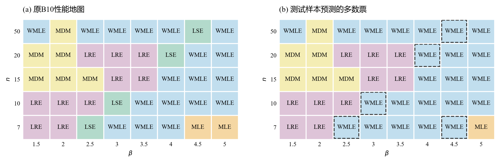

# 小样本三参数Weibull参数估计方法的比较与选择

**报告下（方法对比）v3.4｜2026-10-24**

魏鹏宇｜东北大学机械工程与自动化学院

分会场3：装备寿命与可靠性评估

## 1　实验设置

本轮比较七种方法在相同样本下的估计误差、重复抽样波动、明显异常和有效返回情况。

| 项目 | 本轮设置 |
| --- | --- |
| 方法 | MDM-0.1、LSE、LRE（Park）、WMLE、MLE、MMLE、MM |
| 参数 | η=1000、γ=500；β=1.5、2、2.5、3、3.5、4、4.5、5 |
| 样本量 | n=50、20、15、10、7 |
| 重复抽样 | 每个条件1200组；各方法使用相同样本 |
| 主要观察 | 参数RMSE、估计分布、明显异常与有效返回 |

*统计口径：精度图使用七法均有效的共同样本；分布图使用各法自身有效结果。形状RMSE除以真β，尺度和位置RMSE除以1000。方法与求解约定见[实验设置](实验设置.md)。*

## 2　估计性能的差异与变化

样本量减少通常使估计误差增大，但性能变化并不限于误差数值。不同方法的响应方式，以及估计结果的分布结构，也会随样本量和形状条件改变。

### 2.1　样本量减小下的不同表现

**展示目的：**按 β 分层，在固定形状条件下考察样本量减少带来的误差变化；再比较这一现象在不同形状条件下的共性与差异。

#### n = 50

#### n = 20

#### n = 15

#### n = 10

#### n = 7

*图注：五张图共用线性半径；扇区越长，标准化RMSE越大。MM的数值另列。*

在本次考察范围内，样本量减少时估计误差总体增大，但增长幅度因方法而异。有的方法对样本量减少较敏感，误差上升较快；有的方法增幅相对较小。

*两行分别为β=1.5、5的固定形状条件，三列分别对应形状、尺度、位置参数。横轴按n=50→20→15→10→7排列；同一参数两行共用纵轴。图中展示MDM、LSE、LRE、WMLE、MLE、MMLE六法的全部15个方法对，MM在玫瑰图中另列。*

*差距为两种方法标准化RMSE之差的绝对值，表示相隔多远；各法误差水平结合前面的玫瑰图观察。仍使用七法共同有效样本；形状RMSE除以真β，尺度和位置RMSE除以真η。*

不同方法的误差增长并不同步，方法间的精度差距也随样本量改变：一些方法对的差距扩大，另一些逐渐接近，部分还出现转折。误差总体增大，并不意味着方法间的差距始终扩大。

这种方法间的性能差异及其随样本量变化的关系，也会随形状条件改变。各方法对样本量减少的敏感程度需要在固定形状条件下比较，并结合不同分层考察其共性与差异。

### 2.2　形状参数增大时的估计分布变化

#### β = 1.5

#### β = 2

#### β = 2.5

#### β = 3

#### β = 3.5

#### β = 4

#### β = 4.5

#### β = 5

*图注：行对应n=50、7，列对应形状、尺度、位置。虚线为真值，红点为均值，横线为四分位区间。密度显示主体分布，统计量使用全部有效值。*

β=1.5时，两档n下多数方法的主体分布形态相近。n=7的估计结果通常更分散，LSE、LRE的位置估计还出现了零边界结果。

固定n，β从1.5增至5时，估计分布进一步变化。LSE、LRE的尺度和位置估计逐渐展宽，即使n=50，四分位区间也明显扩大。因此，分布展宽并不只出现在极小样本条件。

MDM、WMLE和MMLE则表现出有规律的参数偏移：形状估计的增幅落后于真β，低估加重；尺度估计向低值偏移，位置估计向高值偏移。两档n下均能观察到这一方向，n=7时偏移更明显。

随着β增大，LSE、LRE的位置估计还进一步向γ=0聚集；n=50时已可见，n=7时边界结果更多。

### 2.3　明显异常估计与求解失败

估计分布中还存在明显偏离真值的结果。这里沿用Research00报告2的判据，将形状估计不超过真值的1/3，或达到真值的3倍，记为明显异常估计。

| β=5、n=7，LSE | 形状 | 尺度 | 位置 |
| --- | --- | --- | --- |
| 真值 | 5 | 1000 | 500 |
| 第34组：接近真值的例子 | 5.55 | 836.77 | 681.73 |
| 第0组：明显低估的例子 | 1.24 | 282.98 | 1205.95 |

相同总体、相同样本量和相同方法，不同抽样仍可能得到相差很大的参数。异常例子中，形状和尺度明显偏低，位置则偏高；这种偏离已经超出估计结果在真值附近的小幅波动。

*两例来自本轮存档W(5,1000,500)、n=7，样本编号从0开始；仅用于展示，不代表其发生频率。*

*图注：异常为β̂≤β/3或β̂≥3β；频率以各方法自身有效结果为分母，求解失败另行统计。*

随着n减小，明显异常估计更常见。八档β下，七种方法在n=7时的异常频率都高于n=50。β=5时，异常频率在五档n上逐档上升。

异常增多的程度和方向存在方法差异：较大β、小n下，多种方法以形状低估为主；MLE在低β、小n下也有较高异常频率。它们不能由一种固定的异常模式概括。

异常发生频率与其对总体误差的影响也不同。例如β=4.5、n=15的MM结果中，一条有效记录贡献了几乎全部形状平方误差，仍保留在原统计中；少数极端结果因此可能主导RMSE。

#### 有效返回情况

明显异常属于已经有效返回的结果；求解失败指当前方法没有得到符合预设约束、支持与接受标准的返回结果。两者分别统计。

*图注：有效率的分母为全部1200次尝试，返回状态按本轮实现与求解约定统计。*

本轮中，MDM、LSE、LRE和MMLE的全部尝试均返回有效估计。MLE的有效率随n减小而下降，低β时下降更明显；其成功结果的精度与全部尝试的返回情况对应不同的统计对象。

### 2.4　主要现象

1. **n减小时，估计误差总体增大，但各方法的增幅不同。**固定β，部分方法对样本量减少更敏感，误差上升较快；部分方法增幅较小。因此，方法间的差距也随样本量改变，而非保持原有的精度关系。

2. **相同n下，β增大时，三个参数的估计呈现不同的偏移和分布变化。**部分方法的形状低估加重，并伴随尺度偏小、位置偏大；另一些方法的尺度和位置估计更分散，还出现边界聚集。β变化的影响不仅体现在误差大小，也体现在参数偏移的方向和估计分布的形态。

3. **小样本下，需要分别考察明显异常与有效返回。**八档β、七种方法的n=7形状异常频率均高于n=50，但增多程度与偏移方向不同；MLE的有效率也随n减小而下降，低β时更明显。异常输出与求解失败是不同的结果。

## 3　性能变化的机制分析

### 共同解释基础

在追踪各方法的响应前，先考察两个共同问题：样本量n和形状参数β怎样影响最小观测与真实起点之间的距离；有限观测为什么仍可能与差别较大的参数组合相容。

#### n、β与最小观测值

记一组样本的最小观测为$x_{(1)}$，真实起点为γ。两者之间的距离$x_{(1)}-\gamma$反映起点附近没有被观测覆盖的范围。最小观测给出了数据的左端，真实起点则仍需由样本和估计规则推断。

*η=1000、γ=500；两列为β=2与5，三行为n=7、15、30。蓝点为观测，橙点为每组最小观测，灰线连接真实起点与最小观测。下排为最小观测的理论密度。图复用Research00报告1的存档样本。*

固定β时，n减小使抽到低寿命观测的机会减少，最小观测的分布向右移动，起点到最小观测之间更容易留下较大空白。固定n时，图中β=5的最小观测比β=2更远离真实起点；此时观测更集中于分布中部，起点附近的覆盖更少。

这一关系可由最小次序统计量直接说明。对独立同分布的三参数Weibull样本，起点之后长度为d的区间内没有观测的概率为：

$$
\Pr\left(x_{(1)}>\gamma+d\right)=[1-F(\gamma+d)]^n=\exp\left[-n\left(\frac{d}{\eta}\right)^\beta\right],\qquad d>0.
$$

固定d和β，n越小，这一概率越大；在起点附近$0<d<\eta$的区间内，β增大也会提高这一概率。例如，γ=500、η=1000时，n=7的样本完全没有观测落在500—1000内的理论概率，β=2时约为17%，β=5时约为80%。因此，n与β共同影响下端观测覆盖，进而影响位置参数可利用的信息。

#### 有限观测下的参数区分困难

下端空白使候选起点受到的直接限制变弱。对需要覆盖全部观测的候选分布，其起点不能高于最小观测；最小观测右移后，部分原先会被观测排除的较高起点便进入了候选范围。位置改变时，形状和尺度又可以共同调整，使候选分布在已有观测覆盖的区间内仍然接近。

*W(β,η,γ)分别为W(5,1000,500)与W(2,500,1000)。黑点为第一组分布下n=7第31组样本，累计概率由排序近似。图复用Research00报告1的存档示例。*

图中位置由500变为1000、尺度由1000变为500、形状由5变为2，三参数均明显改变，两条CDF在观测集中的区间内却仍较接近。两种分布具有不同的起点和下端形态，而这组样本缺少相应观测。因此，仅凭这些有限观测，难以清楚区分这两种参数解释。

这建立了后续分析的共同基础：样本提供什么信息，候选参数组合有多容易区分，各方法又怎样依据判据、定位和参数恢复规则作出选择。下面分别追踪误差增长的组成、规律性参数偏移，以及明显异常与有效返回的形成条件。

### 3.1　样本量减少下的误差增长机制

2.1发现，各方法的误差随n减少而增长的幅度不同。本节先区分增长来自偏差还是重复估计的波动，再考察定位与参数恢复怎样参与这两类变化。

#### 误差增长的组成

*三列分别对应β、η、γ；每档n按MDM(0.1)、LSE、LRE、WMLE、MLE、MMLE排列。浅色斜线为偏差平方，实色为经验方差，整根柱为标准化RMSE²。形状以真β=5、其余以1000标准化，采用各n七法共同有效集合。*

$$
\operatorname{RMSE}^2=\operatorname{Bias}^2+V_R,\qquad V_R=\frac{R-1}{R}\operatorname{SD}^2.
$$

R为有效重复次数，SD采用样本标准差。n=7减n=50的误差平方增量，可以对应拆成偏差平方增量与方差增量：

$$
\Delta\operatorname{RMSE}^2=\Delta\operatorname{Bias}^2+\Delta V_R.
$$

| 方法（β=5，形状估计） | ΔRMSE² | ΔBias² | Δ方差 |
| --- | --- | --- | --- |
| MDM(0.1) | +0.1357 | +0.1461 | -0.0103 |
| LSE | +0.2315 | -0.0005 | +0.2320 |
| LRE | +0.1958 | +0.0000 | +0.1958 |
| WMLE | +0.2228 | +0.2399 | -0.0171 |
| MLE | +0.4687 | +0.0160 | +0.4527 |
| MMLE | +0.0267 | +0.0216 | +0.0051 |

*标准化误差平方单位。n=50、20、15、10、7的七法共同有效集合分别为1182、1100、1025、880、644组，各n集合不同；负项抵消增长。尺度、位置和含MM的完整表见[误差增长分解](结果呈现/比较探索/3.1误差增长分解.md)。*

在这一比较口径下，MLE、LSE和LRE的形状误差增长主要来自方差，MDM(0.1)和WMLE主要来自偏差平方，MMLE的增量较小、也以偏差平方为主。需要解释的因而是：相同的样本信息变化，为什么经过不同规则后，会表现为选参分散或方向性偏移？

#### 从观测覆盖到选参响应

章首已经说明n、β怎样改变下端观测覆盖。这里在相同观测上，直接比较不同规则怎样响应样本减少。

*从正式50点样本预先每10个编号取一份，共120条嵌套路径，按固定随机排列依次保留50、20、15、10、7点。图中展示十条代表路径；行对应n，列对应MLE、MMLE、MDM(0)、MDM(0.1)，颜色与线型标识同一条路径。MLE展示相对每观测负对数似然，MMLE只标最小观测，MDM展示梯度及目标交点。选例与120条核对见[群体诊断](结果呈现/比较探索/3.1偏移量与廓线群体-结果.md)。*

MLE的位置来自候选似然的比较。删点改变候选组合的相对评价，图中优选位置可移向不同内部区域，也可转至零边界。LSE、LRE则由线性匹配或相关性选择位置，再从回归恢复参数；局部间距变化会同时影响定位和回归关系。这些步骤允许位置在不同样本间分散，并把变化传给形状和尺度；3.2与3.3进一步给出具体选参对照。

MMLE采用$\hat\gamma=x_{(1)}$，最小观测的右移直接成为位置偏移。MDM(0.1)则按固定正梯度阈值定位，所选位置改变条件形状和伪尺度均值。两种规则都可能反复选中偏高的位置，形成方向性偏差；波动大小还由各自的定位与恢复步骤决定。

这里的关键是候选优劣、定位目标与恢复关系怎样变化。配对路径中可见不同方向的判据和选点变化，群体核对也未显示各方法随减点普遍变平。

#### 小偏移如何改善小样本估计

MDM(0)在条件最小标准差的梯度为零处定位；MDM(0.1)把目标改为正梯度0.1。交点移向较陡的上升段时，相同梯度扰动对应的位置变化较小。这种调整也改变选参偏差，需要看降低波动的收益能否超过偏差的代价。

*固定W(3,1000,500)，上排n=50，下排n=7；每档两方案共用1200组原样本，均有效。δ=0补算，δ=0.1复用原估计，其他实现相同。与前面β=5的定位图分别解释。*

n=7时，形状偏差的绝对值由0.51增至0.89，SD由2.09降至1.03，RMSE由2.16降至1.36。位置偏差的绝对值由100.7增至226.1，SD由450.5降至292.7，RMSE由461.5降至369.7；尺度RMSE也由504.3降至411.5。小偏移带来的方向性偏差，被更大幅度的波动降低所抵消，最终改善了这档小样本下的三参数估计。

按形状RMSE的绝对增量衡量，小偏移也减轻了n减少的影响：n从50减至7，δ=0时RMSE由1.147增至2.155，增长1.008；δ=0.1时由0.626增至1.359，增长0.733。位置和尺度的收益则体现为两档n下均有较低的RMSE水平。完整指标见[两偏移量核对](结果呈现/比较探索/3.1-MDM偏移量-beta3结果.md)。

因此，适当偏移通过增加一定偏差、明显降低重复波动，改善当前小样本条件下的估计误差，并减小形状RMSE随n减少的绝对增幅。这为MDM(0.1)的小样本表现提供了具体解释，也说明评价样本量敏感性需要同时看偏差、波动与RMSE的变化。

### 3.2　参数耦合、判据选择与规律性估计偏移

2.2显示，β增大时，一些方法反复出现形状偏低、尺度偏低、位置偏高，另一些方法的分布展宽并在零位置聚集。本节考察规则为什么选择特定方向，以及位置变化怎样传给另两参。

#### 直接定位怎样产生位置偏移

MMLE以最小观测定位，再删除该点、用剩余正距离估计形状和尺度。由章首最小观测分布，其位置偏差的期望为：

$$
\operatorname{E}(\hat{\gamma}-\gamma)=\eta\,\Gamma(1+1/\beta)\,n^{-1/\beta}.
$$

η=1000、n=7时，β由2增至5，理论平均位置偏差约由335.0增至622.2。β=5的正式1200组中，位置Bias为+618.6，与这一直接定位关系相符。这里可以从构造直接追溯位置偏高；形状和尺度还需沿删除最小值后的条件估计继续分析。

#### 梯度定位怎样确定联动偏移的方向

*Research00报告1存档示例：η=1000、γ=500，β=2与5，n=7第48组配对样本，δ=0.1；三行依次为梯度、条件形状、伪尺度均值。*

MDM按固定梯度阈值选择位置。图中的高β样本在较高位置才达到阈值，条件形状和伪尺度均值随后在同一位置读取：位置提高，使较小观测到起点的距离按更大比例缩短；条件标准差最低点移向较低形状，恢复的尺度也较小。

这一过程补上了从参数相容到实际选参的环节：阈值交点确定位置，条件最小化确定形状，均值关系确定尺度。图中沿同一所选位置读取三个过程量，直接显示这一样本的联动方向。

WMLE也在2.2中表现出相似的组合偏移，但它按加权方程交点求解。相近的偏移方向提示需要比较其交点与参数恢复，不能用MDM的阈值过程替代WMLE的机制证据。

#### 回归匹配与非负约束怎样形成边界聚集

*Research00报告1存档：η=1000、γ=500；两列为β=2、5，三行为n=7、15、30。每条曲线对应一组样本，橙叉为原返回位置，竖虚线为真位置。*

LSE按线性匹配选择位置。β=5时，图中部分判据在较宽位置范围内变化较小，优选位置又分散在不同区域；候选间的评价差异与局部间距的变化共同参与定位。位置越向左，整体对数跨度越受压缩；在LSE的回归方向下，斜率减小会经取倒数恢复为较大形状。

*Research00报告2存档：W(2,100,500)、n=15第35组为正常参照，第36组为零边界样本；内部左偏样本为W(2,1000,3000)、n=7第1组。*

图中左移位置能改善异常样本的线性匹配。一个样本的优选位置落在γ=0，另一个仍保留内部最低点。非负约束决定了左侧优选是否表现为零边界聚集；回归恢复则决定形状与尺度随所选位置怎样变化。LRE采用相关性定位和另一回归方向，需要按它自己的斜率关系追踪同类位置响应。

本节区分了三种实际过程：最小观测直接映射位置，梯度阈值确定位置，回归匹配与约束共同确定位置。它们都作用于耦合的三参数，却可以选出不同方向的组合；较宽缓的判据只是其中部分样本的一种表现。上述存档图保留原条件与实现，用于解释计算路径，正式分布规律仍以第二章为依据。

### 3.3　明显异常估计与方法失效的形成条件

规律性偏移描述重复抽样中的整体方向，明显异常则要进一步比较具体样本。相同n、β下，有些样本的判据优选仍接近真值，有些会选择远离真值的组合；能否有效返回又取决于各方法的接受条件。

#### 同一方法为什么在部分样本上产生明显异常

复查2.3中的LSE两例：β=5、n=7，第34组与第0组的最小观测分别为1229.88、1241.75，两者接近，但原估计分别接近真值与明显低估。沿冻结的White回归，在真位置和实际返回位置重新计算相同判据：

| 样本 | 比较位置γ | 条件形状 | 条件尺度 | 相对回归残差1−R² |
| --- | --- | --- | --- | --- |
| 第34组：固定真位置 | 500.00 | 6.95 | 1020.03 | 0.077565 |
| 第34组：实际返回位置 | 681.73 | 5.55 | 836.77 | 0.077351 |
| 第0组：固定真位置 | 500.00 | 6.49 | 1020.53 | 0.104104 |
| 第0组：实际返回位置 | 1205.95 | 1.24 | 282.98 | 0.011729 |

*每一位置下均重新回归恢复形状与尺度；“固定真位置”不等于把三个参数都设为真值。R²为上述对数回归的决定系数，相对回归残差越小，当前LSE的匹配评价越好。实际返回位置的参数与正式存档一致；这里只核对候选评价，不重新运行定位搜索。*

第0组在右侧位置取得明显更好的回归匹配，准则因此优选了形状很低、尺度很小、位置很高的组合。第34组的优选位置仍相对接近真位置，判据改善也很小。仅看最小观测留下的空白，不能区分这两种结果；需要进一步看整组间距与参考坐标的匹配，以及定位后参数怎样恢复。

这组对照说明，明显异常可以是方法判据明确优选的结果。参数补偿提供候选空间，当前样本的结构与选参规则决定最终落在哪个区域。

#### 宽缓剖面是另一种具体形成条件

*Research00报告2存档：W(2,100,500)、n=15，第35组为正常参照，第36组为高估样本。该图解释存档案例的候选比较，不作为本轮MLE失败率的证据。*

第36组在γ=0处的条件对数似然约为−72.215，高于真位置处的−72.899；选中左端位置后，形状约为23.54。γ从0移至约251时，条件形状已降至13.64，对数似然却只下降约0.012。这一实例中，偏离真值的组合获得较高似然，宽缓区又使差别较大的参数组合具有近似评价。它与前面的LSE明显改善匹配，是不同的候选选择情形。

#### 有效返回的要求怎样产生失败记录

对正式336000条求解明细逐条核对，11433条失败分别落在三个环节：

| 方法 | 失败次数 | 当前实现记录的失败环节 |
| --- | --- | --- |
| MLE | 8790 | 位置剖面搜索未找到可接受的有限局部极大值 |
| WMLE | 503 | 在既定参数约束与残差门槛内未找到可接受方程根 |
| MM | 2140 | 样本Weibull矩不满足显式反演的可采纳条件 |

*40条件合计，每种方法48000次尝试；MDM、LSE、LRE和MMLE在本批全部有效。计数与原始失败状态逐条对应，见[核对记录](结果呈现/比较探索/第三章选参与返回状态核对.json)。*

MLE比较可接受的有限候选，并把支持边界极限单独记录。例如β=1.5、n=7第0组没有找到有限候选，记录的极限位置等于样本最小值719.93，位于当前开支持条件之外，因此没有把该极限点当作有效估计。WMLE则必须同时满足加权方程和残差要求；MM的失败来自另一种构造条件，例如β=1.5、n=7第27组的两组矩差约为111.14与129.20，未满足前者大于后者且均为正的反演条件。

这些记录把失败定位到了搜索接受、方程可解性与矩反演三个不同环节。“未找到”仍对应当前搜索和约束范围，需要与数学上的解不存在区分。失败样本更细的结构分型尚未完成，现有记录足以说明其返回条件与有效但明显偏离真值的估计不同。

因此，分析明显异常需要比较样本结构、候选评价与实际选点；分析失败还需要核对参数约束和返回条件。两者都需要在实际方法选择中结合使用目标评价。

## 4　B10方法选择与样本特征预测

以前面的性能比较为基础，这里以B10，即10%失效分位寿命为使用目标，按B10的RMSE选择方法。条件地图给出不同n、β下的推荐；实际只有一组样本时，则进一步考察能否由样本自身的特征识别这些推荐。

*左图为原B10性能地图，右图为样本特征分类器在每格测试样本上的预测多数票，恢复35/40格（87.5%）；虚线框为不一致格。β仅用于汇总显示，不是网络输入。MDM指δ=0.1，LRE为Park实现。*

以既有B10地图中每格最低RMSE方法为标签，用样本量、位置尺度、分位数和间距等可观测特征训练分类器。9,642组留出测试样本的逐组一致率为73.15%，高于只按n选择训练多数类的46.53%。这说明样本结构提供了额外的地图识别信息。

预测地图恢复了多数推荐区域，五个不一致格中有四个LSE格和一个MLE格被预测为WMLE。部分区域的方法误差本来就接近，因此还应结合方法间差距判断推荐的意义。图中评价的是既定地图标签的可识别性。

若直接按预计B10误差风险逐样本选法，另一项研究在同批留出测试中，将含回退策略的条件等权RMSE从固定MDM(0.1)的106.85降至95.08，改善11.01%。这一结果评价实际选法误差，与上图的地图标签一致率分别看。

当前识别结果来自η=1000、γ=500的既有40个条件；风险选法在改变尺度、位置后已出现退化。实际使用时仍需结合使用目标、误差差距、极端风险与有效返回情况，并检验新的参数范围。

*完整训练、特征分析与风险验证见[地图分类研究](B10方法选择-地图分类匹配-v1.0.md)、[特征消融](B10方法选择-分类器特征消融-v1.0.md)、[风险选法研究](B10方法选择-简要报告-v1.0.md)。*

## 5　后续研究与平台

样本特征已在本轮固定参数范围内提供了方法选择信息。后续需扩大尺度和位置条件，并在独立样本上检验规则的稳定性与风险；进一步考虑依据使用目标，优化方法内部的过程量与求解过程。

我们也在[weibull.work](https://weibull.work)整理方法实现与相关分析，目前已有部分方法可以在线调用。网站仍在建设，未来希望把样本分析、方法选择与求解优化结合起来，也欢迎大家试用并提出建议。
