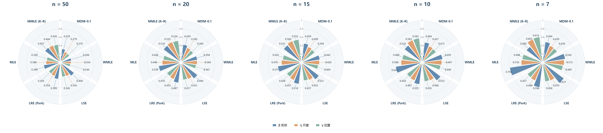
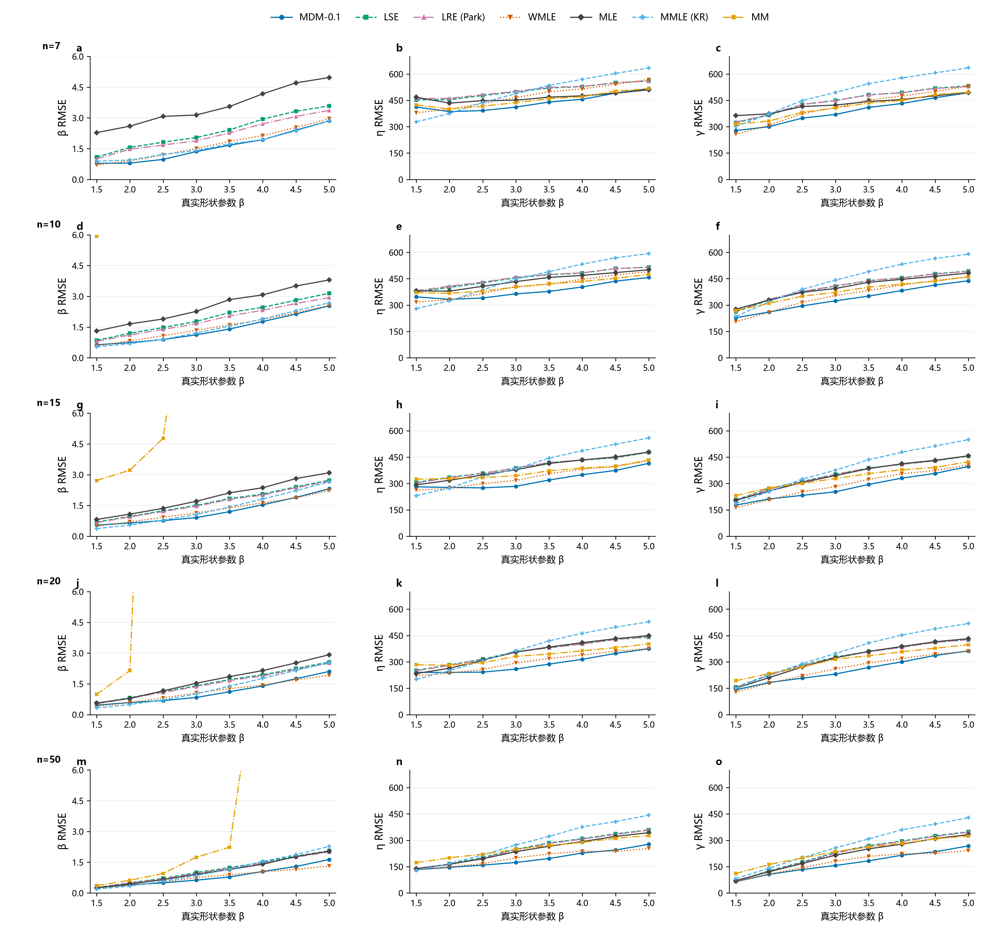

# n与β变化及交互影响分析

> v0.1｜2026-10-19。基于Study04现有40个条件的结果再分析，不新增样本、不重新求解。本文负责归纳性能规律及其依据；实验版本见[实验设置](../实验设置.md)，讲述稿见[报告下](../报告下（方法对比）-v0.2.md)。

当前结果支持三个主要判断：

- **n减小：** 三参数估计精度普遍下降，但不同方法下降的程度不同；误差增大既可能来自波动，也可能来自系统偏移。
- **β变化：** 方法的偏移、波动和优势区域都会改变。高β下，一些方法表现为较强偏移，另一些表现为较大波动；不能只看一个RMSE排序。
- **n与β交互：** 同样减少样本量，在不同β下造成的误差增量不同，方法之间的先后关系也可能改变。选法需要同时考虑这两个条件。

## 1　分析口径

固定真η=1000、γ=500，β取1.5至5的8个值，n取7、10、15、20、50，各条件1200组样本。比较MDM-0.1、LSE、LRE（Park）、WMLE、MLE、MMLE（K–R）、MM七种具体实现。

除特别说明，参数误差按各方法**自身有效结果**计算，失败另列。形状跨β比较使用相对RMSE，即Rβ=RMSEβ/β，避免仅因真β数值增大而放大绝对误差；相对Bias和相对SD也分别除以β。尺度、位置的真值固定，以下直接使用原寿命单位。七法共同有效集合用于核对，但它仍经过成功筛选，各条件保留的样本也不同。

形状异常沿用β̂≤β/3或β̂≥3β，发生率分母为该方法的有效次数；有效率分母为全部1200次。有效极端值全部进入RMSE，失败不填零。

## 2　n减小：精度下降，偏移与波动的变化并不相同

### 2.1　三参数RMSE的下降规律较一致

逐β检查n=50→20→15→10→7：

- 除MM外，其余六种方法的形状、尺度、位置RMSE，在全部8个β下均随n减小而增大。
- MM的尺度、位置RMSE同样呈现这一规律；其形状RMSE存在明显尖峰，不能画成平滑、稳定的样本量规律。

下表汇总形状误差随n的变化。各列对8个β条件等权，采用Qβ=√mean[(RMSEβ/β)²]；它概括本轮参考域内的表现，不代表实际工程中β的概率分布。

| 方法 | n=50 | n=20 | n=15 | n=10 | n=7 |
|---|---:|---:|---:|---:|---:|
| MDM-0.1 | 0.240 | 0.333 | 0.366 | 0.422 | 0.483 |
| LSE | 0.332 | 0.462 | 0.508 | 0.607 | 0.725 |
| LRE（Park） | 0.322 | 0.449 | 0.495 | 0.568 | 0.674 |
| WMLE | 0.234 | 0.343 | 0.388 | 0.453 | 0.517 |
| MLE | 0.314 | 0.500 | 0.580 | 0.792 | 1.163 |
| MMLE（K–R） | 0.319 | 0.378 | 0.396 | 0.434 | 0.515 |
| MM | 3.146 | 7.885 | 50.596 | 12.608 | 37.259 |

尺度、位置也有明显损失。例如MDM的尺度范围RMSE从n=50的200.27增至n=7的440.46，位置从181.79增至393.64。这里仍对8个β条件的RMSE平方等权平均后开方。

MM的形状尖峰与极少数极端输出有关。β=4.5、n=15的一条有效记录得到β̂=17350.39，贡献该条件98.47%的形状总平方误差。因此，表中MM的非单调变化不能解释成“n=15天然比n=7更难”；本次经验RMSE对极端记录非常敏感。

### 2.2　RMSE变大，不一定表现为SD同步变大

β=5时，WMLE从n=10减到n=7：形状SD由1.342略降至1.283，但Bias由−2.174变为−2.671，RMSE仍由2.555升至2.963。

这说明小样本下可能出现**结果更集中，却更偏离真值**的情况。不能把误差增加全部解释为“不稳定”，也不能仅凭分布较窄判断估计更好。

### 2.3　方法差距可以扩大，但不同参数的变化要分开说

该图按各n的七法共同有效集合计算，半径分别为RMSEβ/β、RMSEη/η、RMSEγ/η；六法主视图的刻度一致，MM在[七法完整范围图](图片/15_RMSE玫瑰图_β5_七法完整范围.png)中另列。

β=5时，MLE与MDM的形状Rβ分别从n=50的0.399、0.329变为n=7的0.792、0.494，差距由0.070扩大至0.299。各方法对n减小的反应不同，体现为形状精度差距进一步拉开。

但不能将这一说法直接推广到三个参数：同一图中六法的尺度标准化RMSE最大差距由0.190变为0.164，位置由0.186变为0.185，端点差距没有扩大。形状的六法差距沿五档n也并非逐步单调扩大。准确表述应是：**本条件下，n=7的形状方法差距大于n=50；具体怎样变化取决于方法、参数与条件。**

n减少还会增加交付风险。对8个β条件等权平均，MLE有效率从n=50的99.75%降至n=7的56.88%；MDM的形状异常频率从0.021%升至12.26%。有效率与异常率需分别看，不能仅用成功结果的误差评价全部尝试。

## 3　β变化：误差构成与方法优势都会改变

### 3.1　高β下，系统偏移和重复波动是两种不同表现

固定n=50，对比β=1.5与5，选取四种具有不同表现的方法：

| 方法 | 真β | 相对Bias | 相对SD | 相对RMSE Rβ |
|---|---:|---:|---:|---:|
| MDM-0.1 | 1.5 | 0.026 | 0.170 | 0.172 |
| MDM-0.1 | 5 | −0.289 | 0.152 | 0.327 |
| WMLE | 1.5 | −0.008 | 0.156 | 0.156 |
| WMLE | 5 | −0.179 | 0.195 | 0.265 |
| MMLE（K–R） | 1.5 | −0.039 | 0.118 | 0.124 |
| MMLE（K–R） | 5 | −0.437 | 0.126 | 0.455 |
| LRE（Park） | 1.5 | −0.010 | 0.178 | 0.178 |
| LRE（Park） | 5 | 0.024 | 0.400 | 0.401 |

MDM和K–R在高β下主要增加了形状低估，尤其K–R的相对SD变化很小，相对Bias却明显增大。LRE的相对Bias仍接近零，但相对SD明显增大。WMLE则同时存在负偏移和波动。

因此，β增大后的困难并非只是“估计值更散”。**偏移较小但波动较大，与波动较小但持续低估，是需要区分的两类代价。** 现有[估计分布图](图片/01_估计值分布_β5.png)、[Bias趋势](图片/02_Bias趋势.png)和[SD趋势](图片/03_SD趋势.png)可以相互对照。

### 3.2　影响会传递到尺度和位置，方法优势也随之改变

固定n=20，β从1.5变为5时，MDM的尺度RMSE由240.31增至374.51，位置由141.06增至362.30；K–R分别由200.13增至528.04、149.98增至518.05。位置和尺度的真值没有变化，这些增长反映了估计难度随形状条件改变。

高β下还可见参数偏移组合。β=5、n=50时，MDM的尺度Bias为−227.44、位置Bias为221.30；K–R分别为−431.06、418.06，同时两者形状均偏低。这与Research00讨论的参数补偿现象相符，但仅凭误差统计不能确定各方法的完整形成机制。

方法优势也会改变：n=50、β=1.5时，K–R的形状Rβ为0.124，是七法中最低；β=5时，它增至0.455，而WMLE为0.265、MDM为0.327。低β下的形状优势不能直接沿用到高β。

### 3.3　β的影响并非处处单调，也不等同于失败率的变化

例如n=20时，MDM的Rβ从β=1.5的0.306降至β=2.5的0.273，再升至β=5的0.421。不能将β变化概括成单一线性恶化。

求解有效率还呈现不同方向。n=7时，MLE在β=1.5下仅32.25%有效，β=5下为68.08%；但高β下MDM、WMLE等方法的形状低估异常更突出。**较低β的求解失败问题，与较高β的偏移、异常问题，需要分别识别。** MLE成功集合随β明显改变，其成功结果上的Rβ下降也不能直接解释为全体样本更容易估计。

## 4　n与β交互：样本量效应随形状条件改变

这里的“交互”指：在指定性能指标上，n变化带来的差值随β改变；等价地，β的影响随n改变。以下为离散模拟网格的描述性证据，尚未进行交互项显著性检验。

各行对应不同n，沿β观察各方法曲线，再跨行比较变化。形状列为局部显示，MM的完整量级见[形状指标全范围](图片/04_形状指标全范围.png)；所有有效极端值仍进入统计。

### 4.1　同样从50减到7，误差增量取决于β

定义Δn(β)=Rβ(n=7)−Rβ(n=50)。以自身有效结果计算：

| 方法 | β=1.5时的Δn | β=5时的Δn | 两个增量之差：高β−低β |
|---|---:|---:|---:|
| MDM-0.1 | 0.350 | 0.245 | −0.106 |
| LRE（Park） | 0.489 | 0.273 | −0.216 |
| MMLE（K–R） | 0.468 | 0.116 | −0.352 |

三个例子的增量均随β改变；改用七法共同有效集合，仍保留“低β增量较大”的方向，但数值不同。

这也揭示了一个容易误读的地方：**高β下误差较大，不等于高β下减少样本造成的误差增量一定更大。** K–R在β=5、n=50时已存在明显偏移，Rβ为0.455，减到n=7后为0.571；β=1.5时则由0.124增至0.592。它在高β下的增量较小，同时n=50的误差也较高，不能据此认定高β下更稳妥。

这些交互大小依赖所用指标与归一化方式。表中讨论的是相对RMSE的差值，不能直接当作SD、绝对RMSE或风险发生率的交互大小。

### 4.2　方法之间的误差先后也依赖条件组合

选取MDM与WMLE作直接对照，表内均为自身有效结果的Rβ：

| 真β | n | MDM-0.1 | WMLE | 点估计较小者 |
|---|---:|---:|---:|---|
| 1.5 | 7 | 0.522 | 0.474 | WMLE |
| 1.5 | 20 | 0.306 | 0.272 | WMLE |
| 5 | 7 | 0.571 | 0.593 | MDM |
| 5 | 20 | 0.421 | 0.384 | WMLE |

β=1.5时，两档n下都是WMLE较小；β=5时，n=7与20的先后发生变化。七法共同有效集合保留了这四个条件中的先后方向。它说明两方法的相对表现依赖n与β的组合，尚不足以据此确定连续参数空间中的切换边界，也未检验这些小差异是否超出蒙特卡洛波动。

### 4.3　异常风险的样本量效应在高β下更突出

| 真β | n | MDM形状异常率 | WMLE形状异常率 | MLE有效率 |
|---|---:|---:|---:|---:|
| 1.5 | 50 | 0.00% | 0.00% | 98.00% |
| 1.5 | 7 | 1.50% | 2.04% | 32.25% |
| 5 | 50 | 0.08% | 0.00% | 100.00% |
| 5 | 7 | 25.58% | 39.40% | 68.08% |

从50减到7，MDM与WMLE的异常率增长在β=5时远大于β=1.5；而MLE有效率的损失在β=1.5时更大。交互因评价内容而异，不能把“异常增多”和“无解增多”合成一种困难。

β=5、n=7时，MDM的307次异常全部为形状低估，WMLE的472次异常也全部为低估。这表明该条件下的严重偏离具有明显方向性。WMLE的39.40%来自472/1198，Wilson 95%区间约36.67%—42.20%；表中的0次发生只表示本批未观察到，不等于真实风险为零。完整条件见[形状异常频率](图片/07_形状异常频率.png)和[有效率](图片/06_有效率.png)。

### 4.4　K–R的位置构造提供了一个直接解释

本轮K–R实现将位置估计取为样本最小值γ̂=x₍₁₎，全部48000组记录均符合这一规则。三参数Weibull的最小值生存函数为

$$
P(X_{(1)}>\gamma+t)=\exp[-n(t/\eta)^\beta],\qquad t\ge0.
$$

因此最小值相对起点的期望距离，即该位置估计的理论Bias，为

$$
E[\hat\gamma-\gamma]=\eta\,\Gamma(1+1/\beta)\,n^{-1/\beta}.
$$

这个式子直接包含n和β的共同作用：β=1.5时按n⁻²ᐟ³缩小，β=5时只按n⁻¹ᐟ⁵缩小。n=50时，两者的理论位置Bias分别为66.51、419.88，本批观测为67.90、418.06。

这解释了为什么K–R在高β条件下增加到50个样本，位置仍明显偏高：样本最小值靠近真实起点的速度较慢。这一推导直接解释位置Bias；形状、尺度的变化还涉及后续恢复步骤。它也不意味着偏移在n继续增大时不再下降。

## 5　这些规律对方法选择意味着什么

**n是必须考虑的条件，β范围同样会改变判断。** 现有结果不能仅用一个“大样本排序”推到小样本，也不能仅按β高低给出与n无关的排序。

选择时还需明确目标参数与可接受的代价：K–R在较低β和部分n下的形状优势，伴随位置误差；MDM等方法在部分条件下较低的RMSE，可能伴随系统低估；MLE较低的条件异常率，需要与大量求解失败并列看。

本批结果可以用于归纳**给定n、β参考范围与评价目标下的候选方法**。具体选择规则的收益仍需另行验证；本次分析没有增加AI选法或实际应用收益的证据。

## 数据依据与适用范围

输入为[参数指标](分析数据/参数指标.csv)、[风险统计](分析数据/风险统计.csv)、[范围比较](分析数据/范围比较.csv)及40份[原始估计结果](../结果/README.md)。本次从估计CSV独立重算并核对5040项Bias、SD、RMSE、210组范围汇总及异常和成功计数；核对记录为[n与β影响分析核对](分析数据/n与β影响分析核对.json)。上述数值数据由Git忽略，文档引用本地文件。

本分析为已有结果的描述性再分析，没有重跑估计器或进行显著性检验。小的误差先后差异只按点估计陈述；MM的形状RMSE受极端记录支配，尤其不宜当作已稳定收敛的总体量。

结论限于本轮η=1000、γ=500、β=1.5—5、n=7—50的离散设计及七种固定实现，不外推为任意参数空间的最优方法。
