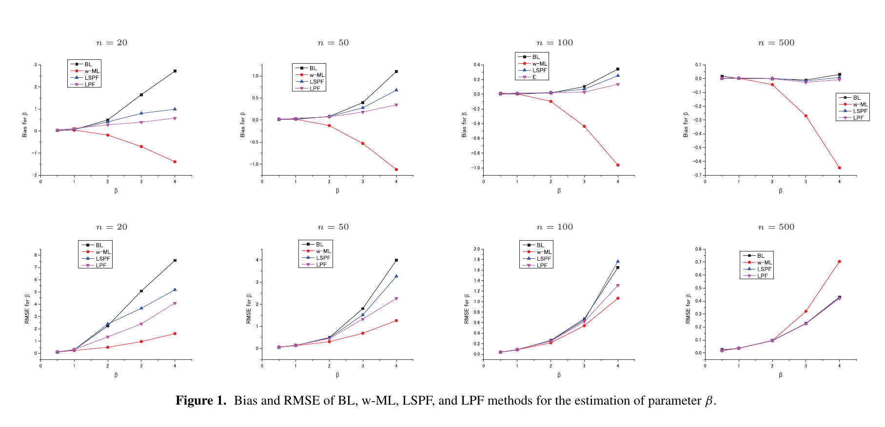
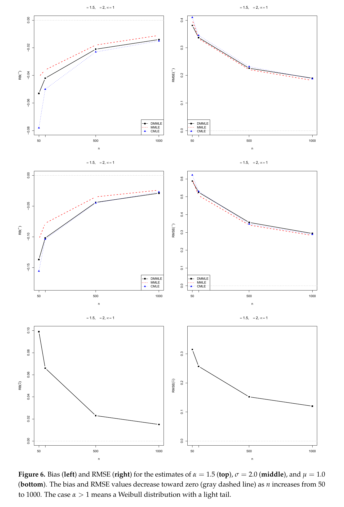
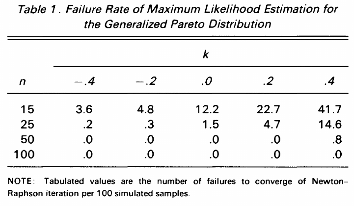
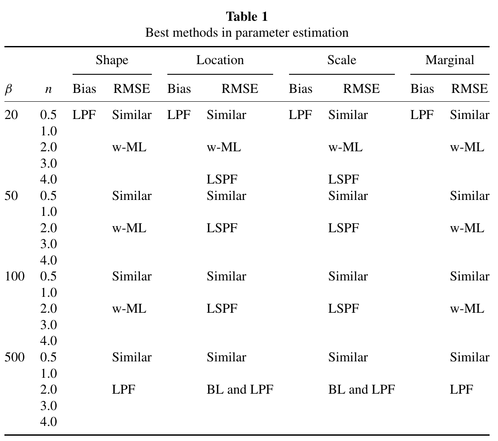
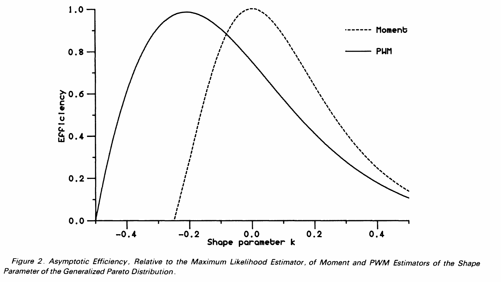
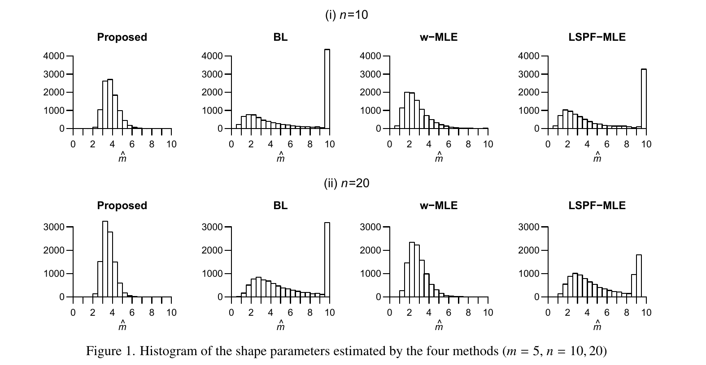
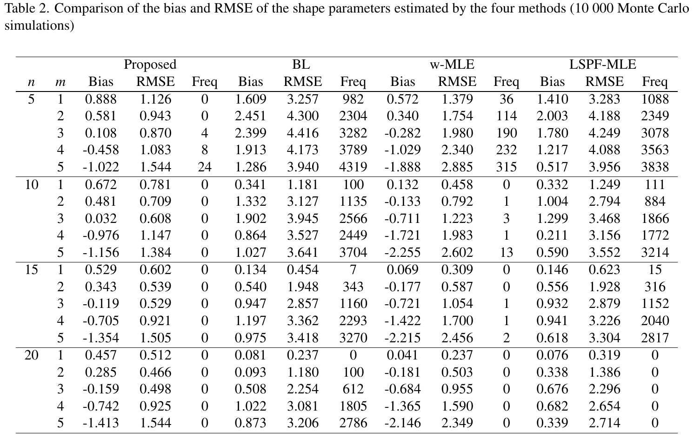
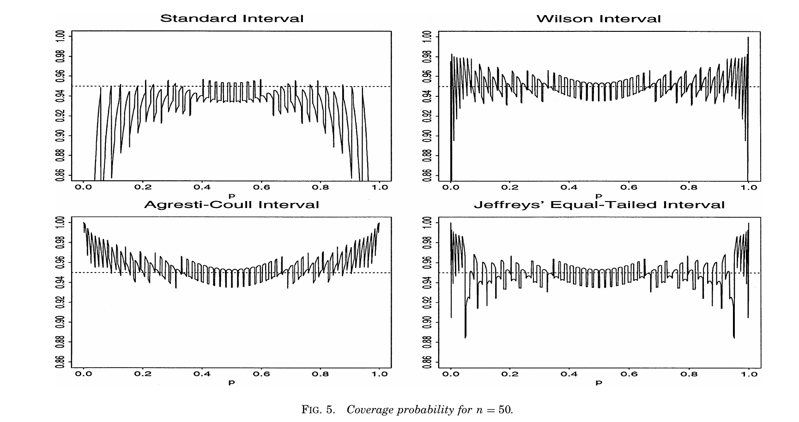
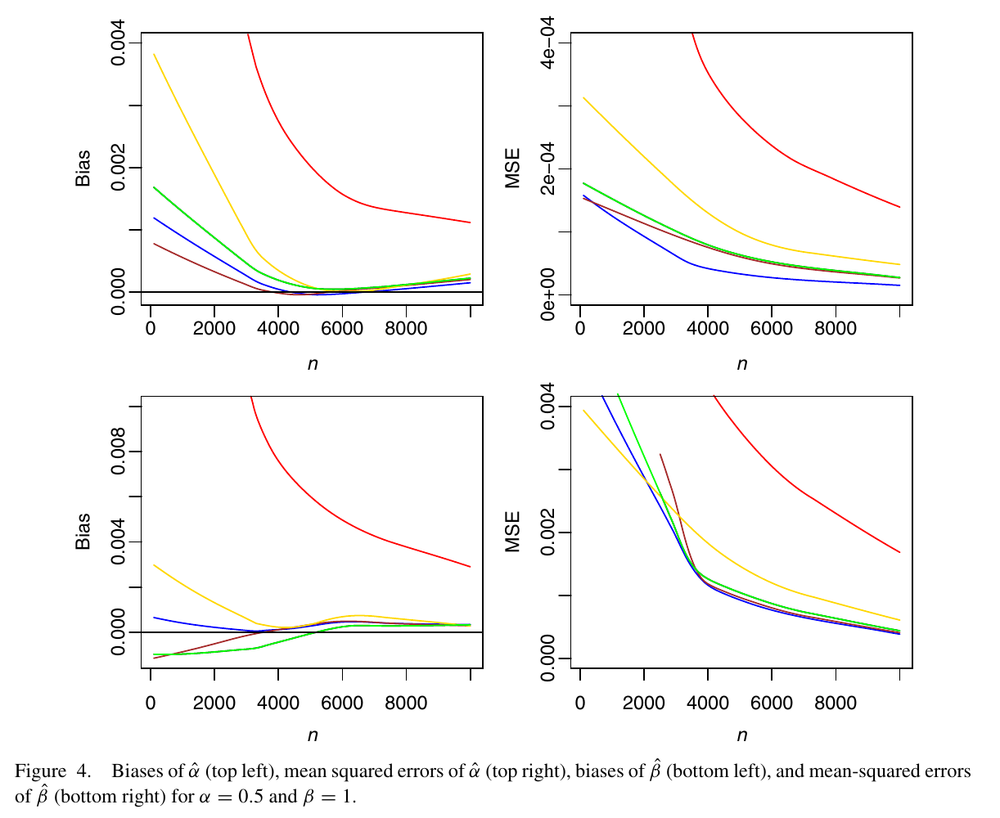

# 文献中的呈现思路与Study04的用法

2026-10-18。结合100文献库新入库的182-147—149，以及182-141、125、130、111等论文的正文和图页，筛选适合本报告的表达方式。以下记录表达思路与取舍；误差容限曲线已用于[报告下v0.3](../报告下（方法对比）-v0.3.md)，偏差与波动由估计分布及数值表说明。文献中的表现结论不移植为本研究结论。

参考图表直接摘自原PDF，保存在[参考图](参考图/)中；仅截取图表区域、将横置页面转正，保留原有内容。图下说明区分原文做法与拟采用的改法，原PDF链接见文末。

## 1. 把偏差与稳定性放到同一张图上

**要回答：一个方法结果集中，是否也估得接近真值？**

182-141的图1—4、182-111的图6均将Bias与RMSE并列展示。它们提示我们应拆开解释误差来源，但原文并未采用下面的散点形式。

原图：182-141，图1，论文302页／PDF第9页。上排Bias、下排RMSE，各列为不同n；可参考它如何展示“偏差较大但RMSE较小”的权衡。

原图：182-111，图6，PDF第11页。每行一个参数，左Bias、右RMSE；可参考其逐参数组织方式。

本轮采用：先用Study01式RMSE玫瑰图展示n=50到7时的方法差异，再接现有估计分布与Bias、SD数值表，解释总体偏移和重复波动。玫瑰图是本项目已有样式的复用，不是上述论文的原图。

原Bias–SD散点与MSE分解柱图均已撤下。保留“偏差更小仍可能有较大总误差”的内容，用β=5、n=7的MDM与LRE数值对照说明，不继续增加误差分解图。

## 2. 用误差容限曲线展示“得到可用结果”的把握

**要回答：允许多大误差时，某方法有多大比例能交付符合要求的估计？**

182-149表1把求解失败单列，并明确讨论忽略失败如何改变估计表现；182-125表2与图1另外展示超大估计的频率。两篇均未使用下面的曲线，这是结合我们需求提出的改法。

原表：182-149，表1，343页／PDF第6页。失败率单列，避免仅用成功结果的误差评价方法；本表本身不是误差容限曲线。

横轴为允许的绝对误差t，纵轴为“返回有效结果且绝对误差≤t的次数 / 全部1200次”。每种方法一条曲线，各参数使用自己的误差单位。曲线越高，表示在该容限下交付合格结果的比例越高；容限充分放宽后，曲线趋近该方法的有效率。失败不被赋予人为误差数值，也不从分母消失。

这能比较“经常有中等偏差”与“通常很准、偶尔严重失误”，也能看出方法名次是否随精度要求改变。它是独立图，不向现有分布图添加有效率。现有逐次结果足够，不需重算估计。

## 3. 用条件分区图收束到方法选择

**要回答：在什么样本量和参数范围内，哪些方法值得优先考虑？**

182-141表1按样本量、形状参数、目标参数及Bias/RMSE归纳优选方法，允许填写“Similar”。182-149图2用相对MLE的渐近效率曲线显示优势随形状参数改变，并在讨论中根据可能的形状范围提出建议。这两种组织方式最接近我们的报告目的。

原表：182-141，表1，306页／PDF第13页。值得参考的是“按条件归纳”和允许“Similar”，无需沿用其大表版式或综合指标。

原图：182-149，图2，342页／PDF第5页。两条曲线的交叉展示优势随形状参数改变；我们的有限样本RMSE比值需另行定义。

我们的改法：n纵向、β横向，三个参数分别归纳候选方法；表现接近时保留多个候选，不强行每格选一个。相对基准的经验RMSE比值可辅助说明优势有多大，基准线为1；这只是有限样本比较，不称为渐近效率。

现有条件指标和配对误差差可以复用。正式分区前，还需明确主要指标、失败与异常风险的要求，以及“接近”的实际差异标准和蒙特卡洛不确定性。图中的真β只用于离线描述；应用者只知道可能范围时，需要在范围内汇总比较，不能把真β分区直接宣称为可执行的自动选法规则。

## 4. 异常结果用一个完整案例讲透

182-125对部分对照方法把形状估计≥10的值按10处理，再计算Bias/RMSE，同时报告接近上限的频率；图1可见上限堆积。值得借鉴的是把极端结果单列观察，而非复制其截断口径。

原图：182-125，图1，44页／PDF第6页。真形状为5，n=10、20；部分对照方法在右端出现堆积，需结合原文的上限处理解释。

原表：182-125，表2，43页／PDF第5页。Freq为10000次模拟中形状估计≥9.999的次数，其解释续见下一页；可参考将误差与极端估计频数并列的思路。

我们已有MM案例可连成“普通结果的分布 → 一个极端估计对平方误差的贡献 → 矩差比值接近1、公式分母接近0”的解释。这样既说明异常有多严重，也解释为什么发生。沿用Research00的机制图思路，主指标继续保留全部有效极端值。

异常频率接近时，可用已有Wilson区间辅助比较。182-148第3.1节讨论Wilson比例区间；这里借用的是比例估计方法，不是把其覆盖率曲线照搬过来。这些区间描述模拟频率的不确定性，不是Weibull参数区间，也不是逐次估计的波动范围。

原图：182-148，图5，107页／PDF第7页。图中横轴为真实比例p、纵轴为区间覆盖率；这是Wilson区间的背景参考，并非我们拟绘制的异常频率及其区间图。

## 本轮取舍

已完成RMSE玫瑰图（β=5、n=50/20/15/10/7）和误差容限曲线（β=5、n=7/50）；程序与口径见[结果呈现说明](README.md)。条件分区图留作结论归纳。现有分布图、RMSE趋势、有效率与风险图继续作为证据；182-130图4及182-111图6的多面板趋势表达与现有图接近，无需再重复做一套。182-141的分位数图可供后续应用讨论，本轮先聚焦参数估计。

原图：182-130，图4，100页／PDF第9页。作为已有趋势图的版式参考；原图中的样本量和曲线不用于本研究结论。

## 原文定位

页码同时列出论文页码或PDF页序，便于回看；本地链接指向原PDF。

- [182-141：Nagatsuka与Balakrishnan（2015）](<D:/博士阶段/100科研文献管理/100科研文献管理/180_AI辅助参数估计/182_传统参数估计方法/182-141_2015_Commun Stat Simul Comput_三参数威布尔分布参数与分位数估计的高效方法.pdf>)：图1在论文302页／PDF第9页；表1在306页／PDF第13页。
- [182-149：Hosking与Wallis（1987）](<D:/博士阶段/100科研文献管理/100科研文献管理/180_AI辅助参数估计/182_传统参数估计方法/182-149_1987_Technometrics_广义帕累托分布的参数与分位数估计.pdf>)：图2在342页／PDF第5页；失败率表1与第4节在343页／PDF第6页；第4节末讨论按可能形状范围选择方法。对象为广义帕累托，借鉴比较组织方式。
- [182-125：Ogura等（2020）](<D:/博士阶段/100科研文献管理/100科研文献管理/180_AI辅助参数估计/182_传统参数估计方法/182-125_2020_Int J Stat Probab_小样本下三参数威布尔耗损失效期形状参数的估计.pdf>)：第3.3节、表2及图1；图1在44页／PDF第6页。
- [182-148：Brown、Cai与DasGupta（2001）](<D:/博士阶段/100科研文献管理/100科研文献管理/180_AI辅助参数估计/182_传统参数估计方法/182-148_2001_Stat Sci_二项比例的区间估计.pdf>)：第3.1节从107页／PDF第7页开始讨论Wilson区间。
- [182-111：da Silva等（2025）](<D:/博士阶段/100科研文献管理/100科研文献管理/180_AI辅助参数估计/182_传统参数估计方法/182-111_2025_Entropy_三参数威布尔分布修正极大似然估计的偏差缩减.pdf>)：图6在PDF第11页。
- [182-130：Teimouri等（2013）](<D:/博士阶段/100科研文献管理/100科研文献管理/180_AI辅助参数估计/182_传统参数估计方法/182-130_2013_Statistics_威布尔分布估计方法比较.pdf>)：图4在100页／PDF第9页。主要对象为两参数Weibull，借鉴图形组织方式。
