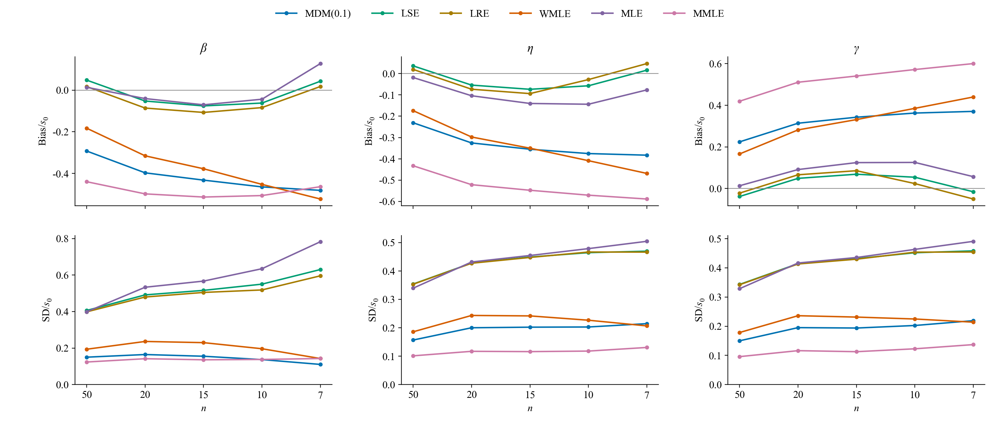
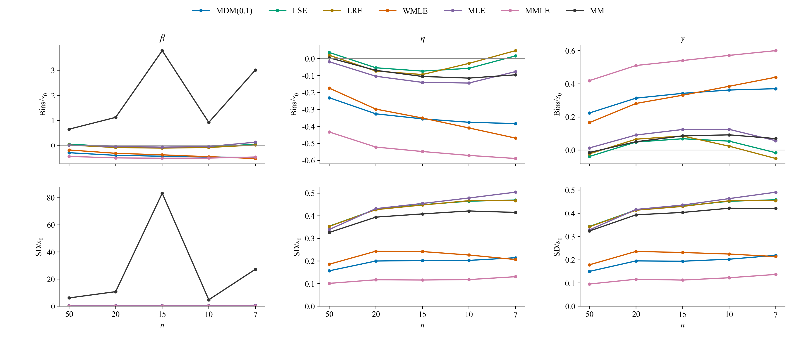
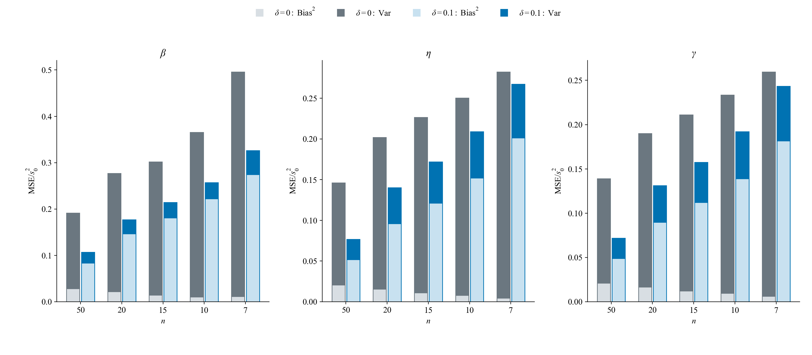
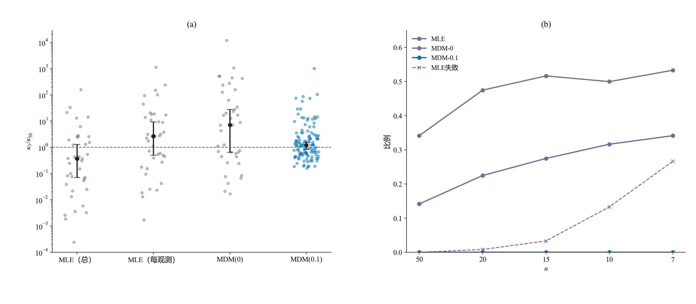
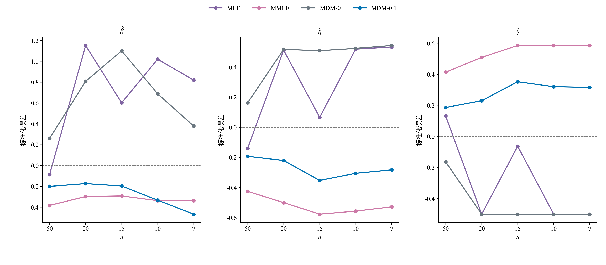
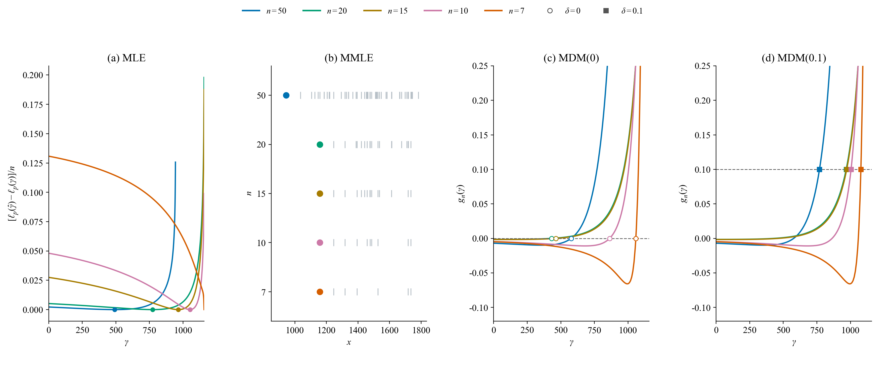
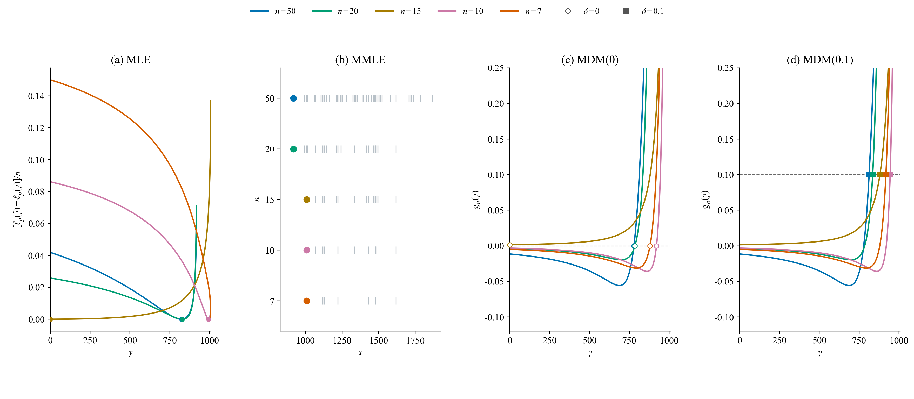

# 3.1补充：偏移量对照与廓线群体验证

对应[报告下v3.2](../../报告下（方法对比）-v3.2.md)。计算前固定的[方案](3.1偏移量与廓线群体验证-方案.md)及用户追加四法后的[补充约定](3.1减点四方法与代表例-补充约定.md)保留实验身份。

## 正文使用β=3的重复分布

第60轮反馈将正文MDM两δ分布改用β=3；[当前配对核对](3.1-MDM偏移量-beta3结果.md)另存n=50、7各1200组。此前[β=2核对](3.1-MDM偏移量-beta2结果.md)保留原身份。以下β=5五档n和120条嵌套结果保留原条件。判据图下仅保留变化描述，详细选例与统计在此核对。

## 两种集合及方法身份

正式对照：W(5,1000,500)，五档n各1200原样本，两δ同输入，共12000条，δ=0新增6000条、δ=0.1全部复用。两方案均全部有效，自身与两方案共同有效指标相同。

嵌套诊断：预先固定120条n50路径，编号0、10、…、1190，固定随机排列后逐档保留50、20、15、10、7点，四法共2400条。n50四法复用，其他档另算1920条；两集合共7920次新增完整估计，不计入原40条件七法排名，不抽取新Weibull样本。

MLE是冻结的β≥1、γ≥0有限候选版本；MMLE以最小值定位、删除该点后估计；MDM两方案共用条件标准差及梯度。零位置截断和近端回退区别于真实内部根。判据图只展示γ怎样确定，Bias/SD由统计图展示。原正式估计及冻结源码不改。

## 分行观察十组定位过程

新布局以[十组定位判据](3.1十组定位判据.md)为准：图按五行n、四列方法排列，每个剖面坐标系叠加十组样本曲线；n仍各占一行，MMLE列仅标最小值定位。选例覆盖六种端点分支，不按变平挑选；120条路径的统计口径不变。以下640、330叠线图保留为曲率选例的补充核对。

## 十组样本选例与失败档

| 图组 | 样本编号 | n=7时MLE / MDM(0) | 该分支路径数/120 | 此中心最近路径数 | MLE失败的n |
|---|---:|---|---:|---:|---|
| 1 | 670 | 零边界 / 零边界 | 40 | 18 | 无 |
| 2 | 630 | 失败 / 内部 | 27 | 26 | 10, 7 |
| 3 | 190 | 内部 / 零边界 | 19 | 19 | 无 |
| 4 | 920 | 内部 / 内部 | 28 | 19 | 无 |
| 5 | 70 | 零边界 / 零边界 | 40 | 11 | 无 |
| 6 | 280 | 零边界 / 零边界 | 40 | 11 | 无 |
| 7 | 90 | 内部 / 内部 | 28 | 9 | 无 |
| 8 | 350 | 失败 / 零边界 | 5 | 5 | 15, 10, 7 |
| 9 | 170 | 零边界 / 内部 | 1 | 1 | 无 |
| 10 | 700 | 失败 / 内部 | 27 | 1 | 10, 7 |

## 正式七法的Bias与SD

[误差平方及其增长分解](3.1误差增长分解.md)是正文使用的组成证据。另保留带符号Bias及SD曲线便于核对。

按七法共同有效集合，每档集合量不同；另核对各法自身有效指标，保存在分析CSV，不能把筛选后的SD变化直接当作全部1200次的变化。

## 两δ误差分解

每个n左柱δ=0、右柱δ=0.1，浅色为Bias平方，深色为估计方差。形状以5、其余以1000标准化；SD采用ddof=1，有限R下使用$(R-1)\operatorname{SD}^2/R$作为方差项，柱高严格等于RMSE平方。

| n | δ | β Bias / SD / RMSE | η Bias / SD / RMSE | γ Bias / SD / RMSE |
|---:|---:|---|---|---|
| 50 | 0 | 0.84 / 2.02 / 2.19 | 143.85 / 354.27 / 382.22 | -144.92 / 343.44 / 372.63 |
| 50 | 0.1 | -1.45 / 0.76 / 1.63 | -227.44 / 158.28 / 277.06 | 221.30 / 151.05 / 267.90 |
| 20 | 0 | 0.74 / 2.53 / 2.63 | 125.25 / 431.66 / 449.29 | -128.62 / 416.53 / 435.77 |
| 20 | 0.1 | -1.91 / 0.87 / 2.10 | -310.07 / 210.13 / 374.51 | 299.64 / 203.75 / 362.30 |
| 15 | 0 | 0.60 / 2.68 / 2.75 | 105.18 / 464.38 / 475.96 | -110.29 / 446.12 / 459.37 |
| 15 | 0.1 | -2.13 / 0.91 / 2.31 | -347.95 / 225.79 / 414.74 | 334.74 / 212.95 / 396.69 |
| 10 | 0 | 0.52 / 2.98 / 3.02 | 89.55 / 492.54 / 500.41 | -97.54 / 473.53 / 483.28 |
| 10 | 0.1 | -2.36 / 0.93 / 2.53 | -390.00 / 238.66 / 457.18 | 372.93 / 230.50 / 438.37 |
| 7 | 0 | 0.53 / 3.48 / 3.52 | 66.97 / 527.44 / 531.45 | -79.04 / 503.51 / 509.47 |
| 7 | 0.1 | -2.62 / 1.14 / 2.86 | -448.64 / 256.93 / 516.95 | 426.11 / 248.67 / 493.31 |

## 判据是否随减点普遍变平

这要用预先固定的多条路径检验。对可靠内部解，用局部曲率比较定位附近的变化速度；零位置、失败、近端回退和形状边界另列。MLE同时报告总似然曲率及除以n的每观测曲率，以区分观测项减少的加和效应与每观测准则形状变化。

*左图每点为一条可靠配对路径的n=7曲率/n=50曲率，低于1表示该处更平；黑点和线为中位数及至少95%的区间。MLE两项和MDM(0)各为39/120条可靠内部配对，MDM(0.1)为120/120条。右图分母始终为120条路径，展示零位置与MLE失败；这些路径不混入内部曲率统计。κ的定义、两档差分及筛选记录见补充。*

| 判据 | 可靠配对/120 | 曲率比中位数 | 中位数区间 |
|---|---:|---:|---:|
| MLE总似然 | 39 | 0.37 | 0.07—1.31 |
| MLE每观测似然 | 39 | 2.64 | 0.51—9.36 |
| MDM(0) | 39 | 7.17 | 0.65—27.87 |
| MDM(0.1) | 120 | 1.22 | 0.85—1.57 |

这些结果没有支持“减点后各方法的判据普遍越来越平”的统一解释。MLE总似然的曲率中位数降低，但每观测结果不同；两种MDM都同时存在变平和变陡路径。n减少还改变了选参位置与分支：本诊断中，MDM(0)零位置由41/120增至64/120，MLE零位置由17/120增至41/120，并出现32/120次失败。因而，选参可能沿平缓区域移动，也可能转向新的内部区域或边界，不能只用一张变平的个例解释总体误差。

## 曲率定义与有效范围

MDM用$\kappa=\eta_0S_n''(\hat\gamma)$，MLE用$\kappa=\eta_0^2[-\ell_p''(\hat\gamma)]$，固定$\eta_0=1000$，另保存MLE的κ/n。不同准则的绝对数值不横向比较。

只对可靠内部解配对，失败、零位置、已知近端外推、形状活跃边界及无法可靠差分的位置另列。两档中心步长h和h/2检查收敛，正曲率、相对差异≤20%、梯度残差≤0.0001；h及支持距离规则见方案。MLE和MDM0各39/120对，MDM0.1为120/120对，不将缺失曲率填零。

中位数区间用整条路径为单位的二项顺序统计量，覆盖至少95%；降低比例用Wilson区间。区间属于这些可靠子群，不代表全部120条路径。

## 主例及代表范围

670号从50/7四法均有效的88/120条路径选出。24维向量为四法、两端n、三参数的标准化带符号误差，按中位数和MAD标准化，取平均绝对距离最小者。MAD为0依次退到IQR、标准差和1。没有按曲率方向或视觉好看筛选；端点综合中心不保证每项变化均为第50百分位。

这是单条路径估计减真值，不是Bias或SD。中间档若失败应保留缺口；670号五档四法均成功。

| 方法 | Δβ分位 | Δη分位 | Δγ分位 |
|---|---:|---:|---:|
| MLE | 75.6% | 85.8% | 17.6% |
| MMLE | 55.1% | 61.9% | 55.1% |
| MDM-0 | 47.2% | 68.8% | 32.4% |
| MDM-0.1 | 40.3% | 59.7% | 52.8% |

上表在同一88条子群内计算。670号MDM0.1曲率比约在第42.1百分位；MLE和MDM0在n7为零位置，不能称为它们的内部几何中心例。

## 内部曲率子群的中心例与反方向例

MDM0可靠内部子群39条，15条曲率降低、24条增大。640号为按预定曲率特征选出的子群中心例，330号为下降子群中心例。保留相反方向，不仅挑变平路径解释总体。

三幅定位图中，MLE横轴γ、纵轴相对每观测负对数似然；MMLE展示样本最小值直接给出γ；MDM两图均为原始γ—梯度γ，目标分别0和0.1，共用坐标范围。失败时不画虚构返回标记。梯度图显示−0.12至0.25以看清目标附近，近支持边缘高梯度仍参与原计算。

## 数据与复现

- [计算程序](验证MDM偏移量与廓线群体.py)：正式δ0及嵌套MDM。
- [四法追加](验证减点MLE与MMLE.py)：同路径MLE/MMLE与样本指纹合并。
- [统计程序](统计偏移量与廓线群体.py)：共享指标、曲率、区间与选例。
- [绘图程序](绘制偏移量与代表廓线.py)：读取结果绘制，不修改估计。
- [可携带核验摘要](3.1群体核验摘要.json)：来源、群体数值、选例及图像SHA。

本地数据位于结果呈现/分析数据/3.1-MDM偏移量与廓线群体/；正式样本和嵌套四法各有results.csv、summary.json和manifest.json，另有指标、廓线几何、分类、群体结论及图像核对。原474号材料保留原身份，不与120条路径或1200次正式比较混算。
