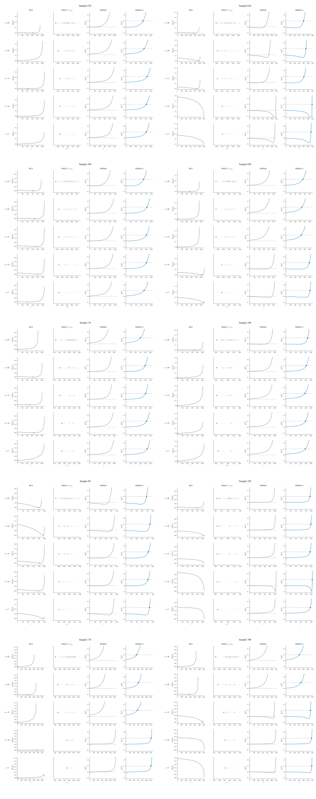

# 3.1补充：十组样本的分行定位判据

对应[报告下v2.1](../../报告下（方法对比）-v2.1.md)的四方法定位图。每组使用同一既有50点样本的嵌套子样本；五行依次为n=50、20、15、10、7，四列依次为MLE、MMLE、MDM(0)、MDM(0.1)。十组样本放在同一张图中，按两列五排排列，图中每列跨n固定坐标，两个MDM面板完全共用坐标；不同组各自固定，不以不同组曲线的视觉高度作比较。图仅解释位置怎样确定，Bias、SD与RMSE另看重复估计图。

MLE纵轴为相对每观测负对数似然；成功行以实际返回位置的似然为基准，圆点标该位置。失败行只以显示网格的最大似然为基准，不虚构返回位置。MMLE彩点为最小观测，灰短线为其余观测。MDM纵轴均为廓线梯度$g_n(\gamma)$，虚线为目标0或0.1；零边界截断不要求梯度恰好等于目标。相同样本两种MDM的梯度曲线相同，选参目标不同。

## 十组怎样选

候选是预先每10个编号取一份的120条既有路径。先按n=7时MLE内部/零边界/失败与MDM(0)内部/零边界分层，共六种实际组合；10个名额按层大小分配，且每层至少一个。层内用四法n=50、7的三参数估计（按真参数尺度标准化、再按稳健离散尺度缩放）的L1距离选实际中心路径，保留原共同中心670号。MLE失败层不填补缺失估计，距离仅用该层共同可用的端点量。各中心的最近路径分区合计恰好覆盖120条，没有按曲率或变平程度筛选。

这十组展示分支和过程，不能用图组中各类所占比例估计发生率；发生率和曲率统计仍使用全部120条。可复核的分层、分区、样本编号及图片指纹见[选例记录](3.1十组定位判据选例.json)，生成程序为[绘制分组定位判据.py](绘制分组定位判据.py)。

| 图组 | 样本编号 | n=7时MLE / MDM(0) | 该分支路径数/120 | 此中心最近路径数 | MLE失败的n |
|---|---:|---|---:|---:|---|
| 1 | 670 | 零边界 / 零边界 | 40 | 18 | 无 |
| 2 | 630 | 失败 / 内部 | 27 | 26 | 10, 7 |
| 3 | 190 | 内部 / 零边界 | 19 | 19 | 无 |
| 4 | 920 | 内部 / 内部 | 28 | 19 | 无 |
| 5 | 70 | 零边界 / 零边界 | 40 | 11 | 无 |
| 6 | 280 | 零边界 / 零边界 | 40 | 11 | 无 |
| 7 | 90 | 内部 / 内部 | 28 | 9 | 无 |
| 8 | 350 | 失败 / 零边界 | 5 | 5 | 15, 10, 7 |
| 9 | 170 | 零边界 / 内部 | 1 | 1 | 无 |
| 10 | 700 | 失败 / 内部 | 27 | 1 | 10, 7 |
