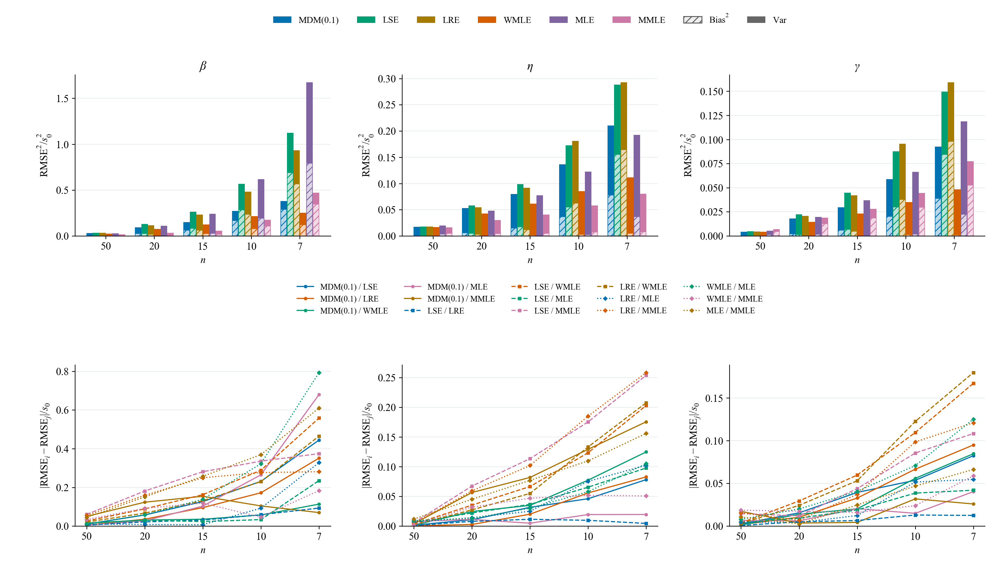
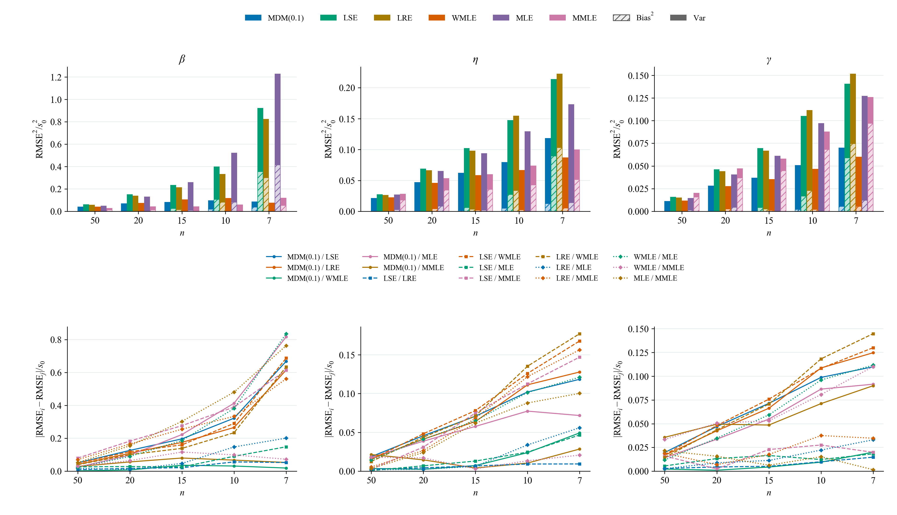
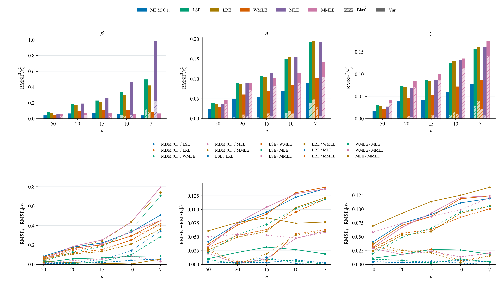
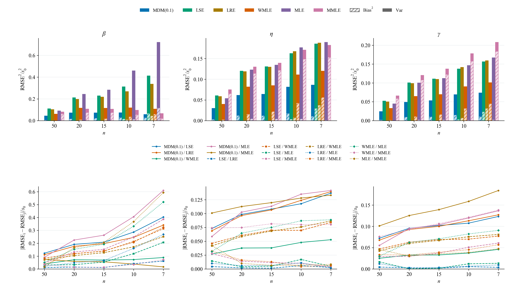
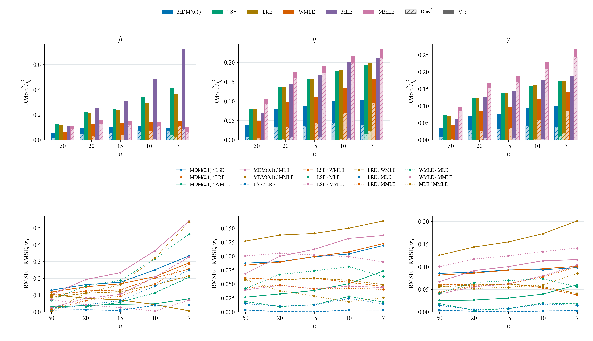
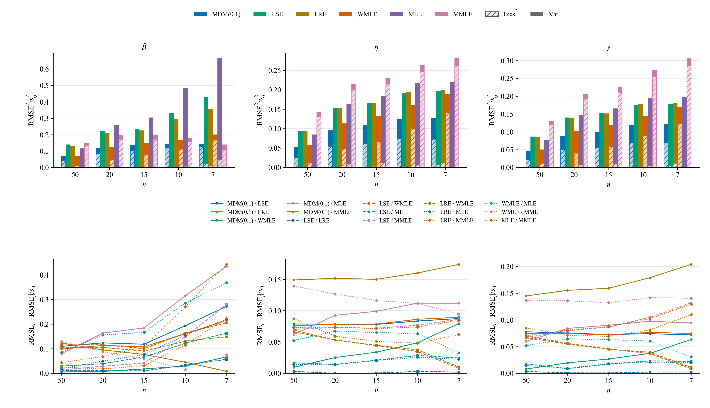
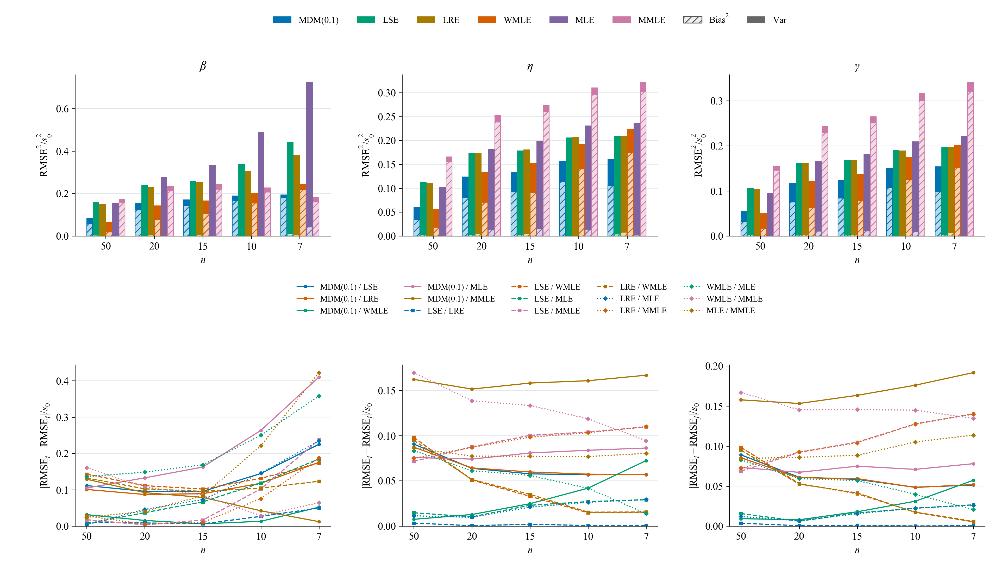
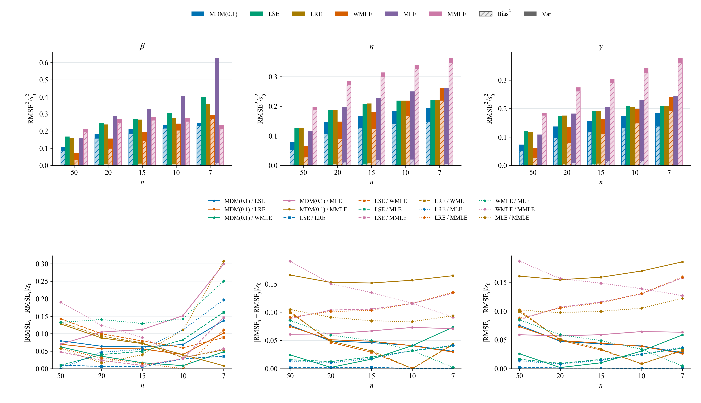
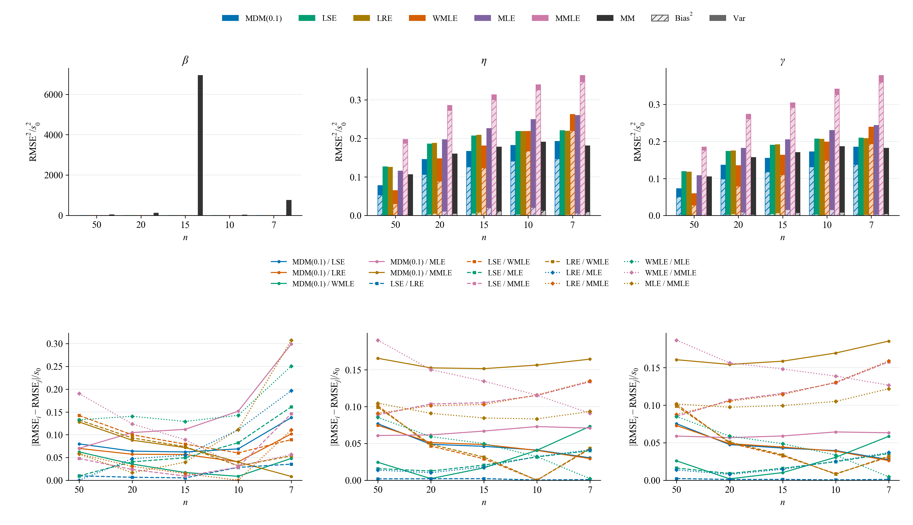

# 3.1补充：误差平方及其增长的组成

对应[报告下v3.3](../../其他/历史版本/报告下（方法对比）-v3.3.md)。数据读取正式40条件七法原结果，经共享指标函数汇总。每个条件采用七法共同有效样本，各n集合不相同；这不是同一固定队列的纵向方差变化。未调用估计器或新抽样。

每根柱高为标准化$\mathrm{RMSE}^2$；浅色斜线部分为$\mathrm{Bias}^2$，实色为经验方差$V_R=(R-1)\mathrm{SD}^2/R$，SD采用ddof=1。增长分解为$\Delta\mathrm{MSE}=\Delta\mathrm{Bias}^2+\Delta V_R$，Δ为n=7减n=50；负项抵消增长，不截成零。

## β=5的三参数增长分解

| 方法 | 参数 | ΔMSE | ΔBias² | Δ方差 |
|---|---|---:|---:|---:|
| MDM(0.1) | β | +0.13572 | +0.14606 | -0.01034 |
| MDM(0.1) | η | +0.11486 | +0.09347 | +0.02139 |
| MDM(0.1) | γ | +0.11248 | +0.08707 | +0.02541 |
| LSE | β | +0.23149 | -0.00049 | +0.23198 |
| LSE | η | +0.09397 | -0.00106 | +0.09503 |
| LSE | γ | +0.09069 | -0.00122 | +0.09190 |
| LRE | β | +0.19584 | +0.00001 | +0.19583 |
| LRE | η | +0.09442 | +0.00183 | +0.09259 |
| LRE | γ | +0.09116 | +0.00205 | +0.08911 |
| WMLE | β | +0.22275 | +0.23990 | -0.01714 |
| WMLE | η | +0.19759 | +0.18948 | +0.00811 |
| WMLE | γ | +0.17966 | +0.16581 | +0.01385 |
| MLE | β | +0.46873 | +0.01603 | +0.45270 |
| MLE | η | +0.14445 | +0.00551 | +0.13894 |
| MLE | γ | +0.13568 | +0.00308 | +0.13260 |
| MMLE | β | +0.02671 | +0.02162 | +0.00509 |
| MMLE | η | +0.16640 | +0.15959 | +0.00681 |
| MMLE | γ | +0.19389 | +0.18433 | +0.00957 |
| MM | β | +711.77013 | +8.62647 | +703.14365 |
| MM | η | +0.07461 | +0.00911 | +0.06550 |
| MM | γ | +0.07701 | +0.00466 | +0.07236 |

所有值均为标准化误差平方单位，贡献不是三个可相加的RMSE值。原单位Bias、SD、RMSE及八档β的完整增长数值保存在[核对记录](3.1误差增长分解.json)。

## β=1.5

## β=2

## β=2.5

## β=3

## β=3.5

## β=4

## β=4.5

## β=5

## β=5：含MM完整范围

