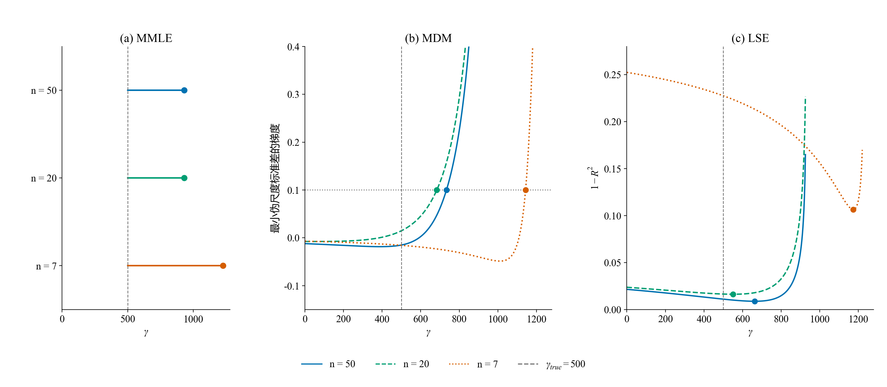
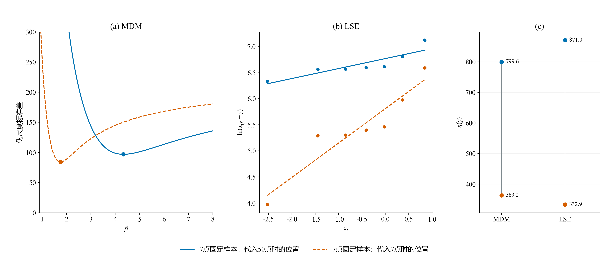
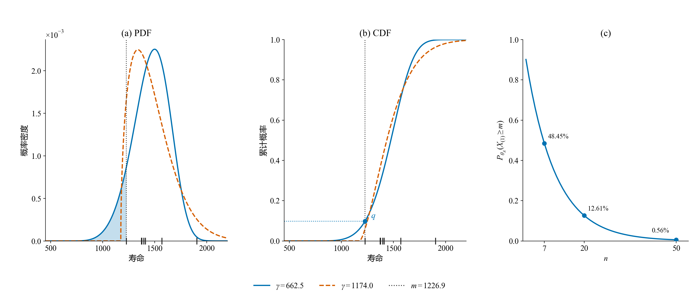
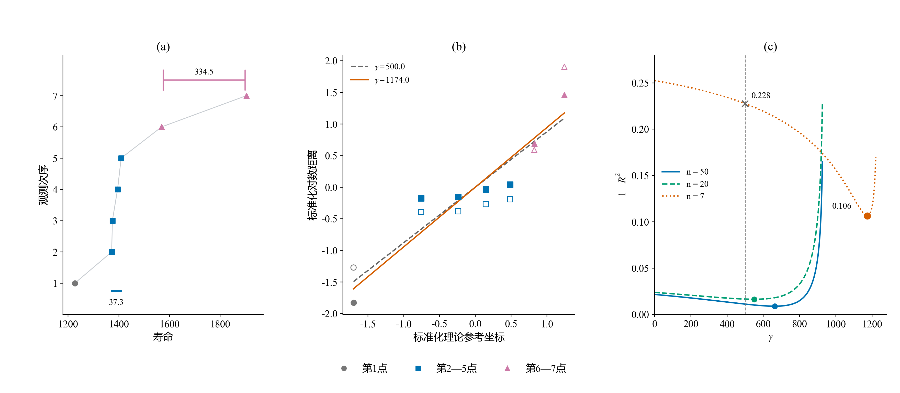

# 3.1补充核对：逐档拟合、误差与构造输入

本页补充[报告下v3.3第3.1节](../../其他/历史版本/报告下（方法对比）-v3.3.md)，沿同一条474号嵌套路径逐档浏览结果。正文用下端覆盖与候选组合引入耦合，从方法原理解释响应差别，以MDM说明选参和偏差—波动取舍；此处保留共同删点例证、样本、判据、条件恢复和逐档CDF供核对，不以单条路径说明总体RMSE成因。

五档CDF共用坐标，同一参数的误差也共用纵轴范围。上排每列只画一种方法及真实CDF；黑点寿命坐标是真实观测，纵坐标按各自n计算(i−0.5)/n，仅作展示。下排为估计值减真值，不是重复抽样的平均Bias。每档都是前一档子集；这里的n=7子集不等于正式n=7表中同编号样本。

## 同一共同输入下的误差响应

*固定W(5,1000,500)，从同一份正式50点样本按既有随机排列保留50、20、15、10、7点；每一档三种方法使用相同观测。纵轴为本次估计减真值，虚线为零误差。这条路径用于观察上述构造怎样响应共同输入变化，不是重复抽样的Bias或RMSE。*

50→20点时最小观测仍为930.6，MMLE位置保持930.6；MDM位置从733.7变为683.7，LSE从662.5变为550.5。这个例子对应信息利用方式的差别：直接以极值定位的一步不变，依赖整组统计关系与n相关参考量的定位则可以改变。20→15点时最小值升至1222.3，三法的位置及后续恢复参数都发生明显变化。该例说明构造与参数传递的具体过程，不用于决定各机制对总体RMSE差距的贡献。

## 同一条路径实际保留了哪些点

深色为当前观测，浅灰为原50点中已删观测，蓝点为当前最小值，橙段为最大相邻间隔。本图只追踪一条路径；正文3.1的31H另用正式各档样本展示最小值分布，3.2保留不同β的共同影响。

## 同一观测怎样进入构造

暂固定MDM的β=5、γ=500及LSE的γ=500，黑箭头追踪50→20点时同一个930.6观测。其MDM绘图位置从0.01389变为0.03431，伪尺度从1011.5变为842.4；LSE的对数距离相同，横坐标从−4.4892变为−3.5729。这是输入变换诊断，不是实际定位判据。

## 三种构造的实际定位判据

本补充区31D集中展示“七点的偶然结构→LSE相对匹配→实际选参”。这里保留三法对照：MMLE位置等于最小观测；MDM先逐位置优化形状，再以最小伪尺度标准差的梯度达到0.1定位；LSE逐位置回归，以同一n下$1-R^2$最小定位。圆点为实际返回位置，虚线为真实位置500。不同n的判据高度不直接表示估计精度。

本补充区31D的回归点列分别作中心化及标准差归一化，展示的是原判据所用的相对匹配。在同一7点上，位置500与1174.0的$1-R^2$分别为0.227536与0.106430。两位置的原始对数距离总变差不同，不能将这个改善说成原始残差平方和下降；参数仍由原始回归恢复。核验JSON保留原始残差平方和、总平方和及全部标准化坐标。

## 位置进入形状与尺度恢复的具体步骤

两种颜色始终使用同一组7点及n=7参考坐标，蓝色代入各法50点时的位置，橙色代入7点时的位置。MDM条件形状4.34→1.76、尺度799.6→363.2；LSE条件形状5.23→1.52、尺度871.0→332.9。蓝色不是原50点估计。本补充区31I用LSE的同两组条件参数展示最终PDF/CDF；本图展开恢复计算。

## 最小观测约束的是起点，也是候选分布的下端概率

记当前最小观测为$m$。从支持范围看，候选起点不能高于$m$，否则就有观测落在模型允许范围之外。但起点即使低于$m$，也还要解释另一件事：**模型认为$m$左侧应该有多少数据，而我们实际一个也没看到？**

设候选参数为$\theta=(\beta,\eta,\gamma)$，它在$m$左侧安排的概率是

$$
q=F_\theta(m)=\int_\gamma^m f_\theta(t)\,\mathrm{d}t.
$$

因此，**PDF在$m$左侧的面积，与CDF在$m$处的高度，是同一份概率信息**。最小观测并不单独确定形状参数；它与样本量一起，对三个参数共同决定的下端概率提供信息。

*前两图始终使用同一组7点及其LSE理论参考坐标，分别代入位置662.5、1174.0后恢复形状与尺度；两条曲线都是7点条件恢复，蓝线不是原50点拟合。底部刻线是这7个真实观测，竖线为最小值$m=1226.9$。蓝色PDF阴影面积等于蓝色CDF圆点的高度$q$。右图固定蓝色候选参数和同一阈值$m$，计算重新独立抽取n个观测时全部不小于$m$的模型概率。*

先只看蓝色候选分布。它在$m$左侧放了约9.83%的概率。若固定这个分布和阈值，重新独立抽取n个观测，全部避开这段区域的概率为

$$
P_\theta(X_{(1)}\geq m)=[1-F_\theta(m)]^n=(1-q)^n.
$$

n=50时约为0.56%，n=7时约为48.4%。这说明，**小样本中没有看到下端观测，仍可能容许总体在那里放有相当概率**；样本CDF在最小值左侧为0，也不表示总体CDF在那里必须为0。上式用于说明空白区包含的抽样信息，具体选参仍要结合全部观测和各方法原有判据。

## 起点怎样牵动形状、尺度和整条曲线

单独改变位置参数、保持形状和尺度不变，只会平移分布。图中PDF外形之所以改变，是因为**方法在新的起点下，为匹配同一批观测，重新估计了形状和尺度**。

仍看图中的同一组7点，最小值为1226.9，最大值为1903.5：

| 代入位置 | 最小观测到起点的距离 | 最大观测到起点的距离 |
|---|---:|---:|
| 662.5 | 564.3 | 1240.9 |
| 1174.0 | 52.9 | 729.5 |

起点右移后，下端距离缩短的比例更大，最大与最小距离之比从约2.2增至13.8。LSE对这些距离取对数，再与固定的理论参考坐标回归；对数距离跨度增大，使本例的回归线变陡。形状取斜率倒数，因此从5.23降到1.52；尺度由截距恢复，从871.0降到332.9。本例中，起点向右移，PDF峰位却向左移：另外两参的重新匹配改变了整条曲线的外形，CDF也随之改变。

这里的传递是“改变起点后重新匹配数据”，并不是最小值单独决定形状。MDM也通过观测到起点的距离恢复伪尺度，位置改变后，其一致关系和恢复参数也会改变；[补充核对图](3.1逐档拟合与误差.md)保留两法的具体恢复过程。

## 样本中的偶然聚集与间隔怎样改变判据

约束变弱，还没有解释方法为什么选中了偏离真值的参数。**判据是用当前这一组点计算的；点数少时，几个点的偶然聚集或一个较大间隔就占据了点列的较大部分，判据更容易受这些结构影响**。这不是说每组小样本都更不规则，而是同一种构造在不同小样本上，可能因为点列关系不同而偏向不同参数。

看474号路径最终保留的7点，约为1226.9、1372.1、1374.8、1395.2、1409.3、1569.0、1903.5。其中**第2—5点共4点挤在37.3的范围内，末端两点却相隔334.5**。这些聚集和间隔是这次保留样本的结构，不是总体分布固定具有的特征。

*从左到右读：(a)七个观测的实际寿命与次序，标出中间四点的跨度和末端间隔；(b)固定同一7点及其理论参考坐标，对比真实位置500与LSE所选位置1174.0。空心点对应500，实心点对应1174.0，同颜色、形状追踪同一组观测；两轴分别中心化并除以样本标准差，只为比较相对线性匹配。(c)同一删点路径n=50、20、7的实际LSE相对失配$1-R^2$；同一n下，其最低点与F比最大点等价。虚线为真实位置500。*

LSE把每个观测到候选起点的距离取对数，与按次序确定的理论参考坐标配对。中间四个观测很近，但各自仍对应不同的参考坐标；末端大间隔又使最后一点的对数距离明显抬高。这组点列在真实位置下没有很好地排成直线。右移候选位置会更强地拉开下端的对数距离，改变整组点列的相对关系；在本例中，这使相对线性匹配更好。

| 同一7点上代入的位置 | 相对失配$1-R^2$ | 由原始回归恢复的形状 | 恢复的尺度 |
|---|---:|---:|---:|
| 真实位置500 | 0.228 | 6.29 | 1036.7 |
| LSE选中位置1174.0 | 0.106 | 1.52 | 332.9 |

**判据确实改善了，位置却离真值更远，形状和尺度也随之降低**。LSE寻找的是“让这组点列相对更接近直线的位置”；这组小样本的偶然结构，使该位置与真实起点分离。这里用的是原有相对匹配判据，不是原始残差平方和；形状仍取原始对数回归斜率的倒数，图中标准化斜率只用于显示。

不同构造会以不同方式响应。MMLE直接以最小值定位，7点的最小值升到1226.9，便直接返回该位置。MDM把整组点反算为伪尺度，以它们的一致程度及其随位置的变化定位；同一7点的实际梯度在1143.8达到0.1，随后恢复出另一组形状、尺度。[三法定位对照](3.1逐档拟合与误差.md)保留完整曲线。

这些响应并非只由最小值决定。50→20点时最小值仍是930.6，MMLE位置不变，MDM却从733.7变到683.7，LSE从662.5变到550.5；此段反而更接近真值。删点同时改变了整组观测、间距和当前n的参考坐标，其影响可以向不同方向发生。

本例展示这组七点的相对匹配怎样支持偏离真值的位置，不将其归因为最小值单独变大，也不据此解释总体RMSE的增幅。

## n = 50

## n = 20

## n = 15

## n = 10

## n = 7

