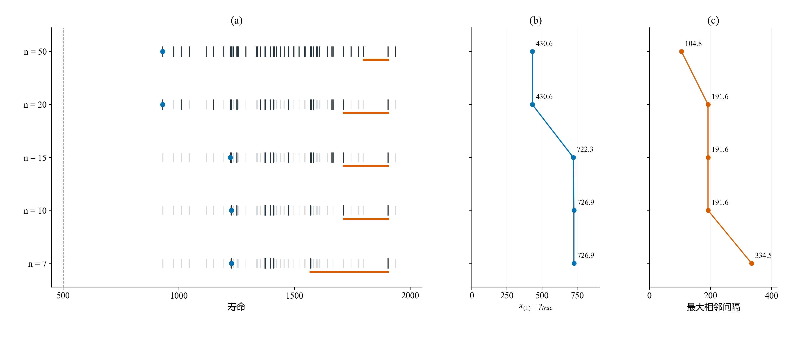
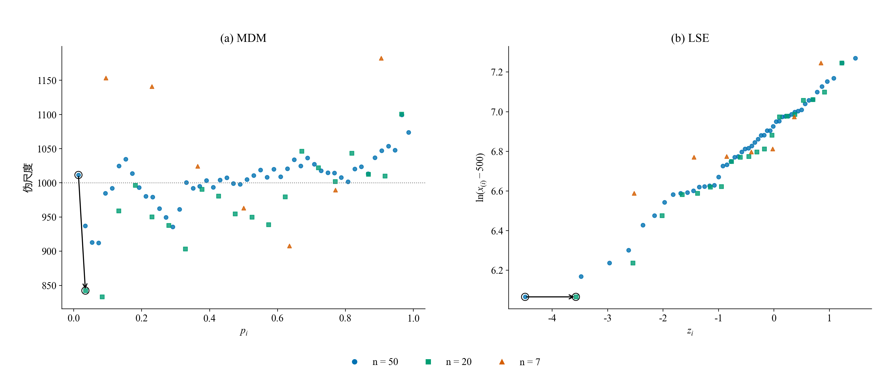
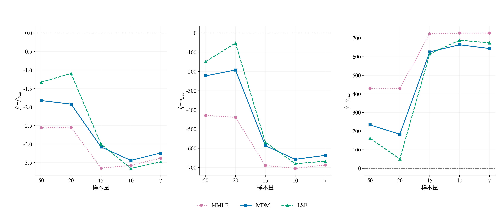
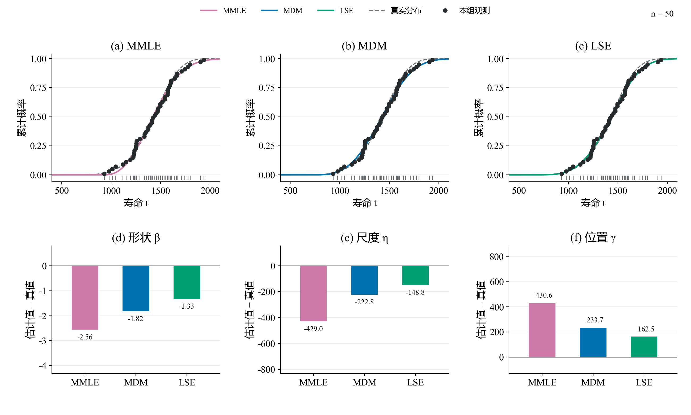
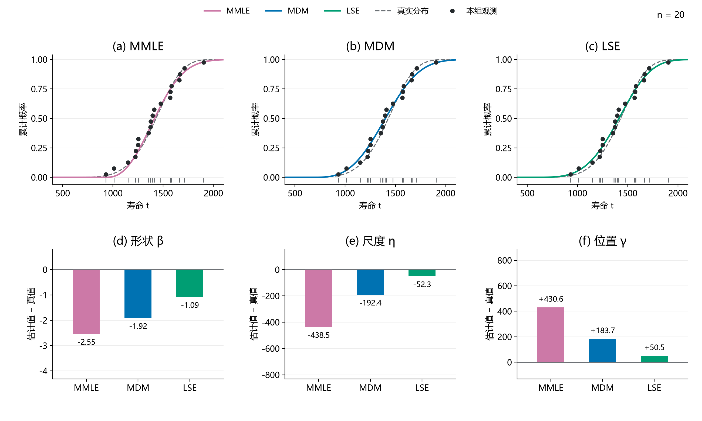
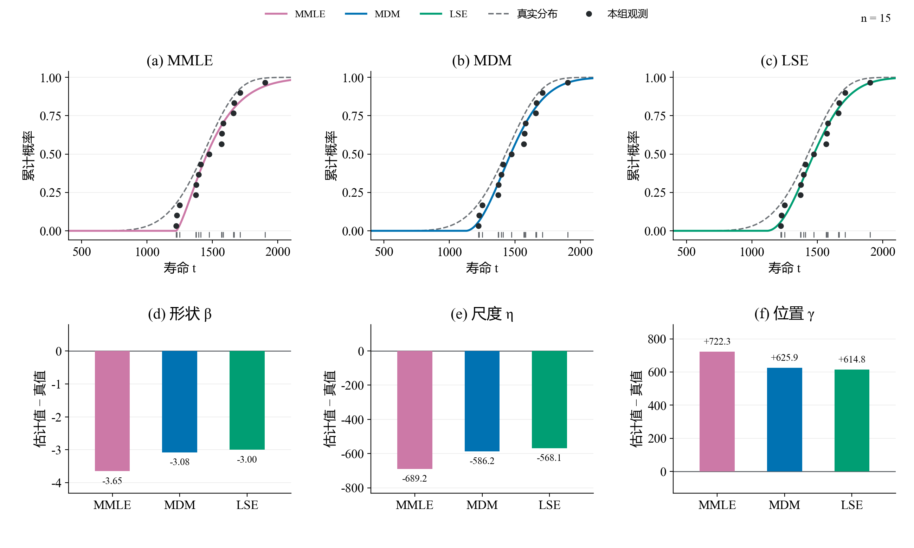
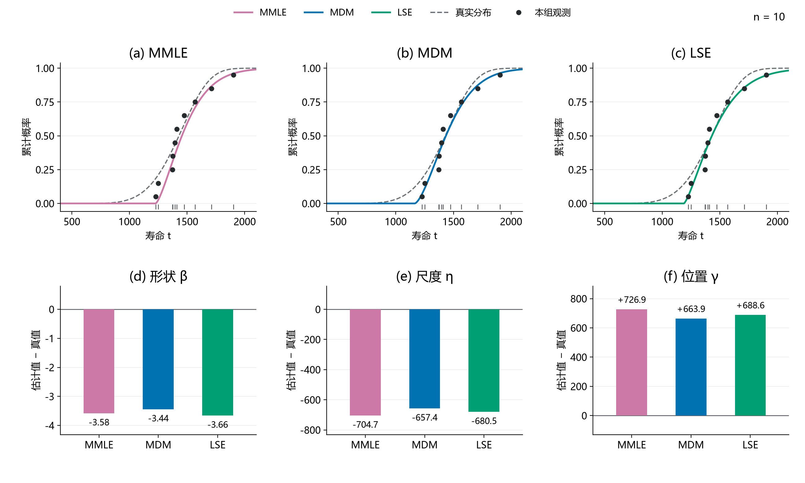
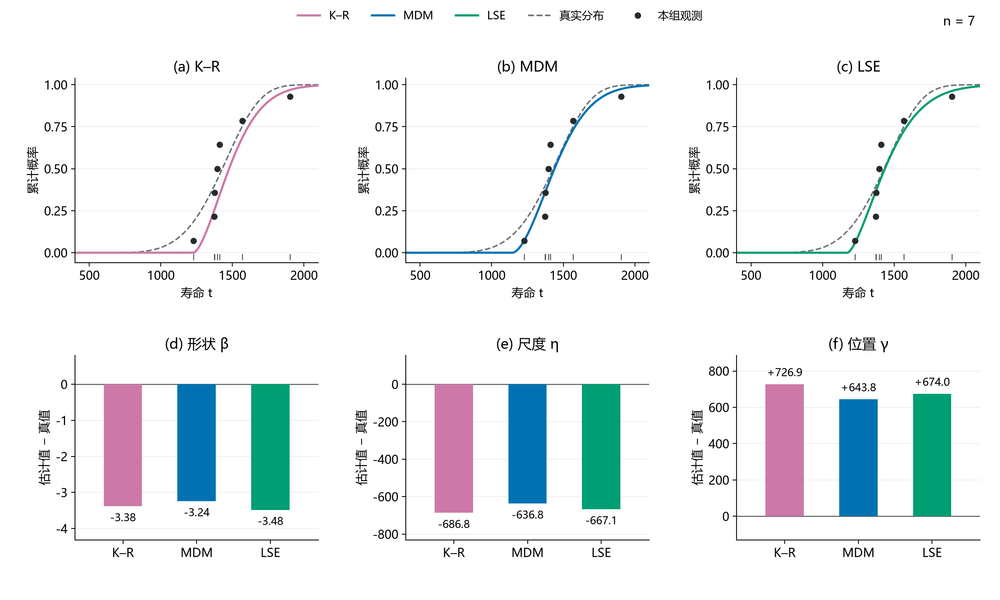

# 3.1补充核对：逐档拟合、误差与构造输入

本页补充[报告下v2.1第3.1节](../../报告下（方法对比）-v2.1.md)，沿同一条474号嵌套路径逐档浏览结果。正文先讲样本信息、估计构造和误差之间的联系；此处用于核对每一档的CDF拟合与三个参数的单次误差。

五档CDF共用坐标，同一参数的误差也共用纵轴范围。上排每列只画一种方法及真实CDF；黑点寿命坐标是真实观测，纵坐标按各自n计算(i−0.5)/n，仅作展示。下排为估计值减真值，不是重复抽样的平均Bias。每档都是前一档子集；这里的n=7子集不等于正式n=7表中同编号样本。

## 同一条路径实际保留了哪些点

深色为当前观测，浅灰为原50点中已删观测，蓝点为当前最小值，橙段为最大相邻间隔。本图追踪一条路径；正文31H展示不同n下重复样本及最小值的总体分布，两者分工不同。

## 同一观测怎样进入构造

暂固定MDM的β=5、γ=500及LSE的γ=500，黑箭头追踪50→20点时同一个930.6观测。其MDM绘图位置从0.01389变为0.03431，伪尺度从1011.5变为842.4；LSE的对数距离相同，横坐标从−4.4892变为−3.5729。这是输入变换诊断，不是实际定位判据。

## 五档单次误差

50→20点时MDM的位置、尺度及LSE三参更接近真值，10→7点时也有小幅回落。单路径误差不必随n逐步增大，不将其称为总体Bias。

## n = 50

## n = 20

## n = 15

## n = 10

## n = 7

